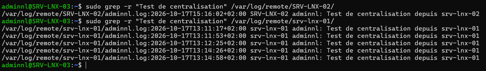

## Introduction

Cette procédure décrit la mise en place d'un serveur de collecte de journaux **rsyslog** sur srv-lnx-03 (192.168.10.23) et la configuration des serveurs Linux du réseau 192.168.10.0/24 pour qu'ils lui transfèrent leurs journaux, sur Debian 13 (trixie) et Ubuntu 24.04 LTS.

Le périmètre couvre la réception en UDP et TCP (modules `imudp` et `imtcp`), le classement des journaux par hôte avec un modèle (template), le transfert côté client avec une file d'attente sur disque, la rotation avec logrotate et le chiffrement TLS à titre de mention. L'intégration avec un SIEM et la collecte des journaux Windows sortent du périmètre.

## Contexte et Justification

Des journaux conservés uniquement sur chaque serveur présentent plusieurs faiblesses :

- **Perte en cas d'incident :** un serveur compromis ou détruit emporte ses journaux, alors qu'ils sont la principale source d'investigation.
- **Effacement par un attaquant :** un intrus qui obtient les droits root supprime ses traces localement.
- **Analyse dispersée :** corréler une connexion SSH, une élévation de privilège et un refus de pare-feu sur dix serveurs impose dix connexions.
- **Conformité :** le guide d'hygiène de l'ANSSI, ISO 27001 et le RGPD imposent la conservation et la protection des journaux sur une durée définie.

Un collecteur central conserve une copie hors de portée des serveurs sources, sur une durée maîtrisée, et sert de point d'entrée unique pour la recherche ou pour un outil d'analyse.

## Concepts Clés

**Syslog :** Protocole et format de journalisation normalisés par la RFC 5424 (format moderne) et la RFC 3164 (format historique BSD). Chaque message porte une facilité (`auth`, `kern`, `daemon`, `local0` à `local7`) et une sévérité (`emerg` à `debug`).

**rsyslog :** Démon syslog de Debian et Ubuntu. Il reçoit, filtre, transforme et transmet les messages. Sa configuration se trouve dans `/etc/rsyslog.conf` et dans les fichiers `/etc/rsyslog.d/*.conf`.

**journald :** Service de journalisation de systemd, qui stocke les messages au format binaire sous `/var/log/journal` (persistant) ou `/run/log/journal` (volatile). rsyslog récupère ces messages et les écrit en texte ou les transfère.

**Situation par défaut selon la distribution :**

| Distribution | rsyslog installé par défaut | Lecture locale des journaux |
|--------------|-----------------------------|-----------------------------|
| Debian 12 et 13 | Non, journald seul | `journalctl` |
| Ubuntu 24.04 et 26.04 LTS | Oui | `/var/log/syslog` et `journalctl` |

: rsyslog par distribution

**Modules d'entrée :** `imudp` (réception UDP 514), `imtcp` (réception TCP, port 514 par convention), `imuxsock` (socket local), `imjournal` (lecture directe du journal systemd).

**Modèle (template) :** Gabarit qui construit dynamiquement un nom de fichier ou un format de message à partir de propriétés comme `%HOSTNAME%` ou `%PROGRAMNAME%`. Il permet d'écrire les journaux de chaque hôte dans un dossier distinct.

**Action omfwd et file d'attente :** Le module `omfwd` transmet les messages à un serveur distant. Associé à une file d'attente de type `LinkedList` avec `queue.filename`, il bascule les messages sur disque lorsque le collecteur est injoignable et les renvoie à son retour.

**Syntaxe RainerScript :** Syntaxe moderne de rsyslog (`module()`, `input()`, `template()`, `action()`), à préférer à l'ancienne syntaxe en `$Directive`.

## Prérequis

- Un serveur collecteur srv-lnx-03 (192.168.10.23) sous Debian 13 ou Ubuntu 24.04 LTS, avec un volume dédié pour `/var/log/remote` (voir « Gestion des Disques avec LVM et Montage par fstab »).
- Des serveurs clients srv-lnx-01 et srv-lnx-02 sous Debian 13 ou Ubuntu 24.04 LTS.
- Une heure synchronisée sur tous les serveurs (chrony).
- Le flux TCP 514 (et UDP 514 si nécessaire) autorisé des clients vers le collecteur.
- Un compte membre de `sudo` sur chaque machine.

## Points de Vigilance

**Debian n'installe plus rsyslog par défaut.** Depuis Debian 12, une installation neuve ne contient que journald, et c'est toujours le cas sur Debian 13. Il faut installer le paquet `rsyslog` sur le collecteur et sur chaque client Debian. Les fichiers `/var/log/syslog` et `/var/log/auth.log` n'existent pas sans lui.

**UDP ne garantit pas la livraison.** Un message UDP perdu ne sera jamais renvoyé, et aucune file d'attente ne peut le protéger. Utilisez TCP entre les serveurs, et réservez UDP aux équipements qui ne savent pas faire autrement (switchs, routeurs, imprimantes).

**Le transfert n'est pas chiffré.** Syslog en TCP ou UDP circule en clair et peut contenir des noms d'utilisateurs ou des requêtes. Sur un réseau non maîtrisé, mettez en place TLS (voir « Choix Architecturaux & Alternatives »).

**AppArmor sur Ubuntu 24.04.** Ubuntu 24.04 applique un profil AppArmor en mode enforce à `rsyslogd`. L'écriture sous `/var/log` est autorisée, mais un chemin hors de `/var/log` ou l'exécution d'un programme externe (`omprog`) est refusé. Vérifiez les refus avec `sudo journalctl -k | grep -i apparmor` et ajoutez les autorisations nécessaires dans `/etc/apparmor.d/local/usr.sbin.rsyslogd`.

**Utilisateur de rsyslog sur Ubuntu.** Sur Ubuntu, rsyslog abandonne ses privilèges au profit de l'utilisateur `syslog`. Le dossier de destination doit lui être accessible en écriture.

**Saturation du disque.** Un collecteur qui reçoit des journaux de nombreux hôtes remplit rapidement un volume. Un `/var/log` plein bloque la journalisation locale du collecteur lui-même. Utilisez un volume dédié et une rotation stricte.

**Usurpation d'hôte.** N'importe quelle machine du réseau peut envoyer un message en se faisant passer pour un autre hôte. Limitez les sources autorisées au pare-feu, et préférez TLS avec authentification par certificat pour un usage probant.

## Choix Architecturaux & Alternatives

### Quand choisir rsyslog

rsyslog convient pour centraliser les journaux d'un parc Linux et d'équipements réseau avec un outil déjà présent dans les distributions, sans base de données ni licence. Il est adapté à une conservation en fichiers texte, consultables avec `grep`, `less` ou `zgrep`, et sert aussi de relais vers un SIEM.

Dès que le besoin inclut la recherche plein texte, les tableaux de bord ou la corrélation de sécurité, rsyslog devient la couche de transport et un outil d'analyse (Graylog, Wazuh, Elastic) s'ajoute en aval.

### Alternatives et comparatif

| Option | Cas d'usage typique | Force principale | Faiblesse principale | Coût relatif |
|--------|---------------------|------------------|----------------------|--------------|
| **rsyslog** | Centralisation simple, relais vers un SIEM | Présent dans les dépôts, robuste, files d'attente sur disque | Pas d'interface de recherche | Gratuit |
| **syslog-ng** | Parcs hétérogènes, filtrage avancé | Syntaxe lisible, nombreux connecteurs | Moins répandu sur Debian et Ubuntu | Gratuit (édition libre) |
| **systemd-journal-remote** | Parc 100 % systemd | Conserve le format journald et ses métadonnées | Peu adapté aux équipements réseau, outillage limité | Gratuit |
| **Graylog ou Elastic (ELK)** | Recherche, tableaux de bord, alertes | Recherche plein texte et visualisation | Ressources importantes, exploitation lourde | Moyen à élevé |
| **Wazuh** | Sécurité, détection d'intrusion | Règles de détection, conformité | Agent à déployer, dimensionnement exigeant | Moyen |

### Impact des choix

- **Sécurité.** La copie centralisée protège les traces d'un attaquant qui obtient root sur un serveur. TLS avec authentification mutuelle garantit la confidentialité et l'origine des messages.
- **Disponibilité.** La file d'attente sur disque côté client évite la perte de messages pendant une indisponibilité du collecteur. Un second collecteur peut recevoir une copie pour éliminer le point de défaillance unique.
- **Exploitation.** Le classement par hôte et par programme rend la recherche immédiate. La rotation et la compression doivent être dimensionnées dès le départ.
- **Coût.** Gratuit. Le principal poste de coût est le stockage, proportionnel au nombre d'hôtes et à la durée de conservation.

## Configuration

### Installer rsyslog sur le collecteur et les clients Debian

```bash
sudo apt update
sudo apt install rsyslog
sudo systemctl enable --now rsyslog
```

Sur Ubuntu, rsyslog est déjà installé et actif. Vérifiez avec `systemctl status rsyslog`.

### Configurer la réception sur le collecteur

Créez un fichier dédié sur srv-lnx-03 :

```bash
sudo nano /etc/rsyslog.d/10-collecteur.conf
```

```text
# Modules de réception
module(load="imudp")
module(load="imtcp")

# Modèle de fichier par hôte et par programme
template(name="ParHote" type="string"
         string="/var/log/remote/%HOSTNAME%/%PROGRAMNAME%.log")

# Jeu de règles dédié aux messages distants
ruleset(name="distant") {
    action(type="omfile" dynaFile="ParHote" createDirs="on"
           dirCreateMode="0750" fileCreateMode="0640")
    stop
}

# Écoute TCP et UDP rattachée au jeu de règles distant
input(type="imtcp" port="514" ruleset="distant")
input(type="imudp" port="514" ruleset="distant")
```

Le jeu de règles `distant` isole les messages reçus du réseau : ils sont écrits dans `/var/log/remote/<hôte>/` et ne se mélangent pas aux journaux locaux du collecteur.

<div class="callout callout-note">

Si les modules `imudp` ou `imtcp` sont déjà chargés dans `/etc/rsyslog.conf` (lignes décommentées), retirez les lignes `module(load=...)` du fichier ci-dessus pour éviter une erreur de double chargement.

</div>

### Préparer le dossier de destination

```bash
sudo mkdir -p /var/log/remote
# Debian : rsyslog s'exécute en root
sudo chown root:adm /var/log/remote
# Ubuntu : rsyslog s'exécute sous l'utilisateur syslog
sudo chown syslog:adm /var/log/remote
sudo chmod 0750 /var/log/remote
```

Appliquez uniquement la commande `chown` qui correspond à votre distribution.

### Valider et redémarrer le collecteur

```bash
sudo rsyslogd -N1
sudo systemctl restart rsyslog
sudo ss -tulpn | grep 514
```

`rsyslogd -N1` vérifie la syntaxe de la configuration sans démarrer le démon.

### Ouvrir le pare-feu du collecteur

```bash
sudo ufw allow from 192.168.10.0/24 to any port 514 proto tcp comment 'Syslog TCP'
sudo ufw allow from 192.168.10.0/24 to any port 514 proto udp comment 'Syslog UDP'
```

### Configurer le transfert sur les clients

Sur srv-lnx-01 et srv-lnx-02 :

```bash
sudo nano /etc/rsyslog.d/90-transfert.conf
```

```text
# Transfert de tous les messages vers le collecteur, en TCP,
# avec file d'attente sur disque en cas d'indisponibilité
action(type="omfwd"
       target="srv-lnx-03.lab.local" port="514" protocol="tcp"
       queue.type="LinkedList"
       queue.filename="fwd_collecteur"
       queue.maxDiskSpace="1g"
       queue.saveOnShutdown="on"
       action.resumeRetryCount="-1"
       action.resumeInterval="30")
```

- `queue.filename` active le stockage sur disque, dans `/var/spool/rsyslog` par défaut.
- `queue.maxDiskSpace` borne l'espace utilisé par la file.
- `queue.saveOnShutdown="on"` conserve les messages en attente lors d'un arrêt du service.
- `action.resumeRetryCount="-1"` réessaie indéfiniment au lieu d'abandonner les messages.

Pour ne transférer qu'une partie des messages, par exemple l'authentification et les avertissements, placez l'action dans une condition :

```text
if ($syslogfacility-text == "auth" or $syslogfacility-text == "authpriv"
    or $syslogseverity <= 4) then {
    action(type="omfwd" target="srv-lnx-03.lab.local" port="514" protocol="tcp"
           queue.type="LinkedList" queue.filename="fwd_collecteur"
           queue.saveOnShutdown="on" action.resumeRetryCount="-1")
}
```

Validez et redémarrez :

```bash
sudo rsyslogd -N1
sudo systemctl restart rsyslog
```

### Configurer la rotation sur le collecteur

```bash
sudo nano /etc/logrotate.d/rsyslog-remote
```

```text
/var/log/remote/*/*.log {
    daily
    rotate 90
    compress
    delaycompress
    missingok
    notifempty
    sharedscripts
    postrotate
        /usr/lib/rsyslog/rsyslog-rotate
    endscript
}
```

Le script `/usr/lib/rsyslog/rsyslog-rotate`, fourni par le paquet Debian et Ubuntu, demande à rsyslog de rouvrir ses fichiers après la rotation. Vérifiez sa présence et sa syntaxe dans `/etc/logrotate.d/rsyslog`, puis testez :

```bash
sudo logrotate -d /etc/logrotate.d/rsyslog-remote
```

L'option `-d` simule la rotation sans rien modifier.

### Chiffrer le transport avec TLS (mention)

Pour chiffrer le transport, installez `rsyslog-gnutls` (pilote `gtls`) ou `rsyslog-openssl` (pilote `ossl`) sur le collecteur et les clients. Le collecteur écoute alors sur TCP 6514 avec `imtcp` et les paramètres `StreamDriver.Name`, `StreamDriver.Mode="1"` et `StreamDriver.AuthMode`, et chaque client utilise `omfwd` avec les mêmes paramètres et le certificat de l'autorité. Les certificats peuvent être émis par l'autorité de certification interne de `lab.local`. Reportez-vous à la documentation officielle de rsyslog pour la syntaxe exacte de la version installée.

## Vérifications

**Écoute du collecteur :** `sudo ss -tulpn | grep 514` montre `rsyslogd` en écoute sur TCP et UDP 514.

**Message de test :** depuis srv-lnx-01, envoyez un message puis vérifiez sa réception sur le collecteur.

```bash
# Sur srv-lnx-01
logger -p auth.notice "Test de centralisation depuis srv-lnx-01"

# Sur srv-lnx-03
sudo ls /var/log/remote/
sudo grep -r "Test de centralisation" /var/log/remote/srv-lnx-01/
```



<p class="figure-caption"><b>Figure 1</b> · Réponse de la commande depuis SRV-LNX-03</p>

**Connexion établie :** sur un client, `ss -tn | grep 514` affiche une connexion `ESTAB` vers 192.168.10.23.

**File d'attente :** arrêtez rsyslog sur le collecteur, générez des messages sur un client, puis vérifiez la présence de fichiers `fwd_collecteur*` dans `/var/spool/rsyslog`. Au redémarrage du collecteur, ils sont transmis puis supprimés.

**Rotation :** le lendemain, `ls /var/log/remote/srv-lnx-01/` affiche les fichiers `.log.1` puis `.log.2.gz`.

## Dépannage

**« Aucun dossier n'apparaît dans /var/log/remote » :** vérifiez que le collecteur écoute (`ss -tulpn`), que le pare-feu autorise le port 514, et que le client transfère bien (`sudo journalctl -u rsyslog` sur le client). Testez la connexion avec `nc -zv srv-lnx-03.lab.local 514`.

**« rsyslogd -N1 signale une erreur de module déjà chargé » :** le module `imudp` ou `imtcp` est chargé à la fois dans `/etc/rsyslog.conf` et dans le fichier dédié. Supprimez l'un des deux chargements.

**« Permission denied lors de l'écriture des fichiers sur Ubuntu » :** le dossier `/var/log/remote` n'appartient pas à `syslog`, ou le profil AppArmor refuse le chemin. Corrigez la propriété et consultez `journalctl -k | grep -i apparmor`.

**« Les messages arrivent avec un nom d'hôte incorrect » :** le client envoie une adresse IP ou un nom court. Utilisez la propriété `%FROMHOST%` (nom résolu de l'expéditeur) dans le modèle si vous préférez le nom DNS vu par le collecteur, ou `%FROMHOST-IP%` pour l'adresse.

**« Le client perd des messages pendant une panne du collecteur » :** la file n'est pas sur disque (pas de `queue.filename`) ou le transfert est en UDP. Ajoutez la file disque et passez en TCP.

**« /var/log se remplit sur le collecteur » :** contrôlez la rotation avec `logrotate -d`, réduisez la rétention ou filtrez les messages de faible sévérité côté clients.

## Conseils et Bonnes Pratiques

**Toujours TCP avec file disque entre serveurs.** UDP n'est acceptable que pour les équipements qui ne savent pas faire mieux.

**Un fichier de configuration par rôle.** Gardez la configuration du collecteur dans `10-collecteur.conf` et celle des clients dans `90-transfert.conf`. Le déploiement par Ansible en est simplifié.

**Volume dédié et alerte de remplissage.** Montez `/var/log/remote` sur un volume LVM dédié et supervisez son taux de remplissage avec Zabbix.

**Définir la durée de conservation.** Alignez la rétention de logrotate sur la politique de l'entreprise (souvent 6 à 12 mois pour les journaux de sécurité) et sauvegardez le volume.

**Rendre journald persistant sur les clients.** Même avec le transfert, conservez une copie locale exploitable avec `journalctl` en créant `/var/log/journal`.

**Préparer TLS dès que les journaux quittent un réseau maîtrisé.** Une liaison inter-sites ou une DMZ justifie systématiquement le chiffrement.

## Procédures Liées

- Gestion des Services avec systemd et journald *(Fonctionnement de journald et lecture locale des journaux)*
- Synchronisation de l'Heure avec chrony *(Horodatages cohérents entre les serveurs)*
- [Configuration du Pare-feu avec UFW et nftables](/procedures/linux/configuration-du-pare-feu-avec-ufw-et-nftables) *(Ouverture du port 514 sur le collecteur)*
- [Gestion des Disques avec LVM et Montage par fstab](/procedures/linux/gestion-des-disques-avec-lvm-et-montage-par-fstab) *(Volume dédié aux journaux centralisés)*
- [Installation de Zabbix](/procedures/linux/installation-de-zabbix) *(Supervision du collecteur et de son espace disque)*
- Supervision avec l'Analyseur de Performances et le Transfert d'Événements *(Équivalent Windows de la centralisation des journaux)*
