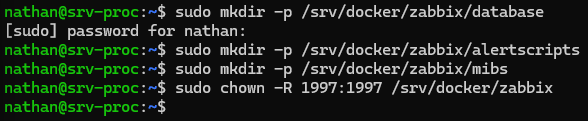
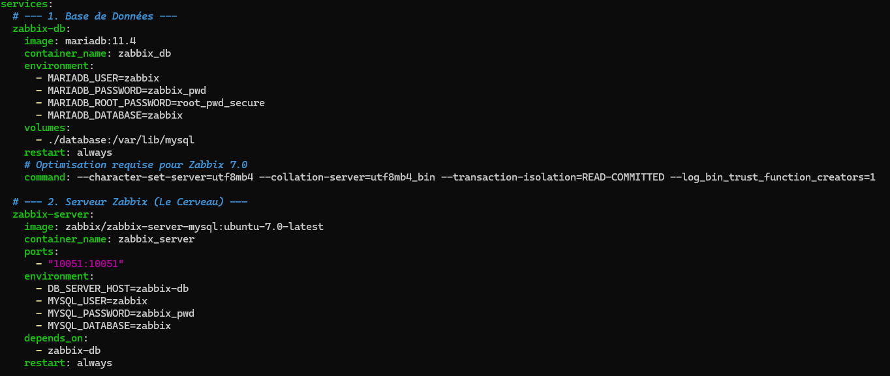
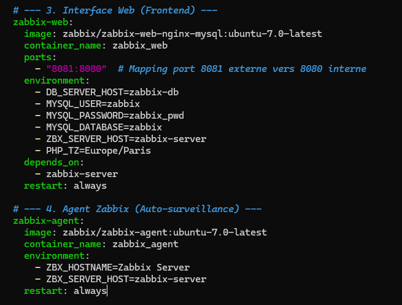
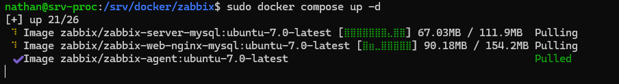
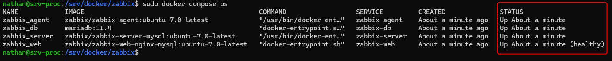
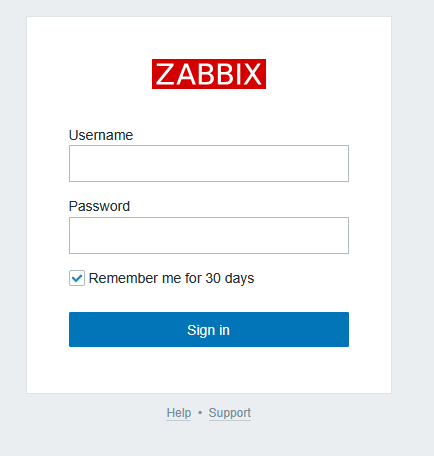

## Introduction

Cette procédure détaille l'installation de la suite de supervision **Zabbix** (version 7.0 LTS) en utilisant des conteneurs Docker. Elle inclut le serveur, l'interface web, la base de données et un agent.

## Contexte et Justification

L'installation manuelle de Zabbix (cf. procédure *Installation de Zabbix*) nécessite de configurer manuellement Apache, PHP-FPM, et de compiler certains modules. Avec Docker :

- **Modularité :** Le « Frontend » (Web) et le « Backend » (Serveur) sont séparés proprement.
- **Cohabitation :** Zabbix peut tourner sur le même serveur que GLPI sans conflit de bibliothèques, car chacun a ses propres versions de PHP/DB isolées.

## Concepts Clés

Contrairement à GLPI qui est souvent vu comme un bloc unique « Web + DB », Zabbix sous Docker est composé de **3 briques distinctes** qui doivent communiquer (plus un agent optionnel) :

1. **Zabbix Server :** Le cerveau. Il ne fait que traiter les données et lancer les alertes. Il n'a pas d'interface graphique.
2. **Zabbix Web (Frontend) :** L'interface graphique (Nginx/PHP). C'est elle que nous afficherons dans le navigateur. Elle discute avec le serveur et la base.
3. **Database :** Stocke la configuration et l'historique.

## Prérequis

- Serveur Linux avec **Docker Engine** actif.
- Port **8081** libre (puisque le 80 est pris par GLPI).
- Avoir déjà déployé GLPI (pour la familiarité avec les commandes).

## Configuration

### Préparation de l'Environnement (Volumes)

**Justification :** Comme pour GLPI, nous préparons les dossiers pour stocker la base de données et les scripts d'alerte.

1. Créez l'arborescence :

```bash
sudo mkdir -p /srv/docker/zabbix/database
sudo mkdir -p /srv/docker/zabbix/alertscripts
sudo mkdir -p /srv/docker/zabbix/mibs
```

2. **Permissions :** Les images Zabbix utilisent l'utilisateur **1997**. Appliquons les droits immédiatement pour éviter les crashs : `sudo chown -R 1997:1997 /srv/docker/zabbix`



<p class="figure-caption"><b>Figure 1</b> · Dossiers et permissions</p>

### Création de la Recette (Docker Compose)

**Justification :** Nous allons définir 4 services : la base de données, le serveur Zabbix, l'interface web et l'agent (pour que le serveur se surveille lui-même).

1. Placez-vous dans le dossier : `cd /srv/docker/zabbix`
2. Créez le fichier : `sudo nano docker-compose.yml`
3. Copiez le contenu suivant (l'indentation YAML est stricte) :

```yaml
services:
  # --- 1. Base de données ---
  zabbix-db:
    image: mariadb:11.4
    container_name: zabbix_db
    environment:
      - MARIADB_USER=zabbix
      - MARIADB_PASSWORD=zabbix_pwd
      - MARIADB_ROOT_PASSWORD=root_pwd_secure
      - MARIADB_DATABASE=zabbix
    volumes:
      - ./database:/var/lib/mysql
    restart: always
    # Optimisation requise pour Zabbix 7.0
    command: --character-set-server=utf8mb4 --collation-server=utf8mb4_bin --transaction-isolation=READ-COMMITTED --log_bin_trust_function_creators=1

  # --- 2. Serveur Zabbix (le cerveau) ---
  zabbix-server:
    image: zabbix/zabbix-server-mysql:ubuntu-7.0-latest
    container_name: zabbix_server
    ports:
      - "10051:10051"
    environment:
      - DB_SERVER_HOST=zabbix-db
      - MYSQL_USER=zabbix
      - MYSQL_PASSWORD=zabbix_pwd
      - MYSQL_DATABASE=zabbix
    volumes:
      - ./alertscripts:/usr/lib/zabbix/alertscripts
      - ./mibs:/var/lib/zabbix/mibs
    depends_on:
      - zabbix-db
    restart: always

  # --- 3. Interface web (frontend) ---
  zabbix-web:
    image: zabbix/zabbix-web-nginx-mysql:ubuntu-7.0-latest
    container_name: zabbix_web
    ports:
      - "8081:8080"   # Port 8081 externe vers 8080 interne
    environment:
      - DB_SERVER_HOST=zabbix-db
      - MYSQL_USER=zabbix
      - MYSQL_PASSWORD=zabbix_pwd
      - MYSQL_DATABASE=zabbix
      - ZBX_SERVER_HOST=zabbix-server
      - PHP_TZ=Europe/Paris
    depends_on:
      - zabbix-server
    restart: always

  # --- 4. Agent Zabbix (auto-surveillance) ---
  zabbix-agent:
    image: zabbix/zabbix-agent:ubuntu-7.0-latest
    container_name: zabbix_agent
    environment:
      - ZBX_HOSTNAME=Zabbix server
      - ZBX_SERVER_HOST=zabbix-server
    restart: always
```



<p class="figure-caption"><b>Figure 2</b> · Fichier docker-compose.yml (début)</p>



<p class="figure-caption"><b>Figure 3</b> · Fichier docker-compose.yml (fin)</p>

### Lancement du Déploiement

1. Lancez la stack : `sudo docker compose up -d`



<p class="figure-caption"><b>Figure 4</b> · Démarrage de la stack Zabbix</p>

2. Vérifiez les statuts : `sudo docker compose ps`



<p class="figure-caption"><b>Figure 5</b> · État des conteneurs</p>

<div class="callout callout-note">

Le démarrage initial est plus long que celui de GLPI : le serveur Zabbix importe automatiquement tout le schéma SQL au premier lancement. Comptez 1 à 2 minutes.

</div>

## Finalisation et Premier Accès

1. Ouvrez votre navigateur : `http://IP_DU_SERVEUR:8081` (attention à bien préciser `:8081`).
2. Vous arrivez directement sur la page de connexion (l'installation est automatique avec Docker, pas d'assistant « Suivant, Suivant » comme en manuel).



<p class="figure-caption"><b>Figure 6</b> · Page de connexion Zabbix</p>

3. Identifiants par défaut :
   - **Utilisateur :** Admin (avec A majuscule).
   - **Mot de passe :** zabbix.
4. Changez immédiatement le mot de passe du compte Admin.

## Dépannage

**Message « Database error » sur l'interface Web :** Le serveur Zabbix n'a pas encore fini d'importer les tables. Attendez 60 secondes et rafraîchissez la page.

**Conteneur `zabbix_server` qui redémarre en boucle :** Vérifiez les logs : `sudo docker compose logs zabbix-server`. Souvent, c'est un problème de mémoire (RAM insuffisante sur la VM) ou de permissions sur les dossiers (étape « Préparation de l'Environnement » oubliée).

## Conseils et Bonnes Pratiques

Par défaut, l'agent Zabbix installé ci-dessus est enfermé dans son conteneur. Il ne voit que son « petit monde » et pas l'utilisation réelle du CPU/RAM de votre serveur Ubuntu.

Pour surveiller le **vrai** serveur physique, modifiez le service `zabbix-agent` dans le fichier `docker-compose.yml` pour lui donner accès au système :

```yaml
  zabbix-agent:
    image: zabbix/zabbix-agent:ubuntu-7.0-latest
    # ... lignes existantes ...
    privileged: true
    network_mode: host        # L'agent utilise directement le réseau du serveur
    volumes:
      - /:/hostfs:ro          # On monte tout le disque du serveur en lecture seule
```

<div class="callout callout-note">

En `network_mode: host`, l'agent ne peut plus joindre le serveur par le nom `zabbix-server` : renseignez `ZBX_SERVER_HOST` avec l'IP du serveur Docker.

</div>

## Procédures Liées

- [Installation de Zabbix](/procedures/linux/installation-de-zabbix) *(Installation classique sans conteneur)*
- [Installation de Docker et Portainer sur Ubuntu](/procedures/linux/installation-de-docker-et-portainer-sur-ubuntu) *(Socle Docker et Portainer)*
- [Centralisation des Journaux avec rsyslog](/procedures/linux/centralisation-des-journaux-avec-rsyslog) *(Centralisation des journaux en complément)*
- [Supervision avec l'Analyseur de Performances et le Transfert d'Événements](/procedures/windows/supervision-avec-lanalyseur-de-performances-et-le-transfert-devenements) *(Supervision native côté Windows)*
