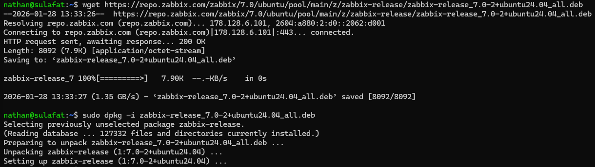
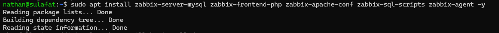
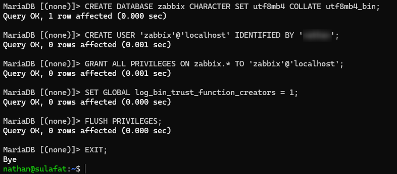
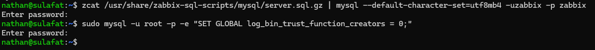
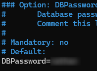
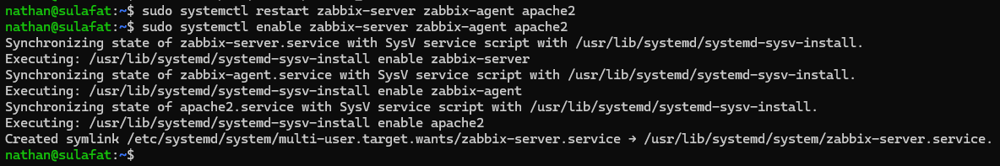
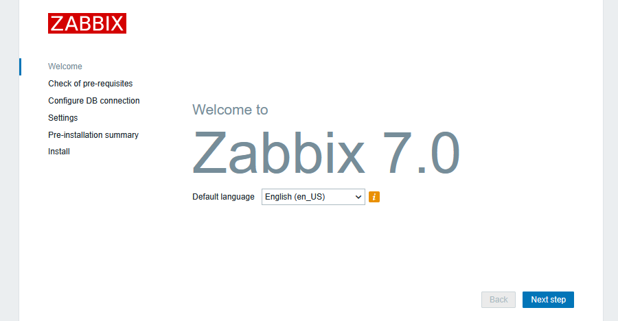
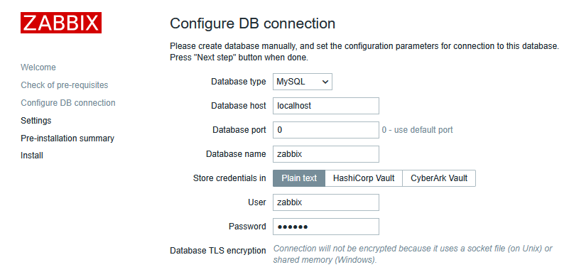
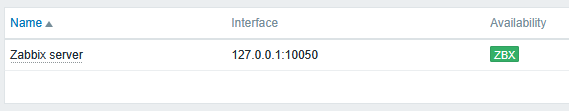
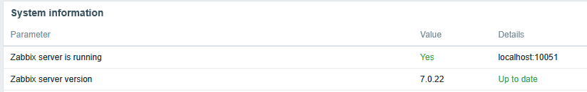

## Introduction

L'objectif est de mettre en place Zabbix, une solution de supervision (monitoring) de classe entreprise. Elle permet de surveiller l'état des serveurs, des réseaux et des services en temps réel.

## Contexte et Justification

Dans un parc informatique, attendre qu'un utilisateur signale une panne est inefficace. Un administrateur doit être proactif. Zabbix permet de :

- Collecter des métriques (CPU, RAM, disque, bande passante).
- Alerter par mail ou notification en cas de dépassement de seuil.
- Historiser les données pour analyser les tendances.

## Concepts Clés

- **Zabbix Server :** Le cœur du système, qui récupère les données et lance les alertes.
- **Zabbix Agent :** Petit programme installé sur les machines à surveiller (Linux/Windows), qui envoie les informations au serveur.
- **Host (Hôte) :** Tout équipement surveillé (serveur, switch, routeur).
- **Trigger (Déclencheur) :** Condition logique qui définit un problème (ex : « CPU > 90 % pendant 5 min »).

## Prérequis

**Scénario :** Un serveur LAMP est déjà en place (cf. procédure *Installation d'un Serveur Web LAMP*). Nous allons y ajouter la brique de supervision.

Avant de commencer, assurez-vous de :

1. Avoir une machine Linux avec **accès root/sudo**.
2. Avoir un serveur de base de données installé.
3. Avoir une connexion Internet active pour récupérer le dépôt officiel Zabbix.

## Configuration

### Installation du Dépôt Zabbix

**Justification :** Les dépôts par défaut d'Ubuntu/Debian contiennent souvent une version obsolète de Zabbix. Nous devons utiliser le dépôt officiel pour obtenir la dernière version stable (LTS).

1. Téléchargez le paquet de configuration du dépôt (exemple pour Ubuntu 24.04, à adapter selon votre version) :

```bash
wget https://repo.zabbix.com/zabbix/7.0/ubuntu/pool/main/z/zabbix-release/zabbix-release_7.0-2+ubuntu24.04_all.deb
```

2. Installez le paquet : `sudo dpkg -i zabbix-release_7.0-2+ubuntu24.04_all.deb`.



<p class="figure-caption"><b>Figure 1</b> · Installation du dépôt officiel Zabbix</p>

3. Mettez à jour la liste des paquets : `sudo apt update`

### Installation des Paquets Serveurs et Agent

**Justification :** Nous installons le serveur (backend), le frontend (interface web PHP), la configuration Apache et l'agent (pour que le serveur se surveille lui-même).

1. Lancez l'installation :

```bash
sudo apt install zabbix-server-mysql zabbix-frontend-php zabbix-apache-conf zabbix-sql-scripts zabbix-agent -y
```



<p class="figure-caption"><b>Figure 2</b> · Installation des paquets Zabbix</p>

### Configuration de la Base de Données

**Justification :** Zabbix a besoin d'une base de données dédiée et d'un schéma précis (tables pré-créées) pour fonctionner.

1. Connectez-vous à MariaDB : `sudo mysql -u root -p`
2. Créez la base et l'utilisateur (remplacez `motdepasse` par un mot de passe fort) :

```sql
CREATE DATABASE zabbix CHARACTER SET utf8mb4 COLLATE utf8mb4_bin;
CREATE USER 'zabbix'@'localhost' IDENTIFIED BY 'motdepasse';
GRANT ALL PRIVILEGES ON zabbix.* TO 'zabbix'@'localhost';
SET GLOBAL log_bin_trust_function_creators = 1;
FLUSH PRIVILEGES;
EXIT;
```



<p class="figure-caption"><b>Figure 3</b> · Création de la base zabbix</p>

3. Importez le schéma initial et les données (entrez le mot de passe configuré précédemment) :

```bash
zcat /usr/share/zabbix-sql-scripts/mysql/server.sql.gz | mysql --default-character-set=utf8mb4 -uzabbix -p zabbix
```

4. Désactivez l'option temporaire : `sudo mysql -u root -p -e "SET GLOBAL log_bin_trust_function_creators = 0;"`



<p class="figure-caption"><b>Figure 4</b> · Import du schéma initial</p>

### Configuration du Serveur Zabbix

**Justification :** Le service Zabbix Server doit savoir quel mot de passe utiliser pour se connecter à la base de données qu'on vient de remplir.

1. Éditez le fichier de configuration : `sudo nano /etc/zabbix/zabbix_server.conf`.
2. Cherchez la ligne `# DBPassword=` (utilisez CTRL+W pour chercher).
3. Décommentez la ligne (enlevez le `#`) et mettez votre mot de passe : `DBPassword=motdepasse`.



<p class="figure-caption"><b>Figure 5</b> · Paramètre DBPassword</p>

4. Sauvegardez (CTRL+O) et quittez (CTRL+X).
5. Redémarrez et activez les services :

```bash
sudo systemctl restart zabbix-server zabbix-agent apache2
sudo systemctl enable zabbix-server zabbix-agent apache2
```



<p class="figure-caption"><b>Figure 6</b> · Redémarrage des services</p>

### Finalisation via l'Interface Web

1. Ouvrez votre navigateur sur le poste client : `http://IP_DU_SERVEUR/zabbix`.
2. Vous arrivez sur l'assistant d'installation « Welcome to Zabbix ».
3. **Check of pre-requisites :** Tout doit être « OK ». Si une ligne est en rouge (souvent Timezone ou PHP version), corrigez le `php.ini`.



<p class="figure-caption"><b>Figure 7</b> · Vérification des prérequis</p>

4. **Configure DB Connection :**
   - **Database type :** MySQL.
   - **User :** zabbix.
   - **Password :** votre mot de passe.



<p class="figure-caption"><b>Figure 8</b> · Connexion à la base de données</p>

5. **Settings :** Donnez un nom à votre serveur (ex : « Serveur Supervision »).
6. Terminez l'installation.

## Vérifications

1. Connectez-vous à l'interface web :
   - **Identifiant par défaut :** Admin (avec un A majuscule).
   - **Mot de passe par défaut :** zabbix.
2. Allez dans le menu **Monitoring \> Hosts**.
3. Vérifiez la ligne « Zabbix server ». La colonne « Availability » doit afficher l'icône **ZBX** en vert après quelques minutes.



<p class="figure-caption"><b>Figure 9</b> · Disponibilité ZBX de l'hôte Zabbix server</p>

4. En bas de page, vérifiez le bandeau : « Zabbix server is running: Yes ».



<p class="figure-caption"><b>Figure 10</b> · Bandeau Zabbix server is running</p>

## Dépannage

**Erreur « Zabbix server is not running » en bas de page :**

- Le service backend est arrêté ou planté. Vérifiez les logs : `tail -f /var/log/zabbix/zabbix_server.log`
- Souvent, c'est une erreur de mot de passe de base de données dans `/etc/zabbix/zabbix_server.conf`.

**L'interface web affiche une page blanche ou du code PHP :**

- Le module PHP d'Apache n'est pas actif ou mal configuré (voir procédure *Installation d'un Serveur Web LAMP*).
- Commande : `sudo apt install libapache2-mod-php`, puis redémarrez Apache.

**Impossible de se connecter à la base de données lors de l'installation web :**

- Vérifiez que le serveur MariaDB écoute bien sur localhost.
- Testez la connexion manuelle en ligne de commande : `mysql -u zabbix -p`.

## Conseils et Bonnes Pratiques

**Sécurité (Changement de mot de passe) :** C'est critique. Le compte Admin / zabbix est connu de tous les pirates.

- Allez dans **User settings \> Profile** et changez le mot de passe immédiatement.

**Graphiques manquants (Polices) :** Si les graphiques n'affichent pas de texte, installez une police compatible ou vérifiez les liens symboliques dans `/usr/share/zabbix/assets/fonts`.

**Pare-feu :** Si vous utilisez UFW, n'oubliez pas d'ouvrir les ports :

```bash
sudo ufw allow 80/tcp      # Interface web
sudo ufw allow 10050/tcp   # Agent passif
sudo ufw allow 10051/tcp   # Serveur / trapper
```

## Procédures Liées

- [Déploiement de Zabbix (Conteneurisé)](/procedures/linux/deploiement-de-zabbix-conteneurise) *(Alternative conteneurisée)*
- [Installation d'un Serveur Web LAMP](/procedures/linux/installation-dun-serveur-web-lamp) *(Pile web de l'interface)*
- [Centralisation des Journaux avec rsyslog](/procedures/linux/centralisation-des-journaux-avec-rsyslog) *(Centralisation des journaux en complément)*
- Supervision avec l'Analyseur de Performances et le Transfert d'Événements *(Supervision native côté Windows)*
