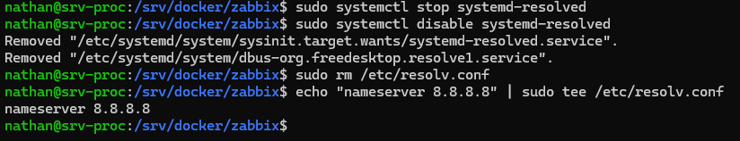
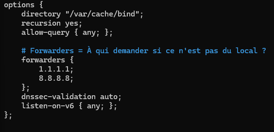
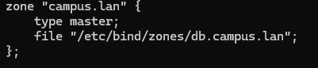
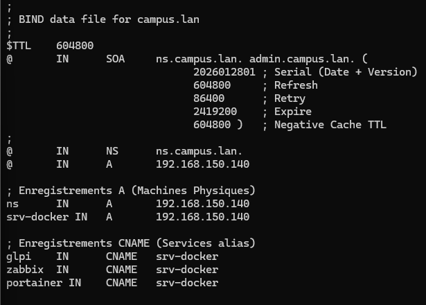
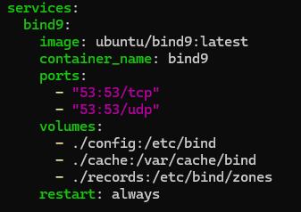
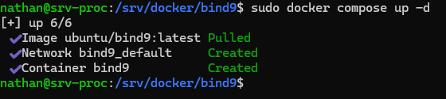
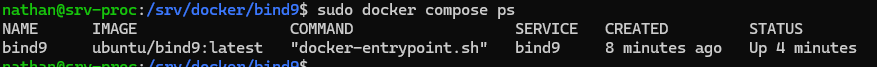
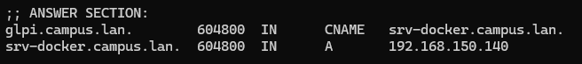

## Introduction

Cette procédure décrit la mise en place d'un serveur **DNS (Domain Name System)** utilisant le logiciel standard **Bind9**, encapsulé dans un conteneur Docker.

## Contexte et Justification

Jusqu'à présent, nous accédons à nos services via des adresses IP (`http://xx.xx.xx.xx:8081`). Ce n'est pas viable en production. L'objectif est de pouvoir taper `http://glpi.campus.lan` ou `http://zabbix.campus.lan` dans le navigateur.

Le serveur DNS agit comme un annuaire téléphonique local : il traduit ces noms en adresses IP.

## Concepts Clés

- **Zone DNS :** Le « domaine » que nous gérons (ici : `campus.lan`).
- **Enregistrement A (Address) :** Fait le lien direct entre un nom et une IP (ex : `srv-docker` -> 192.168.150.140).
- **Enregistrement CNAME (Alias) :** Fait le lien entre un nom et un autre nom (ex : `glpi` -> `srv-docker`). Si l'IP du serveur change, on ne modifie que le A, et tous les CNAME suivent automatiquement.
- **Forwarder (Redirection) :** Si on demande `google.fr` à notre serveur, il ne connaît pas la réponse. Il « transfère » la question à un DNS public (ex : 8.8.8.8 ou votre box Internet).

## Prérequis

- Un serveur Ubuntu avec Docker et Docker Compose installés (cf. procédure *Installation de Docker et Portainer sur Ubuntu*).
- L'adresse IP fixe du serveur Docker (ici 192.168.150.140).

<div class="callout callout-note">

Par défaut, Ubuntu écoute déjà sur le port 53 via `systemd-resolved`. Il faut libérer ce port pour le conteneur.

</div>

1. Sur le serveur hôte, désactivez le résolveur stub :

```bash
sudo systemctl stop systemd-resolved
sudo systemctl disable systemd-resolved
```

2. Supprimez le lien symbolique du fichier `resolv.conf` :

```bash
sudo rm /etc/resolv.conf
```

3. Créez un nouveau fichier `resolv.conf` temporaire (pour que le serveur ait toujours accès à Internet et puisse télécharger l'image Docker) :

```bash
echo "nameserver 8.8.8.8" | sudo tee /etc/resolv.conf
```



<p class="figure-caption"><b>Figure 1</b> · Libération du port 53</p>

## Configuration

### Préparation de l'Environnement (Volumes)

On crée les dossiers qui stockeront la configuration de Bind9.

1. Créez les dossiers et entrez dans le dossier de travail :

```bash
sudo mkdir -p /srv/docker/bind9/config
sudo mkdir -p /srv/docker/bind9/cache
sudo mkdir -p /srv/docker/bind9/records
cd /srv/docker/bind9
```

### Création des Fichiers de Configuration

Bind9 a besoin de 4 fichiers principaux.

**Fichier 1 : named.conf (fichier principal).** C'est le sommaire qui charge les autres. N'incluez pas les zones par défaut pour éviter les erreurs « File not found ».

```bash
sudo nano config/named.conf
```

Contenu :

```text
include "/etc/bind/named.conf.options";
include "/etc/bind/named.conf.local";
```

**Fichier 2 : named.conf.options (options générales).** Ce fichier dit « si tu ne connais pas le domaine, demande à un DNS public ».

```bash
sudo nano config/named.conf.options
```

Contenu :

```text
options {
    directory "/var/cache/bind";
    recursion yes;
    allow-query { any; };
    # Forwarders = à qui demander si ce n'est pas du local ?
    forwarders {
        1.1.1.1;
        8.8.8.8;
    };
    dnssec-validation auto;
    listen-on-v6 { any; };
};
```



<p class="figure-caption"><b>Figure 2</b> · Fichier named.conf.options</p>

**Fichier 3 : named.conf.local (déclaration de notre zone).** Ce fichier dit « je suis le serveur faisant autorité pour le domaine campus.lan ».

```bash
sudo nano config/named.conf.local
```

Contenu :

```text
zone "campus.lan" {
    type master;
    file "/etc/bind/zones/db.campus.lan";
};
```



<p class="figure-caption"><b>Figure 3</b> · Fichier named.conf.local</p>

**Fichier 4 : db.campus.lan (l'annuaire).** C'est ici qu'on définit les IP. Remplacez 192.168.150.140 par l'IP réelle de votre serveur Docker si elle est différente.

```bash
sudo nano records/db.campus.lan
```

Contenu (respectez bien les points et les espaces) :

```text
;
; BIND data file for campus.lan
;
$TTL    604800
@       IN      SOA     ns.campus.lan. admin.campus.lan. (
                        2026012801      ; Serial (Date + Version)
                        604800          ; Refresh
                        86400           ; Retry
                        2419200         ; Expire
                        604800 )        ; Negative Cache TTL
;
@       IN      NS      ns.campus.lan.
@       IN      A       192.168.150.140
; Enregistrements A (machines physiques)
ns          IN  A       192.168.150.140
srv-docker  IN  A       192.168.150.140
; Enregistrements CNAME (alias des services)
glpi        IN  CNAME   srv-docker
zabbix      IN  CNAME   srv-docker
portainer   IN  CNAME   srv-docker
```



<p class="figure-caption"><b>Figure 4</b> · Fichier de zone db.campus.lan</p>

<div class="callout callout-note">

À chaque modification du fichier de zone, incrémentez le numéro de série (Serial), sinon les serveurs secondaires et les caches ne prendront pas en compte les changements.

</div>

### Création de la Recette (Docker Compose)

1. Créez le fichier de configuration :

```bash
sudo nano docker-compose.yml
```

2. Insérez le contenu suivant (l'indentation YAML est stricte) :

```yaml
services:
  bind9:
    image: ubuntu/bind9:latest
    container_name: bind9
    ports:
      - "53:53/tcp"
      - "53:53/udp"
    volumes:
      - ./config:/etc/bind
      - ./cache:/var/cache/bind
      - ./records:/etc/bind/zones
    restart: always
```



<p class="figure-caption"><b>Figure 5</b> · Fichier docker-compose.yml</p>

3. Donnez les droits sur les dossiers à l'utilisateur `bind` du conteneur (UID 101), pour éviter les erreurs « Permission denied » :

```bash
sudo chown -R 101:101 /srv/docker/bind9
```

### Lancement du Déploiement

1. Lancez le conteneur :

```bash
sudo docker compose up -d
```



<p class="figure-caption"><b>Figure 6</b> · Démarrage du conteneur bind9</p>

2. Vérifiez qu'il ne redémarre pas en boucle (si c'est le cas, il s'agit souvent d'une erreur de syntaxe dans les fichiers de configuration) :

```bash
sudo docker compose ps
```



<p class="figure-caption"><b>Figure 7</b> · État du conteneur</p>

## Tests et Validation

Pour tester, inutile de modifier tout de suite la configuration DNS des postes Windows : nous interrogeons directement le serveur.

1. Installez l'outil `dig` sur votre serveur (si absent) :

```bash
sudo apt install dnsutils -y
```

2. Interrogez votre serveur local (`@localhost`) pour savoir qui est `glpi.campus.lan` :

```bash
dig @localhost glpi.campus.lan
```

**Résultat attendu :** vous devez voir une section **ANSWER SECTION** semblable à celle-ci :



<p class="figure-caption"><b>Figure 8</b> · Réponse DNS pour glpi.campus.lan</p>

## Dépannage

**Erreur « listen: address in use » ou « Address in use » dans les logs Docker :** vous n'avez pas désactivé `systemd-resolved` (voir « Prérequis »).

**Le ping fonctionne mais pas le navigateur :** c'est normal. `zabbix.campus.lan` pointe vers 192.168.150.140, mais le navigateur interroge le port 80 alors que Zabbix écoute sur le port 8081. Tapez `http://zabbix.campus.lan:8081`.

**Erreur « Parsing failed / File not found » :** vérifiez que le fichier `named.conf` ne contient pas la ligne `include "...default-zones"`.

**Erreur « Permission denied » :** relancez la commande `sudo chown -R 101:101 /srv/docker/bind9`, puis `sudo docker compose restart`.

## Procédures Liées

- [Installation de Docker et Portainer sur Ubuntu](/procedures/linux/installation-de-docker-et-portainer-sur-ubuntu) *(Socle Docker et Portainer)*
- [Configuration d'un Serveur DNS Dédié](/procedures/windows/configuration-dun-serveur-dns-dedie) *(Équivalent sous Windows Server)*
- [Installation d'un Serveur DHCP sous Linux (ISC-DHCP-Server)](/procedures/linux/installation-dun-serveur-dhcp-sous-linux-isc-dhcp-server) *(Distribution du DNS aux clients)*
- [Filtrage DNS et IP avec pfBlockerNG](/procedures/pare-feu/filtrage-dns-et-ip-avec-pfblockerng) *(Filtrage DNS en amont)*
- [Configuration d'Azure DNS](/procedures/azure/configuration-dazure-dns) *(Équivalent dans le cloud)*
