## Introduction

L'objectif est de mettre en place un serveur mandataire (Proxy) sur le pare-feu OPNsense en utilisant le service Squid. Cette procédure couvre deux méthodes : le mode manuel (configuration explicite sur le poste client) et le mode transparent (interception automatique du trafic sans configuration client).

## Contexte et Justification

Dans un réseau d'entreprise ou scolaire, le contrôle des flux Web est essentiel.

- **Le Proxy (Squid) :** Il agit comme un intermédiaire entre les utilisateurs du LAN et Internet. Il permet de filtrer les URL, de mettre en cache les pages pour accélérer la navigation et d'analyser le trafic.
- **Mode Manuel :** Plus simple à mettre en place, mais oblige l'administrateur à configurer chaque navigateur ou OS.
- **Mode Transparent :** Plus complexe (nécessite la gestion des certificats SSL), mais invisible pour l'utilisateur. Le pare-feu redirige silencieusement le trafic Web vers le proxy.

## Prérequis

- Un pare-feu **OPNsense** fonctionnel (WAN et LAN configurés).
- Un accès à l'interface d'administration Web (GUI) avec le compte `root`.
- Une machine cliente (Windows ou Linux) connectée au LAN pour les tests.

## Installation d'OPNsense

L'installation s'effectue à partir de l'image ISO [officielle](https://opnsense.org/download/).

### Installation du Système

1. Démarrez la machine sur l'ISO OPNsense.
2. Attendez la fin du chargement et connectez-vous avec les identifiants temporaires :
   - **Login :** installer
   - **Mot de passe :** opnsense
3. L'assistant d'installation se lance. Sélectionnez votre disposition de clavier (Keymap).
4. Choisissez l'option **Install (ZFS)**. C'est le système de fichiers le plus robuste.
5. Sélectionnez le disque de destination (ex : da0 ou sda) et validez le formatage (Stripe pour un seul disque).
6. Une fois l'installation terminée, choisissez **Reboot** et retirez le média d'installation.

### Configuration des Interfaces Réseau

**Justification :** Le pare-feu doit savoir quelle interface est reliée à Internet (WAN) et laquelle gère le réseau local (LAN).

1. Au redémarrage, le système demande d'assigner les interfaces. Si vous connaissez les adresses MAC, assignez :
   - **WAN :** Interface connectée à Internet (ex : em0).
   - **LAN :** Interface connectée au réseau local (ex : em1).
2. Une fois le menu console affiché, choisissez l'option **2) Set interface IP address**.
3. Configurez l'interface **LAN** :
   - **IP :** Une adresse statique (ex : 192.168.1.1).
   - **Masque :** 24 (pour 255.255.255.0).
   - **Gateway :** Aucune (appuyez sur Entrée).
4. À la question « Do you want to enable the DHCP server on LAN? », répondez **Oui (y)**.
   - Définissez la plage (ex : 192.168.1.100 à 192.168.1.200).
   - Cela permet aux clients d'obtenir automatiquement une IP pour communiquer avec le proxy.

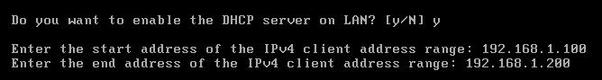

<b>Figure 1</b> · Menu console d'OPNsense

### Mise à Jour du Système

**Justification :** Avant d'installer des plugins, le système doit être à jour pour éviter des conflits de version.

1. Connectez-vous à l'interface Web via un navigateur client : `https://192.168.1.1` (utilisateur : root).
2. Allez dans le menu **Système \> Logiciel (Firmware) \> Statut**.
3. Cliquez sur **Vérifier les mises à jour**.

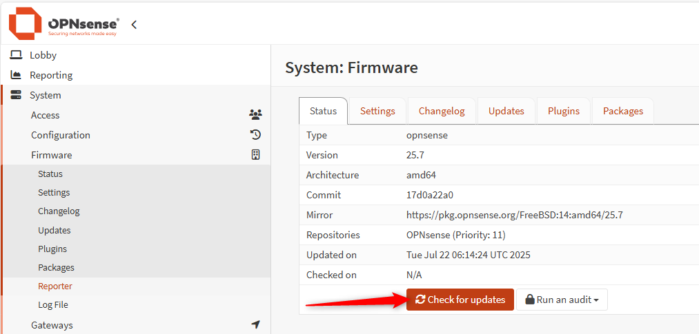

<b>Figure 2</b> · Vérification des mises à jour

4. Si des paquets sont disponibles, cliquez sur **Mettre à jour**. Le pare-feu redémarrera si nécessaire.

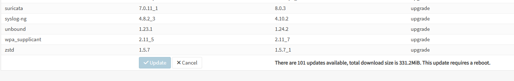

<b>Figure 3</b> · Installation des mises à jour

## Mise en Place du Proxy Squid

### Installation du Plugin

1. Rendez-vous dans **Système \> Logiciel (Firmware) \> Plugins**.
2. Dans la barre de recherche, tapez `os-squid`.
3. Cliquez sur le bouton (+) à droite pour lancer l'installation.

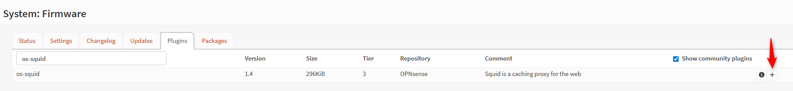

<b>Figure 4</b> · Installation du Plugin

4. Rafraîchissez la page (F5) pour voir apparaître le menu **Services \> Squid Web Proxy**.

### Création de l'Autorité de Certification (PKI)

**Justification :** Pour inspecter le trafic chiffré (HTTPS), OPNsense doit agir comme une autorité de certification (CA) de confiance pour les clients.

1. Allez dans **Système \> Confiance \> Autorités**.
2. Cliquez sur **Ajouter (+)**.
3. Remplissez le formulaire :
   - **Nom descriptif :** OPNsense-Proxy-CA.
   - **Méthode :** Créer une autorité de certification interne.
   - **Durée de vie :** 3650 jours (10 ans).

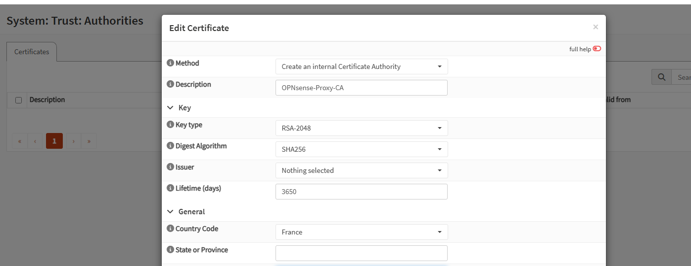

<b>Figure 5</b> · Création de l'Autorité de Certification (PKI)

4. Cliquez sur **Enregistrer**.
5. Dans la liste, cliquez sur l'icône **Download** pour télécharger le certificat sur votre ordinateur.

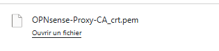

<b>Figure 6</b> · Téléchargement du certificat de la CA

### Installation du Certificat CA sur Windows 11

**Justification :** Cette étape est critique. Elle permet à Windows de « faire confiance » à OPNsense lorsqu'il déchiffre le trafic HTTPS.

1. Récupérez le fichier téléchargé sur le poste client.
2. **Conversion :** Pour faciliter l'installation sous Windows, faites un clic droit sur le fichier, choisissez **Renommer** et changez l'extension `.pem` en `.crt`.
3. Faites un **clic droit** sur le nouveau fichier `.crt` \> **Installer le certificat**.

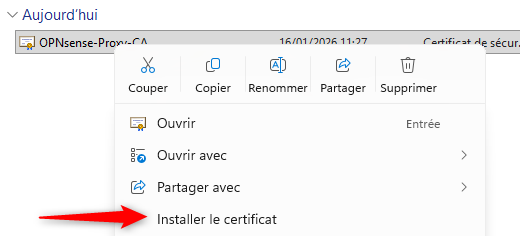

<b>Figure 7</b> · Installation du Certificat CA sur Windows 11

4. Dans l'assistant :
   - **Emplacement de stockage :** Choisissez **Ordinateur local** (nécessite les droits administrateur). Cliquez sur *Suivant*.
   - Sélectionnez **Placer tous les certificats dans le magasin suivant**.
   - Cliquez sur **Parcourir...** et sélectionnez le dossier **Autorités de certification racines de confiance** (Trusted Root Certification Authorities).
   - Validez par **OK**, puis **Suivant** et **Terminer**.

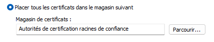

<b>Figure 8</b> · Magasin Autorités de certification racines de confiance

5. Le message « L'importation a réussi » doit s'afficher.

### Configuration en Mode Manuel

1. Allez dans **Services \> Squid Web Proxy \> Administration**.
2. **Activation du service :**
   - Restez dans l'onglet **General Proxy Settings**.
   - Cochez la case **Enable proxy**.
   - Vérifiez que **Enable access logging** est coché (pour avoir les traces).
   - Cliquez sur **Apply** (Appliquer).
3. **Configuration réseau :**
   - Cliquez sur l'onglet **Forward Proxy**.
   - **Proxy Interfaces :** Sélectionnez **LAN**.
   - **Proxy Port :** Vérifiez que la valeur est 3128.

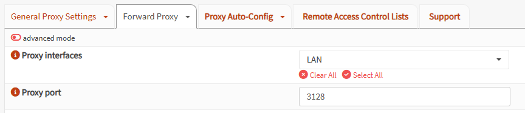

<b>Figure 9</b> · Interface et port du proxy

4. **Autorisation du réseau (ACL) :**
   - Toujours dans le menu **Forward Proxy**, cherchez la sous-section ou l'onglet nommé **Access Control Lists**.
   - Cherchez le champ **Allowed Subnets**.
   - Entrez le réseau LAN : `192.168.1.0/24`.

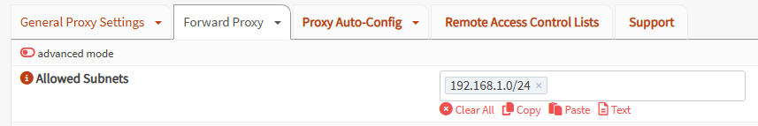

<b>Figure 10</b> · Sous-réseaux autorisés

5. Cliquez sur **Appliquer**.
6. **Sur le PC client :** configurez le navigateur pour utiliser le proxy `192.168.1.1:3128`.

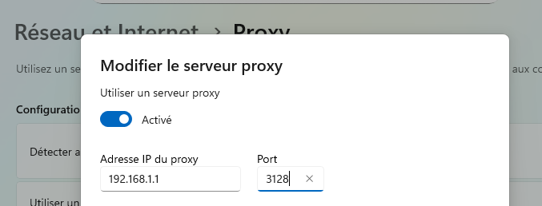

<b>Figure 11</b> · Proxy manuel sur le poste client

## Configuration Avancée : Mode Transparent et SSL

### Activation du Mode Transparent

**Justification :** Le mode transparent intercepte le trafic sans configuration sur le navigateur client.

1. Retournez dans **Services \> Squid Web Proxy \> Administration**.
2. Onglet **Forward Proxy** :
   - Cochez **Enable Transparent HTTP proxy**.
   - Cochez **Enable SSL Inspection**. Si une case **Enable HTTPS Proxy** est présente (selon la version), cochez-la également.
   - **CA to use :** Sélectionnez OPNsense-Proxy-CA.

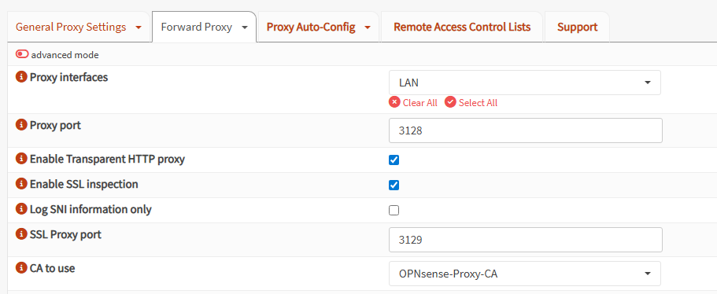

<b>Figure 12</b> · Activation du Mode Transparent

3. Cliquez sur **Appliquer**.

### Règles de Redirection (NAT)

1. Allez dans **Pare-feu \> NAT \> Redirection de port**.
2. Vérifiez ou créez les règles pour rediriger le trafic web vers le proxy (une règle par port) :
   - **Interface :** `LAN`.
   - **Protocol :** `TCP`.
   - **Destination :** `any` (n'importe où).
   - **Destination Port Range :** `HTTP` (80) pour la première règle, `HTTPS` (443) pour la seconde.
   - **Redirect target IP :** `127.0.0.1`.
   - **Redirect target Port :** `3128` pour HTTP, `3129` pour HTTPS (port SSL par défaut du proxy transparent OPNsense).

Le lien « Add a new firewall rule » affiché sous l'option Enable Transparent HTTP proxy crée automatiquement ces règles avec les bons ports.

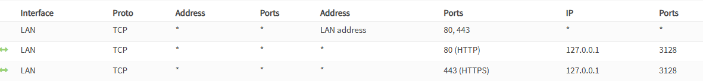

<b>Figure 13</b> · Règles de Redirection (NAT)

3. Appliquez les changements.

## Filtrage et Validation

### Mise en place de la Blacklist (Toulouse)

1. Allez dans **Services \> Squid Web Proxy \> Administration \> Remote Access Control Lists**.
2. Cliquez sur **Add** (Ajouter) **(+)**.
   - **URL :** `http://dsi.ut-capitole.fr/blacklists/download/blacklists.tar.gz`.
   - **Description :** Blocage_sites_inappropriés.
   - **Enabled :** Coché.

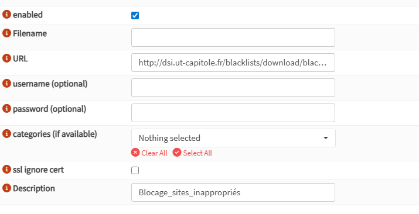

<b>Figure 14</b> · Mise en place de la Blacklist (Toulouse)

3. Cliquez sur **Save** (Enregistrer) puis sur le bouton **Download ACLs** (Télécharger les ACLs).
4. Une fois le téléchargement terminé (statut « OK »), retournez dans l'onglet **Forward Proxy**.
5. Déroulez la section **Access Control Lists**.
6. Dans le champ **Blacklist**, sélectionnez les catégories à bloquer.

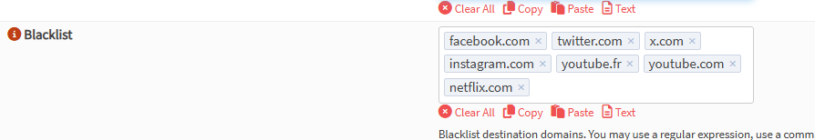

<b>Figure 15</b> · Catégories bloquées

7. Cliquez sur **Apply** (Appliquer).

### Tests et Vérifications

1. **Désactivation du Proxy Manuel :** Sur le poste client, **désactivez** le proxy manuel dans les paramètres Windows/Navigateur.
2. **Test HTTP :** Allez sur un site non sécurisé (ex : `http://perdu.com`). Le site doit s'ouvrir.

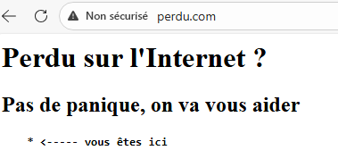

<b>Figure 16</b> · Site HTTP accessible

3. **Test de Blocage :** Tentez d'accéder à un site interdit par la Blacklist (ex : netflix.com).
   - **Validation :** une page d'erreur OPNsense « Access Denied » s'affiche.

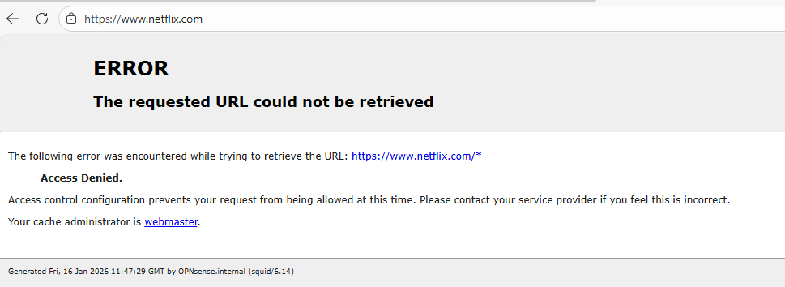

<b>Figure 17</b> · Accès refusé par la blacklist

## Procédures Liées

- [Filtrage DNS et IP avec pfBlockerNG](/procedures/linux/filtrage-dns-et-ip-avec-pfblockerng) *(Filtrage DNS et IP complémentaire)*
- [Segmentation Réseau (VLANs) sur pfSense](/procedures/linux/segmentation-reseau-vlans-sur-pfsense) *(Segmentation des réseaux filtrés)*
- [Installation et Configuration Initiale de pfSense](/procedures/linux/installation-et-configuration-initiale-de-pfsense) *(Pare-feu alternatif à OPNSense)*
- [Configuration d'un Serveur Passerelle Internet](/procedures/windows/configuration-dun-serveur-passerelle-internet) *(Accès Internet de base sous Windows)*
