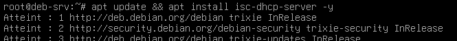
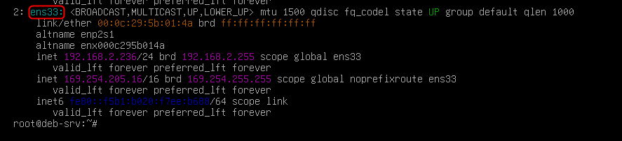
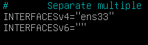
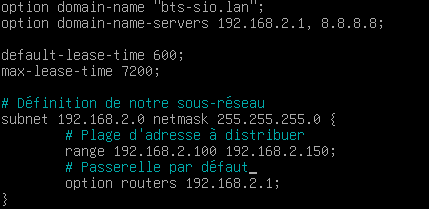
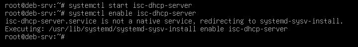

## Introduction

L'objectif est d'installer et de configurer le service DHCP **ISC** sur un serveur Debian ou Ubuntu pour automatiser l'attribution des adresses IP et de la configuration réseau aux clients d'un réseau local.

## Contexte et Justification

ISC-DHCP-Server est la solution open source historique de référence pour le DHCP, utilisée dans d'innombrables entreprises. Sa configuration, bien qu'entièrement en ligne de commande, est extrêmement puissante et flexible. Maîtriser cet outil est une compétence fondamentale pour tout administrateur travaillant dans des environnements hétérogènes.

<div class="callout callout-note">

L'ISC a arrêté la maintenance d'ISC DHCP fin 2022 et recommande Kea DHCP pour les nouveaux déploiements. Le paquet `isc-dhcp-server` reste disponible sur Debian et Ubuntu et convient pour un lab.

</div>

## Prérequis

- Un serveur Debian ou Ubuntu fonctionnel.
- Ce serveur **doit impérativement avoir une adresse IP statique** configurée sur l'interface qui servira le DHCP.
- Des droits d'administration.

## Procédure de Configuration

### Installation du Service DHCP

1. Mettez à jour vos dépôts de paquets et installez le serveur DHCP en tapant la commande `sudo apt update && sudo apt install isc-dhcp-server -y`. Il est normal que l'installation se termine par une erreur, car le service n'est pas encore configuré.



<p class="figure-caption"><b>Figure 1</b> · Installation du Service DHCP</p>

### Configuration de l'Interface d'Écoute

**Justification :** Nous devons indiquer au service DHCP sur quelle interface réseau il doit écouter les demandes des clients.

1. Identifiez le nom de votre interface réseau avec la commande `ip a`. Notez le nom (ici, ens33).



<p class="figure-caption"><b>Figure 2</b> · Nom de l'interface réseau</p>

2. Éditez le fichier de configuration par défaut du service avec la commande `sudo nano /etc/default/isc-dhcp-server`.
3. Trouvez la ligne `INTERFACESv4=""` et ajoutez le nom de votre interface entre les guillemets. Par exemple : `INTERFACESv4="ens33"`.



<p class="figure-caption"><b>Figure 3</b> · Interface d'écoute dans /etc/default/isc-dhcp-server</p>

4. Sauvegardez le fichier et quittez l'éditeur.

### Configuration du Fichier dhcpd.conf

**Justification :** C'est le fichier principal où nous définissons les plages d'adresses, les passerelles, les serveurs DNS, etc.

1. Éditez le fichier de configuration principal avec la commande `sudo nano /etc/dhcp/dhcpd.conf`.
2. Ajoutez ou modifiez les lignes suivantes pour définir votre configuration :

```text
# Ce serveur est l'autorité DHCP pour ce réseau
authoritative;

# Options DNS et nom de domaine envoyées aux clients
option domain-name "bts-sio.lan";
option domain-name-servers 192.168.2.1, 8.8.8.8;

default-lease-time 600;
max-lease-time 7200;

# Définition de notre sous-réseau
subnet 192.168.2.0 netmask 255.255.255.0 {
    # Plage d'adresses à distribuer
    range 192.168.2.100 192.168.2.150;
    # Passerelle par défaut pour les clients
    option routers 192.168.2.1;
}
```



<p class="figure-caption"><b>Figure 4</b> · Fichier dhcpd.conf</p>

3. Sauvegardez le fichier et quittez.

### Démarrage du Service

1. Démarrez le service DHCP avec la commande `sudo systemctl start isc-dhcp-server`.
2. Activez-le pour qu'il se lance automatiquement au démarrage du serveur avec la commande `sudo systemctl enable isc-dhcp-server`.



<p class="figure-caption"><b>Figure 5</b> · Démarrage du Service</p>

## Vérifications

**Côté Serveur :**

- Vérifiez l'état du service avec la commande `sudo systemctl status isc-dhcp-server`. Il doit être « active (running) ».
- Consultez les journaux en temps réel pour voir les attributions avec la commande `sudo journalctl -u isc-dhcp-server -f` (ou `sudo tail -f /var/log/syslog | grep dhcpd` si rsyslog est installé).

**Côté Client :**

- Sur un poste client, passez la carte réseau en DHCP. Il doit recevoir une adresse de la plage configurée.
- Avec la commande `ipconfig /all` (sur Windows), vérifiez que l'adresse du « Serveur DHCP » est bien celle de votre serveur Linux.

## Conseils et Bonnes Pratiques

- **`authoritative;` :** N'oubliez jamais cette ligne dans votre configuration. Elle indique au serveur qu'il est la source officielle pour ce réseau.
- **Sécurité (DHCP Snooping) :** Pour vous protéger des serveurs non autorisés, activez le **DHCP Snooping** sur vos switchs.
- **Agent de Relais :** Si vos clients sont sur un autre VLAN que votre serveur DHCP, vous devez configurer un **agent de relais** sur votre routeur (la commande `ip helper-address` sur Cisco) avec l'adresse IP de votre serveur Linux.

## Dépannage

**Symptôme :** Le service `isc-dhcp-server` refuse de démarrer.

**Checklist :**

1. **Erreur de Syntaxe :** Testez la validité de votre fichier de configuration avec la commande `sudo dhcpd -t -cf /etc/dhcp/dhcpd.conf`. Elle vous indiquera la ligne exacte où se trouve l'erreur.
2. **Interface non spécifiée :** Avez-vous bien configuré l'interface d'écoute dans `/etc/default/isc-dhcp-server` ?
3. **Pas d'IP Statique :** L'interface d'écoute doit avoir une adresse IP statique qui appartient à l'un des subnets déclarés dans `dhcpd.conf`.

## Procédures Liées

- [Installation et Configuration d'un Serveur DHCP](/procedures/windows/installation-et-configuration-dun-serveur-dhcp) *(Équivalent sous Windows Server)*
- [DHCP Relay](/procedures/cisco/dhcp-relay) *(Relais depuis d'autres VLANs)*
- [Déploiement Serveur DNS Local Bind9 (Conteneurisé)](/procedures/linux/deploiement-serveur-dns-local-bind9-conteneurise) *(DNS distribué aux clients)*
- [Segmentation Réseau (VLANs) sur pfSense](/procedures/linux/segmentation-reseau-vlans-sur-pfsense) *(Réseaux à adresser)*
