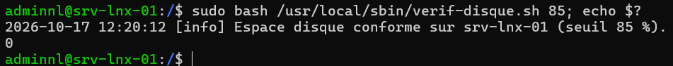
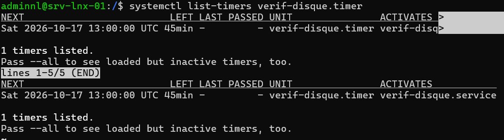

## Introduction

Cette procédure décrit l'écriture, le contrôle et le déploiement de scripts Bash d'administration sur des serveurs Linux Debian 13 (trixie) et Ubuntu 24.04 LTS. Elle pose un socle commun (shebang, mode strict, gestion des erreurs, journalisation) puis l'applique à un exemple concret : un script de vérification de l'espace disque qui journalise et alerte au-delà d'un seuil.

Le périmètre couvre les variables, les conditions, les boucles, les fonctions, les codes retour, la journalisation vers journald, l'analyse statique avec ShellCheck, et le déploiement planifié. Ansible est présenté comme alternative pour les tâches à l'échelle d'un parc. L'écriture de scripts POSIX `sh` portables vers d'autres systèmes sort du périmètre.

## Contexte et Justification

Les tâches d'administration répétitives réalisées à la main (contrôle d'espace disque, purge de fichiers temporaires, vérification de services, rapports) présentent plusieurs défauts :

- **Oublis :** une vérification manuelle n'est faite que lorsque quelqu'un y pense.
- **Hétérogénéité :** deux administrateurs ne tapent pas les mêmes commandes, et le résultat diffère d'un serveur à l'autre.
- **Absence de trace :** une action non journalisée ne peut pas être auditée.
- **Temps perdu :** le temps passé sur des contrôles routiniers n'est pas consacré aux projets.

Un script Bash versionné, testé et planifié transforme ces tâches en procédures reproductibles. Bash est présent sur toutes les installations Debian et Ubuntu, sans dépendance supplémentaire, ce qui en fait l'outil le plus direct pour l'automatisation locale d'un serveur.

## Concepts Clés

**Shebang :** Première ligne du script qui désigne l'interpréteur. `#!/usr/bin/env bash` recherche `bash` dans le `PATH`, `#!/bin/bash` désigne un chemin fixe. Sur Debian et Ubuntu, `/bin/sh` pointe vers `dash` : un script lancé par `sh script.sh` n'est pas exécuté par Bash.

**Mode strict :** La ligne `set -euo pipefail` rend le script plus sûr.

| Option | Effet |
|--------|-------|
| `-e` | Arrête le script dès qu'une commande échoue (hors conditions et listes `&&` ou `\|\|`) |
| `-u` | Considère l'utilisation d'une variable non définie comme une erreur |
| `-o pipefail` | Le code retour d'un pipeline est celui de la dernière commande en échec, et non celui de la dernière commande |

: Options du mode strict

**Code retour :** Chaque commande renvoie un entier entre 0 et 255, lu dans `$?`. La valeur 0 signifie le succès, toute autre valeur un échec. Un script doit lui-même renvoyer un code significatif avec `exit`.

**Variables :** `NOM="valeur"` sans espace autour du signe égal. La lecture se fait avec `"${NOM}"`, toujours entre guillemets pour éviter le découpage des mots et l'expansion des jokers. `readonly` protège une constante, `local` limite une variable à une fonction.

**Conditions :** `[[ ... ]]` est le test de Bash, plus sûr que `[ ... ]`. Les comparaisons numériques utilisent `-gt`, `-lt`, `-eq` ou l'évaluation arithmétique `(( ... ))`.

**trap :** Exécute une commande lors d'un signal ou d'un événement (`EXIT`, `ERR`, `INT`). Il sert au nettoyage des fichiers temporaires et à la journalisation des erreurs.

**logger :** Commande qui écrit un message dans le journal système (journald, et rsyslog s'il est installé) avec une étiquette et une priorité.

**ShellCheck :** Analyseur statique qui détecte les erreurs classiques des scripts shell (guillemets manquants, variables inutilisées, syntaxe non portable) et les identifie par un code `SCxxxx`.

## Prérequis

- Un serveur Debian 13 ou Ubuntu 24.04 LTS (srv-lnx-01) avec un compte membre de `sudo`.
- Bash 5.x, installé par défaut.
- Le paquet `shellcheck`, disponible dans les dépôts Debian et Ubuntu.
- Un dépôt Git pour versionner les scripts.
- Un éditeur avec coloration syntaxique (vim, nano, ou VS Code en connexion SSH).

## Points de Vigilance

**set -e n'est pas une gestion d'erreurs complète.** Il ne s'applique pas aux commandes testées dans un `if`, à celles suivies de `||`, ni de manière intuitive dans certaines substitutions de commande et fonctions. Vérifiez explicitement le code retour des commandes critiques.

**Les variables non protégées par des guillemets sont dangereuses.** `rm -rf $DOSSIER/*` avec une variable vide devient `rm -rf /*`. Protégez toujours les variables (`"${DOSSIER}"`), et utilisez `${DOSSIER:?}` qui interrompt le script si la variable est vide.

**Exécution par sh au lieu de bash.** Un script Bash lancé par `sh script.sh` est interprété par `dash` et échoue sur `[[`, les tableaux ou `pipefail`. Rendez le script exécutable et lancez-le directement.

**Environnement réduit sous cron et systemd.** Une tâche planifiée ne charge pas le profil de l'utilisateur : le `PATH` est minimal et les variables d'environnement habituelles sont absentes. Utilisez des chemins absolus ou définissez `PATH` en tête de script.

**Secrets en clair.** Un mot de passe écrit dans un script se retrouve dans Git, dans les sauvegardes et dans la liste des processus. Lisez-le depuis un fichier protégé en `600`, ou utilisez les credentials systemd (`LoadCredential=`).

**Idempotence.** Un script relancé deux fois ne doit pas produire un état différent (ligne ajoutée en double dans un fichier, compte créé deux fois). Testez l'état avant d'agir.

## Choix Architecturaux & Alternatives

### Quand choisir Bash

Bash convient aux tâches locales, courtes et liées au système : contrôles, purges, rapports, enchaînement de commandes existantes, scripts appelés par un timer systemd ou par un outil de supervision. Il est disponible partout, sans installation.

Au-delà d'environ 200 lignes, ou dès qu'il faut manipuler des structures de données (JSON, API REST), Python devient plus lisible et plus fiable. Dès que la même configuration doit être appliquée à plusieurs serveurs, Ansible est préférable.

### Alternatives et comparatif

| Option | Cas d'usage typique | Force principale | Faiblesse principale | Coût relatif |
|--------|---------------------|------------------|----------------------|--------------|
| **Bash** | Tâches locales, contrôles, enchaînements de commandes | Disponible partout, aucune dépendance | Gestion d'erreurs fragile, peu adapté aux données structurées | Gratuit |
| **Python** | Traitement de données, appels d'API, logique complexe | Lisibilité, bibliothèques, gestion d'exceptions | Dépendances à gérer (environnements virtuels) | Gratuit |
| **Ansible** | Configuration d'un parc, déploiement reproductible | Déclaratif, idempotent, sans agent | Courbe d'apprentissage, lenteur sur de petites tâches | Gratuit (Red Hat Ansible Automation Platform payant) |
| **PowerShell 7 sur Linux** | Équipes Windows qui administrent aussi Linux | Objets structurés, syntaxe commune | Installation supplémentaire, peu de modules Linux natifs | Gratuit |

### Impact des choix

- **Sécurité.** Un script exécuté en root concentre les privilèges. Le moindre privilège, la protection des variables et l'absence de secrets en clair limitent l'impact d'une erreur ou d'une compromission.
- **Fiabilité.** Le mode strict, ShellCheck et des tests sur un serveur de lab réduisent les incidents liés aux scripts.
- **Exploitation.** Un script versionné dans Git, journalisé dans journald et planifié par un timer systemd est traçable et supervisable.
- **Passage à l'échelle.** Bash reste local. Pour dix serveurs ou plus, Ansible apporte l'inventaire, l'idempotence et le rapport d'exécution.
- **Coût.** Gratuit. Le coût réel est le temps de maintenance, d'où l'importance d'un modèle commun à tous les scripts.

## Configuration

### Installer ShellCheck

```bash
sudo apt update
sudo apt install shellcheck
```

### Adopter un modèle de script commun

Chaque script commence par le même en-tête :

```bash
#!/usr/bin/env bash
#
# Nom         : nom-du-script.sh
# Description : rôle du script en une phrase
# Auteur      : Nathan LALLIER
# Version     : 1.0
#
set -euo pipefail
IFS=$'\n\t'

SCRIPT_NAME="$(basename "$0")"
readonly SCRIPT_NAME
PATH="/usr/local/sbin:/usr/local/bin:/usr/sbin:/usr/bin:/sbin:/bin"
```

`IFS=$'\n\t'` limite le découpage des mots aux retours à la ligne et aux tabulations, ce qui évite les erreurs sur les noms contenant des espaces.

### Variables et paramètres

```bash
SEUIL="${1:-85}"             # premier argument, 85 par défaut
readonly EXCLUSIONS="tmpfs|devtmpfs|overlay|squashfs"

if ! [[ "${SEUIL}" =~ ^[0-9]+$ ]] || (( SEUIL > 100 )); then
    echo "Seuil invalide : ${SEUIL}" >&2
    exit 2
fi
```

### Conditions et boucles

```bash
# Condition sur un fichier
if [[ -f /etc/os-release ]]; then
    source /etc/os-release
    echo "Distribution : ${PRETTY_NAME}"
fi

# Boucle sur une liste
for service in ssh chrony rsyslog; do
    if systemctl is-active --quiet "${service}"; then
        echo "${service} : actif"
    else
        echo "${service} : inactif"
    fi
done

# Boucle sur la sortie d'une commande, ligne par ligne
while read -r utilisateur; do
    echo "Compte : ${utilisateur}"
done < <(awk -F: '$3 >= 1000 && $3 < 65534 {print $1}' /etc/passwd)
```

### Fonctions et codes retour

```bash
journaliser() {
    local niveau="$1"; shift
    logger -t "${SCRIPT_NAME}" -p "user.${niveau}" -- "$*"
    echo "$(date '+%F %T') [${niveau}] $*"
}

verifier_root() {
    if (( EUID != 0 )); then
        journaliser err "Ce script doit être exécuté en root."
        return 1
    fi
    return 0
}

verifier_root || exit 1
```

Une fonction renvoie un code avec `return`, le script avec `exit`. Réservez des codes distincts aux différentes erreurs et documentez-les dans l'en-tête.

### Nettoyage et journalisation des erreurs avec trap

```bash
TMPFILE="$(mktemp)"
trap 'rm -f "${TMPFILE}"' EXIT
trap 'journaliser err "Erreur ligne ${LINENO} : ${BASH_COMMAND}"' ERR
```

### Exemple complet : vérification de l'espace disque

Créez le script `/usr/local/sbin/verif-disque.sh` :

```bash
#!/usr/bin/env bash
#
# Nom         : verif-disque.sh
# Description : Contrôle le taux d'occupation des systèmes de fichiers
#               et journalise une alerte au-delà d'un seuil.
# Usage       : verif-disque.sh [seuil_en_pourcentage]
# Codes       : 0 = OK, 1 = au moins un dépassement, 2 = paramètre invalide
# Auteur      : Nathan LALLIER
# Version     : 1.0
#
set -euo pipefail
IFS=$'\n\t'

SCRIPT_NAME="$(basename "$0")"
readonly SCRIPT_NAME
PATH="/usr/local/sbin:/usr/local/bin:/usr/sbin:/usr/bin:/sbin:/bin"

SEUIL="${1:-85}"
readonly EXCLUSIONS="tmpfs|devtmpfs|overlay|squashfs|efivarfs"

journaliser() {
    local niveau="$1"; shift
    logger -t "${SCRIPT_NAME}" -p "user.${niveau}" -- "$*"
    echo "$(date '+%F %T') [${niveau}] $*"
}

valider_seuil() {
    if ! [[ "${SEUIL}" =~ ^[0-9]+$ ]] || (( SEUIL < 1 || SEUIL > 100 )); then
        journaliser err "Seuil invalide : ${SEUIL}"
        exit 2
    fi
}

verifier_disques() {
    local depassement=0
    local type usage point

    while IFS=$' \t' read -r type usage point; do
        usage="${usage%\%}"
        if [[ "${type}" =~ ^(${EXCLUSIONS})$ ]] || ! [[ "${usage}" =~ ^[0-9]+$ ]]; then
            continue
        fi
        if (( usage >= SEUIL )); then
            journaliser warning "${HOSTNAME} : ${point} occupé à ${usage} % (seuil ${SEUIL} %)"
            depassement=1
        fi
    done < <(df --output=fstype,pcent,target | tail -n +2)

    return "${depassement}"
}

main() {
    valider_seuil
    if verifier_disques; then
        journaliser info "Espace disque conforme sur ${HOSTNAME} (seuil ${SEUIL} %)."
        exit 0
    else
        exit 1
    fi
}

main "$@"
```

Rendez-le exécutable :

```bash
sudo install -m 750 -o root -g root verif-disque.sh /usr/local/sbin/verif-disque.sh
```

<div class="callout callout-note">

La fonction `verifier_disques` est appelée dans un `if` : son code retour non nul ne déclenche donc pas l'arrêt du mode `set -e`, ce qui est le comportement voulu.

</div>

### Analyser le script avec ShellCheck

```bash
shellcheck /usr/local/sbin/verif-disque.sh
```

Corrigez chaque avertissement. Si un avertissement est volontairement ignoré, documentez-le juste au-dessus de la ligne concernée :

```bash
# shellcheck disable=SC1091
source /etc/os-release
```

### Planifier l'exécution avec un timer systemd

Service `/etc/systemd/system/verif-disque.service` :

```text
[Unit]
Description=Vérification de l'espace disque

[Service]
Type=oneshot
ExecStart=/usr/local/sbin/verif-disque.sh 85
```

Timer `/etc/systemd/system/verif-disque.timer` :

```text
[Unit]
Description=Vérification de l'espace disque toutes les heures

[Timer]
OnCalendar=hourly
Persistent=true

[Install]
WantedBy=timers.target
```

```bash
sudo systemctl daemon-reload
sudo systemctl enable --now verif-disque.timer
```

### Versionner les scripts

```bash
mkdir -p ~/scripts-admin && cd ~/scripts-admin
git init
cp /usr/local/sbin/verif-disque.sh .
git add verif-disque.sh
git commit -m "Ajout du script de vérification de l'espace disque"
```

### Alternative à l'échelle d'un parc : Ansible

Pour déployer le même script et son timer sur tous les serveurs, un playbook Ansible remplace la copie manuelle :

```yaml
- name: Déployer la vérification d'espace disque
  hosts: serveurs_linux
  become: true
  tasks:
    - name: Copier le script
      ansible.builtin.copy:
        src: verif-disque.sh
        dest: /usr/local/sbin/verif-disque.sh
        mode: "0750"

    - name: Copier le service et le timer
      ansible.builtin.copy:
        src: "{{ item }}"
        dest: "/etc/systemd/system/{{ item }}"
        mode: "0644"
      loop:
        - verif-disque.service
        - verif-disque.timer

    - name: Activer le timer
      ansible.builtin.systemd_service:
        name: verif-disque.timer
        enabled: true
        state: started
        daemon_reload: true
```

## Vérifications

**Analyse statique :** `shellcheck /usr/local/sbin/verif-disque.sh` ne renvoie aucun message.

**Syntaxe :** `bash -n /usr/local/sbin/verif-disque.sh` vérifie la syntaxe sans exécuter le script.

**Exécution manuelle :** `sudo bash /usr/local/sbin/verif-disque.sh 85; echo $?` affiche le message de conformité et le code 0. Avec un seuil bas (`sudo /usr/local/sbin/verif-disque.sh 1`), le script journalise des dépassements et renvoie 1.



<p class="figure-caption"><b>Figure 1</b> · Résultat de la commande.</p>

**Paramètre invalide :** `sudo /usr/local/sbin/verif-disque.sh abc; echo $?` renvoie 2.

**Journal :** `journalctl -t verif-disque.sh --since today` affiche les messages du script.

**Timer :** `systemctl list-timers verif-disque.timer` affiche la prochaine exécution, et `systemctl status verif-disque.service` le résultat de la dernière.



<p class="figure-caption"><b>Figure 2</b> · Résultat de la commande.</p>

**Mode trace :** `bash -x /usr/local/sbin/verif-disque.sh 85` affiche chaque commande exécutée, utile pour la mise au point.

## Dépannage

**« /usr/bin/env: 'bash\r': No such file or directory » :** le script a été édité sous Windows avec des fins de ligne CRLF. Convertissez-le avec `sed -i 's/\r$//' script.sh` ou `dos2unix`, et configurez l'éditeur en LF.

**« Permission denied » à l'exécution :** le bit d'exécution manque ou le système de fichiers est monté en `noexec`. Appliquez `chmod +x` et vérifiez les options de montage avec `findmnt`.

**« unbound variable » :** une variable est utilisée sans être définie alors que `set -u` est actif. Initialisez-la ou utilisez une valeur par défaut `${VAR:-}`.

**« [: not found » ou « Illegal option -o pipefail » :** le script est exécuté par `sh` (dash). Lancez-le directement ou avec `bash`.

**« Le script fonctionne à la main mais pas depuis le timer » :** le `PATH` ou une variable d'environnement diffère. Définissez le `PATH` en tête de script et consultez `journalctl -u verif-disque.service`.

**« Le script s'arrête sans message » :** `set -e` a interrompu le script sur une commande en échec. Ajoutez un `trap ... ERR` qui journalise la ligne, ou exécutez avec `bash -x`.

## Conseils et Bonnes Pratiques

**Un modèle commun pour tous les scripts.** En-tête documenté, mode strict, fonction de journalisation, `main` en fin de fichier. Un administrateur qui découvre un script s'y retrouve immédiatement.

**ShellCheck systématique.** Intégrez-le dans un hook Git `pre-commit` ou dans un pipeline CI pour refuser tout script non conforme.

**Journaliser avec logger.** Les messages arrivent dans journald, sont transférés au collecteur rsyslog, et restent consultables avec `journalctl -t`.

**Codes retour documentés.** Un code retour fiable permet à la supervision et aux timers systemd de détecter les échecs.

**Tester sur un serveur de lab.** Un script qui modifie le système se teste d'abord sur une VM jetable, avec un mode simulation (`--dry-run`) si possible.

**Passer à Ansible au-delà de quelques serveurs.** Gardez Bash pour la logique locale et laissez Ansible déployer et orchestrer.

## Procédures Liées

- [Planification des Tâches avec cron et les Timers systemd *(Planification des scripts)*
- Gestion des Services avec systemd et journald *(Lecture des journaux des scripts)*
- [Centralisation des Journaux avec rsyslog](/procedures/linux/centralisation-des-journaux-avec-rsyslog) *(Remontée des alertes des scripts vers le collecteur)*
- Déploiement Continu avec GitHub Actions *(Contrôle automatique des scripts par ShellCheck)*
- Configuration de PowerShell Remoting et de JEA *(Équivalent de l'automatisation côté Windows)*
