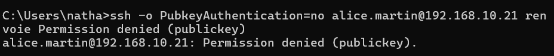

## Introduction

Cette procédure décrit la sécurisation de l'accès SSH à un serveur Linux Debian 13 ou Ubuntu Server 24.04 LTS : authentification par clés ed25519, déploiement des clés avec `ssh-copy-id`, durcissement de `sshd` par un fichier dans `/etc/ssh/sshd_config.d`, désactivation des mots de passe et de la connexion `root`, restriction par groupe avec `AllowGroups`, validation avec `sshd -t`, prise en compte de l'activation par socket d'Ubuntu, puis protection contre la force brute avec Fail2ban.

L'exemple porte sur srv-lnx-01 (192.168.10.21), administré depuis le poste adm-01 (192.168.10.50). Les versions d'OpenSSH sont 9.6 sur Ubuntu 24.04, 10.0 sur Debian 13 et 10.2 sur Ubuntu 26.04 LTS.

## Contexte et Justification

Le service SSH est la porte d'administration de tout serveur Linux. Exposé avec sa configuration par défaut, il subit en permanence des tentatives automatisées de connexion :

- Les robots testent des listes de comptes courants (`root`, `admin`, `ubuntu`) et de mots de passe faibles.
- Un mot de passe réutilisé ou divulgué suffit à ouvrir une session.
- La connexion directe en `root` supprime toute traçabilité nominative.
- Les fonctions de transfert (agent, ports, X11) offrent des rebonds vers le réseau interne après compromission d'un compte.

La sécurisation décrite ici répond à ces risques :

- **Authentification forte :** une clé privée protégée par phrase de passe remplace le mot de passe, insensible à la force brute.
- **Surface réduite :** seuls les membres d'un groupe autorisé peuvent se connecter, sans `root` ni fonctions inutiles.
- **Réaction automatique :** Fail2ban bannit les adresses qui multiplient les échecs.

## Concepts Clés

**Paire de clés.** La clé privée reste sur le poste de l'administrateur, protégée par une phrase de passe. La clé publique est copiée dans `~/.ssh/authorized_keys` du compte sur le serveur. Le type ed25519 offre des clés courtes, rapides et robustes, et il est recommandé pour toute nouvelle clé.

**ssh-agent.** Processus du poste client qui garde la clé déverrouillée en mémoire pendant la session, pour ne saisir la phrase de passe qu'une fois.

**sshd_config et sshd_config.d.** Le fichier principal `/etc/ssh/sshd_config` de Debian et d'Ubuntu commence par `Include /etc/ssh/sshd_config.d/*.conf`. Pour chaque directive, sshd retient la première valeur lue : un fichier du répertoire `sshd_config.d` l'emporte donc sur le fichier principal, et entre deux fichiers, celui dont le nom vient en premier dans l'ordre alphabétique l'emporte.

**AllowGroups.** Directive qui n'autorise la connexion qu'aux membres des groupes listés. Tout autre compte est refusé, même avec une clé valide.

**Activation par socket.** Depuis Ubuntu 22.10, et donc sur Ubuntu 24.04 et 26.04, l'unité `ssh.socket` écoute le port et démarre `ssh.service` à la première connexion. Sur Ubuntu 24.04, le port et l'adresse d'écoute sont lus dans la configuration de sshd par un générateur systemd au moment du `daemon-reload`. Debian 13 utilise `ssh.service` classique, sans activation par socket par défaut.

**Fail2ban.** Service qui surveille les journaux, compte les échecs d'authentification par adresse IP, et ajoute une règle de pare-feu temporaire au delà d'un seuil. Une prison (jail) associe un filtre (expressions de détection), une source de journaux (backend) et une action (bannissement nftables ou iptables).

**PerSourcePenalties.** Mécanisme intégré à OpenSSH depuis la version 9.8, actif par défaut, qui retarde les adresses sources provoquant des échecs répétés. Il est présent sur Debian 13 et Ubuntu 26.04, mais pas sur Ubuntu 24.04 (OpenSSH 9.6).

## Prérequis

- Un serveur Debian 13 ou Ubuntu Server 24.04 LTS, ici srv-lnx-01, avec `openssh-server` installé.
- Un compte nominatif membre du groupe `sudo`, ici `alice.martin`.
- Un poste d'administration avec un client OpenSSH (Linux, macOS ou Windows 10 et 11, où il est intégré).
- Un accès console hors bande au serveur (console d'hyperviseur, iDRAC, iLO) en cas de blocage.
- Le groupe local `ssh-users` créé, avec les comptes autorisés comme membres.
- Si un pare-feu local est actif (UFW ou nftables), les droits pour y ouvrir le port SSH retenu.

## Points de Vigilance

**Gardez une session ouverte pendant toutes les modifications.** Une session SSH établie n'est pas coupée par un rechargement de sshd. Testez chaque changement depuis une seconde connexion avant de fermer la première.

**Déployez et testez les clés avant de désactiver les mots de passe.** Sinon, plus aucun compte ne peut se connecter à distance.

**Le premier fichier lu l'emporte.** Sur les images cloud, `/etc/ssh/sshd_config.d/50-cloud-init.conf` peut contenir `PasswordAuthentication yes`. Un fichier nommé `10-durcissement.conf` est lu avant lui et impose sa valeur ; un fichier nommé `99-durcissement.conf` serait ignoré pour cette directive.

**Changer de port sur Ubuntu 24.04 ne se fait pas comme sur Debian.** Avec l'activation par socket, un `systemctl restart ssh` ne change pas le port d'écoute. Il faut exécuter `systemctl daemon-reload` puis `systemctl restart ssh.socket` (voir « Configuration »).

**Ne bannissez pas votre propre réseau d'administration.** Ajoutez le poste ou le sous réseau d'administration à `ignoreip` dans Fail2ban, sans pour autant y inclure tout le réseau des utilisateurs.

**Fail2ban et OpenSSH 9.8 ou plus.** À partir d'OpenSSH 9.8, la session est gérée par le processus `sshd-session`, ce qui a imposé une mise à jour des filtres Fail2ban. Sur Debian 13 (OpenSSH 10.0), vérifiez avec `fail2ban-regex` que les échecs sont bien détectés.

**Retraits dans OpenSSH récent.** Les clés DSA ne sont plus prises en charge depuis OpenSSH 9.8 (Debian 13, Ubuntu 26.04). sshd ne lit plus `~/.pam_environment`. Debian annonce aussi que ses paquets principaux abandonneront l'authentification GSS-API après Debian 13, au profit de paquets `-gssapi` séparés.

## Choix Architecturaux & Alternatives

### Quand choisir ce durcissement

L'authentification par clés, la désactivation de `root` et des mots de passe, et la restriction par groupe s'appliquent à tous les serveurs, sans exception. Fail2ban est pertinent dès que le port SSH est joignable depuis un réseau non maîtrisé (Internet, réseau utilisateurs). Sur un serveur joignable uniquement depuis un réseau d'administration filtré, il reste utile mais secondaire.

Pour un parc important, les clés individuelles posent un problème de distribution et de révocation. Une autorité de certification SSH ou un bastion centralisé deviennent alors préférables.

### Alternatives et comparatif

| Option | Cas d'usage typique | Force principale | Faiblesse principale | Coût relatif |
|--------|---------------------|------------------|----------------------|--------------|
| **Clés ed25519 et sshd durci** | Tous les serveurs | Résistance à la force brute, natif | Distribution et révocation des clés manuelles | Gratuit |
| **Fail2ban** | Serveurs exposés à des réseaux non maîtrisés | Bannissement automatique, multi services | Réactif, inefficace contre une attaque très distribuée | Gratuit |
| **Certificats SSH (CA OpenSSH)** | Parc moyen à grand | Révocation et expiration centralisées | Autorité de certification à protéger et à opérer | Faible |
| **Clés FIDO2 (ed25519-sk)** | Comptes à privilèges élevés | Clé privée non extractible, présence physique | Matériel à acheter et à gérer | Moyen |
| **Bastion (Teleport, Apache Guacamole, OPNsense VPN)** | Accès prestataires, conformité | Point d'entrée unique, enregistrement de session | Infrastructure supplémentaire, point de défaillance | Moyen à élevé |
| **VPN (WireGuard) avant SSH** | Administration à distance | SSH n'est plus exposé sur Internet | Un service de plus à sécuriser | Faible |

### Impact des choix

- **Sécurité.** Sans mot de passe accepté, la force brute devient inopérante. `AllowGroups` limite les comptes exploitables, et la suppression des transferts réduit les rebonds possibles.
- **Disponibilité.** Une erreur de configuration peut fermer l'accès distant. `sshd -t`, une session conservée et un accès console limitent ce risque. Une prison Fail2ban trop stricte peut bannir un administrateur légitime.
- **Exploitation.** La gestion des clés publiques impose une procédure d'arrivée et de départ. Les certificats SSH ou l'intégration à l'annuaire facilitent cette gestion à l'échelle.
- **Coût.** Toutes les mesures natives sont gratuites. Les clés FIDO2 et les bastions commerciaux ont un coût matériel ou de licence.

## Configuration

### Générer une clé ed25519 sur le poste d'administration

```bash
ssh-keygen -t ed25519 -a 100 -C "alice.martin@adm-01"
```

Acceptez l'emplacement par défaut (`~/.ssh/id_ed25519`) et saisissez une phrase de passe robuste. L'option `-a 100` renforce la dérivation de la phrase de passe.

### Copier la clé publique sur le serveur

Depuis un client Linux ou macOS :

```bash
ssh-copy-id -i ~/.ssh/id_ed25519.pub alice.martin@192.168.10.21
```

Depuis Windows, où `ssh-copy-id` n'existe pas, en PowerShell :

```powershell
type $env:USERPROFILE\.ssh\id_ed25519.pub | ssh alice.martin@192.168.10.21 "umask 077; mkdir -p ~/.ssh; cat >> ~/.ssh/authorized_keys"
```

Testez la connexion par clé, puis vérifiez les droits côté serveur :

```bash
ssh -i ~/.ssh/id_ed25519 alice.martin@192.168.10.21
ls -ld ~/.ssh ~/.ssh/authorized_keys      # attendu : drwx------ et -rw-------
```

### Préparer le groupe autorisé

```bash
sudo groupadd ssh-users
sudo usermod -aG ssh-users alice.martin
id alice.martin
```

### Durcir sshd avec sshd_config.d

```bash
sudo nano /etc/ssh/sshd_config.d/10-durcissement.conf
```

```text
# Authentification
PermitRootLogin no
PubkeyAuthentication yes
PasswordAuthentication no
KbdInteractiveAuthentication no
PermitEmptyPasswords no
AuthenticationMethods publickey

# Comptes autorisés
AllowGroups ssh-users

# Limites de session
MaxAuthTries 3
LoginGraceTime 30
MaxStartups 10:30:60
ClientAliveInterval 300
ClientAliveCountMax 2

# Fonctions inutiles sur un serveur
X11Forwarding no
AllowAgentForwarding no
AllowTcpForwarding no
PermitTunnel no
```

<div class="callout callout-note">

`AllowTcpForwarding no` empêche aussi les tunnels SSH légitimes (accès à une base de données par redirection de port). Adaptez cette directive aux usages réels. Conservez `UsePAM yes`, présent dans le fichier principal de Debian et d'Ubuntu : il gère les sessions et l'expiration des comptes.

</div>

### Valider et appliquer la configuration

```bash
sudo sshd -t
sudo sshd -T | grep -Ei '^(permitrootlogin|passwordauthentication|kbdinteractiveauthentication|allowgroups|port) '
```

`sshd -t` ne renvoie rien si la configuration est valide. `sshd -T` affiche la configuration effective après fusion de tous les fichiers.

Appliquez :

```bash
sudo systemctl reload ssh
```

Ouvrez une seconde connexion depuis adm-01 avant de fermer la session courante, puis vérifiez qu'une connexion en `root` ou par mot de passe est refusée :

```bash
ssh -o PubkeyAuthentication=no alice.martin@192.168.10.21    # attendu : Permission denied (publickey)
```

### Changer le port d'écoute selon le système

Le changement de port réduit le bruit dans les journaux mais n'est pas une mesure de sécurité en soi. S'il est décidé, ouvrez d'abord le nouveau port dans le pare-feu local, par exemple `sudo ufw allow from 192.168.10.0/24 to any port 2222 proto tcp`, puis ajoutez au fichier de durcissement :

```text
Port 2222
```

Sur Debian 13 (service classique) :

```bash
sudo sshd -t && sudo systemctl restart ssh
```

Sur Ubuntu 24.04 et 26.04 (activation par socket), le générateur systemd relit le port au rechargement :

```bash
sudo sshd -t
sudo systemctl daemon-reload
sudo systemctl restart ssh.socket
sudo ss -tlnp | grep 2222
```

<div class="callout callout-note">

Une alternative sur Ubuntu consiste à surcharger directement l'unité socket avec `sudo systemctl edit ssh.socket`, en déclarant `ListenStream=` vide puis `ListenStream=0.0.0.0:2222` et `ListenStream=[::]:2222`. Ne combinez pas les deux méthodes. Pour revenir au service classique, Canonical documente la séquence `systemctl disable --now ssh.socket`, suppression de `/etc/systemd/system/ssh.service.d/00-socket.conf` s'il existe, `systemctl daemon-reload` puis `systemctl enable --now ssh.service`.

</div>

### Installer et configurer Fail2ban

```bash
sudo apt install fail2ban python3-systemd
```

Ne modifiez pas `jail.conf`, remplacé à chaque mise à jour. Créez `jail.local` :

```bash
sudo nano /etc/fail2ban/jail.local
```

```ini
[DEFAULT]
# Poste d'administration jamais banni
ignoreip = 127.0.0.1/8 ::1 192.168.10.50
bantime = 1h
bantime.increment = true
bantime.maxtime = 1w
findtime = 10m
maxretry = 5
backend = systemd
banaction = nftables-multiport
banaction_allports = nftables-allports

[sshd]
enabled = true
port = ssh
mode = aggressive
maxretry = 3
```

<div class="callout callout-note">

Si le port a été changé, remplacez `port = ssh` par `port = 2222`. Le backend `systemd` lit directement journald, ce qui est indispensable sur Debian 13 où `/var/log/auth.log` n'existe pas sans rsyslog. Sur Debian, le fichier `/etc/fail2ban/jail.d/defaults-debian.conf` fourni par le paquet active déjà la prison sshd ; `jail.local` complète ses réglages.

</div>

Validez et démarrez :

```bash
sudo fail2ban-client -t
sudo systemctl enable --now fail2ban
sudo systemctl restart fail2ban
```

## Vérifications

**Configuration effective :** `sudo sshd -T` affiche `permitrootlogin no`, `passwordauthentication no`, `kbdinteractiveauthentication no` et `allowgroups ssh-users`.

**Connexion par clé :** `ssh alice.martin@192.168.10.21` ouvre une session après saisie de la phrase de passe de la clé, sans mot de passe du compte.

**Refus du mot de passe :** `ssh -o PubkeyAuthentication=no alice.martin@192.168.10.21` renvoie `Permission denied (publickey).`

**Refus de root et des comptes hors groupe :** une tentative avec un compte non membre de `ssh-users` échoue, et `sudo journalctl -u ssh -n 20` affiche la raison (`not allowed because none of user's groups are listed in AllowGroups`).

**Écoute :** `sudo ss -tlnp | grep -E ':22|:2222'` montre le port attendu, porté par `systemd` (Ubuntu, socket) ou `sshd` (Debian).

**Fail2ban :** `sudo fail2ban-client status sshd` affiche la prison active, le nombre d'échecs et la liste des adresses bannies. `sudo nft list ruleset | grep -A5 f2b` montre la table de bannissement.

**Détection des échecs :** `sudo fail2ban-regex systemd-journal /etc/fail2ban/filter.d/sshd.conf` indique un nombre de lignes correspondantes non nul après quelques tentatives échouées volontaires depuis une machine de test.

## Dépannage

**« Permission denied (publickey) » avec une clé déployée :** les droits sont trop ouverts sur `~`, `~/.ssh` ou `authorized_keys`, ou le compte n'est pas membre de `ssh-users`. Corrigez avec `chmod 700 ~/.ssh` et `chmod 600 ~/.ssh/authorized_keys`, et lisez `journalctl -u ssh` sur le serveur pour la raison exacte.



<p class="figure-caption"><b>Figure 1</b> · Accès refusé.</p>

**Le mot de passe est toujours accepté :** un fichier de `sshd_config.d` lu avant le vôtre définit `PasswordAuthentication yes`. Identifiez-le avec `grep -ri passwordauthentication /etc/ssh/sshd_config /etc/ssh/sshd_config.d/` et renommez votre fichier pour qu'il soit lu en premier.

**Le port n'a pas changé sur Ubuntu :** `daemon-reload` ou le redémarrage de `ssh.socket` a été omis. Vérifiez avec `systemctl cat ssh.socket` et `ss -tlnp`.

**« Bad configuration option » ou « Unsupported option » au test :** la directive est mal orthographiée ou retirée de la version installée (par exemple `ChallengeResponseAuthentication`, remplacée par `KbdInteractiveAuthentication`). Corrigez puis relancez `sshd -t`.

**Un administrateur est banni :** débannissez son adresse avec `sudo fail2ban-client set sshd unbanip 192.168.10.60`, puis ajoutez le poste à `ignoreip` s'il s'agit d'un poste d'administration.

**La prison sshd ne détecte aucun échec :** le backend ne correspond pas à la source des journaux, ou le filtre ne reconnaît pas les messages de la version d'OpenSSH. Vérifiez `backend = systemd`, la présence de `python3-systemd`, et testez avec `fail2ban-regex`. Mettez à jour le paquet `fail2ban` si le filtre est en cause.

## Conseils et Bonnes Pratiques

**Une clé par personne et par poste.** Une clé partagée empêche la révocation ciblée. Ajoutez un commentaire explicite (`prenom.nom@poste`) pour identifier chaque ligne de `authorized_keys`.

**Revoyez les clés autorisées.** Lors de chaque départ et à chaque revue trimestrielle, contrôlez les fichiers `authorized_keys` de tous les comptes, y compris ceux des comptes de service.

**Restreignez SSH au réseau d'administration.** Un filtrage par le pare-feu local ou réseau, limité au sous réseau d'administration, est plus efficace que toute mesure applicative.

**Utilisez des clés matérielles pour les comptes sensibles.** Les clés `ed25519-sk` stockées sur une clé FIDO2 rendent la clé privée non copiable.

**Centralisez les journaux d'authentification.** Les tentatives de connexion et les bannissements Fail2ban doivent remonter vers le serveur de journaux pour la corrélation et l'alerte.

**Envisagez les certificats SSH au delà de quelques dizaines de serveurs.** Une autorité de certification OpenSSH signe des clés à durée de vie courte et évite la distribution des clés publiques sur chaque serveur.

## Procédures Liées

- [Gestion des Utilisateurs, Groupes et de sudo](/procedures/linux/gestion-des-utilisateurs-groupes-et-de-sudo) *(Comptes nominatifs et groupe ssh-users)*
- [Configuration du Pare-feu avec UFW et nftables](/procedures/linux/configuration-du-pare-feu-avec-ufw-et-nftables) *(Filtrage du port SSH et actions de bannissement)*
- [Accès distant sécurisé via WireGuard](/procedures/pare-feu/acces-distant-securise-via-wireguard) *(Administration sans exposer SSH)*
- Intégration d'un Serveur Linux à Active Directory (realmd et SSSD) *(Connexion SSH avec des comptes AD)*
- [Centralisation des Journaux avec rsyslog](/procedures/linux/centralisation-des-journaux-avec-rsyslog) *(Suivi des connexions et des bannissements)*
- Gestion des Services avec systemd et journald *(Unités ssh.service et ssh.socket)*
