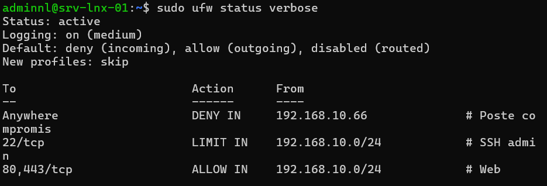
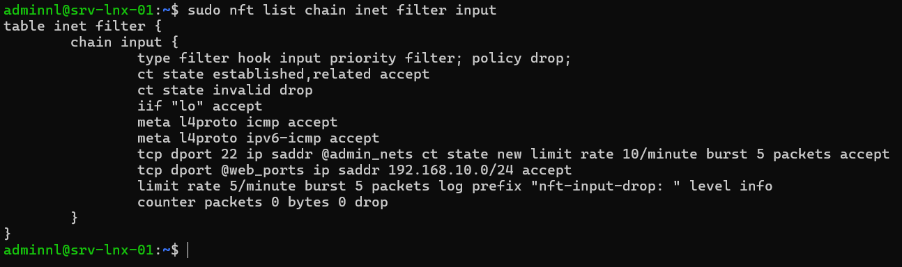

## Introduction

Cette procédure décrit la mise en place d'un pare-feu local sur un serveur Linux Debian 13 (trixie) ou Ubuntu 24.04 LTS, avec deux approches au choix : **UFW** (Uncomplicated Firewall), interface simplifiée, et **nftables**, le framework de filtrage natif du noyau Linux.

Le périmètre couvre la politique par défaut, les règles d'ouverture de ports, la limitation de débit sur SSH, la journalisation, l'écriture d'un fichier `/etc/nftables.conf` avec une table `inet`, des chaînes et des sets, et la vérification du jeu de règles chargé. Le filtrage en mode routeur (forward, NAT) n'est abordé qu'à titre d'exemple. L'exemple porte sur le serveur srv-lnx-01 (192.168.10.21) du réseau 192.168.10.0/24.

## Contexte et Justification

Un serveur Debian ou Ubuntu fraîchement installé n'applique aucun filtrage entrant : tout service qui écoute sur une interface réseau est joignable. Le pare-feu périmétrique (pfSense, OPNsense) ne protège pas des mouvements latéraux à l'intérieur du réseau 192.168.10.0/24.

Un pare-feu local répond à plusieurs besoins :

- **Réduction de la surface d'attaque :** seuls les ports réellement nécessaires sont exposés, et uniquement aux sources légitimes.
- **Défense en profondeur :** un poste compromis du réseau local ne peut pas joindre les services d'administration des serveurs.
- **Traçabilité :** les paquets rejetés sont journalisés et exploitables par un collecteur de journaux.
- **Conformité :** le guide d'hygiène de l'ANSSI et les CIS Benchmarks Debian et Ubuntu exigent un filtrage local actif avec une politique par défaut restrictive.

## Concepts Clés

**Netfilter :** Sous-système du noyau Linux qui intercepte les paquets. iptables et nftables sont deux interfaces d'écriture de règles pour Netfilter.

**nftables :** Successeur d'iptables, présent dans le noyau depuis la version 3.13. Il unifie IPv4, IPv6, ARP et bridge dans une seule syntaxe, gérée par la commande `nft`. C'est le framework par défaut de Debian depuis Debian 10 et des versions récentes d'Ubuntu.

**iptables-nft :** Variante de la commande `iptables` qui traduit la syntaxe iptables en règles nftables. C'est la variante active par défaut sur Debian 13 et Ubuntu 24.04 (`iptables -V` affiche `(nf_tables)`). Les anciens scripts iptables continuent donc de fonctionner, mais leurs règles apparaissent dans `nft list ruleset` sous forme de tables `ip filter` ou `ip6 filter`.

**UFW :** Outil en ligne de commande qui génère des règles à partir d'instructions simples (`ufw allow 22/tcp`). Il s'appuie sur les commandes iptables, donc sur iptables-nft. Il est installé mais inactif par défaut sur Ubuntu, et absent par défaut sur Debian.

**Table, chaîne, règle (nftables) :**

| Élément | Rôle | Exemple |
|---------|------|---------|
| Table | Conteneur de chaînes, liée à une famille (`ip`, `ip6`, `inet`, `arp`, `bridge`, `netdev`) | `table inet filter` |
| Chaîne de base | Accrochée à un hook Netfilter avec une priorité et une politique | `chain input { type filter hook input priority filter; policy drop; }` |
| Chaîne normale | Appelée depuis une autre chaîne par `jump` ou `goto` | `chain ssh_admin { ... }` |
| Règle | Critères suivis d'une action (`accept`, `drop`, `reject`, `counter`, `log`) | `tcp dport 22 accept` |
| Set | Ensemble nommé d'adresses, de ports ou d'interfaces, interrogé en une seule recherche | `set admin_hosts { type ipv4_addr; }` |

: Éléments de nftables

**Famille inet :** Une table `inet` traite IPv4 et IPv6 avec le même jeu de règles, ce qui évite de maintenir deux politiques en parallèle.

**Suivi de connexion (conntrack) :** La règle `ct state established,related accept` autorise les réponses aux connexions déjà acceptées. Elle se place en tête de chaîne pour limiter le coût de traitement.

## Prérequis

- Un serveur Debian 13 ou Ubuntu 24.04 LTS (ou Ubuntu 26.04 LTS) avec un compte membre de `sudo`.
- Un accès console (hyperviseur, IPMI, iLO) en plus de la session SSH, pour reprendre la main en cas d'erreur de règle.
- La liste des flux à autoriser : ici SSH depuis le réseau d'administration 192.168.10.0/24, HTTP et HTTPS depuis tout le réseau.
- Le paquet `ufw` pour la méthode UFW, ou le paquet `nftables` pour la méthode nftables (installé par défaut sur Debian 13).

## Points de Vigilance

**Ne mélangez pas UFW et nftables écrit à la main.** UFW génère ses propres tables via iptables-nft, et le service `nftables.service` exécute `flush ruleset` au chargement de `/etc/nftables.conf`, ce qui efface les règles d'UFW. Les deux outils peuvent aussi laisser deux politiques contradictoires coexister dans des tables différentes : un paquet doit alors être accepté par chaque table pour passer. Choisissez un seul outil par serveur et désactivez l'autre.

**Risque de coupure de la session SSH.** Activer une politique `deny` ou `drop` en entrée sans règle SSH préalable coupe la session en cours. Ajoutez toujours la règle SSH avant d'activer le pare-feu, et gardez un accès console.

**Docker contourne UFW.** Docker insère ses propres règles dans la chaîne `FORWARD` et dans la table NAT. Les ports publiés par un conteneur restent joignables même si UFW les refuse. Sur un hôte Docker, filtrez dans la chaîne `DOCKER-USER` ou n'exposez les ports que sur `127.0.0.1`.

**Journalisation UFW sans rsyslog.** Debian n'installe plus rsyslog par défaut depuis Debian 12 : le fichier `/var/log/ufw.log` n'existe alors pas, et les messages `[UFW BLOCK]` se lisent dans le journal noyau avec `journalctl -k`. Sur Ubuntu, rsyslog est présent et alimente `/var/log/ufw.log`.

**iptables-legacy est déprécié.** Ne réactivez pas `iptables-legacy` par `update-alternatives` : les deux back-ends ne partagent pas les mêmes règles et le diagnostic devient trompeur. Les nouvelles configurations doivent être écrites en nftables ou via UFW.

**IPv6.** UFW gère IPv6 si `IPV6=yes` dans `/etc/default/ufw` (valeur par défaut). Avec nftables, la famille `inet` couvre les deux protocoles. Laisser IPv6 sans filtrage alors qu'une adresse globale est configurée crée une porte dérobée.

## Choix Architecturaux & Alternatives

### Quand choisir UFW ou nftables

**UFW** convient à un serveur isolé avec quelques ports à ouvrir, administré par une équipe qui veut des commandes lisibles et une syntaxe stable. Il est adapté aux serveurs web, aux serveurs de fichiers et aux machines de lab.

**nftables** convient dès que la politique devient riche : listes d'adresses volumineuses (sets), plusieurs interfaces, routage ou NAT, règles différentes par zone, ou besoin d'un fichier unique versionné dans Git et déployé par Ansible. C'est aussi le choix naturel pour un serveur qui fait office de passerelle.

### Alternatives et comparatif

| Option | Cas d'usage typique | Force principale | Faiblesse principale | Coût relatif |
|--------|---------------------|------------------|----------------------|--------------|
| **UFW** | Serveur simple, quelques ports | Syntaxe très simple, profils d'applications | Peu adapté aux politiques complexes, contourné par Docker | Gratuit |
| **nftables natif** | Politique riche, passerelle, sets volumineux | Performance, syntaxe unifiée IPv4 et IPv6, fichier unique versionnable | Courbe d'apprentissage plus forte | Gratuit |
| **firewalld** | Parcs RHEL et dérivés, zones dynamiques | Notion de zones, D-Bus, intégration NetworkManager | Moins courant sur Debian et Ubuntu, couche supplémentaire | Gratuit |
| **iptables (legacy)** | Scripts historiques | Documentation abondante | Déprécié, IPv4 et IPv6 séparés | Gratuit, mais à abandonner |
| **Pare-feu périmétrique seul (pfSense, OPNsense)** | Filtrage entre zones réseau | Gestion centralisée | Aucune protection contre les mouvements latéraux dans un même VLAN | Faible à moyen |

### Impact des choix

- **Sécurité.** Les deux outils reposent sur Netfilter et offrent le même niveau de filtrage. nftables permet des politiques plus fines (sets dynamiques, filtrage par interface et par zone).
- **Exploitation.** UFW se pilote en une ligne par règle et réduit les erreurs de syntaxe. nftables se gère par fichier, ce qui facilite la revue de code et le déploiement par Ansible.
- **Performance.** Les sets nftables effectuent une recherche unique au lieu d'une règle par adresse, ce qui compte au-delà de quelques centaines d'entrées.
- **Disponibilité.** Une erreur de règle peut isoler le serveur. La validation du fichier avec `nft -c` et l'accès console limitent ce risque.
- **Coût.** Les deux solutions sont gratuites et incluses dans les distributions.

## Configuration

### Méthode A : UFW

#### Installer UFW

```bash
sudo apt update
sudo apt install ufw
```

<div class="callout callout-note">

Sur Ubuntu, UFW est déjà installé mais inactif. Vérifiez avec `sudo ufw status`.

</div>

#### Définir la politique par défaut

```bash
sudo ufw default deny incoming
sudo ufw default allow outgoing
sudo ufw default deny routed
```

#### Autoriser SSH avant l'activation

Autorisez SSH uniquement depuis le réseau d'administration, avec limitation de débit :

```bash
sudo ufw limit from 192.168.10.0/24 to any port 22 proto tcp comment 'SSH admin'
```

L'action `limit` refuse les connexions d'une adresse qui a tenté au moins 6 connexions au cours des 30 dernières secondes. Elle freine les attaques par force brute sans remplacer Fail2ban.

#### Ajouter les règles de service

```bash
# Web ouvert à tout le réseau local
sudo ufw allow from 192.168.10.0/24 to any port 80,443 proto tcp comment 'Web'

# Profils d'applications fournis par les paquets
sudo ufw app list
sudo ufw allow from 192.168.10.0/24 to any app 'OpenSSH'
```

<div class="callout callout-note">

Une liste de ports séparés par des virgules exige de préciser `proto tcp` ou `proto udp`.

</div>

#### Activer la journalisation et le pare-feu

```bash
sudo ufw logging medium
sudo ufw enable
sudo ufw status verbose
```

Les niveaux disponibles sont `off`, `low`, `medium`, `high` et `full`. `low` journalise les paquets bloqués par la politique par défaut, `medium` ajoute les paquets invalides et les nouvelles connexions autorisées. Au-delà, le volume devient important.

#### Gérer les règles

```bash
sudo ufw status numbered
sudo ufw delete 3
sudo ufw insert 1 deny from 192.168.10.66 comment 'Poste compromis'
sudo ufw reload
```

### Méthode B : nftables natif

#### Désactiver UFW s'il est présent

```bash
sudo ufw disable
sudo systemctl disable --now ufw
```

#### Installer et activer nftables

```bash
sudo apt install nftables
sudo systemctl enable nftables
```

#### Écrire /etc/nftables.conf

Sauvegardez le fichier fourni puis remplacez son contenu :

```bash
sudo cp /etc/nftables.conf /etc/nftables.conf.orig
sudo nano /etc/nftables.conf
```

```text
#!/usr/sbin/nft -f

flush ruleset

table inet filter {

    set admin_nets {
        type ipv4_addr
        flags interval
        elements = { 192.168.10.0/24 }
    }

    set web_ports {
        type inet_service
        elements = { 80, 443 }
    }

    chain input {
        type filter hook input priority filter; policy drop;

        ct state established,related accept
        ct state invalid drop
        iif "lo" accept

        # ICMP et ICMPv6 indispensables (ping, découverte de voisins IPv6)
        meta l4proto icmp accept
        meta l4proto ipv6-icmp accept

        # SSH depuis le réseau d'administration, avec limitation de débit
        tcp dport 22 ip saddr @admin_nets ct state new limit rate 10/minute accept

        # Services web
        tcp dport @web_ports ip saddr 192.168.10.0/24 accept

        # Journalisation des refus avec limite
        limit rate 5/minute log prefix "nft-input-drop: " level info
        counter drop
    }

    chain forward {
        type filter hook forward priority filter; policy drop;
    }

    chain output {
        type filter hook output priority filter; policy accept;
    }
}
```

<div class="callout callout-note">

Le mot-clé `priority filter` équivaut à la priorité numérique 0. Le fichier commence par `flush ruleset`, qui supprime toutes les règles existantes, y compris celles créées par UFW, Docker ou un script iptables.

</div>

#### Valider puis charger le fichier

```bash
sudo nft -c -f /etc/nftables.conf
sudo systemctl restart nftables
sudo nft list ruleset
```

`nft -c` vérifie la syntaxe sans rien appliquer.

#### Modifier un set à chaud

```bash
sudo nft add element inet filter admin_nets { 10.0.50.0/24 }
sudo nft list set inet filter admin_nets
```

Une modification à chaud est perdue au redémarrage. Reportez-la dans `/etc/nftables.conf` pour la rendre persistante.

#### Filet de sécurité lors des tests à distance

Avant de recharger une politique sur un serveur distant, programmez un retour arrière automatique :

```bash
sudo systemd-run --on-active=5m /usr/sbin/nft flush ruleset
sudo systemctl restart nftables
# Si la session SSH répond toujours, annulez le minuteur
systemctl list-timers --all | grep run-
sudo systemctl stop run-XXXX.timer
```

## Vérifications

**État d'UFW :** `sudo ufw status verbose` affiche `Status: active`, les politiques par défaut et la liste des règles avec leurs sources.



<p class="figure-caption"><b>Figure 1</b> · Résultat de la commande</p>

**Jeu de règles chargé :** `sudo nft list ruleset` affiche la table `inet filter` avec les chaînes `input`, `forward` et `output`. Avec UFW, la même commande montre les tables générées par iptables-nft.

**Back-end iptables :** `iptables -V` affiche `(nf_tables)`.

**Ports en écoute :** `sudo ss -tulpn` liste les services en écoute. Comparez avec les règles pour identifier les services exposés par erreur.

**Test depuis un autre hôte :** depuis srv-lnx-02, `nc -zv 192.168.10.21 22` réussit et `nc -zv 192.168.10.21 3306` échoue par expiration.

**Journalisation :** `sudo journalctl -k | grep -E 'UFW BLOCK|nft-input-drop'` affiche les paquets rejetés. Sur Ubuntu avec UFW, `sudo tail /var/log/ufw.log`.

**Compteurs :** `sudo nft list chain inet filter input` affiche les compteurs de la règle `counter drop`.



<p class="figure-caption"><b>Figure 2</b> · Résultat de la commande</p>

## Dépannage

**« La session SSH s'est figée après ufw enable ou après le rechargement de nftables » :** la règle SSH manque ou la source autorisée ne correspond pas à l'adresse du poste d'administration. Connectez-vous par la console, puis `sudo ufw disable` ou `sudo nft flush ruleset`, corrigez la règle et réactivez.

**« Error: Could not process rule » ou erreur de syntaxe au chargement :** lancez `sudo nft -c -f /etc/nftables.conf`, qui indique la ligne fautive. Les erreurs fréquentes sont une accolade manquante, un point-virgule absent après `policy drop` ou un type de set incompatible avec l'élément ajouté.

**« Les règles UFW ont disparu après un redémarrage » :** le service `nftables.service` est activé en parallèle et son `flush ruleset` efface les règles d'UFW. Désactivez l'un des deux services.

**« Un port refusé par UFW reste accessible » :** un conteneur Docker publie ce port. Vérifiez avec `sudo nft list ruleset | grep -i docker` et filtrez dans la chaîne `DOCKER-USER`.

**« /var/log/ufw.log est vide ou absent » :** rsyslog n'est pas installé (cas par défaut sur Debian 13) ou la journalisation est sur `off`. Utilisez `journalctl -k` ou installez rsyslog.

**« Les règles iptables d'un ancien script ne s'affichent pas » :** le script utilise `iptables-legacy`. Vérifiez avec `sudo iptables-legacy -S` et migrez ces règles vers nftables avec `iptables-restore-translate`.

## Conseils et Bonnes Pratiques

**Un seul outil par serveur.** Documentez dans la fiche du serveur s'il est piloté par UFW ou par nftables, et désactivez l'autre service.

**Restreindre SSH au réseau d'administration.** Une règle `allow 22/tcp` ouverte à tous est rarement justifiée. Combinez la restriction de source, la limitation de débit et Fail2ban.

**Versionner /etc/nftables.conf.** Stockez le fichier dans Git et déployez-le avec Ansible (module `template` puis `nft -c` en validation). Chaque modification est alors relue et traçable.

**Utiliser les sets pour les listes d'adresses.** Un set nommé se met à jour sans réécrire les règles et reste performant avec des milliers d'entrées.

**Journaliser avec une limite.** Une règle `log` sans `limit` peut saturer le journal lors d'un scan. Gardez `limit rate` sur toutes les règles de journalisation.

**Auditer régulièrement.** Comparez `ss -tulpn` et la politique chaque trimestre, et supprimez les ouvertures devenues inutiles.

**Centraliser les refus.** Transférez les messages du noyau vers le collecteur rsyslog pour corréler les tentatives entre serveurs.

## Procédures Liées

- Sécurisation d'OpenSSH (Clés, Durcissement, Fail2ban) *(Protection du service SSH en complément du filtrage)*
- [Centralisation des Journaux avec rsyslog](/procedures/linux/centralisation-des-journaux-avec-rsyslog) *(Collecte des paquets rejetés)*
- Gestion des Services avec systemd et journald *(Pilotage des services ufw et nftables, lecture du journal noyau)*
- [Installation de Docker et Portainer sur Ubuntu](/procedures/linux/installation-de-docker-et-portainer-sur-ubuntu) *(Interaction entre Docker et le pare-feu local)*
- [Configuration d'un Serveur Passerelle Internet](/procedures/windows/configuration-dun-serveur-passerelle-internet) *(Usage de nftables pour le NAT et le forward)*
