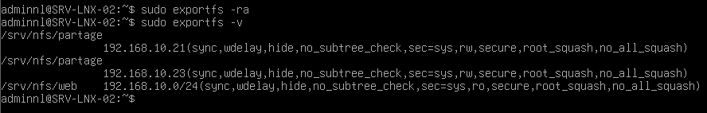
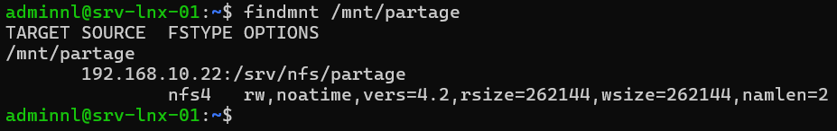

## Introduction

Cette procédure décrit le déploiement d'un serveur de fichiers **NFS** sur srv-lnx-02 (192.168.10.22) sous Debian 13 (trixie) ou Ubuntu 24.04 LTS, et le montage de ses partages sur des clients Linux du réseau 192.168.10.0/24.

Le périmètre couvre l'installation de `nfs-kernel-server`, la déclaration des partages dans `/etc/exports` et leurs options, l'application avec `exportfs`, la restriction à NFSv4, le montage côté client manuel et persistant dans `/etc/fstab`, et l'ouverture du pare-feu. La sécurisation par Kerberos (`sec=krb5`) est présentée à titre de mention. Le partage vers des postes Windows, qui relève de Samba, sort du périmètre.

## Contexte et Justification

Plusieurs serveurs Linux ont souvent besoin d'accéder aux mêmes données : dossiers web partagés entre serveurs d'un cluster, dépôt de fichiers d'une application, répertoires de sauvegarde ou de déploiement. Copier ces données sur chaque serveur pose plusieurs problèmes :

- **Incohérence :** les copies divergent dès qu'un serveur modifie un fichier.
- **Espace gaspillé :** chaque serveur stocke la totalité des données.
- **Exploitation alourdie :** les sauvegardes et les droits sont à gérer à plusieurs endroits.

NFS (Network File System) expose une arborescence d'un serveur Linux que les clients montent comme un système de fichiers local. Il est intégré au noyau, performant et natif sur tous les systèmes Unix et Linux, ce qui en fait le standard du partage de fichiers entre serveurs Linux.

## Concepts Clés

**Export :** Dossier du serveur rendu accessible aux clients, déclaré dans `/etc/exports` ou dans un fichier `/etc/exports.d/*.exports`.

**Versions de NFS :**

| Version | Transport | Ports | Particularités |
|---------|-----------|-------|----------------|
| NFSv3 | TCP ou UDP | 2049 plus rpcbind (111) et ports dynamiques (mountd, statd, lockd) | Sans état côté serveur, verrouillage par protocole annexe |
| NFSv4.x | TCP | 2049 uniquement | Avec état, verrouillage intégré, identités par nom (idmapd), support de Kerberos natif |

: Versions de NFS

NFSv4.2 est la version négociée par défaut entre un client et un serveur Debian 13 ou Ubuntu 24.04 récents.

**Options d'export principales :**

| Option | Effet |
|--------|-------|
| `rw` ou `ro` | Lecture et écriture, ou lecture seule |
| `sync` | Le serveur confirme une écriture après son enregistrement sur disque (par défaut, recommandé) |
| `async` | Le serveur confirme avant l'écriture sur disque : plus rapide, mais risque de perte de données en cas de panne |
| `root_squash` | Le root du client est traité comme l'utilisateur anonyme `nobody` (par défaut) |
| `no_root_squash` | Le root du client garde les droits root sur le partage, à éviter |
| `all_squash` | Tous les utilisateurs du client sont traités comme l'utilisateur anonyme |
| `anonuid`, `anongid` | UID et GID utilisés pour l'utilisateur anonyme |
| `subtree_check` ou `no_subtree_check` | Active ou désactive la vérification de l'arborescence parente (`no_subtree_check` par défaut) |
| `sec=sys`, `sec=krb5`, `krb5i`, `krb5p` | Mode de sécurité : identifiants Unix, ou Kerberos avec authentification, intégrité, puis chiffrement |

: Options d'export

**Sécurité AUTH_SYS :** En mode par défaut `sec=sys`, le serveur fait confiance à l'UID et au GID annoncés par le client. Toute machine autorisée dans `/etc/exports` peut donc se présenter avec n'importe quel UID. La sécurité repose sur la liste des clients autorisés et le pare-feu.

**/etc/nfs.conf :** Fichier de configuration des services NFS au format INI, complété par `/etc/nfs.conf.d/*.conf`. Il remplace les anciens fichiers `/etc/default/nfs-*` depuis Ubuntu 22.04 et sur Debian récent.

## Prérequis

- Un serveur srv-lnx-02 (192.168.10.22) sous Debian 13 ou Ubuntu 24.04 LTS, avec un compte membre de `sudo`.
- Un volume dédié pour les données partagées, monté sur `/srv/nfs` (voir « Gestion des Disques avec LVM et Montage par fstab »).
- Des clients srv-lnx-01 (192.168.10.21) et srv-lnx-03 (192.168.10.23) sous Debian 13 ou Ubuntu 24.04 LTS.
- Une résolution DNS directe et inverse cohérente pour les serveurs (`srv-lnx-02.lab.local`).
- Des UID et GID cohérents entre serveur et clients pour les utilisateurs qui écrivent sur le partage (comptes AD via SSSD ou comptes locaux identiques).
- Une heure synchronisée sur toutes les machines (chrony).

## Points de Vigilance

**no_root_squash ouvre le serveur.** Avec `no_root_squash`, un administrateur ou un attaquant root sur un client peut créer des fichiers appartenant à root, y compris des binaires `setuid`. Réservez cette option à des cas maîtrisés (sauvegarde d'un hyperviseur, par exemple) et à un seul client.

**async risque la perte de données.** En cas de coupure du serveur, des écritures confirmées au client peuvent être perdues sans erreur. Conservez `sync` pour les données de production.

**Clients trop larges.** Un export vers `*` ou vers un réseau entier expose le partage à toute machine qui obtient une adresse dans ce réseau. Déclarez les clients par adresse ou par nom, et doublez la restriction au pare-feu.

**Identités en NFSv4.** Avec `sec=sys`, les droits reposent sur les UID et GID numériques. Si `nlallier` a l'UID 1001 sur le client et 1002 sur le serveur, il n'accède pas à ses fichiers. Alignez les identités, idéalement par AD et SSSD. Le domaine idmapd (`Domain` dans `/etc/idmapd.conf`) doit être identique sur le serveur et les clients, sinon les fichiers apparaissent comme appartenant à `nobody`.

**Montage bloquant au démarrage.** Un montage NFS dans `/etc/fstab` sans `_netdev` ou `nofail` peut bloquer le démarrage d'un client si le serveur est indisponible. Utilisez `_netdev` et, pour les montages non critiques, `nofail` ou `x-systemd.automount`.

**showmount ne fonctionne pas en NFSv4 seul.** La commande `showmount -e` interroge le service mountd de NFSv3. Si NFSv3 est désactivé, elle échoue alors que le partage fonctionne.

## Choix Architecturaux & Alternatives

### Quand choisir NFS

NFS est le bon choix pour partager des fichiers entre serveurs Linux d'un même réseau : contenus web partagés, données applicatives, dépôts de sauvegarde, stockage de VM pour un hyperviseur Linux. Il offre de bonnes performances avec peu de surcoût et s'intègre nativement au noyau.

Pour des postes Windows ou des droits par utilisateur gérés par ACL NTFS, Samba (SMB) est préférable. Pour un stockage partagé en écriture concurrente à l'échelle d'un cluster, un système de fichiers distribué (CephFS, GlusterFS) est plus adapté.

### Alternatives et comparatif

| Option | Cas d'usage typique | Force principale | Faiblesse principale | Coût relatif |
|--------|---------------------|------------------|----------------------|--------------|
| **NFSv4 (sec=sys)** | Partage entre serveurs Linux d'un réseau maîtrisé | Simple, performant, natif | Confiance dans l'UID annoncé par le client | Gratuit |
| **NFSv4 avec Kerberos (krb5p)** | Partage sensible, réseau non maîtrisé | Authentification forte et chiffrement | Keytabs et principaux à gérer, coût CPU | Gratuit |
| **Samba (SMB)** | Postes Windows, environnements mixtes | Intégration AD et ACL Windows | Moins naturel pour des serveurs Linux entre eux | Gratuit |
| **CephFS ou GlusterFS** | Stockage distribué et redondant | Haute disponibilité, extensibilité | Complexité et nombre de nœuds | Moyen à élevé |
| **NAS du commerce (Synology, NetApp)** | Stockage centralisé avec support | Interface de gestion, snapshots, réplication | Coût du matériel et des licences | Moyen à élevé |

### Impact des choix

- **Sécurité.** NFSv4 sans Kerberos repose sur la liste des clients et le pare-feu. Kerberos ajoute l'authentification des utilisateurs et, avec `krb5p`, le chiffrement du trafic.
- **Disponibilité.** Un serveur NFS unique est un point de défaillance unique. Les clients en montage `hard` attendent son retour sans corrompre les données, mais les applications sont bloquées pendant la panne.
- **Performance.** NFSv4 sur TCP avec `sync` offre un bon compromis. `async` améliore les écritures au prix de la sécurité des données.
- **Exploitation.** NFSv4 seul n'utilise que le port 2049, ce qui simplifie le pare-feu par rapport à NFSv3.
- **Coût.** Gratuit. Le coût porte sur le stockage et sa sauvegarde.

## Configuration

### Installer le serveur NFS

Sur srv-lnx-02 :

```bash
sudo apt update
sudo apt install nfs-kernel-server
sudo systemctl enable --now nfs-server
```

### Préparer les dossiers partagés

```bash
sudo mkdir -p /srv/nfs/partage /srv/nfs/web
sudo chown root:root /srv/nfs/partage
sudo chmod 2775 /srv/nfs/partage
```

Attribuez le dossier à un groupe applicatif si nécessaire, par exemple `sudo chgrp www-data /srv/nfs/web`.

### Déclarer les exports

```bash
sudo nano /etc/exports
```

```text
# Partage en lecture et écriture pour srv-lnx-01 et srv-lnx-03
/srv/nfs/partage  192.168.10.21(rw,sync,no_subtree_check,root_squash) 192.168.10.23(rw,sync,no_subtree_check,root_squash)

# Contenu web en lecture seule pour le réseau des serveurs
/srv/nfs/web      192.168.10.0/24(ro,sync,no_subtree_check,root_squash)
```

<div class="callout callout-note">

Aucun espace ne doit séparer le client de sa parenthèse. `192.168.10.21 (rw)` exporte en réalité le partage en lecture seule à `192.168.10.21` et en lecture et écriture à tout le monde.

</div>

### Appliquer les exports

```bash
sudo exportfs -ra
sudo exportfs -v
```

`exportfs -ra` relit `/etc/exports` et synchronise la table des exports, `exportfs -v` affiche les exports actifs avec toutes leurs options, y compris les valeurs par défaut.

### Restreindre le serveur à NFSv4

Créez un fichier de configuration complémentaire :

```bash
sudo nano /etc/nfs.conf.d/nfsv4-seul.conf
```

```ini
[nfsd]
vers3=n
```

Redémarrez le service et vérifiez les versions actives :

```bash
sudo systemctl restart nfs-server
sudo cat /proc/fs/nfsd/versions
```

La sortie affiche `-3` pour NFSv3 désactivé et `+4`, `+4.1`, `+4.2` pour les versions actives.

<div class="callout callout-note">

Le service `rpcbind` reste installé comme dépendance. Il n'est pas nécessaire en NFSv4 seul, mais sa désactivation dépend de la version des paquets : vérifiez le comportement sur votre distribution avant de masquer `rpcbind.service` et `rpcbind.socket`.

</div>

### Ouvrir le pare-feu du serveur

```bash
sudo ufw allow from 192.168.10.21 to any port 2049 proto tcp comment 'NFS srv-lnx-01'
sudo ufw allow from 192.168.10.23 to any port 2049 proto tcp comment 'NFS srv-lnx-03'
```

Pour le partage web en lecture seule, ouvrez le port 2049 au réseau des serveurs concernés.

### Configurer un client

Sur srv-lnx-01 :

```bash
sudo apt update
sudo apt install nfs-common
sudo mkdir -p /mnt/partage
sudo mount -t nfs4 srv-lnx-02.lab.local:/srv/nfs/partage /mnt/partage
```

En NFSv4, le chemin exporté est utilisé tel quel. L'option d'export `fsid=0`, qui définit une racine de pseudo-système de fichiers, n'est pas nécessaire avec les serveurs Linux récents.

### Rendre le montage persistant

```bash
sudo nano /etc/fstab
```

```text
srv-lnx-02.lab.local:/srv/nfs/partage  /mnt/partage  nfs4  defaults,_netdev,hard,noatime  0  0
```

- `_netdev` indique que le montage nécessite le réseau, et le place après son activation.
- `hard` fait attendre les accès pendant une indisponibilité du serveur au lieu de renvoyer une erreur (comportement par défaut, recommandé pour l'intégrité).
- Ajoutez `nofail` pour qu'un serveur indisponible n'empêche pas le démarrage du client, ou `x-systemd.automount` pour monter le partage à la première utilisation.

Appliquez et testez :

```bash
sudo systemctl daemon-reload
sudo umount /mnt/partage
sudo mount -a
findmnt /mnt/partage
```

### Sécuriser avec Kerberos (mention)

Dans le domaine `lab.local`, un serveur et des clients joints à AD par realmd et SSSD disposent déjà d'une keytab. Pour exiger Kerberos :

- créez sur le serveur un principal de service `nfs/srv-lnx-02.lab.local` dans sa keytab avec `adcli update` (option `--service-name=nfs` ou `--add-service-principal`, selon la version, voir `man adcli`) ;
- exportez avec `sec=krb5p` (authentification, intégrité et chiffrement), `krb5i` ou `krb5` ;
- montez côté client avec l'option `sec=krb5p`.

Les utilisateurs doivent alors détenir un ticket Kerberos valide (obtenu à la connexion par SSSD ou avec `kinit`) pour accéder au partage. Validez cette configuration dans un lab avant la production.

## Vérifications

**Exports actifs :** sur srv-lnx-02, `sudo exportfs -v` affiche les deux partages avec leurs options effectives (`sync`, `root_squash`, `no_subtree_check`, `sec=sys`).



<p class="figure-caption"><b>Figure 1</b> · Résultat de la commande</p>

**Service :** `systemctl status nfs-server` indique `active (exited)`, ce qui est normal : le serveur NFS fonctionne dans le noyau.

**Écoute :** `sudo ss -tlnp | grep 2049` montre le port 2049 en écoute.

**Montage côté client :** `findmnt /mnt/partage` affiche le type `nfs4` et les options négociées. `nfsstat -m` affiche la version (`vers=4.2`) et le mode de sécurité.



<p class="figure-caption"><b>Figure 2</b> · Résultat de la commande côté client</p>

**Lecture et écriture :** `touch /mnt/partage/test-$(hostname)` réussit pour un utilisateur autorisé, et le fichier apparaît sur le serveur avec le bon propriétaire.

**root_squash :** `sudo touch /mnt/partage/test-root` crée un fichier appartenant à `nobody:nogroup` sur le serveur, ou échoue si le dossier n'est pas accessible à cet utilisateur.

**Persistance :** après un redémarrage du client, le partage est monté automatiquement.

## Dépannage

**« mount.nfs4: access denied by server while mounting » :** l'adresse du client n'est pas autorisée dans `/etc/exports`, ou les exports n'ont pas été rechargés. Vérifiez avec `sudo exportfs -v` et relancez `sudo exportfs -ra`.

**« mount.nfs4: Connection timed out » ou « No route to host » :** le port 2049 est filtré. Vérifiez le pare-feu du serveur avec `sudo ufw status` et testez avec `nc -zv srv-lnx-02.lab.local 2049`.

**« Les fichiers appartiennent à nobody:nogroup sur le client » :** le domaine idmapd diffère entre client et serveur, ou l'utilisateur n'existe pas des deux côtés. Alignez la directive `Domain` dans `/etc/idmapd.conf` et vérifiez les identités avec `id`.

**« Permission denied en écriture alors que le partage est en rw » :** les droits Unix du dossier ne permettent pas l'écriture à l'UID du client, ou root est écrasé par `root_squash`. Vérifiez les permissions sur le serveur avec `ls -ln`.

**« Le client reste bloqué au démarrage » :** le montage NFS n'a pas l'option `_netdev` ou le serveur est injoignable. Ajoutez `_netdev,nofail` ou passez à `x-systemd.automount`.

**« Les processus restent bloqués sur le partage » :** le serveur est injoignable et le montage est en `hard`. Rétablissez le serveur. En dernier recours, `sudo umount -f -l /mnt/partage` détache le montage.

**« showmount -e renvoie une erreur RPC » :** NFSv3 et mountd sont désactivés. C'est attendu en NFSv4 seul : utilisez `exportfs -v` sur le serveur.

## Conseils et Bonnes Pratiques

**NFSv4 seul.** Désactivez NFSv3 lorsque tous les clients le permettent : un seul port à ouvrir et moins de services exposés.

**Clients nommés et root_squash.** Déclarez chaque client par adresse ou par nom, gardez `root_squash` et `sync`, et limitez `no_root_squash` aux cas documentés.

**Identités centralisées.** Joignez serveur et clients au domaine AD avec SSSD pour obtenir des UID et GID identiques partout.

**Fichiers d'exports par application.** Utilisez `/etc/exports.d/<application>.exports` pour séparer les partages et faciliter le déploiement par Ansible.

**Sauvegarder le serveur NFS.** Les données partagées doivent être sauvegardées sur le serveur NFS lui-même, et non par chaque client.

**Kerberos pour les données sensibles.** Passez en `sec=krb5p` dès que le partage contient des données sensibles ou traverse un réseau non maîtrisé.

## Procédures Liées

- [Gestion des Disques avec LVM et Montage par fstab](/procedures/linux/gestion-des-disques-avec-lvm-et-montage-par-fstab) *(Volume dédié et montage persistant)*
- [Configuration du Pare-feu avec UFW et nftables](/procedures/linux/configuration-du-pare-feu-avec-ufw-et-nftables) *(Ouverture du port 2049)*
- [Intégration d'un Serveur Linux à Active Directory (realmd et SSSD)](/procedures/linux/integration-dun-serveur-linux-a-active-directory-realmd-et-sssd) *(Identités cohérentes et Kerberos)*
- [Gestion des Permissions, ACL et Droits Spéciaux](/procedures/linux/gestion-des-permissions-acl-et-droits-speciaux) *(Droits Unix sur les dossiers exportés)*
- [Installation d'un Serveur de Fichiers Samba](/procedures/linux/installation-dun-serveur-de-fichiers-samba) *(Alternative pour les postes Windows)*
- [Sauvegarde de Serveurs Linux avec rsync et BorgBackup](/procedures/linux/sauvegarde-de-serveurs-linux-avec-rsync-et-borgbackup) *(Sauvegarde des données partagées)*
