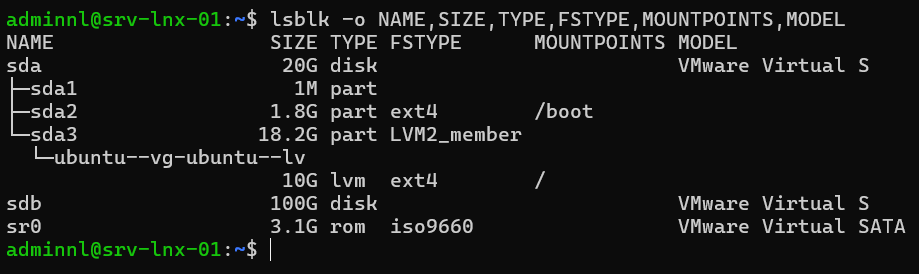
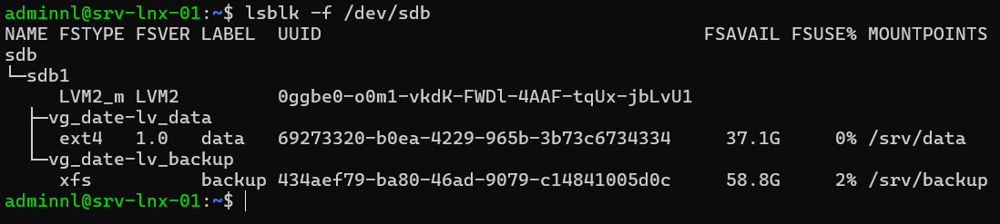
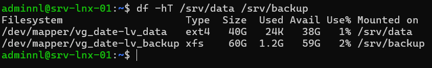

## Introduction

Cette procédure décrit l'ajout et la gestion d'un espace de stockage avec LVM sur un serveur Linux Debian 13 ou Ubuntu Server 24.04 LTS : partitionnement avec `parted`, création des volumes physiques, du groupe de volumes et des volumes logiques, formatage en ext4 ou XFS, montage persistant par UUID dans `/etc/fstab`, puis extension à chaud.

L'exemple porte sur srv-lnx-01 (192.168.10.21), une machine virtuelle à laquelle on ajoute un disque de données `/dev/sdb` de 100 Go pour y héberger `/srv/data` (ext4) et `/srv/backup` (XFS). Le disque système et le volume racine sortent du périmètre.

## Contexte et Justification

Un disque partitionné de façon fixe impose de prévoir la taille de chaque système de fichiers dès l'installation. Quand une partition se remplit, l'agrandir suppose souvent un arrêt, un déplacement de partitions voisines ou une restauration.

LVM ajoute une couche d'abstraction entre les disques et les systèmes de fichiers :

- **Souplesse :** un volume logique s'agrandit à chaud en quelques secondes, en prenant de l'espace libre dans le groupe ou sur un nouveau disque.
- **Agrégation :** plusieurs disques forment un seul groupe de volumes.
- **Services :** instantanés pour les sauvegardes cohérentes, migration de données à chaud entre disques avec `pvmove`.

Le montage par `/etc/fstab` avec l'UUID rend ces volumes persistants au redémarrage et insensibles au renommage des périphériques.

## Concepts Clés

**Volume physique (PV).** Disque ou partition initialisé pour LVM avec `pvcreate`. LVM y écrit ses métadonnées.

**Groupe de volumes (VG).** Réserve d'espace formée d'un ou plusieurs PV. L'espace est découpé en unités appelées extents physiques (PE), de 4 Mio par défaut.

**Volume logique (LV).** Portion d'un VG présentée comme un périphérique bloc, accessible par `/dev/<vg>/<lv>` ou `/dev/mapper/<vg>-<lv>`. C'est lui qui reçoit le système de fichiers.

**ext4 et XFS.** ext4 est le système de fichiers par défaut de Debian et Ubuntu ; il s'agrandit à chaud et se réduit hors ligne. XFS est performant sur les gros volumes et les écritures parallèles ; il s'agrandit à chaud mais ne se réduit jamais.

**UUID.** Identifiant unique écrit dans le système de fichiers au formatage. Contrairement à `/dev/sdb1`, il ne change pas si l'ordre de détection des disques change.

**/etc/fstab.** Table des montages lue au démarrage. systemd la convertit en unités `.mount`. Chaque ligne comporte six champs : périphérique, point de montage, type, options, dump et ordre de vérification (`fsck`).

**nofail.** Option de montage qui évite qu'un échec de montage bloque le démarrage. Le système démarre sans ce volume au lieu de passer en mode d'urgence.

## Prérequis

- Un serveur Debian 13 ou Ubuntu Server 24.04 LTS, ici srv-lnx-01.
- Un compte membre du groupe `sudo`.
- Le paquet `lvm2`, installé par défaut sur Ubuntu Server et sur Debian quand LVM a été choisi à l'installation. Sinon, `sudo apt install lvm2`.
- Le paquet `xfsprogs` pour XFS (`sudo apt install xfsprogs`). `parted` est présent par défaut ou s'installe avec `sudo apt install parted`.
- Un disque vierge ajouté au serveur, ici `/dev/sdb` de 100 Go, et une sauvegarde à jour avant toute opération sur un disque contenant des données.
- Une console d'accès hors bande (console d'hyperviseur, iDRAC, iLO) en cas d'échec de démarrage lié à fstab.

## Points de Vigilance

**Vérifiez deux fois le disque cible.** `parted`, `pvcreate` et `mkfs` détruisent les données sans confirmation dans leurs formes non interactives. Identifiez le disque par sa taille, son modèle et son absence de partitions avec `lsblk` avant toute commande.

**Une erreur dans fstab peut bloquer le démarrage.** Un UUID erroné ou un type incorrect sans `nofail` fait passer le serveur en mode d'urgence. Testez systématiquement avec `findmnt --verify` et `mount -a` avant de redémarrer.

**XFS ne se réduit pas.** Un volume XFS trop grand ne peut être réduit qu'en sauvegardant, recréant et restaurant les données. Sur un volume dont la taille peut baisser, choisissez ext4.

**La réduction d'ext4 se fait hors ligne.** Un volume ext4 se réduit démonté, après `e2fsck -f`. Une réduction du LV avant celle du système de fichiers détruit les données. `lvreduce -r` enchaîne les deux étapes dans le bon ordre.

**systemd lit fstab au démarrage.** Après une modification de `/etc/fstab`, exécutez `systemctl daemon-reload` pour que systemd régénère ses unités de montage ; sinon `mount -a` affiche un avertissement et le comportement peut différer.

**Les noms des périphériques disque ne sont pas stables.** `/dev/sdb` peut devenir `/dev/sdc` après l'ajout d'un disque. Ne référencez jamais `/dev/sdX` dans fstab.

**Debian 13 monte /tmp en mémoire.** `/tmp` est un tmpfs limité par défaut à 50 % de la RAM. N'y placez pas de fichiers volumineux temporaires lors de migrations de données.

## Choix Architecturaux & Alternatives

### Quand choisir LVM

LVM convient à la quasi totalité des serveurs physiques et virtuels dont l'espace évolue : serveurs de fichiers, bases de données, journaux, sauvegardes. Il apporte l'extension à chaud et les instantanés pour un coût de complexité faible. Ubuntu Server propose LVM par défaut dans son installateur.

Sur une machine virtuelle à disque unique dont on agrandit le disque virtuel, une partition simple suffit parfois, mais LVM reste pratique pour séparer les usages. Pour de la redondance, LVM se combine avec un RAID logiciel `mdadm` placé dessous, ou avec le RAID matériel.

### Alternatives et comparatif

| Option | Cas d'usage typique | Force principale | Faiblesse principale | Coût relatif |
|--------|---------------------|------------------|----------------------|--------------|
| **LVM avec ext4 ou XFS** | Serveurs généralistes, VM, données évolutives | Extension à chaud, instantanés, outillage mature | Une couche de plus à comprendre, pas de redondance native simple | Gratuit |
| **Partitions simples** | VM à disque unique, appliances | Simplicité maximale | Redimensionnement délicat, pas d'agrégation | Gratuit |
| **mdadm puis LVM** | Serveur physique sans contrôleur RAID | Redondance logicielle et souplesse de LVM | Deux couches à superviser | Gratuit |
| **ZFS** | Stockage de données critiques, NAS | Intégrité par sommes de contrôle, instantanés, compression | Consommation mémoire, module hors noyau sur Debian | Faible |
| **Btrfs** | Instantanés fréquents, sous-volumes | Instantanés et sous-volumes natifs | RAID 5 et 6 déconseillés, comportement à maîtriser | Gratuit |

### Impact des choix

- **Disponibilité.** LVM évite les arrêts pour agrandir un volume. L'option `nofail` dans fstab protège le démarrage contre un disque de données absent.
- **Performance.** XFS est préférable pour les gros fichiers et les accès parallèles, ext4 pour les usages généraux et les nombreux petits fichiers. LVM linéaire n'ajoute pas de surcoût mesurable.
- **Sécurité.** Des volumes séparés permettent des options de montage restrictives (`nosuid`, `nodev`, `noexec`) et évitent qu'un volume de données plein bloque le système.
- **Exploitation.** Garder de l'espace libre dans le VG facilite les instantanés et les extensions d'urgence.
- **Coût.** Aucun coût logiciel. Les instantanés LVM classiques dégradent les performances en écriture tant qu'ils existent ; ne les conservez pas.

## Configuration

### Identifier le nouveau disque

```bash
lsblk -o NAME,SIZE,TYPE,FSTYPE,MOUNTPOINTS,MODEL
sudo parted -l
```



<p class="figure-caption"><b>Figure 1</b> · Résultat de la commande.</p>

Le disque cible ne doit comporter ni partition ni système de fichiers. Ici, `/dev/sdb` de 100 Go.

### Partitionner avec parted

Créez une table GPT et une partition unique marquée pour LVM :

```bash
sudo parted -s /dev/sdb mklabel gpt
sudo parted -s -a optimal /dev/sdb mkpart lvm-data 1MiB 100%
sudo parted -s /dev/sdb set 1 lvm on
sudo parted /dev/sdb print
```

<div class="callout callout-note">

LVM peut aussi utiliser le disque entier sans partition (`pvcreate /dev/sdb`). La partition rend l'usage du disque visible par tout outil et évite qu'un administrateur le croie vide.

</div>

### Créer le PV, le VG et les LV

```bash
sudo pvcreate /dev/sdb1
sudo vgcreate vg_data /dev/sdb1
sudo lvcreate -n lv_data -L 40G vg_data
sudo lvcreate -n lv_backup -L 40G vg_data
```

Les 20 Go restants sont laissés libres dans `vg_data` pour les extensions et les instantanés.

### Formater en ext4 et en XFS

```bash
sudo mkfs.ext4 -L data /dev/vg_data/lv_data
sudo mkfs.xfs -L backup /dev/vg_data/lv_backup
```

### Monter de façon persistante par UUID

Créez les points de montage et relevez les UUID :

```bash
sudo mkdir -p /srv/data /srv/backup
sudo blkid /dev/vg_data/lv_data /dev/vg_data/lv_backup
```

Sauvegardez fstab, puis ajoutez les lignes en remplaçant les UUID par ceux affichés :

```bash
sudo cp /etc/fstab /etc/fstab.$(date +%F).bak
sudo nano /etc/fstab
```

```text
# Volumes de données srv-lnx-01
UUID=3f1c2a9e-7b44-4c1e-9a52-0d8e6f1b2c3d  /srv/data    ext4  defaults,nofail,nodev,nosuid  0  2
UUID=8a7d5e21-1f0b-4b6c-8e3a-5c9d2e4f7a10  /srv/backup  xfs   defaults,nofail,nodev,nosuid  0  0
```

<div class="callout callout-note">

Le sixième champ vaut `2` pour un système ext4 qui n'est pas la racine, afin qu'il soit vérifié après elle. Il vaut `0` pour XFS, dont la vérification au démarrage n'est pas effectuée par `fsck` (l'outil `fsck.xfs` ne fait rien). Les chemins `/dev/vg_data/lv_data` sont également stables avec LVM, mais l'UUID reste la convention la plus sûre.

</div>

### Tester fstab avant de redémarrer

```bash
sudo systemctl daemon-reload
sudo findmnt --verify --verbose
sudo mount -a
findmnt /srv/data
findmnt /srv/backup
```

`findmnt --verify` contrôle la syntaxe, l'existence des sources et des points de montage, et la cohérence des types. `mount -a` monte tout ce qui ne l'est pas encore. Aucune erreur ne doit apparaître avant un redémarrage.

### Étendre un volume à chaud

Avec l'espace libre du VG, l'option `-r` (`--resizefs`) agrandit le LV puis le système de fichiers, ext4 comme XFS, sans démonter :

```bash
sudo vgs vg_data
sudo lvextend -r -L +10G /dev/vg_data/lv_data
sudo lvextend -r -l +100%FREE /dev/vg_data/lv_backup
```

L'équivalent en deux étapes, si besoin :

```bash
sudo lvextend -L +10G /dev/vg_data/lv_data
sudo resize2fs /dev/vg_data/lv_data      # ext4
sudo xfs_growfs /srv/backup              # XFS : prend le point de montage
```

### Ajouter un disque au groupe de volumes

Quand le VG est plein, ajoutez un nouveau disque `/dev/sdc` préparé comme `/dev/sdb` :

```bash
sudo parted -s /dev/sdc mklabel gpt mkpart lvm-data2 1MiB 100% set 1 lvm on
sudo pvcreate /dev/sdc1
sudo vgextend vg_data /dev/sdc1
```

Si c'est le disque virtuel existant qui a été agrandi dans l'hyperviseur, étendez la partition puis le PV :

```bash
sudo parted /dev/sdb resizepart 1 100%
sudo pvresize /dev/sdb1
```

## Vérifications

**Couches LVM :** `sudo pvs`, `sudo vgs` et `sudo lvs` affichent `/dev/sdb1`, `vg_data` avec l'espace libre attendu, `lv_data` et `lv_backup`.

**Arborescence :** `lsblk -f /dev/sdb` montre la partition, les deux LV, leurs types ext4 et xfs, leurs UUID et leurs points de montage.



<p class="figure-caption"><b>Figure 2</b> · Arborescence sur SRV-LNX-01.</p>

**fstab :** `sudo findmnt --verify` ne retourne aucune erreur.

**Montages :** `findmnt -o TARGET,SOURCE,FSTYPE,OPTIONS /srv/data` affiche les options `nodev,nosuid`.

**Espace :** `df -hT /srv/data /srv/backup` reflète la taille après extension.



<p class="figure-caption"><b>Figure 3</b> · Résultat de la commande.</p>

**Redémarrage :** après `sudo reboot`, les deux volumes sont montés et `systemctl --failed` ne liste aucune unité `.mount` en échec.

## Dépannage

**Le serveur démarre en mode d'urgence (« You are in emergency mode ») :** une ligne de fstab est invalide et ne porte pas `nofail`. Saisissez le mot de passe root, exécutez `mount -o remount,rw /`, corrigez `/etc/fstab` ou restaurez la sauvegarde, puis `systemctl daemon-reload` et `reboot`. Sur Ubuntu, le compte root étant verrouillé par défaut, passez par le mode de récupération du menu GRUB.

**« Device /dev/sdb1 excluded by a filter » avec pvcreate :** le disque porte encore une ancienne signature (table de partitions, système de fichiers, RAID). Vérifiez avec `sudo wipefs /dev/sdb1`, puis effacez les signatures avec `sudo wipefs -a /dev/sdb1` si le disque est bien le bon.

**« Insufficient free space » avec lvextend :** le VG n'a plus d'extents libres. Ajoutez un PV avec `vgextend` ou libérez de l'espace.

**Le système de fichiers n'a pas grandi après lvextend :** l'option `-r` a été omise. Lancez `resize2fs` pour ext4 ou `xfs_growfs <point de montage>` pour XFS.

**Les LV ne sont pas visibles après le déplacement du disque vers un autre serveur :** le VG n'est pas activé. Exécutez `sudo vgscan` puis `sudo vgchange -ay vg_data`. Un conflit de nom avec un VG existant se résout avec `vgrename` en utilisant l'UUID du VG.

## Conseils et Bonnes Pratiques

**Gardez de l'espace libre dans chaque VG.** 10 à 20 % non alloués permettent une extension d'urgence et la création d'un instantané pour une sauvegarde cohérente.

**Nommez explicitement VG et LV.** `vg_data`, `lv_postgres`, `lv_logs` se comprennent sans documentation, contrairement aux noms par défaut.

**Agrandissez souvent par petits incréments.** Un volume étendu au besoin évite d'allouer tout l'espace dès le départ et laisse la place aux autres usages.

**Utilisez nofail pour les volumes de données.** Un serveur qui démarre sans son volume de données reste joignable pour être réparé. Ne l'utilisez pas pour les volumes indispensables au système (`/var`, `/usr`).

**Supervisez le remplissage.** Une alerte à 80 et 90 % sur chaque système de fichiers et sur l'espace libre du VG laisse le temps d'étendre avant la saturation.

**Sauvegardez les métadonnées LVM.** LVM archive automatiquement ses métadonnées dans `/etc/lvm/archive` et `/etc/lvm/backup`. Incluez ces répertoires dans les sauvegardes du serveur.

## Procédures Liées

- [Mise en Place d'un Volume RAID 5 Logiciel sous Linux](/procedures/linux/mise-en-place-dun-volume-raid-5-logiciel-sous-linux) *(Redondance placée sous LVM)*
- [Gestion des Permissions, ACL et Droits Spéciaux](/procedures/linux/gestion-des-permissions-acl-et-droits-speciaux) *(Droits sur les volumes montés)*
- [Sauvegarde de Serveurs Linux avec rsync et BorgBackup](/procedures/linux/sauvegarde-de-serveurs-linux-avec-rsync-et-borgbackup) *(Sauvegarde des volumes de données)*
- [Déploiement d'un Serveur NFS](/procedures/linux/deploiement-dun-serveur-nfs) *(Partage des volumes créés)*
- [Installation d'un Serveur Ubuntu en Ligne de Commande (CLI)](/procedures/linux/installation-dun-serveur-ubuntu-en-ligne-de-commande-cli) *(Partitionnement LVM à l'installation)*
