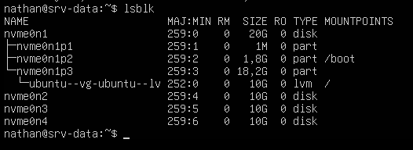
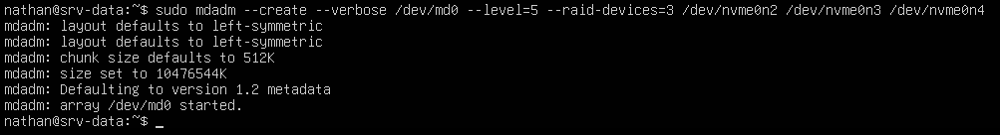
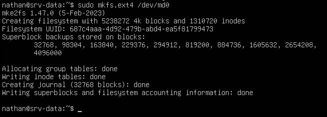
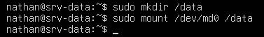
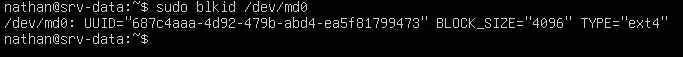
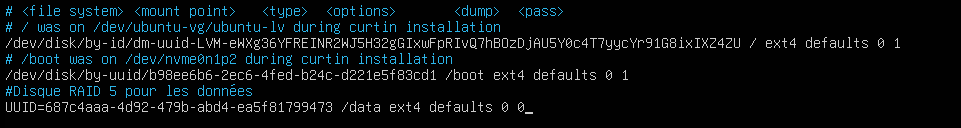
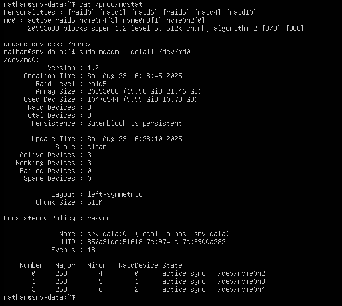
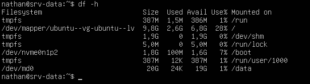
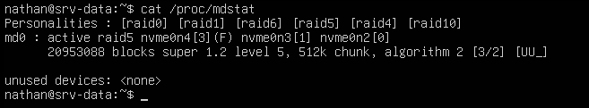

## Introduction

L'objectif est de créer un volume de stockage à tolérance de panne en **RAID 5** sur un serveur Ubuntu, en utilisant l'utilitaire en ligne de commande `mdadm`.

## Contexte : Le RAID Logiciel sous Linux avec mdadm

Sous Linux, `mdadm` (Multiple Disk Administrator) est l'outil de référence pour la gestion du RAID logiciel. Il communique directement avec le noyau Linux pour créer et gérer des grappes RAID de manière très efficace. Le principe est le même que pour les Espaces de Stockage Windows : regrouper plusieurs disques physiques pour créer un unique volume logique plus résilient.

## Prérequis

- Une VM Debian ou Ubuntu Server fonctionnelle.
- **3 disques durs virtuels « vierges »** ajoutés à votre VM (ex : 3 disques de 20 Go).
- L'outil `mdadm` doit être installé. Si ce n'est pas le cas, tapez la commande : `sudo apt update && sudo apt install mdadm -y`.

## Procédure Pratique : Création d'un Volume RAID 5

### Préparation des Disques

1. **Identifiez les disques** que vous avez ajoutés. La commande `lsblk` est parfaite pour ça.



<p class="figure-caption"><b>Figure 1</b> · Liste des disques avec lsblk</p>

Vous devriez voir vos 3 nouveaux disques (`/dev/nvme0n2`, `/dev/nvme0n3`, `/dev/nvme0n4`). Ils ne doivent avoir aucune partition.

### Création de la Grappe (Array) RAID 5

C'est l'étape principale où nous assemblons les disques.

1. **Utilisez `mdadm` pour créer la grappe.** La commande est longue, mais chaque partie a un sens :

```bash
sudo mdadm --create --verbose /dev/md0 --level=5 --raid-devices=3 /dev/nvme0n2 /dev/nvme0n3 /dev/nvme0n4
```

   - `--create` : Indique que nous créons une nouvelle grappe.
   - `--verbose` : Affiche des informations détaillées pendant la création.
   - `/dev/md0` : Le nom que nous donnons à notre volume RAID.
   - `--level=5` : Nous créons un RAID de niveau 5.
   - `--raid-devices=3` : Nous utilisons 3 disques.
   - `/dev/nvme0n2 /dev/nvme0n3 /dev/nvme0n4` : Les disques à inclure dans la grappe.

2. Si le système demande une confirmation, tapez `y` (pour yes) et validez. La création commence.



<p class="figure-caption"><b>Figure 2</b> · Création de la grappe md0</p>

### Création du Système de Fichiers

**Analogie :** Votre grappe `/dev/md0` est comme une boîte de rangement vide. Il faut maintenant y ajouter des étagères et un système de classement (le système de fichiers) pour pouvoir y stocker des choses.

1. **Formatez la grappe** avec le système de fichiers ext4, le standard pour Linux : `sudo mkfs.ext4 /dev/md0`



<p class="figure-caption"><b>Figure 3</b> · Formatage en ext4</p>

### Montage du Volume

Pour que le volume soit accessible, il faut l'attacher à un dossier. C'est ce qu'on appelle le « montage ».

1. **Créez un dossier** qui servira de point de montage avec : `sudo mkdir /data`.
2. **Montez temporairement** le volume pour vérifier que tout fonctionne : `sudo mount /dev/md0 /data`.



<p class="figure-caption"><b>Figure 4</b> · Montage temporaire sur /data</p>

3. **Rendez le montage permanent** pour qu'il survive à un redémarrage. Pour cela, nous allons modifier le fichier `/etc/fstab` :
   - Récupérez l'**UUID** (l'identifiant unique) de votre grappe, plus fiable que son nom `/dev/md0` : `sudo blkid /dev/md0`.



<p class="figure-caption"><b>Figure 5</b> · UUID de la grappe</p>

   - Ouvrez le fichier avec un éditeur de texte : `sudo nano /etc/fstab`.
   - Ajoutez la ligne suivante à la fin du fichier, en remplaçant `<UUID_recupere_precedemment>` par la valeur copiée :

```text
UUID=<UUID_recupere_precedemment> /data ext4 defaults,nofail 0 0
```



<p class="figure-caption"><b>Figure 6</b> · Ligne ajoutée dans /etc/fstab</p>

   - Sauvegardez le fichier (Ctrl + X, puis Y, puis Entrée).

<div class="callout callout-note">

L'option `nofail` évite que le serveur reste bloqué au démarrage si la grappe n'est pas disponible.

</div>

## Vérifications et Test de Panne

**Vérifier l'état de la grappe :**

- Les commandes suivantes montrent l'état de la grappe, les disques qui la composent et l'avancement de la synchronisation :

```bash
cat /proc/mdstat
sudo mdadm --detail /dev/md0
```



<p class="figure-caption"><b>Figure 7</b> · État de la grappe</p>

**Vérifier le montage :**

- Avec la commande `df -h` : vous devez voir votre volume `/dev/md0` monté sur `/data` avec la bonne taille.



<p class="figure-caption"><b>Figure 8</b> · Volume monté sur /data</p>

**Test de panne :**

- Créez un fichier de test : `sudo touch /data/test.txt`.
- Simulez la panne d'un disque (ici, `/dev/nvme0n4`) : `sudo mdadm /dev/md0 --fail /dev/nvme0n4`.
- Vérifiez à nouveau l'état avec `cat /proc/mdstat`. La grappe est en mode « dégradé » (`[UU_]`).



<p class="figure-caption"><b>Figure 9</b> · Grappe en mode dégradé</p>

- Vérifiez que votre fichier est toujours accessible : `ls /data`. Le fichier `test.txt` doit toujours être là.

## Conseils et Bonnes Pratiques

- **Sauvegarder la configuration de la grappe :** Après avoir créé votre grappe, sauvegardez sa configuration pour que le système l'assemble correctement au démarrage : `sudo mdadm --detail --scan | sudo tee -a /etc/mdadm/mdadm.conf`, puis `sudo update-initramfs -u`.
- **Supervision (Monitoring) :** L'outil `mdadm` peut surveiller l'état de vos disques et vous envoyer un e-mail si une panne est détectée. Pour cela, assurez-vous que la ligne `MAILADDR votre@email.com` est correctement configurée dans le fichier `/etc/mdadm/mdadm.conf`.
- **Utiliser des partitions plutôt que des disques entiers :** Il est recommandé de créer une partition unique sur chaque disque (`/dev/sdb1`, `/dev/sdc1`…), de changer son type en **« Linux RAID »** (`fd` en MBR) avec un outil comme `fdisk` ou `parted`, puis de construire la grappe RAID avec ces partitions. C'est une méthode plus propre et plus sûre.
- **Le RAID n'est PAS une sauvegarde :** Cette règle est universelle. Le RAID protège contre une **panne matérielle** d'un disque. Il ne protège **PAS** contre une suppression de fichier, un ransomware ou une erreur humaine. Des sauvegardes régulières et externes sont **indispensables**.

## Dépannage

**Symptôme :** La commande `mdadm` n'est pas trouvée.

- **Cause :** Le paquet n'est pas installé.
- **Solution :** Exécutez `sudo apt update && sudo apt install mdadm -y`.

**Symptôme :** Erreur « Device or resource busy » lors de la création de la grappe.

- **Cause :** Un des disques que vous essayez d'utiliser est déjà monté ou contient des métadonnées d'une ancienne grappe RAID.
- **Solution :** Assurez-vous que les disques ne sont pas montés (`lsblk`). Si le problème persiste, vous pouvez effacer les anciennes informations RAID avec `sudo mdadm --zero-superblock /dev/sdX` (à utiliser avec précaution !).

**Symptôme :** Le volume n'est pas remonté automatiquement après un redémarrage.

- **Cause :** Il y a probablement une erreur dans le fichier `/etc/fstab`.
- **Solution :** Vérifiez qu'il n'y a pas de faute de frappe. Contrôlez que l'UUID est correct en le comparant avec le résultat de `sudo blkid /dev/md0`. Vous pouvez tester la validité de votre fichier fstab sans redémarrer avec la commande `sudo mount -a`.

## Procédures Liées

- [Gestion des Disques avec LVM et Montage par fstab](/procedures/linux/gestion-des-disques-avec-lvm-et-montage-par-fstab) *(Volumes logiques sur le RAID)*
- [Installation d'un Serveur de Fichiers Samba](/procedures/linux/installation-dun-serveur-de-fichiers-samba) *(Partage des données stockées)*
- [Déploiement d'un Serveur NFS](/procedures/linux/deploiement-dun-serveur-nfs) *(Export des données stockées)*
- [Sauvegarde de Serveurs Linux avec rsync et BorgBackup](/procedures/linux/sauvegarde-de-serveurs-linux-avec-rsync-et-borgbackup) *(Le RAID ne remplace pas la sauvegarde)*
- [Mise en Place d'un Volume à Tolérance de Panne (RAID)](/procedures/windows/mise-en-place-dun-volume-a-tolerance-de-panne-raid) *(Équivalent sous Windows Server)*
