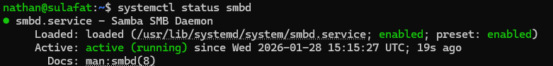
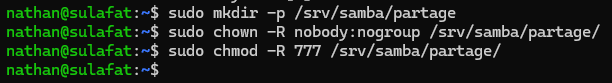
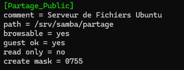
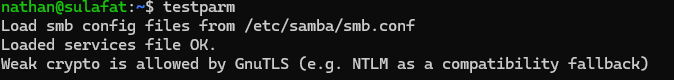
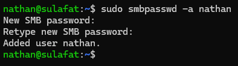
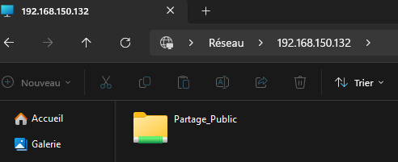

## Introduction

L'objectif est de transformer notre serveur Ubuntu en un serveur de fichiers capable de partager des documents avec des postes clients Windows, macOS et Linux via le réseau.

## Contexte et Justification

Dans une entreprise, les utilisateurs ont besoin d'espaces communs pour collaborer. Bien que le serveur soit sous Linux, la majorité des postes clients sont souvent sous Windows. Le protocole natif de Linux (NFS) n'est pas idéal pour Windows.

Nous utiliserons donc **Samba**, qui implémente le protocole SMB/CIFS (le langage de partage de fichiers de Windows) sur Linux. Cela permet au serveur d'apparaître dans le « Voisinage Réseau » de Windows comme s'il s'agissait d'un serveur Windows natif.

## Concepts Clés

- **SMB (Server Message Block) :** Protocole de partage de ressources (fichiers, imprimantes) sur un réseau local.
- **Share (Partage) :** Le nom du dossier tel qu'il apparaît sur le réseau (ex : `\\SRV-UBU\Compta`), qui peut être différent du nom réel du dossier sur le disque (`/srv/samba/compta`).
- **Workgroup :** Groupe de travail logique regroupant les ordinateurs (par défaut `WORKGROUP` sur Windows).

## Prérequis

**Scénario :** Un serveur Ubuntu est installé et nous voulons créer un dossier « Public » accessible à tous, et un dossier « Privé » sécurisé.

Avant de commencer :

1. Disposer d'un serveur Linux (Ubuntu/Debian) fonctionnel.
2. Avoir un accès root ou sudo.
3. Avoir un poste client Windows connecté au même réseau pour tester.

## Configuration

### Installation des Paquets Samba

**Justification :** Nous installons le service `smbd`, qui gère le partage de fichiers et les clients nécessaires pour tester.

1. Mettez à jour les dépôts et installez Samba :

```bash
sudo apt update
sudo apt install samba samba-common-bin -y
```

2. Vérifiez que le service tourne : `systemctl status smbd`.



<p class="figure-caption"><b>Figure 1</b> · Service smbd actif</p>

### Création de l'Arborescence

**Justification :** Il est recommandé de ne pas partager des dossiers système (`/etc`, `/home`). Nous allons créer un dossier dédié dans `/srv` (standard pour les services).

1. Créez le dossier à partager : `sudo mkdir -p /srv/samba/partage`.
2. Ajustez les permissions (pour cet exemple, le dossier est attribué à l'utilisateur invité `nobody`) :

```bash
sudo chown -R nobody:nogroup /srv/samba/partage
sudo chmod -R 777 /srv/samba/partage
```



<p class="figure-caption"><b>Figure 2</b> · Dossier partagé et permissions</p>

<div class="callout callout-note">

Le 777 est utilisé ici pour la pédagogie, afin d'éviter les blocages initiaux. Voir « Conseils et Bonnes Pratiques » pour la production.

</div>

### Configuration du Fichier smb.conf

**Justification :** Le fichier `/etc/samba/smb.conf` est le cerveau de Samba. Il définit qui a le droit d'accéder à quoi.

1. Sauvegardez le fichier d'origine : `sudo cp /etc/samba/smb.conf /etc/samba/smb.conf.bak`
2. Éditez le fichier : `sudo nano /etc/samba/smb.conf`
3. Ajoutez ces lignes tout à la fin du fichier :

```text
[Partage_Public]
   comment = Serveur de Fichiers Ubuntu
   path = /srv/samba/partage
   browsable = yes
   guest ok = yes
   read only = no
   create mask = 0755
```



<p class="figure-caption"><b>Figure 3</b> · Section Partage_Public dans smb.conf</p>

   - **path :** Chemin réel sur le disque Linux.
   - **guest ok :** Autorise la connexion sans mot de passe (invité).
   - **read only = no :** Permet l'écriture (création/suppression de fichiers).

4. Vérifiez la syntaxe de votre configuration avec `testparm` (si le message « Loaded services file OK » s'affiche sans erreur, c'est bon).



<p class="figure-caption"><b>Figure 4</b> · Résultat de testparm</p>

### Création des Utilisateurs Samba

**Justification :** Si vous voulez sécuriser un dossier, l'utilisateur système Linux ne suffit pas. Il faut créer un mot de passe spécifique Samba.

1. Si vous avez un utilisateur système, ajoutez-le à la base Samba : `sudo smbpasswd -a nomutilisateur`.
2. Définissez son mot de passe de partage.



<p class="figure-caption"><b>Figure 5</b> · Ajout d'un utilisateur Samba</p>

### Démarrage du Service

**Justification :** Pour appliquer les changements du fichier de configuration.

1. Redémarrez Samba :

```bash
sudo systemctl restart smbd
```

## Vérifications

**Depuis un client Windows :**

1. Ouvrez l'explorateur de fichiers (Win + E).
2. Dans la barre d'adresse, tapez l'IP du serveur : `\\192.168.1.XX` (remplacez par votre IP).
3. Vous devriez voir le dossier `Partage_Public`.



<p class="figure-caption"><b>Figure 6</b> · Partage visible depuis Windows</p>

4. Entrez dedans et essayez de créer un fichier « test.txt ». Si ça marche, le serveur est opérationnel.

**Depuis un client Linux :**

1. Ouvrez le gestionnaire de fichiers.
2. Allez dans « Autres emplacements » \> « Connexion à un serveur ».
3. Adresse : `smb://192.168.1.XX`.

## Dépannage

**Erreur « Accès refusé » ou « Vous n'avez pas la permission » :**

- C'est souvent un problème de permissions Linux (et non Samba). Samba donne l'autorisation d'entrer, mais le système de fichiers Linux (ext4) bloque l'écriture.
- Vérifiez : `ls -l /srv/samba/` et assurez-vous que le dossier a les droits d'écriture (w) pour « others » ou le groupe concerné.

**Impossible de se connecter au serveur (timeout) :**

- Le pare-feu bloque probablement le port 445 ou 139.
- Sur Ubuntu, autorisez le trafic : `sudo ufw allow samba`

**Le dossier n'apparaît pas :**

- Vérifiez que `browsable = yes` est bien dans le fichier de configuration.
- Redémarrez le service : `sudo systemctl restart smbd`

## Conseils et Bonnes Pratiques

**Sécurité (Permissions) :** Ne jamais laisser `guest ok = yes` pour des données sensibles. En production, forcez l'authentification (`valid users = @nom_du_groupe`).

**Audit :** Utilisez la commande `smbstatus` pour voir en temps réel qui est connecté à votre serveur et quels fichiers sont ouverts.

**Nom NetBIOS :** Pour que le serveur soit accessible via un nom (ex : `\\MON-SERVEUR`) au lieu de l'IP, assurez-vous que le service `nmbd` est actif, mais la méthode la plus fiable reste le DNS local.

## Procédures Liées

- [Déploiement d'un Serveur NFS](/procedures/linux/deploiement-dun-serveur-nfs) *(Alternative pour les clients Linux)*
- Intégration d'un Serveur Linux à Active Directory (realmd et SSSD) *(Authentification par Active Directory)*
- [Gestion des Permissions, ACL et Droits Spéciaux](/procedures/linux/gestion-des-permissions-acl-et-droits-speciaux) *(Droits Unix sur les dossiers partagés)*
- [Mise en Place d'un Serveur de Fichiers avec Partages et Sécurité NTFS](/procedures/windows/mise-en-place-dun-serveur-de-fichiers-avec-partages-et-securite-ntfs) *(Équivalent sous Windows Server)*
- [Mise en Place d'un Volume RAID 5 Logiciel sous Linux](/procedures/linux/mise-en-place-dun-volume-raid-5-logiciel-sous-linux) *(Stockage redondant des données)*
