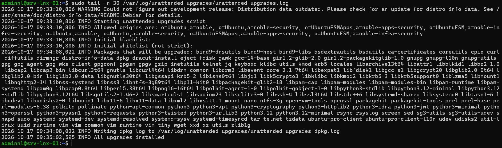

## Introduction

Cette procédure décrit la gestion des paquets sur un serveur Linux Debian 13 ou Ubuntu Server 24.04 LTS avec APT : commandes courantes, format deb822 des sources (`.sources`), ajout d'un dépôt tiers signé avec `Signed-By`, mises à jour de sécurité automatiques avec `unattended-upgrades`, redémarrage des services avec `needrestart`, et mention d'Ubuntu Pro et de Livepatch.

Les exemples portent sur srv-lnx-01 (192.168.10.21). Les versions d'APT diffèrent selon le système : 2.7 sur Ubuntu 24.04, 3.0 sur Debian 13 et 3.1 sur Ubuntu 26.04 LTS. Les écarts de comportement sont signalés.

## Contexte et Justification

La majorité des compromissions de serveurs exploitent des vulnérabilités connues pour lesquelles un correctif existait. Un serveur non mis à jour accumule ces failles, et une mise à jour manuelle irrégulière laisse des fenêtres d'exposition de plusieurs semaines.

À l'inverse, une gestion des dépôts négligée crée d'autres risques :

- Des dépôts tiers ajoutés avec une clé de confiance globale peuvent signer des paquets pour n'importe quel dépôt.
- Des sources dupliquées ou obsolètes provoquent des erreurs à chaque mise à jour.
- Une mise à jour de bibliothèque sans redémarrage des services laisse l'ancienne version vulnérable en mémoire.

La démarche décrite ici apporte :

- **Correctifs rapides :** les mises à jour de sécurité s'installent chaque jour sans intervention.
- **Chaîne de confiance maîtrisée :** chaque dépôt tiers n'est validé que par sa propre clé.
- **Effectivité :** les services utilisant une bibliothèque mise à jour sont redémarrés, et les redémarrages du noyau sont planifiés.

## Concepts Clés

**APT et dpkg.** `dpkg` installe un fichier `.deb` sans gérer les dépendances. APT (`apt`, `apt-get`, `apt-cache`) résout les dépendances, télécharge depuis les dépôts et vérifie les signatures. `apt` est destiné à l'usage interactif, `apt-get` aux scripts car son interface est stable.

**Dépôt, suite et composant.** Un dépôt est une URL. La suite désigne la version (`trixie`, `trixie-updates`, `trixie-security` pour Debian 13, `noble`, `noble-updates`, `noble-security` pour Ubuntu 24.04). Les composants séparent les paquets selon leur licence ou leur support (`main`, `contrib`, `non-free`, `non-free-firmware` chez Debian, `main`, `restricted`, `universe`, `multiverse` chez Ubuntu).

**Format deb822.** Format de sources en blocs de champs (`Types`, `URIs`, `Suites`, `Components`, `Signed-By`), stocké dans des fichiers `/etc/apt/sources.list.d/*.sources`. Il remplace l'ancien format sur une ligne des fichiers `.list`. Ubuntu l'utilise par défaut depuis la 24.04 (`ubuntu.sources`), et Debian 13 fournit la commande `apt modernize-sources` pour convertir les anciens fichiers.

**Signed-By.** Champ qui lie un dépôt à une clé précise. APT n'accepte alors pour ce dépôt que les signatures produites par cette clé. C'est le remplaçant de `apt-key`, qui ajoutait des clés de confiance globales.

**unattended-upgrades.** Outil qui installe automatiquement les mises à jour des origines autorisées. Il est déclenché par les timers systemd `apt-daily.timer` (rafraîchissement des index) et `apt-daily-upgrade.timer` (installation).

**needrestart.** Outil exécuté à la fin d'une transaction APT, qui détecte les processus utilisant encore d'anciennes bibliothèques ou un ancien noyau et propose ou effectue le redémarrage des services concernés.

**Ubuntu Pro et Livepatch.** Abonnement Canonical qui étend la maintenance de sécurité (ESM) à dix ans et à l'ensemble du dépôt `universe`, et donne accès à Livepatch, l'application des correctifs critiques du noyau sans redémarrage. Il est gratuit pour un usage personnel sur un nombre limité de machines.

## Prérequis

- Un serveur Debian 13 ou Ubuntu Server 24.04 LTS, ici srv-lnx-01.
- Un compte membre du groupe `sudo`.
- Un accès HTTP et HTTPS sortant vers les miroirs (`deb.debian.org`, `security.debian.org`, `archive.ubuntu.com`, `security.ubuntu.com`) et vers les dépôts tiers, directement ou par proxy.
- Une fenêtre de maintenance définie pour les redémarrages automatiques.
- Une sauvegarde ou un instantané de la machine virtuelle avant les mises à niveau majeures.
- Pour Ubuntu Pro, un compte Ubuntu One et le jeton d'abonnement.

## Points de Vigilance

**apt-key est retiré.** `apt-key` a disparu de Debian 13 et d'Ubuntu 26.04, et il est déprécié sur Ubuntu 24.04. Les instructions d'éditeurs qui utilisent encore `apt-key add` sont à adapter avec `Signed-By`. Ne déposez jamais une clé tierce dans `/etc/apt/trusted.gpg.d/`, qui accorde une confiance globale.

**Ne mélangez pas les distributions.** Ajouter un dépôt Ubuntu sur Debian, ou un dépôt d'une autre version (`testing`, `sid`), crée des dépendances incohérentes (« FrankenDebian ») qui cassent les mises à jour suivantes.

**apt upgrade et apt full-upgrade diffèrent.** `apt upgrade` n'installe pas de nouveaux paquets et ne supprime rien. `apt full-upgrade` peut supprimer des paquets pour résoudre des conflits ; lisez la liste avant de confirmer. `apt-get upgrade` est plus conservateur encore que `apt upgrade`, qui peut installer de nouvelles dépendances.

**needrestart redémarre automatiquement sur Ubuntu 24.04.** Depuis Ubuntu 24.04, needrestart, installé par défaut sur Ubuntu Server, redémarre directement les services concernés au lieu de demander confirmation, y compris en mode interactif. Excluez explicitement les services sensibles (bases de données, applications à état). Sur Debian, needrestart n'est pas installé par défaut.

**Le redémarrage automatique coupe le service.** `Automatic-Reboot` redémarre le serveur après l'installation d'un noyau. Réservez-le aux serveurs redondants ou planifiez l'heure, et ne l'activez jamais sur un nœud unique sans accord du métier.

**Debian 13 signale un bogue connu d'APT.** Les notes de version de Debian 13 mentionnent qu'`apt update` peut conserver silencieusement d'anciennes données d'index en cas d'erreur (bogue 1078608). Contrôlez la sortie de `apt update` dans les supervisions.

**Fin de support.** Ubuntu 24.04 LTS reçoit des mises à jour standard jusqu'en avril 2029, et jusqu'en 2034 avec Ubuntu Pro. Debian 13 est maintenue par l'équipe sécurité environ trois ans après sa sortie d'août 2025, puis par Debian LTS jusqu'au 30 juin 2030.

## Choix Architecturaux & Alternatives

### Quand choisir unattended-upgrades

unattended-upgrades convient à la plupart des serveurs pour les correctifs de sécurité : il est intégré, gratuit, et réduit la fenêtre d'exposition à moins de 24 heures. Il est particulièrement adapté aux serveurs nombreux et homogènes, et à ceux dont les services redémarrent sans impact.

Pour les serveurs critiques ou à fort couplage applicatif, un processus contrôlé reste préférable : préproduction mise à jour d'abord, puis production pendant une fenêtre de maintenance, piloté par un outil d'automatisation ou une solution de gestion de parc. Dans ce cas, limitez unattended-upgrades aux mises à jour de sécurité ou désactivez-le au profit de l'outil central.

### Alternatives et comparatif

| Option | Cas d'usage typique | Force principale | Faiblesse principale | Coût relatif |
|--------|---------------------|------------------|----------------------|--------------|
| **unattended-upgrades** | Correctifs de sécurité quotidiens | Natif, gratuit, autonome sur chaque serveur | Pas de vue centralisée ni d'orchestration | Gratuit |
| **Mises à jour manuelles planifiées** | Petits parcs, serveurs critiques | Contrôle complet de chaque changement | Délai d'application, charge humaine | Faible |
| **Ansible ou outil d'automatisation** | Parc moyen à grand, ordre de mise à jour imposé | Orchestration par vagues, rapports | Infrastructure et compétences à maintenir | Faible |
| **Landscape (Canonical)** | Parc Ubuntu important | Console centralisée, conformité, inventaire | Ubuntu uniquement, abonnement | Moyen |
| **Miroir local (apt-cacher-ng, aptly)** | Sites sans accès Internet, bande passante limitée | Contrôle des versions, économie de bande passante | Serveur supplémentaire à maintenir | Faible |
| **Ubuntu Pro avec Livepatch** | Serveurs Ubuntu à redémarrage difficile | Correctifs noyau à chaud, ESM 10 ans | Ubuntu uniquement, payant au delà de l'usage personnel | Moyen |

### Impact des choix

- **Sécurité.** Les correctifs automatiques réduisent fortement l'exposition. `Signed-By` limite l'impact d'une clé tierce compromise au seul dépôt concerné.
- **Disponibilité.** needrestart et le redémarrage automatique provoquent de courtes coupures. Sur des services redondants, décalez l'heure de chaque nœud pour ne jamais redémarrer les deux en même temps.
- **Exploitation.** Le format deb822 est plus lisible et se désactive par un champ `Enabled: no`. Les journaux de `/var/log/unattended-upgrades/` et `/var/log/apt/history.log` tracent chaque changement.
- **Coût.** Les outils natifs sont gratuits. Ubuntu Pro et Landscape sont facturés par machine au delà de l'offre personnelle.

## Configuration

### Utiliser les commandes APT courantes

```bash
sudo apt update                         # rafraîchit les index
apt list --upgradable                   # liste les mises à jour disponibles
sudo apt upgrade                        # met à jour sans supprimer de paquets
sudo apt full-upgrade                   # met à jour en autorisant les suppressions
sudo apt install chrony                 # installe un paquet
sudo apt remove --purge telnet          # supprime un paquet et sa configuration
sudo apt autoremove --purge             # supprime les dépendances devenues inutiles
apt search nginx; apt show nginx        # recherche et décrit
apt policy openssh-server               # versions disponibles et priorités
sudo apt-mark hold postgresql-16        # bloque un paquet à sa version
apt-mark showhold
```

Historique des opérations :

```bash
less /var/log/apt/history.log
zgrep -h "Commandline" /var/log/apt/history.log*
```

<div class="callout callout-note">

Ubuntu 26.04 (APT 3.1) ajoute les commandes `apt history-list`, `apt history-info`, `apt history-undo`, `apt history-redo` et `apt history-rollback` pour consulter et annuler des transactions.

</div>

### Lire et écrire les sources au format deb822

Sources par défaut d'Ubuntu 24.04, dans `/etc/apt/sources.list.d/ubuntu.sources` :

```text
Types: deb
URIs: http://archive.ubuntu.com/ubuntu/
Suites: noble noble-updates noble-backports
Components: main restricted universe multiverse
Signed-By: /usr/share/keyrings/ubuntu-archive-keyring.gpg

Types: deb
URIs: http://security.ubuntu.com/ubuntu/
Suites: noble-security
Components: main restricted universe multiverse
Signed-By: /usr/share/keyrings/ubuntu-archive-keyring.gpg
```

Sur Debian 13, convertissez d'abord les anciennes sources si `/etc/apt/sources.list` est encore utilisé :

```bash
sudo apt modernize-sources
```

Le fichier `/etc/apt/sources.list.d/debian.sources` attendu :

```text
Types: deb
URIs: https://deb.debian.org/debian
Suites: trixie trixie-updates
Components: main contrib non-free non-free-firmware
Signed-By: /usr/share/keyrings/debian-archive-keyring.pgp

Types: deb
URIs: https://security.debian.org/debian-security
Suites: trixie-security
Components: main contrib non-free non-free-firmware
Signed-By: /usr/share/keyrings/debian-archive-keyring.pgp
```

<div class="callout callout-note">

`apt modernize-sources` conserve une copie de sauvegarde des fichiers convertis ; relisez le résultat avant `apt update`. Pour désactiver temporairement un dépôt deb822 sans supprimer le fichier, ajoutez le champ `Enabled: no` au bloc concerné.

</div>

### Ajouter un dépôt tiers avec Signed-By

Exemple avec le dépôt Docker sur Debian 13. Téléchargez la clé dans un répertoire dédié :

```bash
sudo install -m 0755 -d /etc/apt/keyrings
sudo curl -fsSL https://download.docker.com/linux/debian/gpg -o /etc/apt/keyrings/docker.asc
sudo chmod a+r /etc/apt/keyrings/docker.asc
gpg --show-keys /etc/apt/keyrings/docker.asc
```

Comparez l'empreinte affichée avec celle publiée sur le site de l'éditeur, puis créez la source :

```bash
sudo tee /etc/apt/sources.list.d/docker.sources > /dev/null <<'EOF'
Types: deb
URIs: https://download.docker.com/linux/debian
Suites: trixie
Components: stable
Architectures: amd64
Signed-By: /etc/apt/keyrings/docker.asc
EOF
sudo apt update
```

Sur Ubuntu 24.04, remplacez `debian` par `ubuntu` dans les URL et `trixie` par `noble`.

Pour éviter qu'un dépôt tiers remplace un paquet officiel, limitez sa priorité :

```bash
sudo tee /etc/apt/preferences.d/docker > /dev/null <<'EOF'
Package: *
Pin: origin download.docker.com
Pin-Priority: 100

Package: docker-ce docker-ce-cli containerd.io docker-buildx-plugin docker-compose-plugin
Pin: origin download.docker.com
Pin-Priority: 500
EOF
apt policy docker-ce
```

### Activer unattended-upgrades

Installez et activez le service (déjà présent sur Ubuntu Server) :

```bash
sudo apt install unattended-upgrades apt-listchanges
sudo dpkg-reconfigure -plow unattended-upgrades
```

Cette commande crée `/etc/apt/apt.conf.d/20auto-upgrades` :

```text
APT::Periodic::Update-Package-Lists "1";
APT::Periodic::Unattended-Upgrade "1";
```

Plutôt que de modifier `50unattended-upgrades`, fourni par le paquet, ajoutez un fichier local lu après lui :

```bash
sudo nano /etc/apt/apt.conf.d/52unattended-upgrades-local
```

```text
// Paquets jamais mis à jour automatiquement
Unattended-Upgrade::Package-Blacklist {
    "postgresql-";
};
Unattended-Upgrade::Remove-Unused-Kernel-Packages "true";
Unattended-Upgrade::Remove-Unused-Dependencies "true";
Unattended-Upgrade::Automatic-Reboot "true";
Unattended-Upgrade::Automatic-Reboot-WithUsers "true";
Unattended-Upgrade::Automatic-Reboot-Time "03:30";
Unattended-Upgrade::Mail "admins-linux@lab.local";
Unattended-Upgrade::MailReport "only-on-error";
```

<div class="callout callout-note">

Les origines autorisées par défaut sont les dépôts de sécurité : `Origins-Pattern` avec `label=Debian-Security` sur Debian, `Allowed-Origins` avec `${distro_codename}-security` sur Ubuntu. L'envoi de courriels exige un agent de messagerie local configuré.

</div>

Décalez l'heure d'installation, par exemple à 02:00 avec un délai aléatoire de 30 minutes :

```bash
sudo systemctl edit apt-daily-upgrade.timer
```

```ini
[Timer]
OnCalendar=
OnCalendar=*-*-* 02:00
RandomizedDelaySec=30m
```

### Régler needrestart

Sur Debian, installez-le si besoin avec `sudo apt install needrestart`. Excluez un service des redémarrages automatiques par un fichier de `conf.d` :

```bash
echo '$nrconf{override_rc}{qr(^postgresql)} = 0;' | sudo tee /etc/needrestart/conf.d/50-local.conf
```

Lancez une vérification manuelle en mode liste, sans redémarrer :

```bash
sudo needrestart -r l
sudo needrestart -k          # état du noyau seulement
```

### Mentionner Ubuntu Pro et Livepatch (Ubuntu)

```bash
sudo pro attach <JETON>
pro status
sudo pro enable livepatch
canonical-livepatch status
```

Ubuntu Pro active ESM-Infra et ESM-Apps, qui prolongent les correctifs de sécurité de `main` et `universe`. Livepatch applique les correctifs critiques du noyau sans redémarrage, mais ne dispense pas des redémarrages planifiés pour les autres mises à jour du noyau. Debian n'a pas d'équivalent intégré : la période étendue est couverte par Debian LTS, sans abonnement.

## Vérifications

**Sources :** `apt update` se termine sans erreur ni avertissement de signature, et `ls /etc/apt/sources.list.d/` ne contient que des fichiers `.sources` attendus.

**Dépôt tiers :** `apt policy docker-ce` affiche le dépôt `download.docker.com` avec la priorité 500.

**unattended-upgrades :** `sudo unattended-upgrade --dry-run --debug` liste les origines autorisées et les paquets qui seraient installés, sans erreur.

**Timers :** `systemctl list-timers 'apt-daily*'` affiche les prochaines exécutions à l'heure choisie.

**Journal des mises à jour :** `sudo tail -n 30 /var/log/unattended-upgrades/unattended-upgrades.log` montre la dernière exécution.



<p class="figure-caption"><b>Figure 1</b> · Résultat de la commande.</p>

**Redémarrage requis :** la présence de `/var/run/reboot-required` signale qu'un redémarrage est attendu ; `cat /var/run/reboot-required.pkgs` liste les paquets responsables.

**Ubuntu Pro :** `pro status` affiche `esm-infra`, `esm-apps` et `livepatch` à l'état `enabled`.

## Dépannage

**« NO_PUBKEY » ou « The following signatures couldn't be verified » :** la clé du dépôt est absente ou le champ `Signed-By` pointe vers un mauvais fichier. Vérifiez le chemin, les droits de lecture (`chmod a+r`) et l'empreinte de la clé.

**« Target Packages ... is configured multiple times » :** le même dépôt est déclaré deux fois, souvent dans un `.list` et un `.sources`. Supprimez le doublon ou lancez `apt modernize-sources` sur Debian 13.

**« Conflicting values set for option Signed-By » :** deux déclarations du même dépôt utilisent des clés différentes. Gardez une seule déclaration.

**« Release file ... is not valid yet » ou « is expired » :** l'horloge du serveur est fausse. Vérifiez la synchronisation avec `timedatectl`.

**« Could not get lock /var/lib/dpkg/lock-frontend » :** une autre opération APT est en cours, souvent unattended-upgrades. Attendez sa fin avec `systemctl status apt-daily-upgrade.service`. Ne supprimez pas le verrou.

**unattended-upgrades n'installe rien :** les timers sont désactivés, `20auto-upgrades` est absent, ou le paquet ne provient pas d'une origine autorisée. Le mode `--dry-run --debug` indique la raison pour chaque paquet.

**Un service a été redémarré de façon inattendue après une mise à jour :** c'est needrestart. Consultez la sortie de la transaction APT, qui liste les services redémarrés, et ajoutez le service à `override_rc`.

## Conseils et Bonnes Pratiques

**Un fichier .sources par dépôt.** Nommez-le d'après l'éditeur (`docker.sources`, `zabbix.sources`) et gardez la clé associée dans `/etc/apt/keyrings/`. Supprimer un dépôt revient à supprimer deux fichiers.

**Limitez les dépôts tiers.** Chaque dépôt ajoute une chaîne de confiance et un risque de conflit. Préférez les paquets officiels, puis les dépôts `backports`, avant un dépôt éditeur.

**Testez avant la production.** Appliquez d'abord les mises à jour sur un serveur de préproduction identique, un ou deux jours avant la production.

**Échelonnez les redémarrages.** Sur des nœuds redondants, utilisez des heures `Automatic-Reboot-Time` différentes pour ne jamais redémarrer tout un service en même temps.

**Supervisez l'état des mises à jour.** Alertez sur le nombre de mises à jour de sécurité en attente, sur la présence de `/var/run/reboot-required` depuis plus de sept jours, et sur l'échec du service `apt-daily-upgrade`.

**Utilisez apt-get dans les scripts.** Son interface est stable entre les versions, contrairement à celle d'`apt`, qui affiche un avertissement à ce sujet quand sa sortie est redirigée.

## Procédures Liées

- [Installation d'un Serveur Debian en Ligne de Commande (CLI)](/procedures/linux/installation-dun-serveur-debian-en-ligne-de-commande-cli) *(Sources configurées à l'installation)*
- [Installation d'un Serveur Ubuntu en Ligne de Commande (CLI)](/procedures/linux/installation-dun-serveur-ubuntu-en-ligne-de-commande-cli) *(Sources et Ubuntu Pro à l'installation)*
- [Installation de Docker et Portainer sur Ubuntu](/procedures/linux/installation-de-docker-et-portainer-sur-ubuntu) *(Exemple de dépôt tiers signé)*
- Planification des Tâches avec cron et les Timers systemd *(Timers apt-daily et fenêtres de maintenance)*
- [Gestion des Services avec systemd et journald](/procedures/linux/gestion-des-services-avec-systemd-et-journald) *(Redémarrage des services après mise à jour)*
- [Configuration d'un Proxy Squid sur OPNSense](/procedures/pare-feu/configuration-dun-proxy-squid-sur-opnsense) *(Accès sortant aux dépôts par proxy)*
