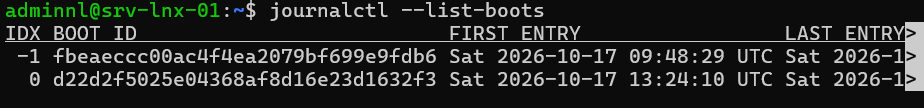

## Introduction

Cette procédure décrit l'administration des services avec systemd sur un serveur Linux Debian 13 ou Ubuntu Server 24.04 LTS : pilotage des unités avec `systemctl`, personnalisation par fichiers de surcharge (drop-ins), création d'une unité de service, gestion des cibles, puis exploitation et rétention des journaux avec `journalctl` et `systemd-journald`.

Les exemples sont réalisés sur srv-lnx-01 (192.168.10.21). Un petit service HTTP interne sert de fil conducteur pour la création d'unité. Les versions de systemd sont 255 sur Ubuntu 24.04, 257 sur Debian 13 et 259 sur Ubuntu 26.04 LTS.

## Contexte et Justification

systemd est le gestionnaire de services et le premier processus (PID 1) de Debian et d'Ubuntu. Tout service installé par paquet, tout montage, tout timer et toute cible de démarrage est une unité systemd. Une mauvaise maîtrise de cet outil conduit à des erreurs fréquentes en production :

- Des fichiers d'unité modifiés directement sous `/usr/lib/systemd/system`, écrasés à la mise à jour suivante.
- Des applications lancées par `nohup` ou `screen`, qui ne redémarrent ni après un plantage ni après un redémarrage.
- Des journaux perdus au redémarrage ou, à l'inverse, un disque saturé par des journaux sans limite.

Une gestion maîtrisée apporte :

- **Fiabilité :** redémarrage automatique, dépendances explicites, ordre de démarrage déterministe.
- **Maintenabilité :** surcharges séparées des fichiers des paquets.
- **Sécurité :** options de confinement par service (système de fichiers en lecture seule, répertoires temporaires privés, absence d'élévation de privilèges).
- **Traçabilité :** journaux structurés, filtrables par service, par priorité et par période.

## Concepts Clés

**Unité.** Objet géré par systemd, décrit par un fichier texte. Les types courants sont `.service` (processus), `.socket` (activation par socket), `.timer` (planification), `.mount` (montage), `.target` (regroupement d'unités) et `.path` (surveillance de fichier).

**Emplacements des unités.** Les paquets installent leurs unités dans `/usr/lib/systemd/system` (ou `/lib/systemd/system`, identique sur ces systèmes à `/usr` fusionné). Les unités de l'administrateur et les surcharges vont dans `/etc/systemd/system`, prioritaire. `/run/systemd/system` contient les unités temporaires.

**Drop-in.** Fichier `.conf` placé dans `/etc/systemd/system/<unité>.d/`, qui modifie quelques directives d'une unité sans la recopier. `systemctl edit` le crée sous le nom `override.conf`.

**État et activation.** `start` et `stop` agissent immédiatement. `enable` et `disable` créent ou suppriment les liens qui lancent l'unité au démarrage. `mask` rend l'unité impossible à démarrer, même par dépendance.

**Type de service.** `Type=simple` et `Type=exec` pour un processus qui reste au premier plan, `Type=notify` pour un service qui signale sa disponibilité à systemd, `Type=oneshot` pour une tâche qui se termine, `Type=forking` pour les démons historiques qui passent en arrière plan.

**Cible (target).** Regroupement d'unités qui joue le rôle des anciens niveaux d'exécution. `multi-user.target` correspond à un serveur sans interface graphique, `graphical.target` à un poste avec interface, `rescue.target` au mode de maintenance.

**journald.** Service `systemd-journald` qui collecte les messages du noyau, des services et de syslog, et les stocke au format binaire indexé. `journalctl` les interroge. Le stockage est persistant si `/var/log/journal` existe (mode `Storage=auto`), volatil en mémoire dans `/run/log/journal` sinon.

## Prérequis

- Un serveur Debian 13 ou Ubuntu Server 24.04 LTS, ici srv-lnx-01.
- Un compte membre du groupe `sudo`. La lecture de tous les journaux est aussi ouverte aux membres des groupes `adm` et `systemd-journal`.
- Pour l'exemple de service, `python3` installé et un répertoire `/srv/www-interne` contenant quelques fichiers.
- Un espace disque suffisant sous `/var` pour la rétention de journaux souhaitée.

## Points de Vigilance

**Ne modifiez jamais les fichiers de /usr/lib/systemd/system.** Ils appartiennent aux paquets et sont remplacés à chaque mise à jour. Passez par `systemctl edit`.

**Une directive de liste se vide avant d'être redéfinie.** Dans un drop-in, `ExecStart=` ajoute une valeur à la liste existante. Pour la remplacer, déclarez d'abord `ExecStart=` vide, puis la nouvelle valeur. Sans cela, systemd refuse le service avec plusieurs `ExecStart` pour un `Type=simple`.

**daemon-reload après chaque modification manuelle.** Un fichier d'unité créé ou modifié sans `systemctl edit` n'est pris en compte qu'après `systemctl daemon-reload`.

**isolate arrête tout ce qui n'appartient pas à la cible.** `systemctl isolate rescue.target` sur un serveur distant coupe le réseau et la session SSH. Utilisez-le uniquement depuis une console.

**Les scripts SysV sont en fin de vie.** systemd n'assure plus qu'une compatibilité transitoire avec les scripts de `/etc/init.d`. Ubuntu 26.04 LTS est annoncée comme la dernière version qui la prend en charge. Migrez les scripts maison vers des unités natives.

**cgroup v1 est retiré.** Ubuntu 26.04 ne prend plus en charge les hiérarchies cgroup v1 et hybrides. Debian 13 et Ubuntu 24.04 fonctionnent déjà en cgroup v2 unifié par défaut. Les anciens outils qui exigent cgroup v1 (vieux runtimes de conteneurs) doivent être mis à jour.

**Journaux persistants et absence de rsyslog sur Debian.** Debian n'installe plus `rsyslog` par défaut depuis Debian 12 : il n'y a donc ni `/var/log/syslog` ni `/var/log/auth.log`, et journald est la seule source. Ubuntu 24.04 conserve `rsyslog` en parallèle de journald, ce qui double l'espace consommé par les journaux.

## Choix Architecturaux & Alternatives

### Quand choisir une unité systemd

Toute application qui doit tourner en continu ou démarrer avec le serveur doit être déclarée comme unité systemd. C'est le seul moyen supporté sur Debian et Ubuntu de bénéficier du redémarrage automatique, des dépendances, de la journalisation et du confinement. Les surcharges par drop-in s'imposent dès qu'on ajuste un service fourni par un paquet.

journald suffit comme stockage local des journaux. Un transfert vers un serveur central (rsyslog, systemd-journal-remote, agent de SIEM) s'ajoute dès que les journaux doivent survivre à la compromission ou à la perte du serveur.

### Alternatives et comparatif

| Option | Cas d'usage typique | Force principale | Faiblesse principale | Coût relatif |
|--------|---------------------|------------------|----------------------|--------------|
| **Unité systemd native** | Tout service sur Debian et Ubuntu | Redémarrage, dépendances, confinement, journalisation intégrés | Syntaxe spécifique à apprendre | Gratuit |
| **Script SysV (/etc/init.d)** | Applications anciennes non migrées | Familier, portable vers d'anciens systèmes | Compatibilité en fin de vie, aucune supervision | Gratuit |
| **Superviseur applicatif (supervisord)** | Plusieurs processus d'une même application | Indépendant de l'init | Couche supplémentaire, redondant avec systemd | Gratuit |
| **Conteneur (Docker, Podman et Quadlet)** | Applications packagées en image | Isolation et portabilité | Moteur de conteneur à exploiter | Faible |
| **Journaux centralisés (rsyslog, Loki, SIEM)** | Parc de serveurs, conformité | Conservation hors du serveur, corrélation | Infrastructure dédiée | Moyen |

### Impact des choix

- **Disponibilité.** `Restart=on-failure` et les limites `StartLimitIntervalSec` et `StartLimitBurst` relancent un service planté sans boucle infinie.
- **Sécurité.** Les options `NoNewPrivileges`, `ProtectSystem`, `ProtectHome` et `PrivateTmp` réduisent l'impact d'une compromission. `systemd-analyze security` note l'exposition de chaque service.
- **Exploitation.** Les drop-ins conservent les personnalisations lors des mises à jour et se listent avec `systemd-delta`.
- **Coût.** Aucun coût logiciel. La rétention des journaux consomme de l'espace disque à dimensionner.

## Configuration

### Piloter un service avec systemctl

```bash
systemctl status ssh
sudo systemctl restart ssh
sudo systemctl reload nginx            # recharge la configuration si le service le permet
sudo systemctl enable --now chrony     # active au démarrage et démarre
sudo systemctl disable --now cups      # désactive et arrête
sudo systemctl mask cups               # interdit tout démarrage
systemctl is-active ssh; systemctl is-enabled ssh
```

Listez les unités et repérez les échecs :

```bash
systemctl list-units --type=service --state=running
systemctl list-unit-files --type=service --state=enabled
systemctl --failed
```

### Lire et surcharger une unité existante

Affichez l'unité complète avec ses surcharges éventuelles :

```bash
systemctl cat nginx.service
systemctl show nginx.service -p Restart,User,LimitNOFILE
```

Créez une surcharge, ici pour relancer nginx en cas d'échec et augmenter la limite de fichiers ouverts :

```bash
sudo systemctl edit nginx.service
```

```ini
[Service]
Restart=on-failure
RestartSec=5s
LimitNOFILE=65536
```

L'éditeur enregistre `/etc/systemd/system/nginx.service.d/override.conf` et recharge systemd. Redémarrez ensuite le service :

```bash
sudo systemctl restart nginx
```

Pour remplacer une commande de lancement :

```ini
[Service]
ExecStart=
ExecStart=/usr/sbin/nginx -g 'daemon on; master_process on;' -c /etc/nginx/nginx.conf
```

Annulez toutes les surcharges d'une unité :

```bash
sudo systemctl revert nginx.service
```

### Créer une unité de service

Créez le fichier de l'unité :

```bash
sudo nano /etc/systemd/system/http-interne.service
```

```ini
[Unit]
Description=Serveur HTTP interne de documentation
Documentation=https://docs.python.org/3/library/http.server.html
After=network-online.target
Wants=network-online.target

[Service]
Type=exec
User=www-data
Group=www-data
ExecStart=/usr/bin/python3 -m http.server 8080 --bind 192.168.10.21 --directory /srv/www-interne
Restart=on-failure
RestartSec=5s

# Confinement
NoNewPrivileges=yes
ProtectSystem=strict
ProtectHome=yes
PrivateTmp=yes
PrivateDevices=yes
ReadOnlyPaths=/srv/www-interne

[Install]
WantedBy=multi-user.target
```

Vérifiez, chargez et démarrez :

```bash
sudo systemd-analyze verify /etc/systemd/system/http-interne.service
sudo systemctl daemon-reload
sudo systemctl enable --now http-interne.service
systemctl status http-interne.service
```

<div class="callout callout-note">

`python3 -m http.server` sert ici d'exemple pédagogique et ne convient pas à une exposition en production. La structure de l'unité, elle, s'applique à toute application.

</div>

### Gérer les cibles

```bash
systemctl get-default
sudo systemctl set-default multi-user.target
systemctl list-dependencies multi-user.target
```

Pour une maintenance depuis la console, le passage en mode secours se fait avec `sudo systemctl isolate rescue.target`, ou au démarrage en ajoutant `systemd.unit=rescue.target` à la ligne du noyau dans GRUB.

### Exploiter les journaux avec journalctl

```bash
journalctl -u http-interne.service -f              # suivre un service en direct
journalctl -u ssh --since "2026-10-16 08:00" --until "2026-10-16 12:00"
journalctl -b -p err                               # erreurs depuis le démarrage courant
journalctl -b -1 -p warning                        # avertissements du démarrage précédent
journalctl --list-boots
journalctl -k                                      # messages du noyau
journalctl _UID=33 -o short-iso                    # messages émis par l'UID 33 (www-data)
journalctl -u nginx -o json-pretty -n 5            # format structuré
```

### Configurer la persistance et la rétention de journald

Créez un fichier de surcharge plutôt que de modifier la configuration principale :

```bash
sudo mkdir -p /etc/systemd/journald.conf.d
sudo nano /etc/systemd/journald.conf.d/50-retention.conf
```

```ini
[Journal]
Storage=persistent
SystemMaxUse=2G
SystemKeepFree=4G
MaxRetentionSec=90day
Compress=yes
```

Appliquez la configuration :

```bash
sudo systemctl restart systemd-journald
journalctl --disk-usage
```

| Directive | Effet |
|-----------|-------|
| `Storage=persistent` | Crée `/var/log/journal` si besoin et y écrit les journaux |
| `SystemMaxUse=2G` | Espace maximal occupé par les journaux persistants |
| `SystemKeepFree=4G` | Espace minimal laissé libre sur le système de fichiers |
| `MaxRetentionSec=90day` | Supprime les fichiers de journaux plus anciens que 90 jours |

Pour un nettoyage ponctuel :

```bash
sudo journalctl --vacuum-time=30d
sudo journalctl --vacuum-size=1G
```

<div class="callout callout-note">

Sur Debian 13 et Ubuntu 24.04, `/var/log/journal` existe déjà et le journal est persistant par défaut. Fixer `Storage=persistent` rend ce comportement explicite. Les fichiers de `journald.conf.d` priment sur le fichier principal, quel que soit son emplacement.

</div>

## Vérifications

**Service créé :** `systemctl is-enabled http-interne` renvoie `enabled` et `systemctl is-active http-interne` renvoie `active`.

**Écoute réseau :** `ss -tlnp | grep 8080` montre python3 en écoute sur 192.168.10.21:8080, et `curl -I http://192.168.10.21:8080/` répond `200`.

**Redémarrage automatique :** `sudo systemctl kill -s SIGKILL http-interne` suivi, cinq secondes plus tard, de `systemctl status http-interne` montre un nouveau PID.

**Surcharges :** `systemd-delta --type=extended` liste `nginx.service.d/override.conf`.

**Confinement :** `systemd-analyze security http-interne.service` affiche une note d'exposition nettement inférieure à celle d'un service sans options de confinement.

**Journald :** `journalctl --list-boots` affiche plusieurs démarrages après un redémarrage, preuve de la persistance, et `journalctl --disk-usage` reste sous la limite fixée.



<p class="figure-caption"><b>Figure 1</b> · Résultat de la commande.</p>

## Dépannage

**« Unit http-interne.service has a bad unit file setting » :** une directive est inconnue ou mal placée. `systemd-analyze verify` indique la ligne fautive.

**Le service passe en « failed » avec « status=203/EXEC » :** le chemin de `ExecStart` est faux, non absolu ou non exécutable. Vérifiez le chemin complet avec `command -v` et les droits.

**Le service passe en « failed » avec « status=217/USER » :** le compte indiqué par `User=` n'existe pas.

**« Start request repeated too quickly » :** le service a planté plus de fois que la limite autorisée. Corrigez la cause dans `journalctl -u <service>`, puis réinitialisez le compteur avec `sudo systemctl reset-failed <service>`.

**La modification du fichier d'unité n'a aucun effet :** `systemctl daemon-reload` n'a pas été exécuté, ou un drop-in plus prioritaire redéfinit la directive. `systemctl cat` affiche tous les fragments dans l'ordre d'application.

**« Read-only file system » dans les journaux du service :** `ProtectSystem=strict` interdit l'écriture. Déclarez les chemins nécessaires avec `ReadWritePaths=` ou utilisez `StateDirectory=` et `LogsDirectory=`.

**Les journaux disparaissent au redémarrage :** le stockage est volatil. Vérifiez la présence de `/var/log/journal` et la directive `Storage` avec `systemd-analyze cat-config systemd/journald.conf`.

## Conseils et Bonnes Pratiques

**Toujours passer par systemctl edit.** Il crée le drop-in au bon endroit, recharge systemd et évite les fautes de chemin.

**Confinez chaque service maison.** Commencez par `NoNewPrivileges`, `ProtectSystem=strict`, `ProtectHome`, `PrivateTmp`, puis ajustez avec `ReadWritePaths`. Contrôlez le résultat avec `systemd-analyze security`.

**Utilisez des comptes dédiés.** Un service ne tourne jamais en `root` s'il n'en a pas besoin. `DynamicUser=yes` crée un utilisateur éphémère pour les services sans état.

**Préférez network-online.target avec parcimonie.** Elle retarde le démarrage jusqu'à la configuration complète du réseau. Ne l'utilisez que pour les services qui doivent joindre une ressource distante au lancement.

**Limitez la taille des journaux.** Fixez `SystemMaxUse` selon la taille de `/var` et la durée de conservation exigée, et transférez les journaux vers un serveur central pour la conservation longue.

**Documentez les unités maison.** La directive `Documentation=` et un commentaire en tête du fichier indiquent le responsable et la finalité du service.

## Procédures Liées

- Planification des Tâches avec cron et les Timers systemd *(Unités .timer associées aux services)*
- [Centralisation des Journaux avec rsyslog](/procedures/linux/centralisation-des-journaux-avec-rsyslog) *(Conservation des journaux hors du serveur)*
- [Gestion des Utilisateurs, Groupes et de sudo](/procedures/linux/gestion-des-utilisateurs-groupes-et-de-sudo) *(Comptes dédiés aux services)*
- [Sécurisation d'OpenSSH (Clés, Durcissement, Fail2ban)](/procedures/linux/securisation-dopenssh-cles-durcissement-fail2ban) *(Unités ssh.service et ssh.socket)*
- [Automatisation de l'Administration avec des Scripts Bash](/procedures/linux/automatisation-de-ladministration-avec-des-scripts-bash) *(Scripts lancés par des unités oneshot)*
