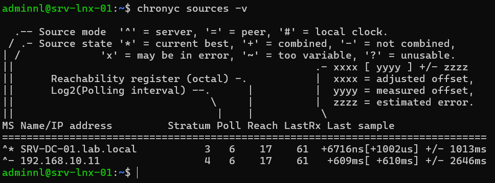
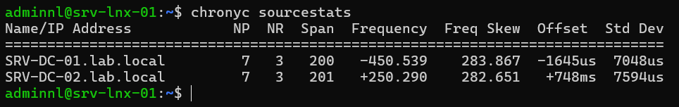

## Introduction

Cette procédure décrit la synchronisation de l'heure des serveurs Linux Debian 13 (trixie) et Ubuntu 24.04 LTS avec **chrony**, en prenant comme sources les contrôleurs de domaine SRV-DC-01 et SRV-DC-02 du domaine `lab.local`. Elle couvre aussi la transformation d'un serveur Linux en serveur NTP local pour les autres machines du réseau 192.168.10.0/24.

Le périmètre comprend le remplacement de systemd-timesyncd, l'écriture des sources dans `/etc/chrony/sources.d/`, le contrôle avec `chronyc`, et l'ouverture du service NTP. La configuration du service de temps Windows (W32Time) sur les contrôleurs de domaine sort du périmètre.

## Contexte et Justification

Une dérive d'horloge de quelques minutes suffit à provoquer des incidents difficiles à diagnostiquer :

- **Kerberos :** l'authentification échoue au-delà de 5 minutes d'écart avec le contrôleur de domaine (tolérance par défaut d'Active Directory). Un serveur Linux joint à `lab.local` devient inaccessible aux comptes du domaine.
- **Corrélation des journaux :** l'analyse d'un incident sur plusieurs serveurs devient impossible si les horodatages divergent.
- **TLS et certificats :** une horloge en avance ou en retard fait rejeter des certificats valides.
- **Sauvegardes et tâches planifiées :** les rotations et les rétentions reposent sur des dates cohérentes.

Dans un domaine Active Directory, la référence de temps est le contrôleur de domaine qui porte le rôle d'émulateur PDC. Aligner les serveurs Linux sur SRV-DC-01 et SRV-DC-02 garantit qu'ils partagent la même heure que les clients Windows.

## Concepts Clés

**NTP (Network Time Protocol) :** Protocole de synchronisation d'horloge sur UDP 123. Il mesure le délai aller-retour et le décalage avec plusieurs sources et corrige l'horloge progressivement.

**chrony :** Implémentation complète de NTP composée du démon `chronyd` et de l'outil de contrôle `chronyc`. Il fonctionne en client et en serveur, converge rapidement et tolère les machines virtuelles et les connexions intermittentes.

**systemd-timesyncd :** Client SNTP minimal intégré à systemd. Il sait se synchroniser sur une source mais ne peut pas servir l'heure aux autres machines et offre peu de diagnostic.

**Client par défaut selon la distribution :**

| Distribution | Client installé par défaut | Remarque |
|--------------|----------------------------|----------|
| Debian 13 (trixie) | systemd-timesyncd | chrony disponible dans les dépôts |
| Ubuntu 24.04 LTS | systemd-timesyncd | chrony disponible dans les dépôts |
| Ubuntu 25.10 et 26.04 LTS | chrony | Sources Ubuntu en NTS activées par défaut |

: Client NTP par défaut

**Stratum :** Distance à une horloge de référence. Une horloge atomique ou GPS est au stratum 0, un serveur qui s'y synchronise au stratum 1, et ainsi de suite.

**Décalage (offset) et correction :** chrony corrige l'horloge par accélération ou ralentissement (slew), sans saut. La directive `makestep` autorise un saut (step) lorsque l'écart est important, typiquement au démarrage.

**NTS (Network Time Security) :** Extension qui authentifie les échanges NTP par TLS (négociation sur TCP 4460). Les contrôleurs de domaine Windows ne la prennent pas en charge.

**Fichiers de chrony sur Debian et Ubuntu :**

- `/etc/chrony/chrony.conf` : fichier principal.
- `/etc/chrony/sources.d/*.sources` : fichiers de sources, inclus par la directive `sourcedir`.
- `/etc/chrony/conf.d/*.conf` : compléments de configuration, inclus par la directive `confdir`.
- Le service se nomme `chrony.service` (alias `chronyd.service`).

## Prérequis

- Un serveur Debian 13 ou Ubuntu 24.04 LTS (srv-lnx-01, 192.168.10.21) avec un compte membre de `sudo`.
- SRV-DC-01 (192.168.10.10) et SRV-DC-02 (192.168.10.11) joignables en UDP 123, avec le service W32Time actif. L'émulateur PDC doit lui-même être synchronisé sur une source externe fiable.
- La résolution DNS de `srv-dc-01.lab.local` et `srv-dc-02.lab.local` depuis le serveur Linux.
- Un fuseau horaire correct, par exemple `sudo timedatectl set-timezone Europe/Paris`.

## Points de Vigilance

**Un seul service de synchronisation.** chrony et systemd-timesyncd ne doivent pas fonctionner ensemble. Sur Debian et Ubuntu, l'installation du paquet `chrony` retire `systemd-timesyncd`. Sur un serveur Ubuntu mis à niveau depuis une version antérieure à 25.10, systemd-timesyncd peut rester actif et chrony désactivé : vérifiez avec `timedatectl` après la mise à niveau.

**NTS par défaut sur Ubuntu 25.10 et 26.04 LTS.** Le fichier `/etc/chrony/sources.d/ubuntu-ntp-pools.sources` pointe vers les serveurs NTS d'Ubuntu (TCP 4460 et UDP 123 vers Internet). Dans un réseau qui bloque ces flux ou qui doit suivre l'heure du domaine, désactivez ce fichier et déclarez les contrôleurs de domaine en NTP classique.

**Sources DHCP.** La directive `sourcedir /run/chrony-dhcp` ajoute les serveurs NTP reçus par l'option DHCP 42. Si le serveur DHCP annonce une source différente des contrôleurs de domaine, elle s'ajoute à votre liste. Commentez cette ligne sur les serveurs à adressage fixe.

**Dispersion élevée annoncée par W32Time.** Le service de temps Windows peut annoncer une dispersion racine importante, ce qui conduit chrony à rejeter la source. La directive `maxdistance` permet d'assouplir ce contrôle (voir « Dépannage »).

**Machines virtuelles.** Désactivez la synchronisation de l'heure par l'hyperviseur (services d'intégration Hyper-V, VMware Tools) lorsque chrony est actif, sauf au démarrage. Deux mécanismes concurrents provoquent des sauts d'horloge.

**Serveur NTP ouvert.** La directive `allow` sans argument ouvre le service à toutes les adresses. Limitez-la toujours à un réseau précis.

## Choix Architecturaux & Alternatives

### Quand choisir chrony

chrony est le bon choix pour tout serveur Linux de production : il converge vite, supporte les sources multiples et le NTS, fournit un diagnostic détaillé et peut servir l'heure à d'autres machines. Il est obligatoire dès qu'un serveur Linux doit jouer le rôle de serveur NTP local (réseau isolé, DMZ, équipements qui ne joignent pas les contrôleurs de domaine).

systemd-timesyncd reste acceptable sur un poste ou un conteneur simple qui n'a besoin que d'une source unique et ne sert l'heure à personne.

### Alternatives et comparatif

| Option | Cas d'usage typique | Force principale | Faiblesse principale | Coût relatif |
|--------|---------------------|------------------|----------------------|--------------|
| **chrony** | Serveurs, machines virtuelles, serveur NTP local | Convergence rapide, NTS, client et serveur, diagnostic complet | Configuration un peu plus riche que timesyncd | Gratuit |
| **systemd-timesyncd** | Postes, conteneurs, besoins simples | Intégré à systemd, aucune configuration | Client SNTP seul, ne sert pas l'heure, diagnostic limité | Gratuit |
| **ntpsec** | Remplaçant historique de ntpd | Héritier sécurisé de ntpd, compatible avec ses configurations | Moins répandu, convergence plus lente que chrony | Gratuit |
| **Horloge matérielle dédiée (GPS, PTP)** | Finance, industrie, télécoms | Précision de l'ordre de la microseconde | Matériel spécifique et exploitation dédiée | Élevé |

### Impact des choix

- **Sécurité.** Prendre l'heure des contrôleurs de domaine garantit le fonctionnement de Kerberos. Le NTS protège contre l'usurpation de source, mais n'est utilisable qu'avec des serveurs qui le prennent en charge.
- **Disponibilité.** Deux sources (SRV-DC-01 et SRV-DC-02) évitent qu'une panne de contrôleur ne laisse le serveur sans référence. Avec deux sources seulement, chrony ne peut pas départager un désaccord : trois sources ou plus sont préférables en production.
- **Exploitation.** Un fichier dédié dans `/etc/chrony/sources.d/` se déploie facilement par Ansible sans modifier le fichier fourni par le paquet.
- **Coût.** Gratuit, inclus dans les dépôts des deux distributions.

## Configuration

### Vérifier l'état actuel

```bash
timedatectl
systemctl status systemd-timesyncd chrony --no-pager
```

`timedatectl` indique si une synchronisation NTP est active (`NTP service: active`) et si l'horloge est synchronisée.

### Installer chrony

```bash
sudo apt update
sudo apt install chrony
```

Sur Debian 13 et Ubuntu 24.04, cette commande retire systemd-timesyncd. Sur Ubuntu 26.04 LTS, chrony est déjà installé.

### Déclarer les contrôleurs de domaine comme sources

Créez un fichier de sources dédié :

```bash
sudo nano /etc/chrony/sources.d/lab-local.sources
```

```text
server srv-dc-01.lab.local iburst prefer
server srv-dc-02.lab.local iburst
```

`iburst` envoie une rafale de requêtes au démarrage pour accélérer la première synchronisation. `prefer` donne la priorité à SRV-DC-01 lorsque les sources sont de qualité comparable.

<div class="callout callout-note">

Placez la source préférée sur le contrôleur qui porte le rôle d'émulateur PDC. Vérifiez-le sur un contrôleur avec `netdom query fsmo`.

</div>

### Désactiver les sources par défaut

Dans `/etc/chrony/chrony.conf`, commentez les lignes `pool` fournies par la distribution, ainsi que la source DHCP sur un serveur à adresse fixe :

```bash
sudo nano /etc/chrony/chrony.conf
```

```text
# pool 2.debian.pool.ntp.org iburst
# sourcedir /run/chrony-dhcp
sourcedir /etc/chrony/sources.d
```

Sur Ubuntu 25.10 et 26.04 LTS, les sources par défaut se trouvent dans un fichier séparé. Renommez-le pour qu'il ne soit plus chargé :

```bash
sudo mv /etc/chrony/sources.d/ubuntu-ntp-pools.sources /etc/chrony/sources.d/ubuntu-ntp-pools.sources.disabled
```

<div class="callout callout-note">

Le contenu exact de `chrony.conf` varie selon la distribution et la version du paquet. Conservez les directives `driftfile`, `makestep`, `rtcsync` et `leapsectz` présentes par défaut.

</div>

### Appliquer la configuration

```bash
sudo systemctl restart chrony
```

Pour recharger uniquement les fichiers de sources, sans redémarrage :

```bash
sudo chronyc reload sources
```

### Forcer une correction immédiate

Si l'écart initial est important et que le serveur vient d'être installé :

```bash
sudo chronyc makestep
```

### Transformer le serveur en serveur NTP local

Pour que srv-lnx-01 serve l'heure au réseau 192.168.10.0/24, créez un complément de configuration :

```bash
sudo nano /etc/chrony/conf.d/serveur-ntp.conf
```

```text
# Autoriser les clients du réseau local
allow 192.168.10.0/24

# Continuer à servir l'heure si toutes les sources sont perdues
local stratum 10
```

`local stratum 10` permet au serveur de répondre avec un stratum volontairement élevé en cas de perte des contrôleurs de domaine, pour que les clients le considèrent comme une source de dernier recours.

Redémarrez chrony et ouvrez le port :

```bash
sudo systemctl restart chrony
sudo ufw allow from 192.168.10.0/24 to any port 123 proto udp comment 'NTP'
```

### Configurer un client Linux sur ce serveur

Sur srv-lnx-02, après installation de chrony :

```bash
echo "server srv-lnx-01.lab.local iburst" | sudo tee /etc/chrony/sources.d/srv-lnx-01.sources
sudo chronyc reload sources
```

## Vérifications

**Sources :** `chronyc sources -v` liste SRV-DC-01 et SRV-DC-02. Le caractère `*` désigne la source sélectionnée, `+` une source combinée, `-` une source exclue, `?` une source injoignable.

```bash
chronyc sources -v
```



<p class="figure-caption"><b>Figure 1</b> · Résultat de la commande.</p>

**État de la synchronisation :** `chronyc tracking` affiche la source de référence (`Reference ID`), le stratum, le décalage (`System time`) et l'état (`Leap status : Normal`).

```bash
chronyc tracking
```

**Statistiques des sources :** `chronyc sourcestats` affiche la dérive et l'écart type estimés pour chaque source.



<p class="figure-caption"><b>Figure 2</b> · Résultat de la commande.</p>

**Vue système :** `timedatectl` affiche `System clock synchronized: yes` et `NTP service: active`.

**Clients servis :** sur le serveur NTP local, `sudo chronyc clients` liste les machines qui l'interrogent.

**Écart avec Kerberos :** sur un serveur joint au domaine, `kinit utilisateur@LAB.LOCAL` réussit sans erreur de décalage d'horloge.

## Dépannage

**« chronyc sources affiche ? ou ^? pour les contrôleurs » :** la source est injoignable. Vérifiez la résolution DNS de `srv-dc-01.lab.local`, le flux UDP 123 entre les deux machines et l'état du service W32Time sur le contrôleur.

**« Les sources apparaissent avec un x ou ne sont jamais sélectionnées » :** chrony juge la source incohérente ou trop dispersée. Avec W32Time, ajoutez dans `/etc/chrony/conf.d/ad.conf` une directive `maxdistance 16.0`, redémarrez chrony et vérifiez avec `chronyc sources`. Corrigez aussi la configuration W32Time de l'émulateur PDC s'il n'a pas de source externe fiable.

**« timedatectl indique NTP service: inactive » :** chrony est arrêté ou systemd-timesyncd est encore actif. Lancez `sudo systemctl enable --now chrony` et vérifiez que `systemd-timesyncd` n'est plus installé.

**« L'heure saute régulièrement sur une VM » :** l'hyperviseur corrige aussi l'horloge. Désactivez la synchronisation de l'heure dans les services d'intégration de la VM.

**« Les clients n'obtiennent pas l'heure du serveur NTP local » :** vérifiez la directive `allow`, le pare-feu (`sudo ufw status`) et que chrony écoute sur UDP 123 avec `sudo ss -ulpn | grep 123`.

**« Échec Kerberos : Clock skew too great » :** l'écart dépasse la tolérance du domaine. Exécutez `sudo chronyc makestep`, puis contrôlez la sélection des sources.

## Conseils et Bonnes Pratiques

**Utiliser des fichiers dédiés.** Placez vos sources dans `/etc/chrony/sources.d/` et vos compléments dans `/etc/chrony/conf.d/` plutôt que de modifier le fichier du paquet. Les mises à jour ne génèrent alors pas de conflit de configuration.

**Hiérarchie claire.** Émulateur PDC sur une source externe fiable, autres contrôleurs sur l'émulateur, serveurs Linux et Windows sur les contrôleurs. Un serveur NTP Linux local ne sert qu'aux équipements qui ne peuvent pas joindre les contrôleurs.

**Au moins deux sources, idéalement trois.** Trois sources permettent à chrony d'écarter une horloge fausse.

**Superviser l'écart.** Ajoutez une sonde Zabbix ou un script qui alerte lorsque `chronyc tracking` dépasse un décalage de 100 ms ou que le statut n'est plus `Normal`.

**Documenter le choix NTS.** Sur Ubuntu 26.04 LTS, notez dans la fiche du serveur que les sources NTS par défaut ont été remplacées par les contrôleurs de domaine, et pourquoi.

## Procédures Liées

- [Configuration d'un Serveur de Temps (NTP) pour un Domaine AD](/procedures/windows/configuration-dun-serveur-de-temps-ntp-pour-un-domaine-ad) *(Configuration de W32Time sur l'émulateur PDC)*
- [Intégration d'un Serveur Linux à Active Directory (realmd et SSSD)](/procedures/linux/integration-dun-serveur-linux-a-active-directory-realmd-et-sssd) *(Kerberos exige une heure synchronisée)*
- [Configuration du Pare-feu avec UFW et nftables](/procedures/linux/configuration-du-pare-feu-avec-ufw-et-nftables) *(Ouverture du port UDP 123)*
- [Gestion des Services avec systemd et journald](/procedures/linux/gestion-des-services-avec-systemd-et-journald) *(Pilotage du service chrony)*
- [Installation de Zabbix](/procedures/linux/installation-de-zabbix) *(Supervision de l'écart d'horloge)*
