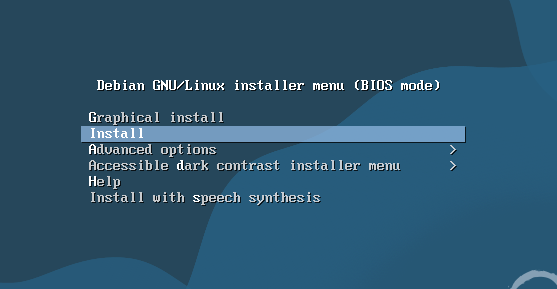
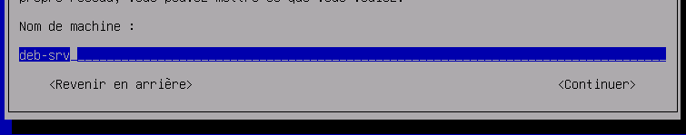
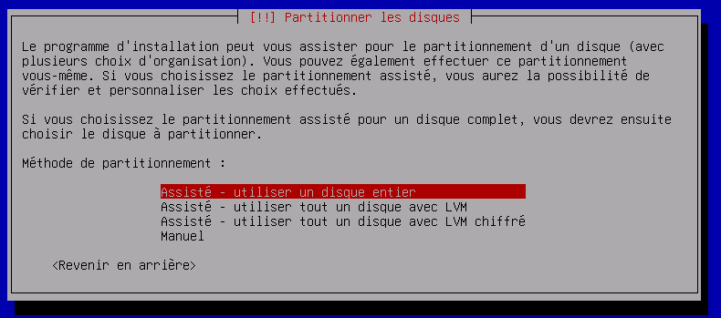
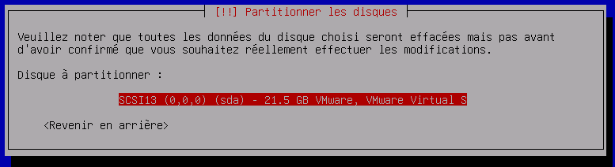
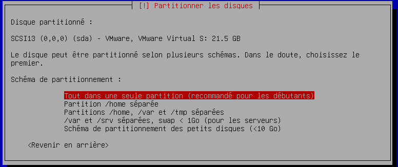
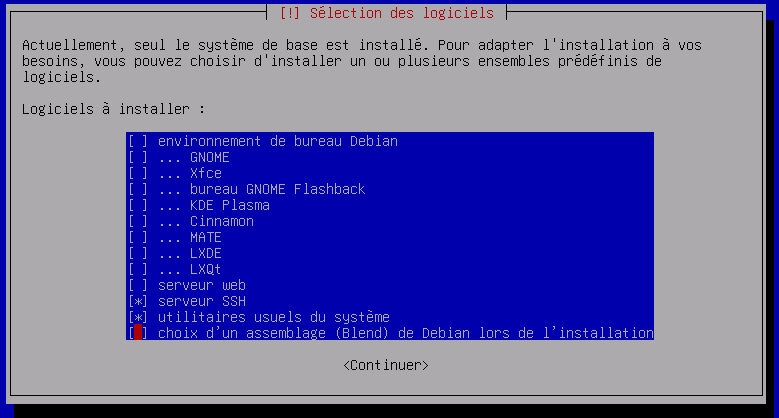
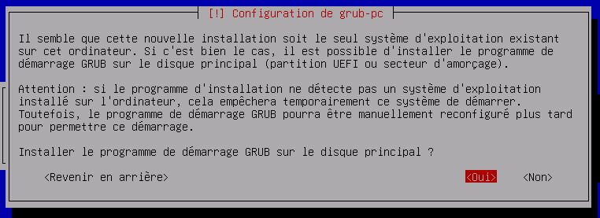
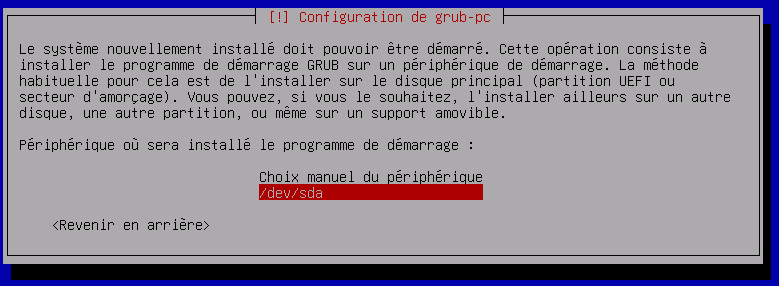
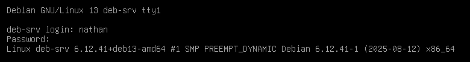

## Introduction

Ce document a pour objectif de détailler, étape par étape, la procédure d'installation et de configuration initiale d'un serveur Debian sans interface graphique (en mode CLI, Command Line Interface). L'approche en ligne de commande est privilégiée pour les serveurs afin d'optimiser les ressources et la sécurité.

Cette procédure est destinée aux administrateurs système, aux étudiants et aux techniciens souhaitant déployer une machine virtuelle ou physique sous Debian Server.

## Prérequis

Avant de commencer, assurez-vous de disposer des éléments suivants :

- **Fichier ISO :** L'image disque (.iso) d'un serveur Debian, [téléchargeable ici](https://www.debian.org/distrib/).
- **Plateforme d'Installation :** Une machine physique ou un environnement de virtualisation (VMware, VirtualBox, Hyper-V, etc.).
- **Connectivité :** Un accès à Internet est requis pour le téléchargement des paquets et les mises à jour.

## Procédure d'Installation

### Démarrage et Lancement de l'Installateur

1. Montez le fichier ISO de Debian Server sur votre machine virtuelle ou créez une clé USB bootable.
2. Démarrez la machine sur le média d'installation.
3. Dans le menu de démarrage, sélectionnez l'option « Install » (et non « Graphical Install ») et validez avec la touche « Entrée ».



<p class="figure-caption"><b>Figure 1</b> · Menu de démarrage de l'installateur Debian</p>

### Configuration Initiale (Langue, Clavier, Réseau)

1. Suivez les instructions pour choisir la langue, le pays et la disposition de votre clavier.
2. Définissez le **nom d'hôte** de la machine.



<p class="figure-caption"><b>Figure 2</b> · Nom d'hôte de la machine</p>

3. Si votre réseau utilise un nom de domaine, renseignez-le. Sinon, laissez ce champ vide et continuez.

### Création des Utilisateurs

1. Définissez un mot de passe robuste pour l'utilisateur root (super-utilisateur).
2. Créez un utilisateur standard (non root) en renseignant son nom complet, un nom d'utilisateur et un mot de passe sécurisé.

### Configuration du Stockage

1. Pour une installation standard, choisissez la méthode « Assisté – utiliser un disque entier ».



<p class="figure-caption"><b>Figure 3</b> · Méthode de partitionnement assistée</p>

2. Sélectionnez le disque dur sur lequel installer le système.



<p class="figure-caption"><b>Figure 4</b> · Choix du disque</p>

3. Il est généralement recommandé de conserver le schéma de partitionnement par défaut (« Tout dans une seule partition » pour les débutants).
4. Sur l'écran récapitulatif, sélectionnez « Terminer le partitionnement et appliquer les changements », puis confirmez en choisissant « Oui ».



<p class="figure-caption"><b>Figure 5</b> · Application du partitionnement</p>

### Configuration des Paquets et Services

1. Confirmez le pays du miroir d'archive des paquets pour garantir des téléchargements rapides.
2. Un écran vous permet de choisir des ensembles de logiciels à installer. Pour un serveur CLI :
   - Décochez la ligne « environnement de bureau Debian ».
   - Décochez la ligne « GNOME ».
   - Cochez la ligne « serveur SSH ».
   - Laissez « utilitaires usuels du système » coché.



<p class="figure-caption"><b>Figure 6</b> · Sélection des logiciels</p>

### Installation du Programme de Démarrage (GRUB)

1. À la question « Installer le programme de démarrage GRUB ? », choisissez « Oui ».



<p class="figure-caption"><b>Figure 7</b> · Installation de GRUB</p>

2. Sélectionnez votre disque dur principal pour l'installation de GRUB (généralement `/dev/sda`).



<p class="figure-caption"><b>Figure 8</b> · Disque cible de GRUB</p>

### Finalisation de l'Installation

L'installateur procède à la copie des fichiers et à l'installation des paquets système. Cette étape peut prendre plusieurs minutes. Une fois terminée, l'option « Redémarrer maintenant » apparaît.

## Premiers Pas Post-Installation

### Redémarrage et Connexion

1. Sélectionnez « Redémarrer maintenant » et retirez le média d'installation (ISO ou clé USB) lorsque vous y êtes invité.
2. Une fois le système redémarré, connectez-vous avec le nom d'utilisateur et le mot de passe créés précédemment.



<p class="figure-caption"><b>Figure 9</b> · Première connexion</p>

### Mise à Jour du Système

1. Passez en super-utilisateur (root) avec la commande `su -`. Entrez le mot de passe défini lors de l'installation.


<p class="figure-caption"><b>Figure 10</b> · Passage en root</p>

2. Exécutez la commande suivante pour mettre à jour la liste des paquets et appliquer les mises à jour de sécurité :

```bash
apt update && apt upgrade -y
```

### (Optionnel) Installation des Outils pour VMware

Si votre machine virtuelle est hébergée sur un environnement VMware, l'installation des outils est recommandée.

1. Exécutez la commande suivante :

```bash
apt install open-vm-tools -y
```

<div class="callout callout-note">

Votre serveur Debian est maintenant installé, mis à jour et prêt à être utilisé. Vous pouvez désormais procéder à l'installation des applications spécifiques à votre projet.

</div>

## Procédures Liées

- [Installation d'un Serveur Ubuntu en Ligne de Commande (CLI)](/procedures/linux/installation-dun-serveur-ubuntu-en-ligne-de-commande-cli) *(Variante Ubuntu)*
- [Configuration Réseau avec Netplan](/procedures/linux/configuration-reseau-avec-netplan) *(Configuration réseau, avec l'équivalent ifupdown de Debian)*
- Sécurisation d'OpenSSH (Clés, Durcissement, Fail2ban) *(Sécurisation de l'accès distant)*
- [Gestion des Paquets APT et Mises à Jour Automatiques](/procedures/linux/gestion-des-paquets-apt-et-mises-a-jour-automatiques) *(Mises à jour du système)*
- [Gestion des Utilisateurs, Groupes et de sudo](/procedures/linux/gestion-des-utilisateurs-groupes-et-de-sudo) *(Comptes et droits d'administration)*
