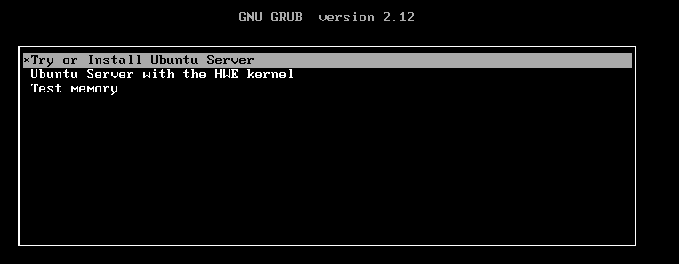
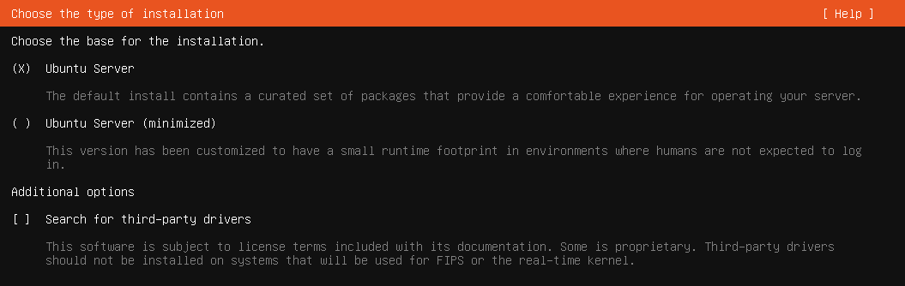
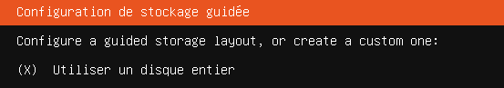
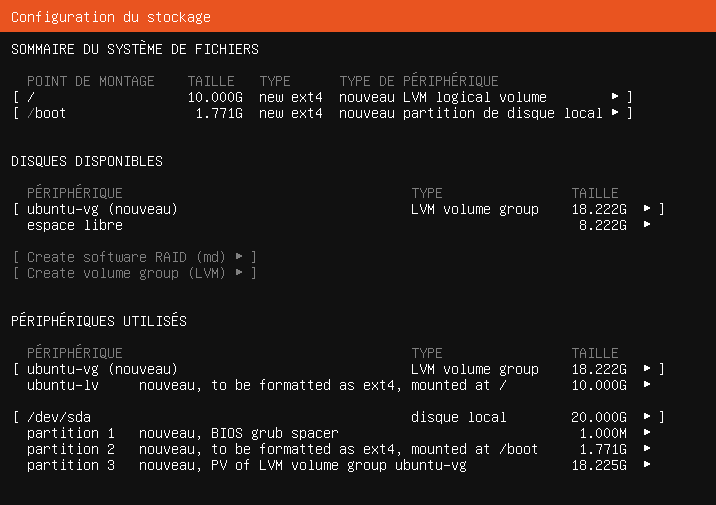
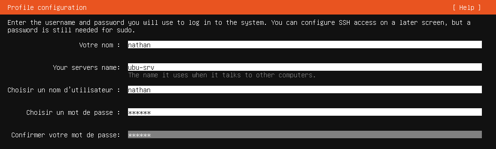
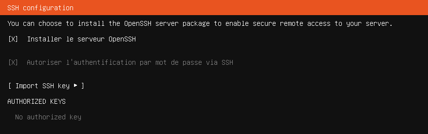
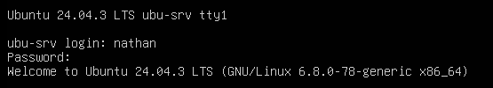
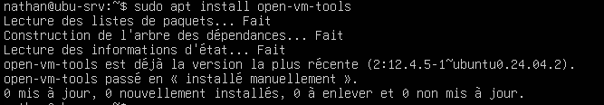

## Introduction

Ce document a pour objectif de détailler, étape par étape, la procédure d'installation et de configuration initiale d'un serveur Ubuntu sans interface graphique (en mode CLI, Command Line Interface). L'approche en ligne de commande est privilégiée pour les serveurs afin d'optimiser les ressources et la sécurité.

Cette procédure est destinée aux administrateurs système, aux étudiants et aux techniciens souhaitant déployer une machine virtuelle ou physique sous Ubuntu Server.

## Prérequis

Avant de commencer, assurez-vous de disposer des éléments suivants :

- **Fichier ISO :** L'image disque (.iso) d'Ubuntu Server, [téléchargeable ici](https://ubuntu.com/download/server).
- **Plateforme d'Installation :** Une machine physique ou un environnement de virtualisation (VMware, VirtualBox, Hyper-V, etc.) prêt à accueillir la nouvelle installation.
- **Connectivité :** Un accès à Internet est requis pour le téléchargement des paquets et les mises à jour.

## Procédure d'Installation

### Démarrage et Lancement de l'Installateur

1. Montez le fichier ISO d'Ubuntu Server sur votre machine virtuelle ou créez une clé USB bootable pour une machine physique.
2. Démarrez la machine sur le média d'installation.
3. Dans le menu de démarrage, sélectionnez l'option « Try or Install Ubuntu Server » et validez avec la touche « Entrée ».



<p class="figure-caption"><b>Figure 1</b> · Menu de démarrage d'Ubuntu Server</p>

### Configuration Initiale (Langue, Clavier, Réseau)

1. Suivez les instructions pour choisir la langue de l'installateur, la disposition de votre clavier et votre région.
2. Choisissez le type d'installation de base. Il est recommandé de sélectionner « Ubuntu Server » (version par défaut) plutôt que la version minimisée pour une expérience plus complète.



<p class="figure-caption"><b>Figure 2</b> · Type d'installation</p>

3. Configurez l'interface réseau. Vous pouvez utiliser le DHCP pour une attribution automatique d'adresse IP ou définir une configuration statique (adresse IP, masque, passerelle, DNS) selon les besoins de votre infrastructure.
4. L'installateur vous demande si vous devez utiliser un proxy pour vous connecter à Internet.
   - Si votre réseau **ne nécessite pas de proxy**, laissez le champ vide et appuyez sur « Entrée » pour continuer.
   - Si votre réseau **exige un proxy**, entrez son adresse en respectant le format indiqué.
5. Choisissez le serveur de téléchargement (miroir) pour les paquets Ubuntu. L'adresse proposée par défaut est presque toujours le meilleur choix pour une vitesse de téléchargement optimale. Laissez la valeur par défaut et continuez, sauf si vous avez une raison spécifique d'utiliser un autre miroir.

### Configuration du Stockage

1. Pour une installation standard, choisissez « Utiliser un disque entier ». Cette option formatera l'intégralité du disque sélectionné.



<p class="figure-caption"><b>Figure 3</b> · Utiliser un disque entier</p>

2. Sélectionnez le disque dur sur lequel installer le système.


<p class="figure-caption"><b>Figure 4</b> · Choix du disque et LVM</p>

3. Il est conseillé de cocher la case « Set up this disk as an LVM group ». LVM (Logical Volume Management) offre plus de flexibilité pour gérer l'espace de stockage à l'avenir.
4. Un écran récapitulatif du partitionnement s'affiche. Vérifiez la configuration, sélectionnez « Terminé », puis appuyez sur « Continuer » pour confirmer et écrire les changements sur le disque.



<p class="figure-caption"><b>Figure 5</b> · Récapitulatif du partitionnement</p>

### Création du Profil Utilisateur

1. Remplissez les champs pour configurer votre premier utilisateur. Cet utilisateur disposera des droits « sudo » (super-utilisateur).
2. Donnez un nom d'hôte à la machine.



<p class="figure-caption"><b>Figure 6</b> · Profil utilisateur et nom d'hôte</p>

### Configuration des Services Additionnels

1. Sur l'écran de configuration SSH, cochez la case « Installer le serveur OpenSSH ». L'installation d'OpenSSH est une étape cruciale qui vous permettra de vous connecter et de gérer votre serveur à distance de manière sécurisée.



<p class="figure-caption"><b>Figure 7</b> · Installation du serveur OpenSSH</p>

2. L'installateur vous propose ensuite une liste de services populaires (comme Docker, Nextcloud, etc.). Pour une installation standard, il est conseillé de **ne rien sélectionner** et de continuer en appuyant sur « Entrée ». Il est plus propre d'installer ces logiciels manuellement une fois le système de base mis à jour.

### Finalisation de l'Installation

L'installateur procède à la copie des fichiers et à l'installation des paquets système. Cette étape peut prendre plusieurs minutes. Une fois terminée, l'option « Redémarrer maintenant » apparaît.

## Premiers Pas Post-Installation

### Redémarrage et Connexion

1. Sélectionnez « Redémarrer maintenant » et retirez le média d'installation (ISO ou clé USB) lorsque vous y êtes invité.
2. Une fois le système redémarré, connectez-vous avec le nom d'utilisateur et le mot de passe créés précédemment.



<p class="figure-caption"><b>Figure 8</b> · Première connexion</p>

### Mise à Jour du Système

Il est primordial de mettre à jour votre système immédiatement après l'installation pour appliquer les derniers correctifs de sécurité.

1. Exécutez la commande suivante :

```bash
sudo apt update && sudo apt upgrade -y
```


<p class="figure-caption"><b>Figure 9</b> · Mise à jour des paquets</p>

### (Optionnel) Installation des Outils pour VMware

Si votre machine virtuelle est hébergée sur un environnement VMware, l'installation des outils VMware est fortement recommandée pour améliorer les performances et l'intégration entre l'hôte et la VM.

1. Exécutez la commande suivante :

```bash
sudo apt install open-vm-tools -y
```



<p class="figure-caption"><b>Figure 10</b> · Installation d'open-vm-tools</p>

<div class="callout callout-note">

Votre serveur Ubuntu est maintenant installé, mis à jour et prêt à être utilisé. Vous pouvez désormais procéder à l'installation des applications spécifiques à votre projet.

</div>

## Procédures Liées

- [Installation d'un Serveur Debian en Ligne de Commande (CLI)](/procedures/linux/installation-dun-serveur-debian-en-ligne-de-commande-cli) *(Variante Debian)*
- [Configuration Réseau avec Netplan](/procedures/linux/configuration-reseau-avec-netplan) *(Configuration réseau persistante)*
- Sécurisation d'OpenSSH (Clés, Durcissement, Fail2ban) *(Sécurisation de l'accès distant)*
- [Gestion des Paquets APT et Mises à Jour Automatiques](/procedures/linux/gestion-des-paquets-apt-et-mises-a-jour-automatiques) *(Mises à jour du système)*
- [Installation de Docker et Portainer sur Ubuntu](/procedures/linux/installation-de-docker-et-portainer-sur-ubuntu) *(Hôte de conteneurs)*
