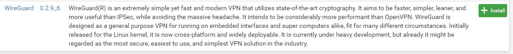
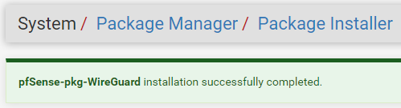
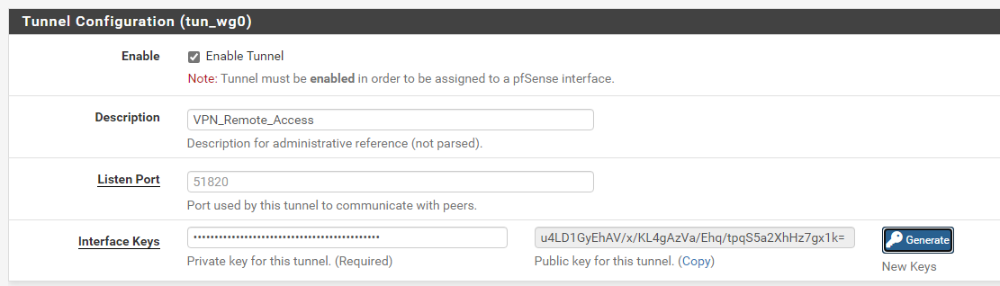
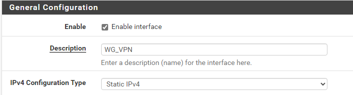
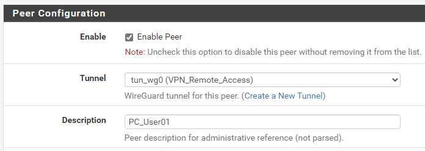

## Introduction

Cette procédure détaille la mise en œuvre d'un serveur VPN (Virtual Private Network) basé sur le protocole **WireGuard** au sein du pare-feu pfSense. Elle permet de connecter des équipements distants au réseau local de l'entreprise de manière sécurisée.

## Contexte et Justification

L'exposition directe de services internes (RDP, SSH, Intranet) sur Internet constitue un risque de sécurité majeur.

- **Sécurisation :** Le VPN encapsule le trafic dans un tunnel chiffré.
- **Mobilité :** Permet aux collaborateurs nomades d'accéder aux ressources internes comme s'ils étaient connectés physiquement au réseau local.
- **Performance :** WireGuard offre un débit supérieur et une latence inférieure par rapport aux protocoles historiques (IPsec, OpenVPN).

## Concepts Clés

**Tunnel :** Interface réseau virtuelle chiffrée disposant de sa propre plage d'adressage IP.

**Peer (Pair) :** Tout périphérique connecté au VPN (serveur ou client). L'authentification se fait par échange de clés cryptographiques.

**Handshake :** Processus de « poignée de main » qui valide la connexion entre deux pairs uniquement si les clés correspondent.

**Endpoint :** L'adresse IP publique et le port d'écoute du serveur VPN.

## Prérequis

- Un pare-feu pfSense opérationnel (version 2.5.0 ou supérieure, cf. procédure *Installation et Configuration Initiale de pfSense*).
- Une adresse IP publique sur l'interface WAN (ou une redirection de port UDP configurée sur le routeur en amont).
- Droits d'administration sur le pare-feu.

## Installation du Paquet

WireGuard n'est pas activé par défaut dans le noyau de certaines versions de pfSense et nécessite un paquet.

1. Naviguez vers **System \> Package Manager**.
2. Allez dans l'onglet **Available Packages**.
3. Recherchez « WireGuard ».
4. Installez le paquet **pfSense-pkg-WireGuard**.

<b>Figure 1</b> · Paquet WireGuard dans le Package Manager

5. Attendez la confirmation de l'installation (« Success »).

<b>Figure 2</b> · Installation réussie

## Configuration du Serveur (Tunnel)

### Création de l'Interface Tunnel

1. Allez dans **VPN \> WireGuard \> Tunnels**.
2. Cliquez sur **Add Tunnel**.
3. **Enable :** Cochez la case.
4. **Description :** `VPN_Remote_Access`.
5. **Listen Port :** `51820` (port standard).
6. **Interface Keys :** Cliquez sur **Generate**. La *Private Key* reste secrète, la *Public Key* sera utilisée par les clients.

<b>Figure 3</b> · Paramètres du tunnel WireGuard

7. **Interface Addresses :** Définissez un sous-réseau unique dédié au VPN, qui ne chevauche pas le LAN (ex : `10.200.0.1/24`).
8. Cliquez sur **Save Tunnel**.

### Assignation et Activation de l'Interface Logique

Pour appliquer des règles de pare-feu, le tunnel doit être déclaré comme une interface.

1. Allez dans **Interfaces \> Assignments**.
2. Dans le menu déroulant « Available network ports », sélectionnez le tunnel créé (ex : `tun_wg0`).

<b>Figure 4</b> · Ajout du tunnel dans les assignations

3. Cliquez sur **Add**.
4. Cliquez sur le nom de la nouvelle interface (ex : `OPTX`) pour la configurer :
   - **Enable :** Cochez la case.
   - **Description :** `WG_VPN` (nommage générique).
   - **IPv4 Configuration Type :** `Static IPv4`.
   - **IPv4 Address :** Renseignez la même IP que celle du tunnel (ex : `10.200.0.1` / `24`).

<b>Figure 5</b> · Configuration de l'interface WG_VPN

5. Cliquez sur **Save** puis **Apply Changes**.

## Configuration d'un Client (Peer)

**Justification :** Chaque utilisateur ou appareil distant doit être déclaré.

1. Allez dans **VPN \> WireGuard \> Peers**.
2. Cliquez sur **Add Peer**.
3. **Tunnel :** Sélectionnez le tunnel créé (`tun_wg0`).
4. **Description :** Nom de l'utilisateur ou de l'appareil (ex : `PC_User01`).

<b>Figure 6</b> · Déclaration d'un peer

5. **Pre-shared Key :** Cliquez sur **Generate** (renforce la sécurité).
6. **Allowed IPs :** L'adresse IP unique attribuée à ce client dans le tunnel (ex : `10.200.0.2/32`). Le masque /32 est impératif pour isoler le client.
7. **Peer Keys :** Si le client n'a pas encore de clés, cliquez sur **Generate** pour les créer ici.
8. Cliquez sur **Save Peer**.

Pour que le tunnel soit utilisable, il reste à autoriser le port UDP 51820 sur l'interface WAN (**Firewall \> Rules \> WAN**), à créer les règles de trafic sur l'interface `WG_VPN`, puis à importer la configuration sur le client WireGuard.

## Procédures Liées

- [Installation et Configuration Initiale de pfSense](/procedures/pare-feu/installation-et-configuration-initiale-de-pfsense) *(Pare-feu pouvant héberger le VPN)*
- [Configuration du Pare-feu avec UFW et nftables](/procedures/linux/configuration-du-pare-feu-avec-ufw-et-nftables) *(Ouverture du port UDP du tunnel)*
- Sécurisation d'OpenSSH (Clés, Durcissement, Fail2ban) *(Administration à travers le tunnel)*
- Déploiement d'une VPN Gateway Site-to-Site *(Équivalent site à site dans Azure)*
