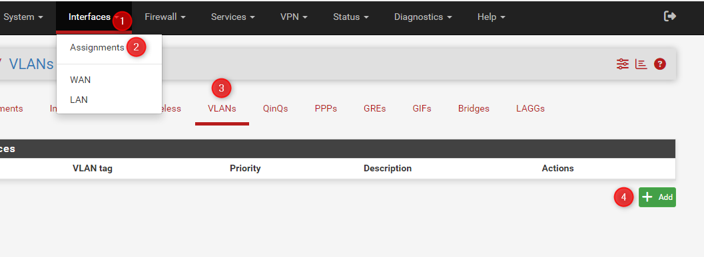
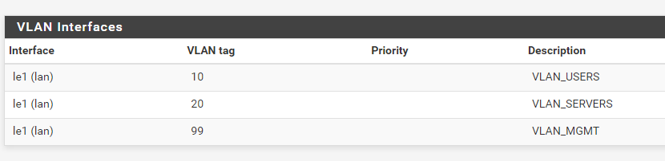
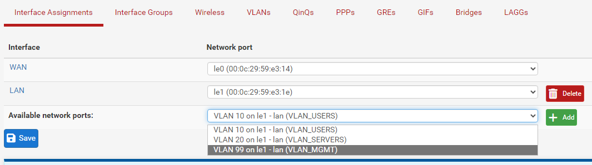
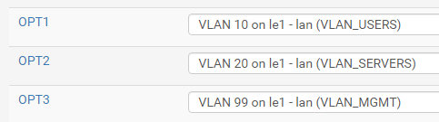
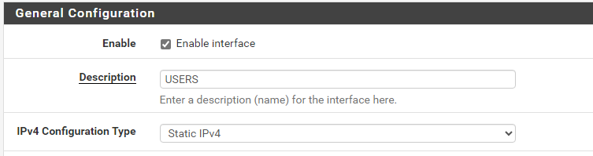
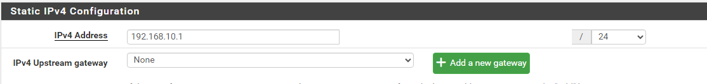
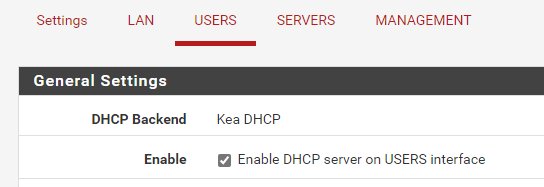
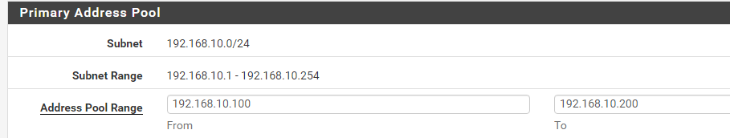
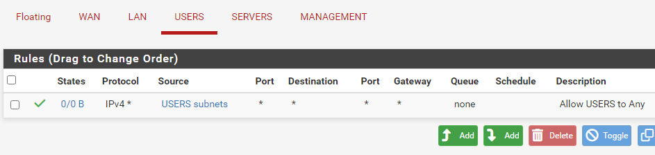

## Introduction

Cette procédure décrit la méthode pour segmenter un réseau physique unique en plusieurs réseaux logiques isolés (VLANs) sur un pare-feu pfSense.

## Contexte et Justification

Dans un réseau « plat » (sans VLAN), tout le monde voit tout le monde. Si un PC utilisateur est infecté par un virus, il peut attaquer directement les serveurs critiques ou les interfaces d'administration. La segmentation permet de :

- **Sécurité :** Isoler les zones sensibles (serveurs, Wi-Fi invité, administration).
- **Performance :** Réduire le domaine de diffusion (broadcast).
- **Organisation :** Séparer logiquement les flux (VoIP, caméras, data).

## Concepts Clés

**VLAN (Virtual Local Area Network) :** Un réseau logique identifié par un numéro (Tag ID).

**Parent Interface :** L'interface physique (câble) du pfSense qui portera tous les VLANs.

**Tagging (802.1Q) :** Le standard qui permet de faire passer plusieurs réseaux dans un seul câble. Chaque paquet reçoit une « étiquette » (Tag 10, Tag 20...).

**Inter-VLAN Routing :** Par défaut, les VLANs sont isolés. C'est pfSense qui agira comme routeur pour autoriser ou refuser le trafic d'un VLAN à l'autre.

## Prérequis

1. Un pare-feu pfSense opérationnel (cf. procédure *Installation et Configuration Initiale de pfSense*).
2. Connaître le nom de l'interface physique LAN (ex : `vtnet1`, `em1` ou `igb1`).
3. **Côté Infrastructure :** Le switch (ou l'hyperviseur, de type Proxmox ou VMware) connecté au pfSense doit être configuré pour accepter les VLANs (Mode « Trunk » ou « VLAN Aware »).

## Configuration

Pour cet exemple générique, nous créerons 3 zones standards :

| VLAN | Nom | Usage | Réseau |
|------|-----|-------|--------|
| 10 | USERS | Postes de travail, Wi-Fi employés | 192.168.10.0/24 |
| 20 | SERVERS | Applications, bases de données | 192.168.20.0/24 |
| 99 | MGMT | Administration des équipements | 192.168.99.0/24 |

: Plan des VLANs

### Création des VLANs

1. Allez dans le menu **Interfaces \> Assignments**.
2. Cliquez sur l'onglet **VLANs**.
3. Cliquez sur **Add** (en bas à droite).

<b>Figure 1</b> · Onglet VLANs

4. Remplissez le formulaire pour le premier VLAN :
   - **Parent Interface :** Sélectionnez votre interface LAN physique.
   - **VLAN Tag :** `10`.
   - **VLAN Priority :** Laissez à 0.
   - **Description :** `VLAN_USERS`.
5. Répétez l'opération pour le VLAN 20 (VLAN_SERVERS) et le VLAN 99 (VLAN_MGMT).

<b>Figure 2</b> · Liste des VLANs créés

### Assignation des Interfaces Logiques

**Justification :** pfSense connaît les tags, il faut maintenant créer les cartes réseau virtuelles associées.

1. Allez dans **Interfaces \> Assignments** (onglet « Interface Assignments »).
2. Dans la liste déroulante « Available network ports », choisissez « VLAN 10 on … ».

<b>Figure 3</b> · Sélection du VLAN 10

3. Cliquez sur **Add**. Une nouvelle interface (ex : OPT1) apparaît dans la liste.
4. Répétez pour le VLAN 20 et VLAN 99.

<b>Figure 4</b> · Interfaces OPT créées

5. Cliquez sur **Save**.

### Configuration des IP et Services

**Justification :** Il faut maintenant allumer ces interfaces et leur donner une adresse IP (qui sera la passerelle des clients).

Exemple pour le VLAN 10 (à répéter pour chaque VLAN) :

1. Cliquez sur le nom de l'interface (ex : **OPT1**) dans le menu **Interfaces**.
2. Cochez **Enable Interface**.
3. **Description :** Renommez-la en `USERS` (plus clair que OPT1).
4. **IPv4 Configuration Type :** Static IPv4.

<b>Figure 5</b> · Activation de l'interface USERS

5. **IPv4 Address :** Définissez l'IP de passerelle (ex : `192.168.10.1` / `24`).

<b>Figure 6</b> · Adresse IPv4 de l'interface

6. Cliquez sur **Save** et **Apply Changes**.

**Activation du DHCP (optionnel mais recommandé pour les zones utilisateurs) :**

1. Allez dans **Services \> DHCP Server**.
2. Cliquez sur l'onglet **USERS**.
3. Cochez **Enable DHCP server on interface USERS**.

<b>Figure 7</b> · Activation du serveur DHCP

4. Définissez la plage (Range) : `192.168.10.100` à `192.168.10.200`.

<b>Figure 8</b> · Plage DHCP du VLAN 10

5. Cliquez sur **Save**.

### Configuration du Pare-Feu (Règles de Base)

**Justification :** Par défaut, une nouvelle interface sur pfSense a une règle implicite « Tout Bloquer ». Si vous ne créez pas de règle, le VLAN n'aura même pas accès à Internet.

1. Allez dans **Firewall \> Rules**.
2. Sélectionnez l'onglet **USERS**.
3. Cliquez sur **Add** (flèche vers le haut).
4. Créez une règle permissive de base :
   - **Action :** Pass.
   - **Protocol :** Any.
   - **Source :** `USERS net` (le réseau du VLAN).
   - **Destination :** Any.
   - **Description :** `Allow USERS to Any`.

<b>Figure 9</b> · Règle Allow USERS to Any

5. Cliquez sur **Save** et **Apply Changes**.

Dans un environnement sécurisé, on remplacera cette règle « Any » par des règles plus strictes bloquant l'accès aux VLANs SERVERS ou MGMT.

## Tests et Validation

1. Connectez une machine cliente sur le réseau, en la configurant pour être sur le VLAN 10 (via la config du switch ou de la VM).
2. Vérifiez l'IP : la machine doit recevoir une IP en `192.168.10.x`.
3. **Test ping passerelle :** Pinguez `192.168.10.1` (doit répondre).
4. **Test Internet :** Pinguez `8.8.8.8` (doit répondre).
5. **Test d'isolation (si des règles restrictives sont appliquées) :** Tentez de pinger une IP du VLAN 20 (doit échouer).

## Dépannage

**Le client ne reçoit pas d'IP (DHCP) :**

- Avez-vous bien coché « Enable Interface » (étape « Configuration des IP et Services ») ?
- Le serveur DHCP est-il activé sur cette interface ?
- **Problème d'infrastructure :** Le switch ou l'hyperviseur est-il bien configuré pour laisser passer le Tag 10 ? C'est la cause n°1 des problèmes.

**Le client a une IP mais pas d'Internet :**

- Vérifiez les règles de pare-feu (Firewall Rules). Avez-vous créé la règle « Pass Any » ?
- Vérifiez le DNS.

**Je n'arrive pas à pinger entre deux VLANs :**

- C'est le comportement par défaut si les règles firewall ne l'autorisent pas explicitement (ou si le pare-feu Windows du poste cible bloque le ping).

## Conseils et Bonnes Pratiques

**Ne jamais utiliser le VLAN 1 (Default) :** En sécurité, on n'utilise pas le VLAN natif par défaut pour transporter des données. Créez toujours des VLANs explicites (10, 20, etc.).

**Convention de nommage IP :** Alignez le 3e octet de l'IP avec le numéro du VLAN pour faciliter la lecture.

- VLAN **10** -> 192.168.**10**.1
- VLAN **20** -> 192.168.**20**.1

**VLAN Management :** L'interface d'administration pfSense (HTTPS/SSH) ne devrait être accessible que depuis le VLAN 99 (MGMT) et bloquée depuis le VLAN 10 (USERS).

## Procédures Liées

- [Installation et Configuration Initiale de pfSense](/procedures/pare-feu/installation-et-configuration-initiale-de-pfsense) *(Configuration initiale du pare-feu)*
- [Routage Inter-VLANs avec un Routeur (Router-on-a-Stick)](/procedures/cisco/routage-inter-vlans-avec-un-routeur-router-on-a-stick) *(Alternative avec un routeur Cisco)*
- [Configuration Initiale et Sécurisation d'un Switch Cisco](/procedures/cisco/configuration-initiale-et-securisation-dun-switch-cisco) *(Trunk et VLANs côté switch)*
- [DHCP pour Multiples VLANs](/procedures/cisco/dhcp-pour-multiples-vlans) *(Adressage DHCP par VLAN)*
