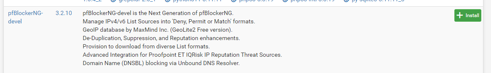
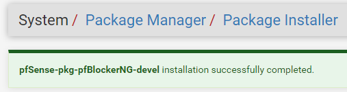
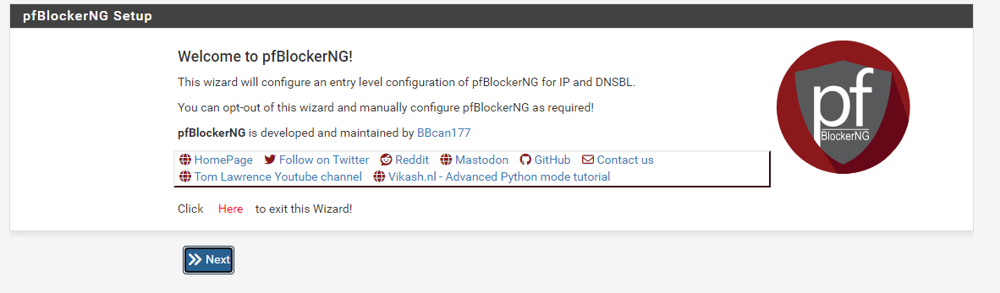
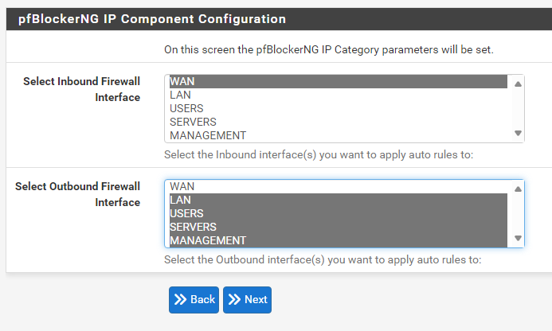
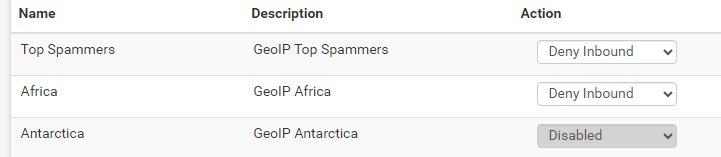
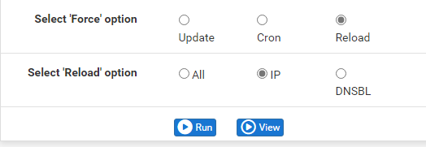
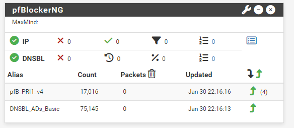

## Introduction

Cette procédure décrit l'installation et la configuration de l'extension **pfBlockerNG-devel** sur pfSense pour assurer un filtrage de contenu (publicités) et une protection géographique.

## Contexte et Justification

Les pare-feux classiques filtrent par ports (80, 443). Mais aujourd'hui, les menaces se cachent dans le trafic web légitime.

- **Optimisation :** En bloquant les publicités au niveau du routeur, on économise de la bande passante et on protège tous les appareils (y compris les mobiles et IoT qui ne peuvent pas avoir de bloqueur de pub).
- **Réduction de la surface d'attaque :** Si votre entreprise n'a pas de clients en Corée du Nord ou en Russie, il n'y a aucune raison d'accepter des connexions venant de ces pays.

## Concepts Clés

**DNSBL (DNS Blacklist) :** Le pare-feu intercepte les requêtes DNS. Si un utilisateur demande `pub.google.com`, pfBlockerNG répond `0.0.0.0` (adresse vide) au lieu de la vraie IP. La pub ne se charge pas.

**GeoIP :** Une base de données qui associe chaque adresse IP mondiale à un pays.

**Feeds (Flux) :** Des listes maintenues par la communauté (ex : Spamhaus, abuse.ch) qui recensent les IP et domaines malveillants, mises à jour automatiquement.

## Prérequis

1. Un pfSense opérationnel avec accès Internet.
2. **CRITIQUE :** Le service **DNS Resolver (Unbound)** doit être actif (c'est le défaut sur pfSense).
3. Espace disque et RAM suffisants (pfBlockerNG est gourmand : prévoir au minimum 2 Go de RAM).
4. Pour le filtrage GeoIP : une clé de licence MaxMind GeoLite2 (gratuite, sur inscription), demandée par pfBlockerNG.

## Installation

### Gestionnaire de Paquets

1. Allez dans le menu **System \> Package Manager**.
2. Cliquez sur l'onglet **Available Packages**.
3. Dans la barre de recherche, tapez « pfBlockerNG ».
4. Localisez **pfBlockerNG-devel** (la version la plus complète). Sur les versions récentes de pfSense, seul le paquet **pfBlockerNG** peut être proposé : installez-le, il intègre les mêmes fonctions.

<b>Figure 1</b> · Paquet pfBlockerNG-devel

5. Cliquez sur **Install** puis **Confirm**.
6. Attendez que la barre de progression verte se termine (« Success »).

<b>Figure 2</b> · Installation réussie

### Assistant de Configuration

L'installation lance un assistant. S'il ne se lance pas, allez dans **Firewall \> pfBlockerNG \> Wizard**.

1. Cliquez sur **Next** pour démarrer.

<b>Figure 3</b> · Démarrage de l'assistant

2. **Inbound Interface :** Sélectionnez **WAN** (on bloque ce qui *entre*).
3. **Outbound Interface :** Sélectionnez **LAN** et vos VLANs si vous en avez, ex : USERS (on bloque ce qui *sort* vers des sites interdits).

<b>Figure 4</b> · Interfaces inbound et outbound

4. **VIP Address :** Laissez la valeur par défaut (`10.10.10.1`). C'est un mini-serveur web interne qui affichera une image vide ou une page « Bloqué » à la place des pubs.
5. **Finish :** L'assistant va télécharger les bases de données (cela peut prendre 2 à 5 minutes).

## Configuration Avancée

Une fois l'assistant terminé, nous allons affiner le blocage géographique.

### Filtrage GeoIP (Pays)

1. Allez dans **Firewall \> pfBlockerNG \> IP**.
2. Vous verrez des listes pré-créées (IPv4). Repérez la ligne **GeoIP Top Spammers** (souvent nommée Top_v4).
3. Cliquez sur l'icône **Crayon** (Éditer) à droite.
4. Dans la liste des pays, sélectionnez ceux que vous voulez bloquer (ex : Chine, Russie, Corée du Nord, etc.).
5. **List Action :** Réglez sur **Deny Inbound** (bloquer ce qui entre).

<b>Figure 5</b> · Blocage GeoIP en Deny Inbound

Ne mettez pas « Deny Both » (entrée et sortie), sauf si vous êtes sûr de ne jamais visiter de site hébergé dans ces pays.

6. Cliquez sur **Save**.

### Force Update

Pour appliquer les changements immédiatement :

1. Allez dans **Firewall \> pfBlockerNG \> Update**.
2. Sélectionnez **Reload** au lieu de Update.
3. Cochez **All**.
4. Cliquez sur **Run**.

<b>Figure 6</b> · Rechargement complet des listes

5. Regardez les logs défiler. Une fois fini, vos règles de pare-feu sont actives.

## Tests et Validations

**Test du DNSBL (anti-pub) :**

1. Placez-vous sur un PC du réseau LAN.
2. Ouvrez une invite de commande et essayez de pinger un domaine publicitaire connu : `ping doubleclick.net`.
3. **Résultat attendu :** l'adresse IP retournée doit être `10.10.10.1` (votre VIP) ou `0.0.0.0`.

Si vous obtenez une vraie IP publique, le filtrage ne fonctionne pas encore : videz le cache DNS du PC (`ipconfig /flushdns`) et retestez.

**Test de visualisation (Dashboard) :**

1. Allez sur la page d'accueil de pfSense (**Dashboard**).
2. Cliquez sur **+** en haut à droite pour ajouter un widget.
3. Choisissez **pfBlockerNG**.

<b>Figure 7</b> · Widget pfBlockerNG

4. Sauvegardez.
5. Vous verrez un tableau avec des compteurs « Packets » qui augmentent à chaque fois qu'une pub ou une attaque est bloquée.

## Dépannage

**Un site légitime est bloqué (faux positif) :**

1. Allez dans **Firewall \> pfBlockerNG \> Reports** (ou Alerts).
2. Trouvez la ligne correspondant au blocage (DNSBL ou IP).
3. Cliquez sur l'icône **+** (Plus) à gauche de la ligne.
4. Le domaine ou l'IP est ajouté automatiquement à la « Whitelist » (liste blanche).
5. Forcez une mise à jour (Update \> Reload) pour appliquer.

## Conseils et Bonnes Pratiques

**Attention à la RAM :** Si vous activez toutes les listes (« Feeds »), pfSense peut planter par manque de mémoire. Commencez doucement (ex : liste « StevenBlack » pour les pubs).

**L'ordre des règles :** pfBlockerNG crée des règles automatiques dans le pare-feu. Vérifiez toujours dans **Firewall \> Rules \> WAN** que les règles de blocage sont bien **au-dessus** de vos règles d'autorisation.

**Cron :** Dans les réglages généraux de pfBlockerNG, réglez la mise à jour automatique (« Cron Settings ») sur **Once a day** (une fois par jour) pour ne pas surcharger le système.

## Procédures Liées

- [Installation et Configuration Initiale de pfSense](/procedures/pare-feu/installation-et-configuration-initiale-de-pfsense) *(Prérequis pfSense)*
- [Déploiement Serveur DNS Local Bind9 (Conteneurisé)](/procedures/linux/deploiement-serveur-dns-local-bind9-conteneurise) *(Résolution DNS interne)*
- [Configuration d'un Proxy Squid sur OPNSense](/procedures/pare-feu/configuration-dun-proxy-squid-sur-opnsense) *(Filtrage web par proxy)*
- [Segmentation Réseau (VLANs) sur pfSense](/procedures/pare-feu/segmentation-reseau-vlans-sur-pfsense) *(Filtrage par segment réseau)*
