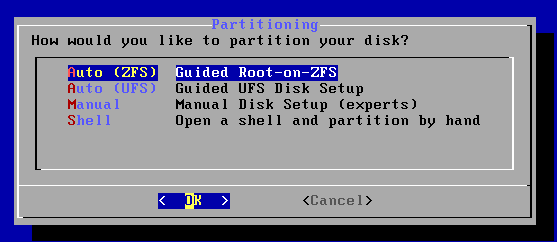
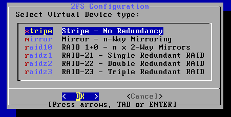
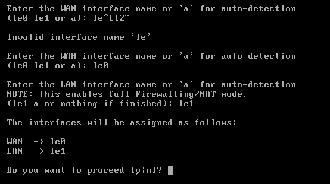
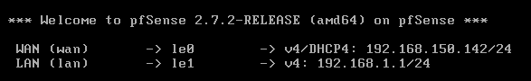
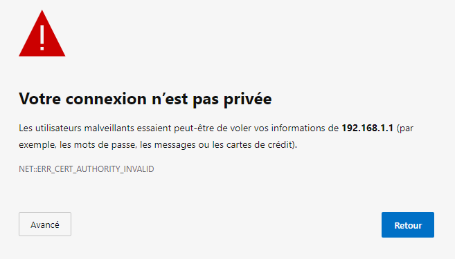
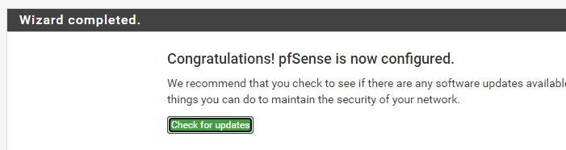
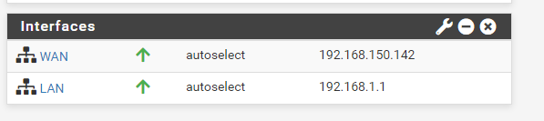

## Introduction

Cette procédure détaille l'installation de **pfSense CE (Community Edition)**, un système d'exploitation open source basé sur FreeBSD, transformant un ordinateur ou une VM en pare-feu et routeur professionnel.

## Contexte et Justification

Contrairement à un routeur domestique (« Box ») qui est une « boîte noire » peu configurable, pfSense offre un contrôle total sur le trafic.

- **Sécurité :** Filtrage fin des paquets.
- **Visibilité :** Logs détaillés de tout ce qui entre et sort.
- **Services :** Il portera le DHCP, le DNS et plus tard le VPN.

## Concepts Clés

**WAN (Wide Area Network) :** L'interface connectée à Internet (l'extérieur). C'est la zone « dangereuse ».

**LAN (Local Area Network) :** L'interface connectée à votre réseau interne (vos serveurs GLPI, Zabbix, etc.). C'est la zone « de confiance ».

**WebConfigurator :** L'interface de gestion graphique. On ne touche presque jamais à la ligne de commande sur pfSense.

**Default Deny Rule :** Par défaut, pfSense bloque **tout** ce qui vient de l'extérieur (WAN) vers l'intérieur.

## Prérequis

- Une machine virtuelle (ou physique) avec :
  - **2 cartes réseau (NICs) :** impératif, une pour le WAN, une pour le LAN ;
  - 2 vCPU et 2 Go de RAM ;
  - 20 Go de disque dur.
- L'image ISO de pfSense CE (version 2.7.x ou supérieure).
- Une machine cliente (Windows/Linux) connectée sur le même réseau virtuel que l'interface LAN pour accéder à la configuration.

## Installation du Système

### Séquence de Boot et Installation

1. Démarrez la VM sur l'ISO.
2. Acceptez le copyright (appuyez sur Entrée).
3. Choisissez **Install** (Install pfSense).
4. **Keymap :** Choisissez votre clavier ou laissez par défaut (les claviers FR posent parfois problème en console, l'US est recommandé pour l'installation, on changera après).
5. **Partitionnement :** Choisissez **Auto (ZFS)**. C'est le système de fichiers le plus moderne et robuste.

<b>Figure 1</b> · Choix du partitionnement Auto (ZFS)

6. **Configuration ZFS :** Laissez tout par défaut (Stripe, No Redundancy pour une VM) et validez avec **Select**.

<b>Figure 2</b> · Configuration ZFS

7. Confirmez l'effacement du disque. L'installation commence.
8. À la fin, choisissez **No** (pas de shell manuel) et **Reboot**.

### Assignation des Interfaces

**C'est l'étape critique.** Au redémarrage, pfSense détecte vos deux cartes réseau (souvent nommées `vtnet0/1`, `em0/1` ou `le0/1` selon l'hyperviseur).

1. **VLANs :** À la question « Should VLANs be set up now? », répondez **n** (No). Nous le ferons plus tard via l'interface web.
2. **WAN Interface Name :** Entrez le nom de la première carte (ex : `le0`).
3. **LAN Interface Name :** Entrez le nom de la seconde carte (ex : `le1`).
4. Confirmez avec **y**.

<b>Figure 3</b> · Assignation WAN et LAN

5. Le système charge et affiche le menu console. Regardez les adresses IP :
   - **WAN :** Doit avoir une IP (fournie par votre box, VMware ou VirtualBox).
   - **LAN :** A `192.168.1.1` par défaut.

<b>Figure 4</b> · Menu console avec les adresses IP

### Configuration Initiale (Wizard Web)

1. Connectez votre PC client sur le réseau LAN. Il doit recevoir une IP automatiquement.
2. Ouvrez le navigateur et allez sur `https://192.168.1.1` (ou l'IP définie).
3. Acceptez le certificat de sécurité (avertissement « risque potentiel »).

<b>Figure 5</b> · Page de connexion pfSense

4. **Login par défaut :**
   - **User :** `admin`.
   - **Password :** `pfsense`.
5. L'assistant (Wizard) démarre :
   - **Hostname :** `firewall` / **Domain :** `campus.lan`.
   - **DNS Servers :** Laissez vide (ou mettez 1.1.1.1), décochez « Override DNS » si vous voulez forcer le vôtre.
   - **Timezone :** Europe/Paris.
   - **WAN Configuration :** Laissez en DHCP (sauf si vous avez une IP publique statique dédiée). **Décochez** « Block RFC1918 Private Networks » si votre WAN est derrière une autre Box (sinon vous n'aurez pas Internet).
   - **LAN Configuration :** Vérifiez l'IP.
   - **Set Admin Password :** Changez le mot de passe `pfsense` immédiatement !
6. Cliquez sur **Reload**.

<b>Figure 6</b> · Fin de l'assistant de configuration

## Vérifications

Sur le **Dashboard** (Tableau de bord), vérifiez la liste des interfaces.

- **WAN** doit être vert (Up) avec une IP.
- **LAN** doit être vert (Up).

<b>Figure 7</b> · Interfaces sur le tableau de bord

Depuis votre PC client, essayez d'aller sur Internet (ex : google.fr).

- Si ça marche : votre routeur est fonctionnel.
- Si ça ne marche pas : vérifiez la case « Block RFC1918 » dans *Interfaces \> WAN*.

## Dépannage

**Pas d'accès à l'interface web :**

- Êtes-vous bien sur le port LAN ? (Le WAN bloque l'accès web par défaut).
- Votre PC a-t-il bien reçu une IP dans la plage du LAN (192.168.1.x par défaut) ?

**Pas d'Internet sur le client :**

- Allez dans *System \> Routing \> Gateways*. Vérifiez que la Gateway WAN est « Online ».
- Vérifiez les règles DNS (*Services \> DNS Resolver* doit être actif).

## Conseils et Bonnes Pratiques

**Sauvegarde :** Allez dans *Diagnostics \> Backup & Restore* et téléchargez le fichier `.xml` après chaque modification majeure. C'est votre assurance vie.

**Mises à jour :** Vérifiez *System \> Update*. Gardez le système à jour.

**Sécurité :** N'ouvrez jamais l'interface de gestion (port 443/80) sur le WAN. Pour administrer à distance, passez par un VPN (cf. procédure *Accès distant sécurisé via WireGuard*).

## Procédures Liées

- [Segmentation Réseau (VLANs) sur pfSense](/procedures/pare-feu/segmentation-reseau-vlans-sur-pfsense) *(Segmentation en VLANs)*
- [Filtrage DNS et IP avec pfBlockerNG](/procedures/pare-feu/filtrage-dns-et-ip-avec-pfblockerng) *(Filtrage DNS et IP)*
- [Accès distant sécurisé via WireGuard](/procedures/pare-feu/acces-distant-securise-via-wireguard) *(Accès distant par VPN)*
- [Configuration d'un Proxy Squid sur OPNSense](/procedures/pare-feu/configuration-dun-proxy-squid-sur-opnsense) *(Proxy sur OPNSense, alternative à pfSense)*
