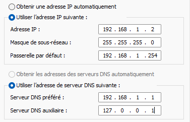
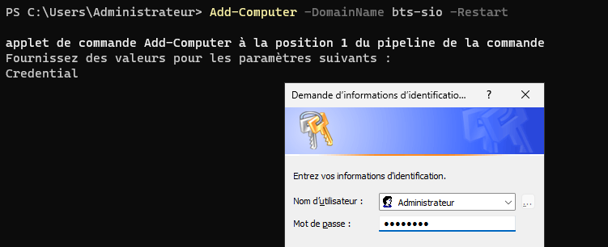
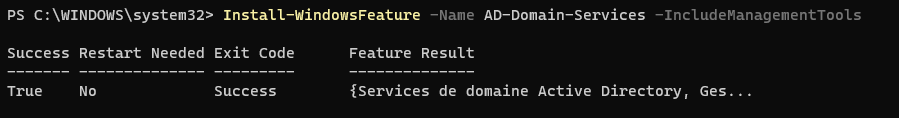
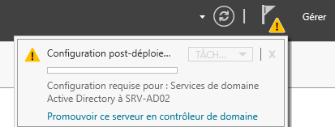
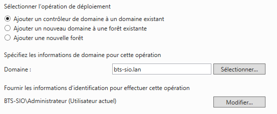
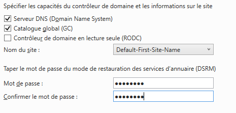

## Objectif

Ce document a pour objectif de détailler les étapes pour **ajouter un second contrôleur de domaine (DC)** à un domaine Active Directory existant. L'opération vise à mettre en place la **redondance** et la **haute disponibilité** des services d'authentification et d'annuaire, éliminant ainsi le premier serveur comme unique point de défaillance (Single Point of Failure, SPOF).

## Contexte et Justification

Un seul contrôleur de domaine représente un risque majeur pour une infrastructure. S'il tombe en panne, plus aucun utilisateur ne peut se connecter, plus aucune ressource n'est accessible et les services critiques comme le DNS sont hors service.

Ajouter un second contrôleur de domaine permet de :

- **Assurer la continuité de service :** Si le DC primaire est indisponible (panne, maintenance), le second prend le relais de manière transparente pour les utilisateurs.
- **Répartir la charge :** Les requêtes d'authentification et les requêtes DNS sont distribuées entre les deux serveurs, améliorant les performances globales.
- **Permettre la maintenance sans interruption :** Il est possible d'arrêter un DC pour une mise à jour matérielle ou logicielle sans paralyser l'entreprise.

## Prérequis et Schéma Cible

**Prérequis :**

- Un contrôleur de domaine principal fonctionnel (que nous nommerons SRV-AD01), hébergeant le DNS et tous les rôles FSMO.
- Un second serveur (que nous nommerons SRV-AD02) avec Windows Server installé et entièrement mis à jour (cf. procédure *Installation de Windows Server 2025*).
- Les informations d'identification d'un compte Administrateur du domaine (ex : `VOTREDOMAINE\Administrateur`).
- Un plan d'adressage IP défini pour les deux serveurs.

**Schéma cible :**

Notre objectif est de passer d'une topologie à un seul serveur à une topologie redondante où les deux serveurs synchronisent en permanence l'annuaire Active Directory.

## Procédure de Configuration

### Préparation du Second Serveur

Cette étape de configuration initiale est **cruciale** pour que le serveur puisse contacter le domaine existant.

1. **Configuration IP statique :**
   - Attribuez une adresse IP statique à SRV-AD02 (ex : 192.168.1.2).
   - Configurez le masque de sous-réseau et la passerelle par défaut.
   - **Point clé :** Configurez le **Serveur DNS préféré** avec l'adresse IP de votre premier contrôleur de domaine (SRV-AD01, ex : 192.168.1.1). Le serveur DNS auxiliaire peut être `127.0.0.1` (lui-même).



<p class="figure-caption"><b>Figure 1</b> · Configuration IP de SRV-AD02</p>

2. **Renommage et jonction au domaine :**
   - Donnez un nom explicite au serveur (ex : `SRV-AD02`).
   - Joignez le serveur au domaine existant. Pour cela, ouvrez PowerShell en tant qu'administrateur et utilisez la commande suivante, en adaptant le nom du domaine et en entrant les identifiants d'un administrateur du domaine lorsqu'ils sont demandés :

```powershell
Add-Computer -DomainName "bts-sio.lan" -Restart
```



<p class="figure-caption"><b>Figure 2</b> · Jonction au domaine</p>

Le serveur redémarre et devient membre du domaine.

### Installation du Rôle « AD DS »

1. Connectez-vous à SRV-AD02 avec un compte administrateur **du domaine**.
2. Ouvrez PowerShell en tant qu'administrateur et installez le rôle AD DS :

```powershell
Install-WindowsFeature -Name AD-Domain-Services -IncludeManagementTools
```



<p class="figure-caption"><b>Figure 3</b> · Installation du rôle AD DS</p>

### Promotion en Contrôleur de Domaine Secondaire

1. Dans le **Gestionnaire de serveur**, cliquez sur le drapeau de notification jaune et sélectionnez **« Promouvoir ce serveur en contrôleur de domaine ».**



<p class="figure-caption"><b>Figure 4</b> · Promouvoir ce serveur en contrôleur de domaine</p>

2. Sur la première page de l'assistant, sélectionnez l'option **« Ajouter un contrôleur de domaine à un domaine existant »**.
   - Le domaine devrait être détecté automatiquement. Cliquez sur **« Sélectionner »** pour fournir les informations d'identification d'un administrateur du domaine.



<p class="figure-caption"><b>Figure 5</b> · Ajout à un domaine existant</p>

3. Sur l'écran « Options du contrôleur de domaine » :
   - Vérifiez que les cases **Serveur DNS (Domain Name System)** et **Catalogue global (GC)** sont cochées.
   - Définissez un mot de passe de restauration des services d'annuaire (DSRM).



<p class="figure-caption"><b>Figure 6</b> · Options du contrôleur de domaine</p>

4. Passez les écrans suivants (Options de réplication, Emplacements, etc.) en gardant les valeurs par défaut.
5. Lancez la vérification des prérequis, puis cliquez sur **« Installer »**. Le serveur va finaliser la configuration, synchroniser une première fois l'annuaire avec SRV-AD01, puis **redémarrer automatiquement**.

## Vérifications

Une fois SRV-AD02 redémarré, il est indispensable de vérifier que la redondance est bien fonctionnelle.

1. **Vérification visuelle :**
   - Sur SRV-AD02, ouvrez la console **« Utilisateurs et ordinateurs Active Directory »**. Vous devez voir exactement la même arborescence, les mêmes utilisateurs et groupes que sur SRV-AD01.
   - **Test ultime :** Créez un utilisateur de test sur SRV-AD01. Après quelques secondes, actualisez la vue sur SRV-AD02 : le nouvel utilisateur doit apparaître. Supprimez-le ensuite depuis SRV-AD02 et vérifiez qu'il disparaît de SRV-AD01.
2. **Vérification de la réplication (ligne de commande) :** sur l'un des deux serveurs, ouvrez une invite de commande ou PowerShell en administrateur et tapez :

```powershell
repadmin /showrepl
```

   La commande doit montrer que la dernière tentative de réplication avec le serveur partenaire a **réussi**.

3. **Mise à jour finale du DNS :**
   - Sur `SRV-AD01` : DNS préféré = `192.168.1.2` (IP de SRV-AD02), DNS auxiliaire = `127.0.0.1`.
   - Sur `SRV-AD02` : DNS préféré = `192.168.1.1` (IP de SRV-AD01), DNS auxiliaire = `127.0.0.1`.

   Chaque DC pointe ainsi sur l'autre en priorité, assurant la continuité du service DNS même si l'un des deux est en panne.

<div class="callout callout-note">

Votre infrastructure Active Directory est maintenant hautement disponible.

</div>

## Procédures Liées

- [Installation d'un Contrôleur de Domaine Active Directory](/procedures/windows/installation-dun-controleur-de-domaine-active-directory) *(Premier contrôleur de domaine)*
- [Configuration des Sites et de la Réplication AD](/procedures/windows/configuration-des-sites-et-de-la-replication-ad) *(Réplication entre contrôleurs)*
- [Transfert et Prise de Rôles FSMO](/procedures/windows/transfert-et-prise-de-roles-fsmo) *(Répartition des rôles maîtres)*
- [Mise en Place de la Redondance DNS avec une Zone Secondaire](/procedures/windows/mise-en-place-de-la-redondance-dns-avec-une-zone-secondaire) *(Redondance DNS hors zones intégrées)*
- Dépannage de la Réplication AD et de Kerberos *(Diagnostic de la réplication)*
