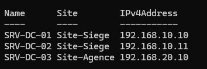
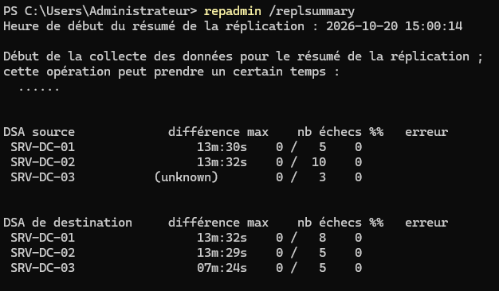

## Introduction

Cette procédure décrit la configuration de la topologie physique d'Active Directory sous Windows Server 2025 : sites, sous-réseaux, liens de sites, coût, intervalle de réplication et serveurs tête de pont. Elle explique le rôle du KCC et la vérification de la réplication avec `repadmin`.

Le périmètre couvre un domaine `lab.local` réparti sur deux sites. La réplication de SYSVOL et le dépannage approfondi des erreurs de réplication sont traités dans des procédures dédiées.

| Élément | Valeur |
|---------|--------|
| Domaine | `lab.local` |
| Site du siège | `Site-Siege`, sous-réseau 192.168.10.0/24, SRV-DC-01 (192.168.10.10) et SRV-DC-02 (192.168.10.11) |
| Site de l'agence | `Site-Agence`, sous-réseau 192.168.20.0/24, SRV-DC-03 (192.168.20.10) |
| Lien de sites | `SL-Siege-Agence`, coût 100, intervalle 30 minutes |

## Contexte et Justification

À l'installation, Active Directory place tous les contrôleurs dans un site unique nommé `Default-First-Site-Name`. Tant que l'entreprise occupe un seul bâtiment, ce comportement convient. Dès qu'un second site est relié par un lien WAN, il pose trois problèmes.

- Les postes de l'agence peuvent s'authentifier auprès d'un contrôleur du siège à travers le WAN, ce qui ralentit l'ouverture de session et l'application des GPO.
- La réplication intra-site, prévue pour un réseau local rapide, sature le lien WAN par des notifications fréquentes et non compressées.
- Les services qui s'appuient sur la notion de site (DFS Namespaces, Exchange, localisation du catalogue global) orientent mal les clients.

Déclarer les sites et leurs sous-réseaux permet aux clients de trouver un contrôleur proche. Les liens de sites donnent à l'administrateur le contrôle du coût, de la fréquence et des horaires de la réplication entre sites.

## Concepts Clés

**Site.** Ensemble de sous-réseaux IP bien connectés entre eux. Un site est un objet de la partition de configuration, répliqué dans toute la forêt.

**Sous-réseau.** Préfixe IP associé à un site. Un client détermine son site à partir de son adresse IP et du sous-réseau correspondant. Une adresse qui n'appartient à aucun sous-réseau déclaré est signalée dans le journal `%SystemRoot%\debug\netlogon.log` avec la mention `NO_CLIENT_SITE`.

**Lien de sites.** Objet reliant deux sites ou plus, avec un coût, un intervalle et une planification. Sans lien, deux sites ne répliquent pas. Le lien par défaut `DEFAULTIPSITELINK` a un coût de 100 et un intervalle de 180 minutes.

**Coût.** Valeur relative qui oriente le choix du chemin de réplication. Le KCC privilégie le chemin de coût cumulé le plus faible. Un lien rapide reçoit un coût bas, un lien de secours un coût élevé.

**Intervalle de réplication.** Fréquence, en minutes, à laquelle la réplication entre sites est tentée pendant les plages autorisées. La valeur minimale est 15 minutes.

**Réplication intra-site et inter-site.** Dans un site, la réplication est déclenchée par notification quelques secondes après une modification et n'est pas compressée. Entre sites, elle suit l'intervalle et la planification du lien et elle est compressée.

**KCC (Knowledge Consistency Checker).** Processus présent sur chaque contrôleur, exécuté par défaut toutes les 15 minutes. Il calcule les objets de connexion de la topologie de réplication. Dans un site, il construit un anneau. Entre sites, un contrôleur par site, l'ISTG (Inter-Site Topology Generator), calcule les connexions inter-sites.

**Serveur tête de pont (bridgehead).** Contrôleur qui réplique avec les autres sites pour une partition donnée. L'ISTG le choisit automatiquement, sauf si des têtes de pont préférées sont désignées.

**Pont de liens de sites.** Mécanisme de transitivité entre liens. Par défaut, l'option **Bridge all site links** est active sur le transport IP, ce qui rend tous les liens transitifs.

**Transport IP et SMTP.** Le transport IP (RPC sur IP) est le standard. Le transport SMTP ne réplique pas la partition de domaine et dépend du service SMTP, déprécié depuis Windows Server 2012. Il ne doit pas être utilisé dans un nouveau déploiement.

## Prérequis

- Un compte membre de **Enterprise Admins**. Les sites sont stockés dans la partition de configuration de la forêt.
- La console **Active Directory Sites and Services** (`dssite.msc`) et le module PowerShell ActiveDirectory, via RSAT ou sur un contrôleur.
- Un plan d'adressage sans chevauchement entre sites (192.168.10.0/24 et 192.168.20.0/24 dans ce lab).
- Une connectivité routée entre les deux sous-réseaux, avec les flux AD ouverts (DNS 53, Kerberos 88, RPC 135 et plage dynamique 49152 à 65535, LDAP 389, SMB 445, GC 3268).
- SRV-DC-03 installé sous Windows Server 2025 avec l'adresse 192.168.20.10, ou prêt à être promu dans `Site-Agence`.
- Une réplication saine avant modification (`repadmin /replsummary` sans échec).

## Points de Vigilance

**Déclarez les sous-réseaux avant de promouvoir un contrôleur distant.** Un contrôleur promu sans sous-réseau correspondant est placé dans un site par défaut, et les clients de l'agence s'authentifient au siège. Le site et le sous-réseau doivent exister avant la promotion.

**Couvrez toutes les plages clientes.** Une plage oubliée (VPN, Wi-Fi invités, VLAN de téléphonie) produit des clients sans site. Ils utilisent alors un contrôleur quelconque, parfois distant. Surveillez `netlogon.log` et l'événement 5807 du journal Système des contrôleurs.

**Un site sans contrôleur n'est pas une erreur.** Un site peut ne contenir que des clients. Les clients sont alors orientés vers le site de moindre coût qui héberge un contrôleur, selon la couverture automatique de site.

**Ne désignez pas de tête de pont préférée sans redondance.** Si une tête de pont préférée est déclarée et devient indisponible, l'ISTG ne bascule pas vers un autre contrôleur pour cette partition et la réplication inter-site s'arrête. Désignez au moins deux têtes de pont par site, ou laissez l'ISTG choisir.

**Ne supprimez pas les objets de connexion générés sans comprendre la cause.** Le KCC les recrée au cycle suivant. Une connexion créée manuellement n'est jamais supprimée par le KCC et fige la topologie.

**Le transport SMTP est à proscrire.** Il est déprécié, ne réplique pas la partition de domaine et dépend d'un service SMTP lui-même déprécié.

**Un intervalle trop court sur un WAN faible sature le lien.** À l'inverse, un intervalle long retarde la propagation des désactivations de comptes et des changements de GPO. Choisissez l'intervalle en fonction du débit réel et des exigences de sécurité.

## Choix Architecturaux & Alternatives

### Quand créer un site

Créez un site pour chaque emplacement relié au reste du réseau par un lien significativement plus lent ou moins fiable que le réseau local, ou dont les clients doivent être servis par un contrôleur local. Un site n'a de sens pour l'authentification que s'il héberge un contrôleur, mais il peut aussi servir à la localisation de services (DFS, catalogue global) sans contrôleur.

Ne créez pas de site pour chaque VLAN d'un même bâtiment. Des sous-réseaux reliés en réseau local appartiennent au même site, sinon la réplication inter-site ralentit inutilement la convergence.

### Alternatives et comparatif

| Option | Cas d'usage typique | Force principale | Faiblesse principale | Coût relatif |
|--------|---------------------|------------------|----------------------|--------------|
| **Site unique** | Un seul bâtiment ou WAN très rapide | Convergence en quelques secondes, aucune configuration | Clients distants servis par n'importe quel contrôleur | Gratuit |
| **Sites et liens IP gérés par le KCC** | Plusieurs sites, topologie en étoile ou maillée simple | Topologie calculée et réparée automatiquement | Contrôle limité du chemin réel | Gratuit |
| **Sites avec têtes de pont préférées** | Pare-feu limitant les contrôleurs autorisés à traverser le WAN | Flux inter-sites prévisibles et filtrables | Perte de basculement automatique si une seule tête de pont | Faible (exploitation) |
| **Sites sans pont automatique (Bridge all site links désactivé)** | Réseau non entièrement routé, topologie en étoile stricte | Respect exact du routage réel | Ponts de liens à maintenir manuellement | Moyen (exploitation) |
| **Connexions manuelles** | Cas particuliers de dépannage | Contrôle total | Aucune adaptation automatique, risque d'îlots | Élevé (exploitation) |

### Impact des choix

- **Disponibilité.** Un contrôleur par site garantit l'authentification locale. La couverture automatique de site oriente les clients d'un site sans contrôleur vers le site le plus proche selon les coûts.
- **Performance.** La compression inter-site réduit fortement le volume transféré. Un intervalle de 15 à 30 minutes convient à un WAN moderne. La notification de changement sur un lien (option `USE_NOTIFY`) rapproche le comportement de l'intra-site.
- **Sécurité.** Un intervalle court propage plus vite la désactivation d'un compte. Les têtes de pont préférées permettent de limiter les flux RPC inter-sites à quelques contrôleurs filtrés.
- **Exploitation.** Laisser le KCC gérer la topologie est la règle. Chaque dérogation (tête de pont préférée, connexion manuelle, pont désactivé) doit être documentée.

## Méthode 1 : Configuration via la Console Sites et services Active Directory (dssite.msc)

### Renommer le Site par Défaut

1. Ouvrez `dssite.msc` avec un compte Enterprise Admins.
2. Dépliez **Sites**, faites un clic droit sur **Default-First-Site-Name** > **Renommer**, puis saisissez `Site-Siege`.

<div class="callout callout-note">

Renommer le site ne modifie ni son GUID ni ses liens. Les contrôleurs et le lien `DEFAULTIPSITELINK` restent associés.

</div>

### Créer le Site de l'Agence

1. Faites un clic droit sur **Sites** > **New Site**.
2. **Name** : `Site-Agence`.
3. Sélectionnez le lien `DEFAULTIPSITELINK` dans la liste, puis cliquez sur **OK**. Il sera remplacé par un lien dédié, puis supprimé.

### Créer les Sous-réseaux

1. Faites un clic droit sur **Sites** > **Subnets** > **New Subnet**.
2. **Prefix** : `192.168.10.0/24`. Sélectionnez `Site-Siege`, puis **OK**.
3. Répétez avec `192.168.20.0/24` associé à `Site-Agence`.
4. Dans les propriétés de chaque sous-réseau, renseignez le champ **Location** (par exemple `Siège` et `Agence`).

### Créer le Lien de Sites

1. Dépliez **Inter-Site Transports**, faites un clic droit sur **IP** > **New Site Link**.
2. **Name** : `SL-Siege-Agence`. Ajoutez `Site-Siege` et `Site-Agence`, puis **OK**.
3. Ouvrez les propriétés du lien :
   - **Cost** : 100 ;
   - **Replicate every** : 30 minutes ;
   - **Change Schedule** : conservez la disponibilité permanente, ou bloquez les heures de sauvegarde si le WAN est saturé.
4. Supprimez `DEFAULTIPSITELINK` : faites un clic droit dessus > **Delete**, puis confirmez. Seul le nouveau lien porte alors la réplication.

<div class="callout callout-note">

Il n'est pas possible de retirer `Site-Agence` de `DEFAULTIPSITELINK`, car un lien de sites doit contenir au moins deux sites. Ce lien ne contient que `Site-Siege` et `Site-Agence`, donc il se supprime en entier. Vérifiez au préalable, dans les propriétés du lien, qu'aucun autre site n'en dépend, et créez `SL-Siege-Agence` avant la suppression pour ne pas interrompre la réplication.

</div>

### Activer la Notification de Changement sur le Lien (optionnel)

1. Dans le menu **Affichage**, activez **Fonctionnalités avancées**.
2. Ouvrez les propriétés de `SL-Siege-Agence` > onglet **Attribute Editor**.
3. Modifiez l'attribut `options` à la valeur `1` (USE_NOTIFY), puis **OK**.

<div class="callout callout-note">

Cette option convient à un WAN rapide. Elle supprime l'attente de l'intervalle mais conserve la compression inter-site.

</div>

### Placer les Contrôleurs dans leur Site

1. SRV-DC-03 promu après la création du sous-réseau est placé automatiquement dans `Site-Agence`.
2. Si SRV-DC-03 a été promu avant, ouvrez **Site-Siege** > **Servers**, faites un clic droit sur **SRV-DC-03** > **Move**, puis sélectionnez `Site-Agence`.

### Désigner des Têtes de Pont Préférées (optionnel)

1. Ouvrez **Site-Siege** > **Servers** > **SRV-DC-01** > **Propriétés**.
2. Dans **Transports available for inter-site data transfer**, sélectionnez **IP**, cliquez sur **Add** pour le placer dans **This server is a preferred bridgehead server for the following transports**.
3. Répétez pour SRV-DC-02, afin de garder deux têtes de pont au siège.

### Recalculer la Topologie et Forcer la Réplication

1. Ouvrez **Site-Agence** > **Servers** > **SRV-DC-03** > **NTDS Settings**.
2. Faites un clic droit sur **NTDS Settings** > **All Tasks** > **Check Replication Topology**. Le KCC recalcule les connexions.
3. Actualisez la vue, faites un clic droit sur une connexion générée automatiquement > **Replicate Now**.

## Méthode 2 : Configuration via PowerShell

### Variables

```powershell
$configNC = (Get-ADRootDSE).configurationNamingContext
```

### Renommer le Site par Défaut et Créer le Site de l'Agence

```powershell
$siteDefaut = Get-ADReplicationSite -Identity "Default-First-Site-Name"
Rename-ADObject -Identity $siteDefaut.DistinguishedName -NewName "Site-Siege"

New-ADReplicationSite -Name "Site-Agence" -Description "Agence, lien WAN"
```

### Créer les Sous-réseaux

```powershell
New-ADReplicationSubnet -Name "192.168.10.0/24" -Site "Site-Siege"  -Location "Siège"
New-ADReplicationSubnet -Name "192.168.20.0/24" -Site "Site-Agence" -Location "Agence"
```

### Créer le Lien de Sites

```powershell
New-ADReplicationSiteLink `
    -Name "SL-Siege-Agence" `
    -SitesIncluded "Site-Siege","Site-Agence" `
    -Cost 100 `
    -ReplicationFrequencyInMinutes 30 `
    -InterSiteTransportProtocol IP

# Supprimer le lien par défaut (un lien doit contenir au moins deux sites)
Remove-ADReplicationSiteLink -Identity "DEFAULTIPSITELINK" -Confirm:$false

# Optionnel : notification de changement sur le lien
Set-ADReplicationSiteLink -Identity "SL-Siege-Agence" -Replace @{options=1}
```

### Déplacer un Contrôleur dans son Site

```powershell
Get-ADDomainController -Identity "SRV-DC-03" | Move-ADDirectoryServer -Site "Site-Agence"
```

### Désigner des Têtes de Pont Préférées (optionnel)

```powershell
$transportIP = "CN=IP,CN=Inter-Site Transports,CN=Sites,$configNC"

foreach ($dc in "SRV-DC-01","SRV-DC-02") {
    $serveur = "CN=$dc,CN=Servers,CN=Site-Siege,CN=Sites,$configNC"
    Set-ADObject -Identity $serveur -Add @{bridgeheadTransportList=$transportIP}
}
```

### Recalculer la Topologie et Répliquer

```powershell
repadmin /kcc SRV-DC-03
repadmin /syncall SRV-DC-03 /AdeP
```

## Vérifications

**Sites et sous-réseaux :** `Get-ADReplicationSite -Filter * | Select-Object Name` et `Get-ADReplicationSubnet -Filter * | Select-Object Name,Site` listent les deux sites et leurs préfixes.

**Lien de sites :** `Get-ADReplicationSiteLink -Filter * -Properties Cost,ReplicationFrequencyInMinutes,SitesIncluded` affiche `SL-Siege-Agence` avec un coût de 100 et un intervalle de 30 minutes.

**Placement des contrôleurs :** `Get-ADDomainController -Filter * | Select-Object Name,Site,IPv4Address` place SRV-DC-01 et SRV-DC-02 dans `Site-Siege` et SRV-DC-03 dans `Site-Agence`.



<p class="figure-caption"><b>Figure 1</b> · Résultat de la commande.</p>

**Site d'un client :** sur un poste de l'agence, `nltest /dsgetsite` retourne `Site-Agence` et `nltest /dsgetdc:lab.local` retourne SRV-DC-03.

**Connexions générées :** `Get-ADReplicationConnection -Filter * | Select-Object Name,ReplicateFromDirectoryServer,ReplicateToDirectoryServer` montre des connexions entre SRV-DC-03 et une tête de pont du siège.

**Têtes de pont :** `repadmin /bridgeheads` liste les têtes de pont actives de chaque site.

**État de la réplication :** `repadmin /replsummary` ne présente aucun échec, et `Get-ADReplicationFailure -Target "lab.local" -Scope Domain` ne retourne aucune entrée.



<p class="figure-caption"><b>Figure 2</b> · Etat de la réplication.</p>

**Propagation :** créez un utilisateur de test sur SRV-DC-01, puis vérifiez sa présence sur SRV-DC-03 après l'intervalle du lien, ou immédiatement après `repadmin /syncall SRV-DC-03 /AdeP`.

## Dépannage

**« Les clients de l'agence s'authentifient au siège » :** le sous-réseau du client n'est pas déclaré ou est associé au mauvais site. Consultez `netlogon.log` sur SRV-DC-03 et SRV-DC-01 à la recherche de `NO_CLIENT_SITE`, corrigez le sous-réseau, puis lancez `nltest /dsgetsite` sur le poste après un `ipconfig /renew` ou un redémarrage.

**« Aucune connexion n'existe entre les sites » :** aucun lien ne relie les deux sites, ou l'option Bridge all site links est désactivée sans pont adapté. Vérifiez les liens avec `Get-ADReplicationSiteLink -Filter *`, puis relancez `repadmin /kcc`. Un événement 1311 du KCC dans le journal Directory Service signale une topologie inter-site incomplète.

**« La réplication inter-site s'est arrêtée après une panne de SRV-DC-01 » :** SRV-DC-01 était la seule tête de pont préférée du siège. Ajoutez SRV-DC-02 comme tête de pont préférée, ou supprimez les désignations pour rendre la main à l'ISTG.

**« repadmin /showrepl signale l'erreur 1722 (RPC server is unavailable) » :** le pare-feu bloque la plage RPC dynamique ou le port 135 entre les sites, ou la résolution DNS du partenaire échoue. Testez avec `Test-NetConnection SRV-DC-01 -Port 135` depuis SRV-DC-03 et `Resolve-DnsName SRV-DC-01.lab.local`.

**« Les modifications mettent plusieurs heures à atteindre l'agence » :** le site est encore rattaché au seul lien `DEFAULTIPSITELINK` (180 minutes), ou la planification du lien bloque la plage horaire. Vérifiez l'intervalle et la planification de `SL-Siege-Agence`.

## Conseils et Bonnes Pratiques

**Laisser le KCC construire la topologie.** Les connexions manuelles et les têtes de pont figées sont des exceptions documentées. Le KCC recalcule et répare la topologie toutes les 15 minutes.

**Déclarer toutes les plages IP.** Incluez les plages VPN, Wi-Fi et DHCP de chaque site dans les sous-réseaux. Une revue mensuelle de `netlogon.log` détecte les oublis.

**Nommer les objets de façon explicite.** Utilisez des préfixes stables (`Site-`, `SL-`) et le champ Location des sous-réseaux. La topologie reste lisible dans `dssite.msc` comme dans les scripts.

**Adapter le coût au débit réel.** Un lien principal à 100 et un lien de secours à 200 orientent la réplication sans intervention lors d'une panne.

**Documenter la topologie dans un script.** Conservez les commandes PowerShell de création des sites, sous-réseaux et liens. Elles servent de référence et permettent de reconstruire la configuration dans le lab.

**Superviser la réplication.** Planifiez un `repadmin /replsummary` quotidien ou une collecte de `Get-ADReplicationFailure` vers l'outil de supervision, avec alerte au-delà d'un écart supérieur à deux intervalles de réplication.

## Procédures Liées

- [Ajout d'un Contrôleur de Domaine Secondaire](/procedures/windows/ajout-dun-controleur-de-domaine-secondaire) *(Promotion de SRV-DC-03 dans le site de l'agence)*
- [Déploiement d'un Contrôleur de Domaine en Lecture Seule (RODC)](/procedures/windows/deploiement-dun-controleur-de-domaine-en-lecture-seule-rodc) *(Contrôleur adapté aux agences peu sécurisées)*
- [Dépannage de la Réplication AD et de Kerberos](/procedures/windows/depannage-de-la-replication-ad-et-de-kerberos) *(Analyse des erreurs de réplication)*
- [Déploiement de DFS Namespaces et DFS Replication](/procedures/windows/deploiement-de-dfs-namespaces-et-dfs-replication) *(Services orientés par la notion de site)*
- [Configuration d'un Serveur DNS Dédié](/procedures/windows/configuration-dun-serveur-dns-dedie) *(Résolution des enregistrements SRV entre sites)*
