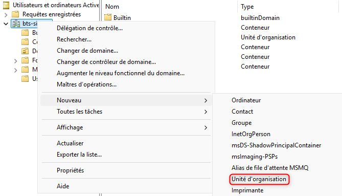
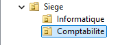
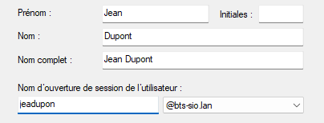
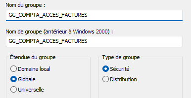
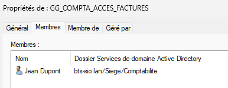

## Objectif

L'objectif de cette procédure est d'apprendre à créer, organiser et gérer les objets fondamentaux d'Active Directory : les Unités d'Organisation, les utilisateurs, les groupes et les ordinateurs. C'est le cœur du métier d'un administrateur système.

## Contexte et Justification

Imaginez Active Directory comme **l'annuaire numérique complet de votre entreprise.**

- **Utilisateurs** : Ce sont les fiches d'identité numériques de chaque employé. Elles contiennent leur nom, leur identifiant de connexion, leur mot de passe, etc.
- **Groupes** : Ce sont des « équipes » ou des « listes de diffusion ». Au lieu de donner une permission à 50 personnes une par une, vous donnez la permission à l'équipe « Comptabilité », et tous ses membres l'obtiennent automatiquement.
- **Ordinateurs** : C'est l'inventaire de tous les postes de travail et serveurs de l'entreprise.
- **Unités d'Organisation (UO)** : C'est la partie la plus importante. Ce sont les services ou les départements de votre entreprise numérique (Direction, Ventes, Informatique). Elles servent à ranger et à organiser les utilisateurs, les groupes et les ordinateurs. Leur véritable pouvoir est de permettre d'appliquer des règles (des GPO) spécifiques à un département entier.

## Prérequis

- Un domaine Active Directory fonctionnel (avec au moins un contrôleur de domaine en ligne).
- Les identifiants d'un compte administrateur du domaine.
- Une machine cliente (Windows 10 ou 11) pour le test de jonction.

## Procédure de Gestion

Toutes les actions suivantes se déroulent sur un de vos contrôleurs de domaine.

### Lancement de la Console d'Administration

1. Ouvrez le menu Démarrer.
2. Lancez la console **« Utilisateurs et ordinateurs Active Directory »**. C'est votre principal outil de gestion.

### Création des Unités d'Organisation (UO)

**Justification :** Nous allons créer une structure de dossiers pour organiser notre annuaire. C'est la première chose à faire.

1. Dans la console, faites un clic droit sur votre nom de domaine (ex : `bts-sio.lan`).
2. Choisissez **Nouveau \> Unité d'organisation**.

<b>Figure 1</b> · Nouvelle unité d'organisation

3. Donnez-lui un nom. Par exemple, **« Siege »**. Laissez la case « Protéger le conteneur contre une suppression accidentelle » cochée.
4. Maintenant, faites un clic droit sur l'UO « Siege » que vous venez de créer pour y ajouter des sous-dossiers. Créez deux nouvelles UO : **« Informatique »** et **« Comptabilite ».**

<b>Figure 2</b> · Arborescence Siege, Informatique et Comptabilite

### Création d'un Utilisateur

1. Naviguez jusqu'à l'UO **« Comptabilite ».**
2. Faites un clic droit dans la zone blanche \> **Nouveau \> Utilisateur.**
3. Remplissez les informations. Par exemple :
   - **Prénom :** Jean.
   - **Nom :** Dupont.
   - **Nom d'ouverture de session de l'utilisateur :** `jeadupon`.

<b>Figure 3</b> · Nouvel utilisateur Jean Dupont

4. Cliquez sur **Suivant.**
5. Définissez un mot de passe et cochez la case **« L'utilisateur doit changer le mot de passe à la prochaine ouverture de session »**. C'est la pratique standard pour un nouvel employé.
6. Cliquez sur **Suivant**, puis **Terminer**. Votre utilisateur est créé.

### Création d'un Groupe de Sécurité

1. Dans l'UO **« Comptabilite »**, faites un clic droit \> **Nouveau \> Groupe.**
2. Nommez le groupe en suivant une convention claire. Par exemple : `GG_COMPTA_ACCES_FACTURES`.
3. Laissez les options par défaut (« Étendue : Globale », « Type : Sécurité ») et cliquez sur **OK**. Un groupe de sécurité sert à donner des droits, contrairement à un groupe de distribution qui ne sert qu'à envoyer des e-mails.

<b>Figure 4</b> · Nouveau groupe de sécurité global

**Quelle étendue de groupe choisir ?**

L'étendue (scope) d'un groupe définit ses règles d'utilisation. Pour simplifier, imaginez que votre domaine (`bts-sio.lan`) est un **pays**.

| Étendue | Rôle | Membres possibles | Où donner des permissions |
|---------|------|-------------------|---------------------------|
| **Globale (GG)** | Rassembler les utilisateurs d'un même domaine (ex : tous les comptables) | Uniquement des objets de son propre domaine | Dans tous les domaines de la forêt |
| **Domaine local (GL)** | Porter les permissions d'accès à une ressource (dossier, imprimante) | Objets de n'importe quel domaine (utilisateurs, groupes globaux…) | Uniquement dans son propre domaine |
| **Universelle (GU)** | Environnements multi-domaines | Objets de toute la forêt | Dans toute la forêt |

: Étendues des groupes Active Directory

Règle AGDLP : on met les **utilisateurs** dans des groupes **globaux**, on donne les **permissions** sur les ressources à des groupes de **domaine local**, puis on place les groupes globaux dans les groupes de domaine local. Dans un domaine unique, le groupe universel n'est quasiment jamais nécessaire.

### Ajout d'un Utilisateur à un Groupe

1. Trouvez le groupe `GG_COMPTA_ACCES_FACTURES` que vous venez de créer.
2. Faites un clic droit dessus et choisissez **« Propriétés ».**
3. Allez dans l'onglet **« Membres »** et cliquez sur **« Ajouter… »**.
4. Dans la fenêtre qui s'ouvre, tapez le nom de l'utilisateur (`jeadupon`) et cliquez sur **« Vérifier les noms »**. Son nom complet va apparaître, souligné.
5. Cliquez sur **OK** deux fois. Jean Dupont fait maintenant partie du groupe.

<b>Figure 5</b> · Ajout de jeadupon au groupe

### Jonction d'un Ordinateur au Domaine

1. Sur votre **machine cliente Windows 11**, allez dans **Paramètres \> Système \> À propos de.**
2. Cliquez sur **« Paramètres avancés du système ».**
3. Dans l'onglet **« Nom de l'ordinateur »**, cliquez sur **« Modifier… »**.
4. Dans la section « Membre de », cochez **« Domaine »** et tapez le nom de votre domaine (`bts-sio.lan`).
5. Cliquez sur **OK**. Une fenêtre vous demandera les identifiants d'un administrateur du domaine. Entrez-les.
6. Après un message de bienvenue, la machine vous demandera de redémarrer. Faites-le.
7. **Sur le contrôleur de domaine**, vous verrez que l'ordinateur est apparu dans le dossier par défaut **« Computers »**. Faites un clic droit dessus et déplacez-le dans l'UO **« Informatique »** pour le ranger correctement.

## Vérifications

- Naviguez dans vos UO pour vérifier que tous les objets (utilisateurs, groupes, ordinateurs) sont bien présents et au bon endroit.
- Allez dans les propriétés de l'utilisateur `jeadupon`, onglet **« Membre de »**, pour vérifier qu'il est bien membre du groupe `GG_COMPTA_ACCES_FACTURES`.
- **Test final :** Sur l'écran de connexion de la machine cliente, choisissez « Autre utilisateur » et connectez-vous avec l'identifiant `bts-sio\jeadupon` et son mot de passe. Si la session s'ouvre, votre annuaire est parfaitement fonctionnel !

## Conseils et Bonnes Pratiques

- **Structure des UO :** Réfléchissez à votre structure d'UO avant de la créer. C'est le squelette numérique de votre entreprise. Une structure logique (par site géographique, puis par département, par exemple) est essentielle pour une administration simple et efficace des GPO.
- **Conventions de Nommage :** Adoptez et respectez une convention de nommage stricte pour tous les objets.
- **Utilisez les Groupes pour les Permissions :** C'est la règle d'or. N'assignez **jamais** de permissions directement à un utilisateur. Donnez la permission à un **groupe**, puis ajoutez l'utilisateur à ce groupe. C'est plus simple à gérer (un seul endroit à modifier) et à auditer.
- **Évitez les Conteneurs par Défaut :** Ne laissez pas vos utilisateurs et ordinateurs dans les conteneurs « Users » et « Computers » par défaut. **Rangez-les toujours dans vos UO**. La raison principale est que vous ne pouvez pas appliquer de GPO directement sur ces conteneurs par défaut.
- **Description :** Utilisez le champ « Description » pour les utilisateurs (poste occupé), les groupes (rôle du groupe) et les ordinateurs (propriétaire ou emplacement). C'est une aide précieuse.

## Dépannage

**Symptôme :** Un ordinateur ne parvient pas à joindre le domaine (« Le domaine spécifié n'existe pas ou n'a pas pu être contacté »).

- **Cause la plus fréquente :** Un problème de **DNS**.
- **Solution :** Sur le poste client, vérifiez que le **serveur DNS préféré** est bien configuré avec l'adresse IP de votre contrôleur de domaine. Testez la connectivité avec la commande `ping <adresse_ip_du_DC>`, puis la résolution avec `nslookup bts-sio.lan`.

**Symptôme :** Un utilisateur ne peut pas ouvrir de session.

- **Causes possibles :**
  - **Mot de passe incorrect :** C'est la cause la plus évidente.
  - **Compte verrouillé :** Après trop de tentatives échouées, le compte se verrouille. Dans les propriétés de l'utilisateur \> onglet « Compte », vous pouvez voir l'état et le déverrouiller.
  - **Compte désactivé :** Vérifiez que l'option « Le compte est désactivé » n'est pas cochée dans les propriétés de l'utilisateur.
- **Solution :** Réinitialisez le mot de passe de l'utilisateur (clic droit sur l'utilisateur \> « Réinitialiser le mot de passe ») et cochez la case « L'utilisateur doit changer le mot de passe… ».

**Symptôme :** Impossible de supprimer une Unité d'Organisation.

- **Cause :** La case **« Protéger le conteneur contre une suppression accidentelle »** est cochée par défaut.
- **Solution :** Dans la console « Utilisateurs et ordinateurs AD », allez dans le menu **Affichage \> Fonctionnalités avancées**. Maintenant, faites un clic droit sur l'UO \> Propriétés \> onglet « Objet » et décochez la case de protection.

## Procédures Liées

- [Installation d'un Contrôleur de Domaine Active Directory](/procedures/windows/installation-dun-controleur-de-domaine-active-directory) *(Domaine à administrer)*
- Délégation de l'Administration Active Directory *(Déléguer la gestion des objets)*
- [Restauration d'Objets et Récupération d'Active Directory](/procedures/windows/restauration-dobjets-et-recuperation-dactive-directory) *(Récupérer un objet supprimé)*
- Stratégies de Mots de Passe Affinées et Groupe Protected Users *(Politiques de mots de passe par groupe)*
- [Mappage de Lecteurs Réseau avec les Stratégies de Groupe (GPO)](/procedures/windows/mappage-de-lecteurs-reseau-avec-les-strategies-de-groupe-gpo) *(GPO ciblant utilisateurs et groupes)*
