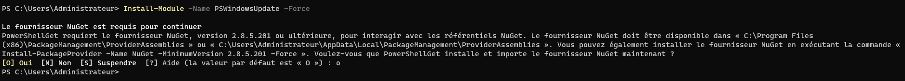
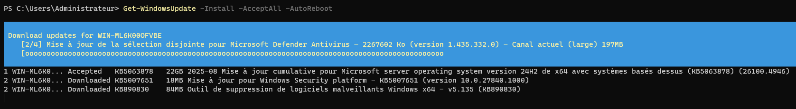
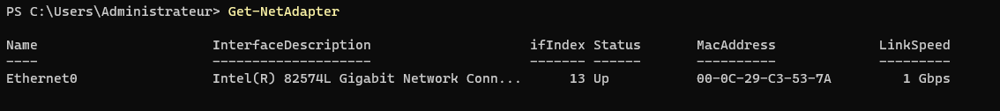
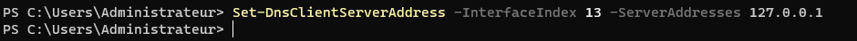
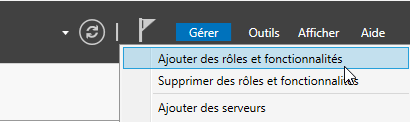
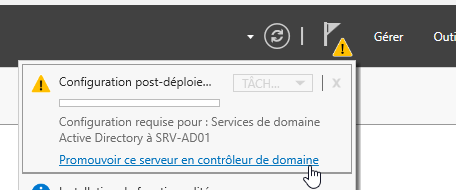
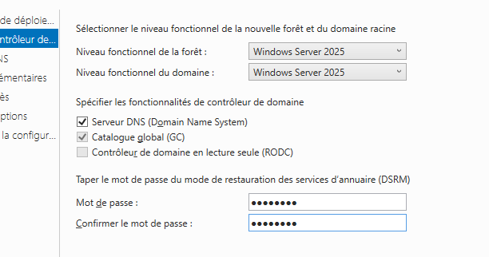
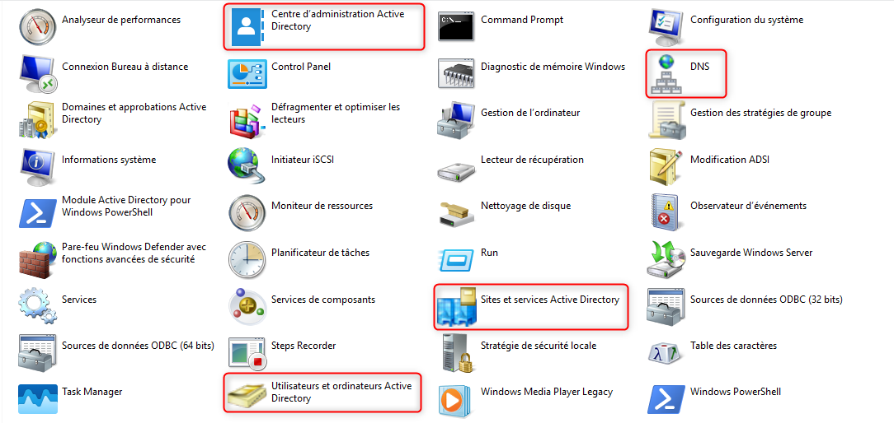
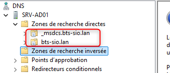
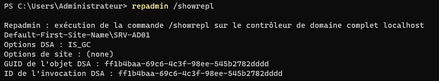

## Objectif

Ce document détaille la méthode complète pour installer et configurer un serveur Windows Server en tant que premier contrôleur de domaine (DC) pour une nouvelle forêt Active Directory (AD). L'objectif est de créer le socle d'une infrastructure de gestion centralisée des identités et des ressources.

## Contexte et Justification

Active Directory Domain Services (AD DS) est un service d'annuaire qui permet de centraliser et de gérer les utilisateurs, les ordinateurs, et les autres ressources réseau.

Mettre en place un contrôleur de domaine est la première étape pour :

- **Centraliser l'authentification :** Un seul identifiant et mot de passe par utilisateur pour accéder à toutes les ressources autorisées.
- **Gérer la sécurité :** Déployer des politiques de sécurité uniformes via les Stratégies de Groupe (GPO).
- **Simplifier l'administration :** Gérer l'ensemble du parc informatique depuis une console centralisée.
- **Fournir des services essentiels :** Le DC héberge généralement le service **DNS** pour la résolution de noms interne, un service critique au bon fonctionnement du réseau.

## Prérequis

- **Logiciel :** Une installation fonctionnelle de Windows Server (2019, 2022 ou ultérieur).
- **Matériel :** Une machine (physique ou virtuelle) avec des ressources suffisantes (minimum 2 CPU, 4 Go de RAM, 60 Go de disque).
- **Compte :** Un accès avec un compte ayant les droits Administrateur local sur le serveur.
- **Planification :**
  - Une adresse IP fixe a été définie pour le serveur.
  - Le nom du domaine Active Directory a été choisi (ex : `bts-sio.lan`).

## Procédure d'Installation et de Configuration

### Mise à Jour Complète du Système (Windows Update)

**Justification :** Avant d'installer des rôles aussi critiques que les services Active Directory, il est impératif que le système d'exploitation soit entièrement à jour. Cela permet d'appliquer les derniers correctifs de sécurité, d'améliorer la stabilité et d'éviter les problèmes de compatibilité.

1. Ouvrez une fenêtre PowerShell en tant qu'administrateur.
2. **Installez le module PSWindowsUpdate**, qui permet de gérer Windows Update en ligne de commande :

```powershell
Install-Module -Name PSWindowsUpdate -Force
```



<p class="figure-caption"><b>Figure 1</b> · Installation du module PSWindowsUpdate</p>

<div class="callout callout-note">

Si une question s'affiche concernant le fournisseur « NuGet » ou un « dépôt non approuvé », tapez O (pour Oui) puis Entrée pour valider.

</div>

3. **Lancez l'installation des mises à jour.** Cette commande unique recherche, télécharge et installe toutes les mises à jour nécessaires. Elle accepte toutes les licences et redémarre le serveur automatiquement si une mise à jour l'exige :

```powershell
Get-WindowsUpdate -Install -AcceptAll -AutoReboot
```



<p class="figure-caption"><b>Figure 2</b> · Installation des mises à jour</p>

Le processus peut prendre du temps. Après le redémarrage, réexécutez la même commande pour vérifier qu'aucune mise à jour cumulative n'est apparue entre-temps. Continuez jusqu'à ce que la commande ne trouve plus aucune mise à jour.

### Configuration Réseau Statique

Un contrôleur de domaine **doit impérativement** avoir une adresse IP statique pour que les autres machines du réseau puissent le retrouver de manière fiable.

1. Ouvrez une fenêtre PowerShell en tant qu'administrateur.
2. Listez vos interfaces réseau avec la commande `Get-NetAdapter` et notez l'index (`ifIndex`) de la carte à configurer.



<p class="figure-caption"><b>Figure 3</b> · Liste des cartes réseau</p>

3. Configurez l'adresse IP, le masque de sous-réseau et la passerelle. Remplacez les valeurs par celles de votre réseau :

```powershell
New-NetIPAddress -InterfaceIndex <Index_de_votre_carte> -IPAddress 192.168.1.10 -PrefixLength 24 -DefaultGateway 192.168.1.1
```


<p class="figure-caption"><b>Figure 4</b> · Adresse IP statique</p>

4. Configurez le serveur DNS. Le premier contrôleur de domaine doit pointer **vers lui-même** pour la résolution DNS :

```powershell
Set-DnsClientServerAddress -InterfaceIndex <Index_de_votre_carte> -ServerAddresses "127.0.0.1"
```



<p class="figure-caption"><b>Figure 5</b> · Serveur DNS du contrôleur de domaine</p>

### Renommage du Serveur

Donnez un nom explicite au serveur pour l'identifier facilement.

1. Dans la même fenêtre PowerShell, exécutez la commande suivante en remplaçant `SRV-AD01` par le nom souhaité :

```powershell
Rename-Computer -NewName "SRV-AD01" -Restart
```

### Installation du Rôle « AD DS »

1. Après le redémarrage, ouvrez le **Gestionnaire de serveur.**
2. Cliquez sur **Gérer** \> **Ajouter des rôles et fonctionnalités.**



<p class="figure-caption"><b>Figure 6</b> · Ajouter des rôles et fonctionnalités</p>

3. Cochez la case **« Services de domaine Active Directory (AD DS) »**.
4. Une fenêtre s'ouvre pour ajouter les fonctionnalités requises (consoles de gestion, etc.). Cliquez sur **« Ajouter des fonctionnalités »**.
5. Cliquez sur **Suivant** jusqu'à la fin de l'assistant, puis cliquez sur **Installer**.

### Promotion du Serveur en Contrôleur de Domaine

L'installation du rôle ne fait que copier les fichiers nécessaires. Il faut maintenant configurer le service.

1. Dans le **Gestionnaire de serveur**, cliquez sur le drapeau de notification jaune et sélectionnez **« Promouvoir ce serveur en contrôleur de domaine »**.



<p class="figure-caption"><b>Figure 7</b> · Promouvoir ce serveur en contrôleur de domaine</p>

2. L'assistant de configuration se lance. Choisissez l'option **« Ajouter une nouvelle forêt ».**
3. Entrez le **nom de domaine racine** que vous avez choisi dans les prérequis (ex : `bts-sio.lan`).
4. Sur l'écran suivant :
   - Laissez le **niveau fonctionnel** de la forêt et du domaine par défaut (sauf si vous avez des besoins spécifiques de compatibilité avec d'anciens serveurs).
   - Assurez-vous que **Serveur DNS (Domain Name System)** est coché.
   - Saisissez un **mot de passe de restauration des services d'annuaire (DSRM)**. Ce mot de passe est crucial en cas de sinistre majeur sur l'AD. Conservez-le précieusement !



<p class="figure-caption"><b>Figure 8</b> · Options du contrôleur de domaine</p>

5. Ignorez l'avertissement sur la délégation DNS en cliquant sur **Suivant**.
6. Confirmez le nom NetBIOS du domaine (généralement la version courte du nom de domaine).
7. Laissez les chemins d'accès pour la base de données, les journaux et SYSVOL par défaut, puis cliquez sur **Suivant.**
8. Passez en revue le récapitulatif de vos choix.
9. L'assistant effectue une **vérification de la configuration requise**. Si tout est au vert (les avertissements sont normaux), cliquez sur **Installer**. Le serveur va finaliser la configuration puis **redémarrer automatiquement**. Ce processus peut prendre plusieurs minutes.

## Vérifications

Une fois le serveur redémarré, il est essentiel de vérifier que tout fonctionne correctement.

1. **Connexion au domaine :** L'écran de connexion a changé. Vous devez maintenant vous connecter avec le compte administrateur du domaine (ex : `BTS-SIO\Administrateur`).


<p class="figure-caption"><b>Figure 9</b> · Connexion avec le compte du domaine</p>

2. **Consoles de gestion :** Ouvrez le menu Démarrer \> Outils d'administration Windows. Vous devez voir les nouvelles consoles :
   - Utilisateurs et ordinateurs Active Directory.
   - Sites et services Active Directory.
   - DNS.



<p class="figure-caption"><b>Figure 10</b> · Nouvelles consoles d'administration</p>

3. **Vérification DNS :** Ouvrez la console DNS. Vérifiez que les zones de recherche directe (`_msdcs.votredomaine.lan` et `votredomaine.lan`) ont été créées automatiquement et contiennent de nombreux enregistrements (SRV, A, etc.).



<p class="figure-caption"><b>Figure 11</b> · Zones DNS créées automatiquement</p>

4. **Diagnostic du contrôleur de domaine :** Ouvrez une invite de commande (CMD) ou PowerShell en tant qu'administrateur et exécutez les commandes `dcdiag` et `repadmin /showrepl`. Elles ne doivent retourner aucune erreur critique.



<p class="figure-caption"><b>Figure 12</b> · Résultat de dcdiag</p>

## Conseils et Bonnes Pratiques

- **Ne pas utiliser le compte « Administrateur » :** Créez un compte administrateur nominatif pour vous et n'utilisez le compte par défaut qu'en cas d'urgence.
- **Redondance :** Pour tout environnement de production, déployez un **second contrôleur de domaine** pour assurer la continuité de service (cf. procédure *Ajout d'un Contrôleur de Domaine Secondaire*).
- **Sauvegardes :** Mettez en place une politique de sauvegarde régulière de l'**état du système (System State)** de votre contrôleur de domaine.
- **Rôle dédié :** N'installez pas de rôles ou d'applications « lourdes » (comme SQL Server) sur un contrôleur de domaine. Sa fonction doit rester dédiée à l'annuaire et au DNS.

## Dépannage

- **Erreur lors de la vérification des prérequis :** Le plus souvent, cela est dû à une adresse IP laissée en DHCP ou à une mauvaise configuration du DNS (le serveur ne pointait pas sur lui-même avant la promotion).
- **Les clients ne peuvent pas joindre le domaine :** Vérifiez que les postes clients utilisent bien l'adresse IP du contrôleur de domaine comme **serveur DNS primaire**. Assurez-vous également qu'aucun pare-feu ne bloque les flux entre le client et le serveur.

## Procédures Liées

- [Installation de Windows Server 2025](/procedures/windows/installation-de-windows-server-2025) *(Installation du serveur)*
- [Ajout d'un Contrôleur de Domaine Secondaire](/procedures/windows/ajout-dun-controleur-de-domaine-secondaire) *(Redondance du domaine)*
- [Configuration d'un Serveur DNS Dédié](/procedures/windows/configuration-dun-serveur-dns-dedie) *(Rôle DNS associé)*
- [Configuration d'un Serveur de Temps (NTP) pour un Domaine AD](/procedures/windows/configuration-dun-serveur-de-temps-ntp-pour-un-domaine-ad) *(Source de temps du domaine)*
- [Gestion des Objets dans Active Directory](/procedures/windows/gestion-des-objets-dans-active-directory) *(Création des premiers objets)*
