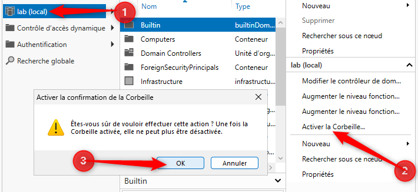
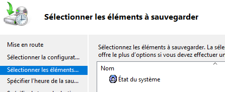

## Introduction

Cette procédure décrit les moyens de restaurer des objets et de récupérer un contrôleur de domaine dans le domaine `lab.local`, composé de SRV-DC-01 et SRV-DC-02 sous Windows Server 2025 sur le réseau 192.168.10.0/24. Elle couvre :

- l'activation et l'utilisation de la Corbeille Active Directory ;
- la sauvegarde de l'état système des contrôleurs de domaine avec Sauvegarde Windows Server (`wbadmin`) ;
- le démarrage en mode de restauration des services d'annuaire (DSRM) ;
- la restauration non autoritaire et la restauration autoritaire (`ntdsutil authoritative restore`) ;
- la restauration de SYSVOL répliqué par DFSR, en mode non autoritaire et autoritaire.

La récupération complète d'une forêt après compromission, qui suit un plan Microsoft dédié, sort du périmètre. Elle est seulement évoquée dans les choix architecturaux.

## Contexte et Justification

Active Directory est répliqué entre tous les contrôleurs de domaine. Cette réplication protège contre la perte d'un serveur, mais elle propage aussi les erreurs : une OU supprimée sur SRV-DC-01 disparaît de SRV-DC-02 en quelques secondes dans un même site. La redondance ne remplace donc pas la sauvegarde.

Les incidents courants sont :

- la suppression accidentelle d'un utilisateur, d'un groupe ou d'une OU entière ;
- la modification massive erronée d'attributs par un script ;
- la suppression ou la corruption de GPO et de scripts dans SYSVOL ;
- la perte d'un contrôleur de domaine (disque, mise à jour ratée, base `ntds.dit` corrompue).

Chaque incident appelle un outil différent. La Corbeille AD restaure en quelques secondes un objet supprimé avec tous ses attributs. La sauvegarde d'état système, combinée au mode DSRM et à `ntdsutil`, couvre les modifications d'attributs, les suppressions antérieures à la Corbeille et la reconstruction d'un DC. Disposer de ces trois niveaux, testés, distingue un incident de quelques minutes d'une interruption de plusieurs jours.

## Concepts Clés

**Tombstone lifetime et objets supprimés.** Un objet supprimé n'est pas effacé immédiatement. Sans Corbeille, il devient un tombstone (la plupart des attributs sont retirés) conservé pendant la durée `tombstoneLifetime`, 180 jours par défaut dans les forêts récentes, puis il est purgé. Une sauvegarde plus ancienne que cette durée ne doit pas être restaurée.

**Corbeille Active Directory.** Fonction optionnelle de la forêt, irréversible une fois activée. Un objet supprimé passe d'abord à l'état « objet supprimé » en conservant tous ses attributs, y compris les appartenances aux groupes, pendant `msDS-deletedObjectLifetime` (égal par défaut à `tombstoneLifetime`). Il devient ensuite « objet recyclé » et n'est plus restaurable par la Corbeille.

**Sauvegarde d'état système.** Sauvegarde qui contient, sur un DC, la base `ntds.dit` et ses journaux, SYSVOL, le registre et les fichiers de démarrage. Les sauvegardes incrémentielles d'AD DS ne sont pas prises en charge par Sauvegarde Windows Server : chaque sauvegarde est complète.

**DSRM (Directory Services Restore Mode).** Mode de démarrage d'un DC où le service AD DS n'est pas démarré. On s'y connecte avec le compte administrateur local DSRM, dont le mot de passe est défini à la promotion. C'est le mode requis pour restaurer l'état système d'un DC.

**Restauration non autoritaire.** Le DC est remis dans l'état de la sauvegarde, puis il reçoit par réplication toutes les modifications faites depuis sur les autres DC. Elle sert à reconstruire un DC, pas à récupérer un objet supprimé, car la suppression revient par réplication.

**Restauration autoritaire.** Après une restauration non autoritaire et avant le redémarrage normal, `ntdsutil` augmente le numéro de version des objets choisis (100 000 par défaut). Ces objets deviennent prioritaires et sont répliqués vers les autres DC, ce qui annule leur suppression ou leur modification.

**SYSVOL et DFSR.** SYSVOL contient les GPO et les scripts d'ouverture de session. Il est répliqué par DFSR (FRS n'est plus pris en charge). Sa restauration se pilote par les attributs `msDFSR-Enabled` et `msDFSR-Options` de l'objet `CN=SYSVOL Subscription` de chaque DC.

| Situation | Outil adapté |
|-----------|--------------|
| Objet supprimé après activation de la Corbeille | Corbeille AD (`Restore-ADObject`) |
| Attributs modifiés à tort, objet non supprimé | Sauvegarde, DSRM, restauration autoritaire de l'objet |
| Objet supprimé avant activation de la Corbeille | Sauvegarde, DSRM, restauration autoritaire |
| DC défaillant, autres DC sains | Restauration non autoritaire, ou démotion forcée et nouvelle promotion |
| GPO supprimée sur tous les DC | Sauvegarde de GPO (`Restore-GPO`) ou restauration autoritaire de SYSVOL |

: Choix de l'outil de restauration

## Prérequis

- Un compte membre de Domain Admins, et Enterprise Admins pour activer la Corbeille.
- Le niveau fonctionnel de forêt Windows Server 2008 R2 ou supérieur pour la Corbeille (le lab est au niveau Windows Server 2025).
- La fonctionnalité **Sauvegarde Windows Server** (`Windows-Server-Backup`) installée sur SRV-DC-01 et SRV-DC-02.
- Une cible de sauvegarde dédiée : un volume local non sauvegardé lui-même (par exemple `E:` sur SRV-DC-01) ou un partage réseau sur un serveur de sauvegarde, accessible uniquement aux administrateurs du Tier 0.
- Le mot de passe DSRM de chaque DC, connu et conservé dans un coffre. Il peut être redéfini avec `ntdsutil "set dsrm password" "reset password on server null" q q`.
- Un accès console aux DC (console Hyper-V, iDRAC, iLO ou équivalent), une session RDP n'étant pas disponible en DSRM sans configuration réseau.
- Une réplication saine avant toute opération (`repadmin /replsummary`).

## Points de Vigilance

**L'activation de la Corbeille est irréversible et rend les anciens tombstones irrécupérables par la Corbeille.** Les objets supprimés avant l'activation deviennent des objets recyclés. Seule une restauration autoritaire depuis une sauvegarde antérieure permet de les récupérer.

**Ne restaurez jamais un instantané de machine virtuelle d'un DC comme méthode de sauvegarde.** Sur un hyperviseur compatible avec VM-GenerationID, Windows Server détecte la restauration et protège le DC. Sans cette protection, le retour en arrière provoque une restauration USN (USN rollback) qui casse la réplication. Utilisez une sauvegarde d'état système.

**N'utilisez pas une sauvegarde plus ancienne que la durée de vie des tombstones.** Elle réintroduirait des objets supprimés et purgés ailleurs (objets persistants, ou lingering objects).

**La restauration autoritaire d'une OU entière annule toutes les modifications faites depuis la sauvegarde.** Mots de passe, appartenances aux groupes et attributs changés après la sauvegarde reviennent à leur ancienne valeur pour tous les objets de l'OU. Ciblez l'objet ou le conteneur le plus bas possible.

**Les appartenances aux groupes sont des liens.** Lors d'une restauration autoritaire d'utilisateurs, `ntdsutil` génère un fichier LDIF qui permet de recréer les liens d'appartenance dans les groupes situés hors du périmètre restauré. Conservez-le et importez-le si nécessaire.

**En DSRM, désactivez la réplication entrante avant le retour en mode normal si la restauration est autoritaire.** Sinon le DC restauré peut recevoir la suppression depuis l'autre DC avant d'avoir répliqué ses objets restaurés.

**Ne restaurez pas SYSVOL en autoritaire sur un DC sans traiter tous les autres.** Microsoft indique que si un DC est déclaré autoritaire, tous les autres doivent être resynchronisés en non autoritaire, sinon des conflits apparaissent.

**Protégez les sauvegardes comme le Tier 0.** Une sauvegarde d'état système contient les hachages de tous les mots de passe du domaine et la clé racine KDS. Son vol équivaut à la compromission du domaine.

**Le droit d'effectuer des sauvegardes sur un DC est un droit à privilèges.** Les membres de Backup Operators peuvent lire la base AD. Laissez ce groupe vide et utilisez des comptes de Tier 0 ou une solution de sauvegarde dédiée.

## Choix Architecturaux & Alternatives

### Quand choisir chaque mécanisme

Activez la Corbeille AD sur toute forêt de production : son coût est négligeable et elle couvre la grande majorité des incidents (suppressions accidentelles). Complétez-la par une sauvegarde d'état système quotidienne d'au moins deux DC, conservée sur une durée inférieure à la durée de vie des tombstones mais couvrant plusieurs semaines. La restauration autoritaire reste réservée aux modifications d'attributs et aux suppressions non couvertes par la Corbeille.

Pour un DC défaillant dans un domaine qui compte d'autres DC sains, il est souvent plus rapide et plus sûr de forcer sa rétrogradation, de nettoyer ses métadonnées, puis de promouvoir un nouveau DC, que de restaurer l'état système. La restauration de l'état système reste indispensable si tous les DC sont perdus.

### Alternatives et comparatif

| Option | Cas d'usage typique | Force principale | Faiblesse principale | Coût relatif |
|--------|---------------------|------------------|----------------------|--------------|
| **Corbeille AD** | Objet supprimé par erreur | Restauration en ligne, attributs et appartenances conservés | Ne couvre ni les modifications d'attributs ni les objets recyclés | Gratuit |
| **Sauvegarde d'état système (wbadmin)** | Restauration autoritaire, reconstruction de DC | Native, sauvegarde complète et cohérente | Restauration hors ligne en DSRM, procédure exigeante | Gratuit, stockage à prévoir |
| **Instantanés AD (`ntdsutil snapshot`) et `dsamain`** | Consulter un état antérieur pour comparer des attributs | Lecture d'une ancienne base sans redémarrer le DC | Lecture seule, la réinjection des valeurs est manuelle | Gratuit |
| **Sauvegarde des GPO (`Backup-GPO`)** | GPO supprimée ou mal modifiée | Restauration ciblée d'une GPO | Ne couvre que les GPO | Gratuit |
| **Nouvelle promotion d'un DC** | Perte d'un DC parmi plusieurs | Rapide, sans risque de rollback | Nécessite au moins un DC sain | Gratuit |
| **Solution de sauvegarde et de récupération AD tierce** | Grands environnements, récupération de forêt | Restauration granulaire d'attributs, automatisation de la récupération de forêt | Licence, composant à protéger comme du Tier 0 | Élevé |

### Impact des choix

- **Disponibilité.** La Corbeille restaure sans arrêt de service. Une restauration en DSRM arrête le DC concerné pendant l'opération. Avec deux DC, l'authentification reste assurée par l'autre DC.
- **Sécurité.** Les sauvegardes d'état système sont aussi sensibles que les DC eux-mêmes. Elles doivent être stockées hors ligne ou immuables, accessibles au seul Tier 0, pour résister à un rançongiciel qui chiffrerait aussi les cibles de sauvegarde.
- **Exploitation.** Une procédure de restauration non testée échoue souvent le jour où on en a besoin (mot de passe DSRM perdu, sauvegarde incomplète). Un test trimestriel en lab isolé est recommandé.
- **Coût.** Les outils natifs sont gratuits. Le coût porte sur le stockage des sauvegardes et le temps de test.

## Méthode 1 : Configuration via le Centre d'administration Active Directory (dsac.exe) et la Console Sauvegarde Windows Server (wbadmin.msc)

### Activer la Corbeille AD

1. Ouvrez le Centre d'administration Active Directory (`dsac.exe`) sur SRV-DC-01 avec un compte Enterprise Admins.
2. Sélectionnez le domaine `lab (local)` dans le volet de gauche.
3. Dans le volet **Tâches**, cliquez sur **Activer la Corbeille...**, puis confirmez l'avertissement d'irréversibilité.
4. Actualisez la console après la réplication vers SRV-DC-02. Le conteneur **Deleted Objects** apparaît sous le domaine.



<p class="figure-caption"><b>Figure 1</b> · Activation de la corbeille.</p>

### Restaurer un Objet Supprimé

1. Dans `dsac.exe`, ouvrez le conteneur **Deleted Objects** du domaine.
2. Filtrez sur le nom de l'objet, par exemple `jdupont`.
3. Sélectionnez l'objet, puis :
   - **Restaurer** pour le replacer dans son conteneur d'origine (`lastKnownParent`) ;
   - **Restaurer sur...** pour choisir une autre OU.
4. Si une OU entière a été supprimée, restaurez d'abord l'OU, puis les objets qu'elle contenait. Un objet ne peut pas être restauré dans un conteneur encore supprimé.


<p class="figure-caption"><b>Figure 2</b> · Restauration de `jdupont`</p>

### Planifier la Sauvegarde d'État Système

1. Sur SRV-DC-01, installez la fonctionnalité **Sauvegarde Windows Server** depuis le Gestionnaire de serveur.
2. Ouvrez `wbadmin.msc` > Sauvegarde locale > **Planification de sauvegarde...**.
3. **Configuration de la sauvegarde :** **Personnalisé**, puis **Ajouter des éléments** > **État du système**.



<p class="figure-caption"><b>Figure 3</b> · Choix des éléments personnalisés</p>

1. **Heure de la sauvegarde :** une fois par jour, par exemple à 21:00.
2. **Type de destination :** disque dédié ou dossier réseau partagé (`\\SRV-BCK-01\AD-Backup\SRV-DC-01`).
3. Confirmez. Répétez sur SRV-DC-02 avec une destination distincte.

<div class="callout callout-note">

Une sauvegarde vers un dossier réseau partagé écrase la précédente. Pour conserver plusieurs versions, utilisez un disque dédié ou une solution de sauvegarde qui copie le contenu du partage vers un stockage versionné.

</div>

### Démarrer en Mode DSRM

1. Sur SRV-DC-02 (le DC à restaurer), ouvrez **msconfig** > onglet **Démarrer**.
2. Cochez **Démarrage sécurisé** > **Réparation Active Directory**, validez, puis redémarrez.
3. À l'écran de connexion, choisissez **Autre utilisateur** et connectez-vous en `.\Administrateur` avec le mot de passe DSRM.

### Restaurer l'État Système (non autoritaire)

1. En DSRM, ouvrez `wbadmin.msc` > **Récupérer...**.
2. Sélectionnez l'emplacement et la date de la sauvegarde, puis **État du système**.
3. Choisissez **Emplacement d'origine**. Laissez décochée l'option **Effectuer une restauration faisant autorité des fichiers Active Directory** pour une restauration non autoritaire de SYSVOL.
4. Lancez la récupération et attendez la fin. Ne redémarrez pas si une restauration autoritaire d'objets doit suivre.

### Revenir au Mode Normal

1. Ouvrez **msconfig** > onglet **Démarrer**, décochez **Démarrage sécurisé**, puis redémarrez.

## Méthode 2 : Configuration via PowerShell

### Activer et Utiliser la Corbeille

```powershell
# Activation (sur le maître d'attribution de noms de domaine)
$dnm = (Get-ADForest).DomainNamingMaster
Enable-ADOptionalFeature -Identity "Recycle Bin Feature" -Scope ForestOrConfigurationSet `
    -Target "lab.local" -Server $dnm

# Vérification
Get-ADOptionalFeature -Filter 'Name -like "Recycle Bin Feature"' | Select-Object Name, EnabledScopes

# Rechercher un objet supprimé
Get-ADObject -Filter 'isDeleted -eq $true -and samAccountName -eq "jdupont"' `
    -IncludeDeletedObjects -Properties lastKnownParent, whenChanged

# Restaurer dans le conteneur d'origine
Get-ADObject -Filter 'isDeleted -eq $true -and samAccountName -eq "jdupont"' -IncludeDeletedObjects |
    Restore-ADObject

# Restaurer une OU supprimée puis son contenu (parent d'abord)
Get-ADObject -Filter 'isDeleted -eq $true -and msDS-LastKnownRDN -eq "Comptabilite"' -IncludeDeletedObjects |
    Restore-ADObject
Get-ADObject -Filter 'isDeleted -eq $true -and lastKnownParent -eq "OU=Comptabilite,OU=LAB,DC=lab,DC=local"' `
    -IncludeDeletedObjects | Restore-ADObject
```

### Consulter la Durée de Vie des Objets Supprimés

```powershell
$dsConfig = "CN=Directory Service,CN=Windows NT,CN=Services,CN=Configuration,DC=lab,DC=local"
Get-ADObject $dsConfig -Properties tombstoneLifetime, msDS-deletedObjectLifetime |
    Select-Object tombstoneLifetime, msDS-deletedObjectLifetime
```

Une valeur vide pour `msDS-deletedObjectLifetime` signifie que la valeur de `tombstoneLifetime` s'applique.

### Sauvegarder l'État Système

```powershell
Install-WindowsFeature -Name Windows-Server-Backup

# Sauvegarde ponctuelle vers le volume E:
wbadmin start systemstatebackup -backupTarget:E: -quiet

# Lister les versions disponibles
wbadmin get versions -backupTarget:E:
```

Pour une planification quotidienne en ligne de commande :

```powershell
wbadmin enable backup -addtarget:E: -systemState -schedule:21:00 -quiet
```

### Basculer en DSRM et Revenir

```powershell
# Démarrage suivant en DSRM
bcdedit /set safeboot dsrepair
shutdown /r /t 0

# Une fois les opérations terminées, retour au démarrage normal
bcdedit /deletevalue safeboot
shutdown /r /t 0
```

### Restaurer l'État Système en DSRM

```powershell
# Restauration non autoritaire (AD et SYSVOL non autoritaires)
wbadmin start systemstaterecovery -version:10/15/2026-21:00 -backupTarget:E: -quiet

# Variante : AD non autoritaire et SYSVOL autoritaire (perte de tous les DC uniquement)
# wbadmin start systemstaterecovery -version:10/15/2026-21:00 -backupTarget:E: -authsysvol -quiet
```

Le paramètre `-version` utilise le format `MM/JJ/AAAA-HH:MM` indiqué par `wbadmin get versions`.

### Marquer des Objets en Restauration Autoritaire

Toujours en DSRM, après la restauration de l'état système et avant tout redémarrage :

```cmd
ntdsutil
activate instance ntds
authoritative restore
restore object "CN=Jean Dupont,OU=Utilisateurs,OU=LAB,DC=lab,DC=local"
quit
quit
```

Pour un conteneur et tout son contenu :

```cmd
ntdsutil "activate instance ntds" "authoritative restore" "restore subtree \"OU=Comptabilite,OU=LAB,DC=lab,DC=local\"" q q
```

`ntdsutil` crée dans le dossier courant un fichier texte listant les objets marqués et, si des liens doivent être recréés, un fichier `.ldf`. Notez leur nom.

### Répliquer les Objets Restaurés

1. Redémarrez SRV-DC-02 en mode normal (`bcdedit /deletevalue safeboot`).
2. Désactivez temporairement la réplication entrante sur SRV-DC-02, puis poussez les objets restaurés :

```powershell
repadmin /options SRV-DC-02 +DISABLE_INBOUND_REPL
repadmin /syncall SRV-DC-02 "DC=lab,DC=local" /d /e /P
```

3. Si un fichier `.ldf` a été généré, importez-le pour recréer les appartenances aux groupes :

```powershell
ldifde -i -k -f .\<fichier_genere_par_ntdsutil>.ldf
```

4. Réactivez la réplication entrante :

```powershell
repadmin /options SRV-DC-02 -DISABLE_INBOUND_REPL
```

### Resynchroniser SYSVOL en Non Autoritaire (DFSR)

Pour réparer SYSVOL sur un seul DC (SRV-DC-02), sans toucher aux autres :

```powershell
$sub = "CN=SYSVOL Subscription,CN=Domain System Volume,CN=DFSR-LocalSettings,CN=SRV-DC-02,OU=Domain Controllers,DC=lab,DC=local"

Set-ADObject $sub -Replace @{"msDFSR-Enabled" = $false} -Server SRV-DC-01
repadmin /syncall SRV-DC-01 /AdeP
dfsrdiag pollad /member:SRV-DC-02
# Attendre l'événement DFSR 4114 sur SRV-DC-02

Set-ADObject $sub -Replace @{"msDFSR-Enabled" = $true} -Server SRV-DC-01
repadmin /syncall SRV-DC-01 /AdeP
dfsrdiag pollad /member:SRV-DC-02
# Attendre les événements DFSR 4614 puis 4604 sur SRV-DC-02
```

### Restaurer SYSVOL en Autoritaire (DFSR)

À réserver au cas où le contenu de SYSVOL est perdu ou corrompu sur tous les DC. SRV-DC-01, émulateur PDC, devient la référence.

1. Sur SRV-DC-01 et SRV-DC-02, passez le service DFSR en démarrage manuel et arrêtez-le :

   ```powershell
   Invoke-Command -ComputerName SRV-DC-01,SRV-DC-02 { Set-Service DFSR -StartupType Manual; Stop-Service DFSR }
   ```

2. Sur l'objet `CN=SYSVOL Subscription` de SRV-DC-01, positionnez `msDFSR-Enabled = FALSE` et `msDFSR-Options = 1`. Sur celui de SRV-DC-02, positionnez `msDFSR-Enabled = FALSE` :

   ```powershell
   $sub01 = "CN=SYSVOL Subscription,CN=Domain System Volume,CN=DFSR-LocalSettings,CN=SRV-DC-01,OU=Domain Controllers,DC=lab,DC=local"
   $sub02 = "CN=SYSVOL Subscription,CN=Domain System Volume,CN=DFSR-LocalSettings,CN=SRV-DC-02,OU=Domain Controllers,DC=lab,DC=local"
   Set-ADObject $sub01 -Replace @{"msDFSR-Enabled" = $false; "msDFSR-Options" = 1} -Server SRV-DC-01
   Set-ADObject $sub02 -Replace @{"msDFSR-Enabled" = $false} -Server SRV-DC-01
   repadmin /syncall SRV-DC-01 /AdeP
   ```

3. Démarrez DFSR sur SRV-DC-01 et attendez l'événement 4114.
4. Sur SRV-DC-01, positionnez `msDFSR-Enabled = TRUE`, forcez la réplication AD, exécutez `dfsrdiag pollad` et attendez l'événement 4602.
5. Démarrez DFSR sur SRV-DC-02 et attendez l'événement 4114.
6. Sur SRV-DC-02, positionnez `msDFSR-Enabled = TRUE`, forcez la réplication AD et exécutez `dfsrdiag pollad` sur SRV-DC-02.
7. Remettez le service DFSR en démarrage automatique sur les deux DC.

## Vérifications

**Corbeille :** `Get-ADOptionalFeature 'Recycle Bin Feature'` affiche une valeur dans `EnabledScopes`. L'objet restauré est visible dans son OU avec ses groupes (`Get-ADUser jdupont -Properties MemberOf`).


<p class="figure-caption"><b>Figure 4</b> · Résultat de la commande `Get-ADOptionalFeature 'Recycle Bin Feature'`</p>

**Sauvegarde :** `wbadmin get versions` liste une sauvegarde récente pour chaque DC. `repadmin /showbackup` indique la date de la dernière sauvegarde de chaque partition, qui doit dater de moins de 24 heures.

**Restauration autoritaire :** `repadmin /showobjmeta SRV-DC-01 "CN=Jean Dupont,OU=Utilisateurs,OU=LAB,DC=lab,DC=local"` montre des versions d'attributs augmentées d'environ 100 000 et l'objet est présent sur SRV-DC-01 comme sur SRV-DC-02.

**Réplication :** `repadmin /replsummary` ne signale aucune erreur, `repadmin /options SRV-DC-02` ne contient plus `DISABLE_INBOUND_REPL`.


<p class="figure-caption"><b>Figure 5</b> · Résultat de la commande `repadmin /replsummary`.</p>

**SYSVOL :** les partages `SYSVOL` et `NETLOGON` sont publiés (`net share`), `dcdiag /test:sysvolcheck /test:advertising` réussit et le journal **DFS Replication** contient l'événement 4602 (autoritaire) ou 4604 (non autoritaire).

## Dépannage

**La Corbeille ne propose pas l'objet :** il a été supprimé avant l'activation de la Corbeille, ou sa durée de conservation est dépassée et il est recyclé. Vérifiez avec `Get-ADObject -Filter 'isRecycled -eq $true' -IncludeDeletedObjects`. Seule une restauration autoritaire depuis une sauvegarde reste possible.

**`Restore-ADObject` échoue sur un objet dont l'OU a aussi été supprimée :** le conteneur parent est encore à l'état supprimé. Restaurez d'abord l'OU parente, ou utilisez `-TargetPath` vers une OU existante.

**Mot de passe DSRM refusé :** il a été modifié ou perdu. Avant de redémarrer en DSRM, réinitialisez-le depuis le mode normal avec `ntdsutil "set dsrm password" "reset password on server null" q q`. Il est aussi possible de le synchroniser avec un compte de domaine (`sync from domain account`).

**Les objets restaurés en autoritaire disparaissent de nouveau :** la réplication entrante n'a pas été désactivée, ou la restauration a été faite sur un DC qui a ensuite reçu la suppression. Recommencez en respectant l'ordre : DSRM, restauration, `ntdsutil`, redémarrage, `DISABLE_INBOUND_REPL`, réplication sortante.

**Les utilisateurs restaurés n'ont plus leurs groupes :** les liens d'appartenance situés hors du périmètre restauré n'ont pas été recréés. Importez le fichier `.ldf` généré par `ntdsutil` avec `ldifde -i -k -f`.

**Les partages SYSVOL et NETLOGON n'apparaissent pas après la restauration :** la réplication initiale DFSR n'est pas terminée. Consultez le journal **DFS Replication**, vérifiez `msDFSR-Enabled` sur l'objet d'abonnement et relancez `dfsrdiag pollad`.

## Conseils et Bonnes Pratiques

**Activer la Corbeille dès la création de la forêt.** Elle ne coûte presque rien et évite la majorité des restaurations hors ligne.

**Protéger les OU contre la suppression accidentelle.** Cochez **Protéger contre la suppression accidentelle** sur les OU (`Set-ADOrganizationalUnit -ProtectedFromAccidentalDeletion $true`). Cette protection ajoute une ACE de refus de suppression.

**Sauvegarder au moins deux DC chaque jour.** Conservez les sauvegardes sur un support isolé ou immuable, sur une durée qui couvre plusieurs semaines sans dépasser la durée de vie des tombstones.

**Sauvegarder aussi les GPO séparément.** `Backup-GPO -All -Path \\SRV-BCK-01\GPO-Backup` permet de restaurer une GPO sans toucher à SYSVOL entier.

**Tester la restauration chaque trimestre.** Restaurez un DC dans un réseau isolé, vérifiez le démarrage d'AD DS, la présence d'objets récents et le mot de passe DSRM. Documentez la durée réelle de l'opération.

**Conserver le mot de passe DSRM dans un coffre.** Changez-le après chaque usage et documentez le changement.

**Surveiller l'âge des sauvegardes.** Les DC journalisent un avertissement lorsqu'une partition n'a pas été sauvegardée depuis longtemps. Supervisez `repadmin /showbackup` ou cet événement dans votre outil de supervision.

## Procédures Liées

- [Installation d'un Contrôleur de Domaine Active Directory](/procedures/windows/installation-dun-controleur-de-domaine-active-directory) *(Mot de passe DSRM défini à la promotion)*
- [Ajout d'un Contrôleur de Domaine Secondaire](/procedures/windows/ajout-dun-controleur-de-domaine-secondaire) *(Reconstruction d'un DC par nouvelle promotion)*
- Dépannage de la Réplication AD et de Kerberos *(Contrôle de la réplication après restauration)*
- [Transfert et Prise de Rôles FSMO](/procedures/windows/transfert-et-prise-de-roles-fsmo) *(Rôles à reprendre si le DC perdu les détenait)*
- Déploiement de DFS Namespaces et DFS Replication *(Fonctionnement de DFSR utilisé par SYSVOL)*
- [Gestion des Objets dans Active Directory](/procedures/windows/gestion-des-objets-dans-active-directory) *(Protection des OU contre la suppression accidentelle)*
