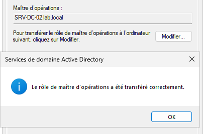
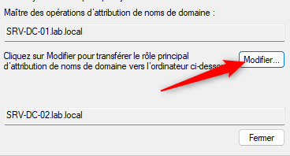

## Introduction

Cette procédure décrit comment identifier, transférer et prendre (seize) les cinq rôles de maître d'opérations (FSMO) d'une forêt Active Directory sous Windows Server 2025.

Le périmètre couvre l'inventaire des porteurs de rôles, le transfert planifié depuis les consoles MMC et PowerShell, la prise forcée avec `Move-ADDirectoryServerOperationMasterRole -Force` ou `ntdsutil`, et les règles à respecter après une prise. La restauration complète d'une forêt sort du périmètre.

Le lab utilisé est le domaine `lab.local`, racine de forêt unique, avec SRV-DC-01 (192.168.10.10) et SRV-DC-02 (192.168.10.11) sous Windows Server 2025, tous deux catalogues globaux. SRV-DC-01 porte initialement les cinq rôles.

## Contexte et Justification

Active Directory est multi-maître pour la plupart des opérations, mais certaines tâches ne peuvent être réalisées que par un seul contrôleur à la fois. Un porteur de rôle indisponible ne bloque pas immédiatement le domaine, mais provoque des pannes différées et difficiles à diagnostiquer.

- Le PDC émulateur indisponible dégrade la synchronisation horaire, le verrouillage de comptes et la propagation urgente des changements de mot de passe.
- Le maître RID indisponible empêche, une fois leur réserve épuisée, les contrôleurs de créer de nouveaux objets de sécurité.
- Le maître de schéma ou d'attribution de noms indisponible bloque les extensions de schéma et l'ajout ou la suppression de domaines.

Savoir transférer les rôles avant une maintenance, et les prendre de force après la perte définitive d'un contrôleur, fait partie du socle d'exploitation d'un annuaire.

## Concepts Clés

**Les cinq rôles.**

| Rôle | Portée | Partition | Fonction principale |
|------|--------|-----------|---------------------|
| Schema master | Forêt | `CN=Schema,CN=Configuration,DC=lab,DC=local` | Seul contrôleur autorisé à modifier le schéma |
| Domain naming master | Forêt | `CN=Configuration,DC=lab,DC=local` | Ajout et suppression de domaines et de partitions d'application |
| PDC emulator | Domaine | `DC=lab,DC=local` | Source de temps du domaine, priorité sur les changements de mot de passe, verrouillage de comptes, édition des GPO par défaut |
| RID master | Domaine | `DC=lab,DC=local` | Distribution des blocs d'identifiants relatifs (RID) aux contrôleurs |
| Infrastructure master | Domaine | `DC=lab,DC=local` | Mise à jour des références vers des objets d'autres domaines |

**Transfert.** Déplacement coordonné d'un rôle entre deux contrôleurs en ligne. Les données liées au rôle sont synchronisées avant la bascule. C'est l'opération recommandée.

**Prise (seize).** Réattribution unilatérale du rôle quand l'ancien porteur est injoignable. L'attribut `fSMORoleOwner` est réécrit sans synchronisation préalable. `Move-ADDirectoryServerOperationMasterRole -Force` et `ntdsutil` tentent d'abord un transfert, puis prennent le rôle si le transfert échoue.

**Réplication initiale.** Après un transfert ou une prise, le nouveau porteur n'agit pas immédiatement. Il attend un cycle de réplication entrante réussi sur la partition du rôle, comme un porteur qui redémarre.

**RID burn.** Pour éviter des SID en double, la prise du maître RID augmente le prochain bloc disponible. Selon Microsoft, `Move-ADDirectoryServerOperationMasterRole` l'augmente de 30 000 et `ntdsutil` de 10 000. Une prise inutile consomme donc des RID de façon irréversible.

**Infrastructure master et catalogue global.** Le rôle n'est plus utile si tous les contrôleurs du domaine sont catalogues globaux ou si la corbeille AD est activée. Microsoft recommande néanmoins de lui conserver un porteur valide pour éviter les alertes des outils de supervision.

## Prérequis

- Un compte membre de **Enterprise Admins** pour les rôles de forêt, et de **Schema Admins** pour le maître de schéma.
- Un compte membre de **Domain Admins** du domaine pour les rôles de domaine.
- Les outils RSAT AD DS ou une session sur un contrôleur de domaine (`dsa.msc`, `domain.msc`, module ActiveDirectory, `ntdsutil`, `netdom`).
- Une réplication saine entre SRV-DC-01 et SRV-DC-02 avant tout transfert (`repadmin /replsummary` sans erreur).
- Une sauvegarde récente de l'état système des contrôleurs.
- Pour une prise, la certitude que l'ancien porteur ne sera pas remis en ligne dans son état actuel.

## Points de Vigilance

**Ne jamais remettre en ligne un ancien porteur après une prise sans nettoyage.** Microsoft recommande de prendre les rôles uniquement si l'ancien porteur ne revient pas. Le contrôleur dont les rôles ont été pris doit être reformaté et réinstallé, ou rétrogradé de force, puis ses métadonnées doivent être nettoyées sur un contrôleur sain avant toute nouvelle promotion. Pour le schéma, l'attribution de noms et le RID, deux porteurs simultanés peuvent créer des objets de schéma, des domaines ou des blocs RID en conflit.

**Ne pas restaurer un ancien porteur depuis une sauvegarde.** La restauration recrée un contrôleur qui se croit porteur des rôles. Microsoft recommande de reconstruire le contrôleur à partir de zéro.

**Prendre le maître RID uniquement en dernier recours.** Chaque prise consomme un large bloc de RID. Si l'ancien porteur peut être réparé dans un délai acceptable, attendez.

**Une prise reste une décision documentée.** Consignez l'heure, le motif, le contrôleur cible et le résultat de `netdom query fsmo` avant et après l'opération.

**Le PDC émulateur porte la source de temps.** Après un déplacement du PDC, la configuration NTP externe doit suivre le rôle. Sinon le domaine se synchronise sur l'horloge locale du nouveau PDC, avec un risque d'écart et d'échecs Kerberos.

**Une console MMC ne sait que transférer.** La prise forcée n'est possible qu'en ligne de commande, avec PowerShell ou `ntdsutil`.

**La cmdlet ne fonctionne pas avec un RODC.** Un contrôleur en lecture seule ne peut pas porter de rôle FSMO.

## Choix Architecturaux & Alternatives

### Quand transférer, quand prendre

Transférez les rôles quand le porteur actuel est en ligne et joignable : maintenance planifiée, remplacement matériel, rétrogradation propre d'un contrôleur ou rééquilibrage des rôles. Prenez les rôles uniquement quand le porteur est définitivement perdu (panne matérielle irréparable, système réinstallé, rétrogradation forcée) ou quand une opération dépendant du rôle échoue durablement sans possibilité de transfert.

Dans un domaine unique à deux contrôleurs comme `lab.local`, regrouper les cinq rôles sur le même contrôleur est la configuration la plus simple. Le PDC émulateur doit être placé sur le contrôleur le mieux connecté et le plus fiable.

### Alternatives et comparatif

| Option | Cas d'usage typique | Force principale | Faiblesse principale | Coût relatif |
|--------|---------------------|------------------|----------------------|--------------|
| **Transfert via consoles MMC** | Opération ponctuelle par un administrateur peu familier de PowerShell | Visuel, confirmation explicite | Trois consoles différentes, pas de prise possible | Gratuit |
| **Move-ADDirectoryServerOperationMasterRole** | Transfert ou prise, exécution distante, scripts | Une commande pour plusieurs rôles, exécutable à distance | Prise du RID plus coûteuse en RID que ntdsutil | Gratuit |
| **ntdsutil** | Prise sur le contrôleur cible, environnement sans module PowerShell AD | Outil présent sur tout contrôleur, référence historique | Syntaxe interactive, exécution locale recommandée | Gratuit |
| **Rétrogradation propre du porteur** | Retrait planifié d'un contrôleur | Les rôles sont cédés automatiquement à un autre contrôleur | Choix du nouveau porteur non maîtrisé | Gratuit |

### Impact des choix

- **Disponibilité.** Un transfert se fait sans interruption perceptible. Une prise est sans impact immédiat pour les utilisateurs, mais impose la reconstruction de l'ancien porteur.
- **Intégrité.** Le transfert garantit la cohérence des données du rôle. La prise peut perdre les dernières modifications non répliquées de l'ancien porteur, en particulier un bloc RID ou une extension de schéma en cours.
- **Exploitation.** PowerShell s'exécute depuis un poste d'administration et se scripte. `ntdsutil` reste utile en situation dégradée sur le contrôleur lui-même.
- **Sécurité.** Les rôles de forêt exigent Enterprise Admins ou Schema Admins. Ces appartenances doivent être temporaires et retirées après l'opération.

## Méthode 1 : Configuration via les Consoles MMC (dsa.msc, domain.msc et Active Directory Schema)

### Identifier les Porteurs Actuels

1. Ouvrez une invite de commandes élevée sur SRV-DC-01.
2. Exécutez `netdom query fsmo`. La commande affiche les cinq rôles et leur porteur.


<p class="figure-caption"><b>Figure 1</b> · Résultat de `netdom query fsmo`.</p>

### Transférer les Rôles de Domaine (PDC, RID, Infrastructure)

1. Ouvrez `dsa.msc`.
2. Faites un clic droit sur le domaine `lab.local` > **Change Domain Controller**, puis sélectionnez **SRV-DC-02.lab.local**. La console doit être connectée au futur porteur.
3. Faites un clic droit sur `lab.local` > **Operations Masters**.
4. Dans l'onglet **RID**, vérifiez que le champ du bas indique SRV-DC-02, puis cliquez sur **Change** et confirmez.
5. Répétez l'opération dans les onglets **PDC** et **Infrastructure**.



<p class="figure-caption"><b>Figure 2</b> · Changement d'Operations Masters.</p>

### Transférer le Maître d'Attribution de Noms

1. Ouvrez `domain.msc`.
2. Faites un clic droit sur **Active Directory Domains and Trusts** > **Change Active Directory Domain Controller**, puis sélectionnez SRV-DC-02.
3. Faites un clic droit sur **Active Directory Domains and Trusts** > **Operations Master**.
4. Cliquez sur **Change** et confirmez.



<p class="figure-caption"><b>Figure 3</b> · Changement d'Operations Master.</p>

### Transférer le Maître de Schéma

1. Dans une invite de commandes élevée, enregistrez le composant de la console avec `regsvr32 schmmgmt.dll`.
2. Lancez `mmc`, puis **Fichier** > **Ajouter/Supprimer un composant logiciel enfichable** et ajoutez **Active Directory Schema**.
3. Faites un clic droit sur **Active Directory Schema** > **Change Active Directory Domain Controller**, puis choisissez SRV-DC-02.
4. Faites un clic droit sur **Active Directory Schema** > **Operations Master**, puis cliquez sur **Change** et confirmez.

<div class="callout callout-note">

Le compte utilisé doit être membre de Schema Admins. Retirez cette appartenance dès l'opération terminée.

</div>

### Reconfigurer la Source de Temps

Si le PDC émulateur a changé de contrôleur, reportez la configuration NTP sur SRV-DC-02 et remettez SRV-DC-01 en synchronisation hiérarchique.

```cmd
REM Sur SRV-DC-02, nouveau PDC
w32tm /config /manualpeerlist:"0.fr.pool.ntp.org 1.fr.pool.ntp.org" /syncfromflags:manual /reliable:yes /update

REM Sur SRV-DC-01, ancien PDC
w32tm /config /syncfromflags:domhier /reliable:no /update
```

## Méthode 2 : Configuration via PowerShell

### Inventaire des Rôles

```powershell
Get-ADForest | Select-Object SchemaMaster, DomainNamingMaster
Get-ADDomain | Select-Object PDCEmulator, RIDMaster, InfrastructureMaster
netdom query fsmo
```

### Transfert Planifié

La cmdlet peut être lancée depuis un poste d'administration. Le paramètre `-Identity` désigne le contrôleur qui **reçoit** les rôles.

```powershell
Move-ADDirectoryServerOperationMasterRole `
    -Identity "SRV-DC-02" `
    -OperationMasterRole PDCEmulator, RIDMaster, InfrastructureMaster, SchemaMaster, DomainNamingMaster
```

La cmdlet demande une confirmation par rôle. Ajoutez `-Confirm:$false` dans un script validé.

### Prise Forcée

Scénario : SRV-DC-01 est définitivement perdu. Les rôles sont pris par SRV-DC-02.

```powershell
Move-ADDirectoryServerOperationMasterRole `
    -Identity "SRV-DC-02" `
    -OperationMasterRole PDCEmulator, RIDMaster, InfrastructureMaster, SchemaMaster, DomainNamingMaster `
    -Force
```

<div class="callout callout-note">

Avec `-Force`, la cmdlet tente d'abord un transfert propre, puis prend le rôle si l'ancien porteur ne répond pas. L'opération peut prendre plusieurs minutes par rôle pendant les tentatives de contact.

</div>

### Alternative avec ntdsutil

Microsoft recommande d'exécuter `ntdsutil` sur le contrôleur qui reçoit les rôles. Les commandes de transfert sont identiques en remplaçant `seize` par `transfer`.

```cmd
ntdsutil
roles
connections
connect to server SRV-DC-02.lab.local
quit
seize pdc
seize rid master
seize infrastructure master
seize naming master
seize schema master
quit
quit
```

<div class="callout callout-note">

Chaque commande demande une confirmation. Après la prise, `ntdsutil` affiche la liste des rôles et leur porteur. Si SRV-DC-02 n'était pas maître RID, une boîte de dialogue peut signaler l'impossibilité de synchroniser avec un partenaire. Répondez **Oui** uniquement dans le cas d'une perte définitive de SRV-DC-01.

</div>

### Nettoyage des Métadonnées de l'Ancien Porteur

Après une prise, supprimez toute trace de SRV-DC-01 depuis SRV-DC-02.

1. Dans `dsa.msc` connecté à SRV-DC-02, ouvrez l'OU **Domain Controllers**, faites un clic droit sur **SRV-DC-01** > **Supprimer**.
2. Cochez l'option indiquant que le contrôleur est définitivement hors ligne et ne peut plus être rétrogradé, puis confirmez. Cette suppression déclenche le nettoyage des métadonnées du serveur.
3. Si l'objet serveur subsiste dans `dssite.msc`, supprimez-le sous **Sites** > **Site-Siege** > **Servers** > **SRV-DC-01**.
4. Supprimez les enregistrements DNS restants de SRV-DC-01 (A, NS, SRV sous `_msdcs.lab.local`) dans la console DNS.

L'alternative en ligne de commande passe par `ntdsutil`, à lancer sur SRV-DC-02.

```cmd
ntdsutil
metadata cleanup
remove selected server "CN=SRV-DC-01,CN=Servers,CN=Site-Siege,CN=Sites,CN=Configuration,DC=lab,DC=local"
quit
quit
```

<div class="callout callout-note">

Adaptez le nom du site dans le DN à votre environnement. Dans un lab non découpé en sites, le site est `Default-First-Site-Name`.

</div>

## Vérifications

**Porteurs des rôles :** `netdom query fsmo` sur SRV-DC-02 affiche SRV-DC-02 pour les cinq rôles.


<p class="figure-caption"><b>Figure 4</b> · Résultat de `netdom query fsmo`après les changements de porteur.</p>

**Cohérence entre contrôleurs :** `dcdiag /test:knowsofroleholders /v` et `dcdiag /test:fsmocheck` ne signalent aucune erreur.

**Réplication :** `repadmin /replsummary` ne présente aucun échec. Après une prise, `repadmin /showrepl SRV-DC-02` ne doit plus lister SRV-DC-01 comme partenaire une fois les métadonnées nettoyées.

**Maître RID opérationnel :** la création d'un utilisateur de test sur SRV-DC-02 avec `New-ADUser -Name "test-rid"` réussit. Supprimez ensuite ce compte.

**Source de temps :** `w32tm /query /source` sur SRV-DC-02 affiche la source NTP externe, et `w32tm /monitor` montre un écart faible pour les autres contrôleurs.

## Dépannage

**« Le transfert échoue car le porteur actuel ne peut pas être contacté » :** vérifiez la résolution DNS de l'ancien porteur, la connectivité RPC et l'état de la réplication. Si l'ancien porteur est réellement hors service et ne reviendra pas, passez à la prise forcée.

**« La prise du maître RID échoue avec une erreur 0x20af » :** l'attribut `fSMORoleOwner` de l'objet `CN=RID Manager$,CN=System,DC=lab,DC=local` pointe vers un objet NTDS Settings supprimé. Corrigez la valeur avec ADSI Edit pour qu'elle désigne le NTDS Settings de SRV-DC-02, puis relancez l'opération.

**« Les comptes se verrouillent de façon incohérente après le changement de PDC » :** la réplication entrante initiale du nouveau PDC n'est pas terminée, ou les contrôleurs n'ont pas encore reçu l'information. Forcez la réplication avec `repadmin /syncall SRV-DC-02 /AdeP` et attendez la convergence.

**« L'heure du domaine dérive après le transfert » :** le nouveau PDC n'est pas configuré avec une source externe. Appliquez la configuration `w32tm` décrite dans la Méthode 1, puis `w32tm /resync /rediscover`.

**« L'ancien porteur a été redémarré par erreur après une prise » :** isolez-le du réseau immédiatement, rétrogradez-le de force (`Uninstall-ADDSDomainController -ForceRemoval`), nettoyez ses métadonnées sur SRV-DC-02, puis contrôlez l'absence d'objets en conflit avec `repadmin /showrepl` et `dcdiag`.

## Conseils et Bonnes Pratiques

**Toujours privilégier le transfert.** La prise est réservée à la perte définitive d'un contrôleur. Une panne de quelques heures ne justifie pas une prise du maître RID.

**Documenter l'emplacement des rôles.** Inscrivez le porteur de chaque rôle dans la documentation d'exploitation et vérifiez-le après chaque maintenance avec `netdom query fsmo`.

**Coupler PDC émulateur et configuration NTP.** Intégrez la reconfiguration `w32tm` dans la procédure de transfert du PDC, ou utilisez un filtre WMI sur la GPO de temps qui cible le porteur du rôle PDC.

**Limiter l'appartenance aux groupes de forêt.** Ajoutez le compte d'administration à Schema Admins ou Enterprise Admins pour la durée de l'opération seulement, idéalement via un mécanisme d'élévation temporaire.

**Tester la procédure dans le lab.** Simulez la perte de SRV-DC-01 sur des machines virtuelles, effectuez la prise, puis reconstruisez SRV-DC-01. L'exercice valide la procédure et les temps d'intervention.

**Garder au moins deux contrôleurs inscriptibles par domaine.** Sans second contrôleur, aucune prise n'est possible et la seule issue est la restauration.

## Procédures Liées

- [Installation d'un Contrôleur de Domaine Active Directory](/procedures/windows/installation-dun-controleur-de-domaine-active-directory) *(Création initiale des rôles sur le premier contrôleur)*
- [Ajout d'un Contrôleur de Domaine Secondaire](/procedures/windows/ajout-dun-controleur-de-domaine-secondaire) *(Contrôleur candidat à la reprise des rôles)*
- [Configuration d'un Serveur de Temps (NTP) pour un Domaine AD](/procedures/windows/configuration-dun-serveur-de-temps-ntp-pour-un-domaine-ad) *(Source de temps liée au PDC émulateur)*
- [Restauration d'Objets et Récupération d'Active Directory](/procedures/windows/restauration-dobjets-et-recuperation-dactive-directory) *(Restauration et reconstruction d'un contrôleur)*
- Dépannage de la Réplication AD et de Kerberos *(Contrôle de la réplication avant et après opération)*
