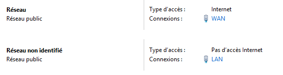
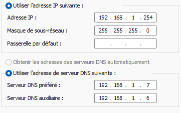
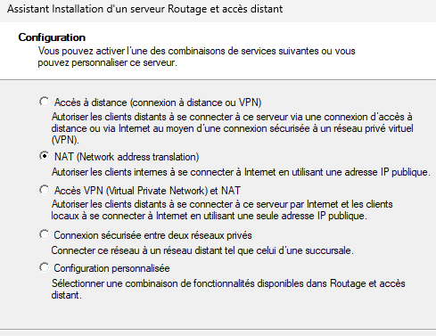
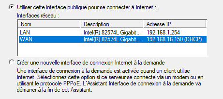

## Objectif

Cette procédure a pour objectif de configurer une machine virtuelle Windows Server pour qu'elle agisse comme un routeur et une passerelle NAT (Network Address Translation). Le but est de fournir un accès Internet contrôlé et sécurisé à un segment de réseau virtuel totalement isolé.

## Contexte et Justification

Dans un environnement de laboratoire ou d'entreprise, il est courant d'isoler les serveurs critiques (comme les contrôleurs de domaine) dans des réseaux privés pour des raisons de sécurité. Cependant, ces serveurs ont parfois besoin d'un accès ponctuel à Internet pour télécharger des mises à jour ou contacter des services externes (NTP, synchronisation cloud, etc.).

Plutôt que de donner à chaque serveur un accès direct, on utilise une passerelle. Tout le trafic sortant du réseau privé est forcé de passer par ce serveur routeur. C'est un point de contrôle unique qui permet de :

- **Sécuriser :** Seul le routeur est exposé au réseau externe.
- **Simplifier :** Une seule machine à configurer pour l'accès Internet de tout un réseau.
- **Analyser :** Tout le trafic passant par la passerelle peut être journalisé et surveillé.

## Prérequis et Schéma Cible

**Prérequis :**

- Un environnement de virtualisation (VMware).
- Un segment réseau isolé (LAN Segment, ex : LAB).
- Au moins un serveur « client » sur ce LAN segment qui a besoin d'Internet.

**Schéma cible :**

- Une nouvelle VM SRV-ROUTER01 sera créée avec deux cartes réseau.
- **NIC 1 (LAN)** sera connectée au LAB avec l'IP statique 192.168.1.254.
- **NIC 2 (WAN)** sera connectée au réseau NAT de VMware pour l'accès à Internet.

## Procédure de Configuration

### Préparation de la VM « Routeur »

1. Créez une nouvelle machine virtuelle Windows Server avec une configuration légère (1 à 2 vCPU, 2 Go de RAM, 60 Go de disque). Nommez-la SRV-ROUTER01.
2. **Avant de démarrer la VM**, allez dans ses paramètres et ajoutez **deux cartes réseau :**
   - **Carte réseau 1 :** Connectez-la à votre `LAN Segment` (`LAB`).
   - **Carte réseau 2 :** Configurez-la en mode `NAT`.
3. Démarrez la VM et installez Windows Server.

### Configuration des Interfaces Réseau

1. Une fois Windows Server installé, connectez-vous à SRV-ROUTER01.
2. Allez dans le Centre Réseau et partage et renommez vos cartes pour les identifier clairement : **LAN** pour celle connectée au LAN Segment, **WAN** pour celle en NAT.

<b>Figure 1</b> · Cartes réseau renommées LAN et WAN

3. Configurez la carte **LAN :**
   - **Adresse IP :** `192.168.1.254`.
   - **Masque de sous-réseau :** `255.255.255.0`.
   - **Passerelle par défaut :** Laissez vide.
   - **Serveur DNS préféré :** L'IP de votre serveur DNS interne.

<b>Figure 2</b> · Configuration IP de la carte LAN

4. Vérifiez la configuration de la carte **WAN** : elle doit être en DHCP pour recevoir automatiquement sa configuration du service NAT de VMware.

### Installation du Rôle « Accès à distance »

1. Dans le **Gestionnaire de serveur**, cliquez sur « Ajouter des rôles et fonctionnalités ».
2. Suivez l'assistant jusqu'à la sélection des rôles. Cochez **Accès à distance.**
3. Passez à l'écran « Services de rôle ». Cochez uniquement la case **Routage.**
4. Confirmez et terminez l'installation.

### Configuration du Routage et NAT

1. Dans le **Gestionnaire de serveur**, allez dans **Outils \> Routage et accès distant.**
2. Faites un clic droit sur le nom de votre serveur (SRV-ROUTER01) et choisissez **« Configurer et activer le routage et l'accès distant ».**
3. L'assistant se lance. Choisissez **« NAT (Network Address Translation) »** et cliquez sur **Suivant.**

<b>Figure 3</b> · Choix de la configuration NAT

4. L'assistant vous demande de choisir l'interface connectée à Internet. Sélectionnez votre carte **WAN** dans la liste.

<b>Figure 4</b> · Sélection de l'interface WAN

5. Cliquez sur **Suivant**, puis **Terminer**. Le service démarre, et l'icône du serveur dans la console doit passer au vert.

## Vérifications

Sur un serveur du LAB, configurez la passerelle par défaut sur `192.168.1.254`, puis effectuez les tests suivants.

**Test 1 : Pinger la passerelle.**

- `ping 192.168.1.254`.
- **Résultat attendu :** le ping réussit.

**Test 2 : Pinger une adresse IP sur Internet.**

- `ping 8.8.8.8`.
- **Résultat attendu :** le ping réussit, ce qui prouve que le routage et le NAT fonctionnent.

**Test 3 : Pinger un nom de domaine sur Internet.**

- `ping google.com`.
- **Résultat attendu :** le ping réussit, ce qui prouve que la résolution DNS fonctionne à travers la passerelle.

## Conseils et Bonnes Pratiques

**Filtrage :** pour un vrai rôle de pare-feu, explorez les règles de pare-feu dans la console « Routage et accès distant » pour filtrer le trafic sortant (par exemple, n'autoriser que les flux DNS, NTP et HTTP/HTTPS).

## Procédures Liées

- [Installation et Configuration d'un Serveur DHCP](/procedures/windows/installation-et-configuration-dun-serveur-dhcp) *(Distribution de la passerelle aux clients)*
- [NAT Dynamique et PAT](/procedures/cisco/nat-dynamique-et-pat) *(Équivalent sur un routeur Cisco)*
- [Installation et Configuration Initiale de pfSense](/procedures/pare-feu/installation-et-configuration-initiale-de-pfsense) *(Alternative avec un pare-feu dédié)*
- [Configuration du Pare-feu Windows et des Règles de Sécurité de Connexion](/procedures/windows/configuration-du-pare-feu-windows-et-des-regles-de-securite-de-connexion) *(Filtrage sur la passerelle)*
- [Configuration du Pare-feu avec UFW et nftables](/procedures/linux/configuration-du-pare-feu-avec-ufw-et-nftables) *(Équivalent NAT sous Linux)*
