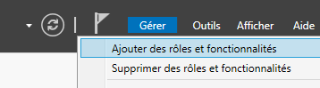
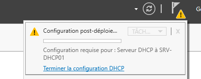
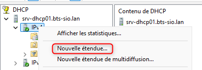
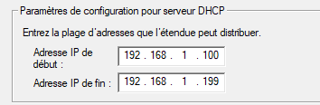

## Objectif

L'objectif est d'installer et de configurer le rôle de serveur **DHCP** (Dynamic Host Configuration Protocol) sur un serveur membre du domaine Windows Server. Ce serveur automatisera l'attribution des adresses IP et de la configuration réseau à tous les clients du réseau.

## Contexte et Justification

Dans un réseau, chaque appareil a besoin d'une adresse IP unique pour communiquer. Le faire manuellement est long et source d'erreurs. Le service DHCP centralise et automatise ce processus.

**Analogie :** Le serveur DHCP est comme le **maître d'hôtel** d'un restaurant. Il accueille chaque nouvel appareil (client), l'installe à une table libre (lui attribue une adresse IP unique) et lui donne le menu (la configuration réseau : passerelle, DNS) pour qu'il puisse communiquer avec le reste du réseau.

## Prérequis

- Un domaine Active Directory fonctionnel.
- Un serveur Windows Server membre du domaine, **dédié à ce rôle**. Pour des raisons de sécurité, il ne doit **pas** s'agir d'un contrôleur de domaine.
- Ce serveur **doit impérativement avoir une adresse IP statique**. Un serveur qui distribue des adresses ne peut pas changer d'adresse lui-même.
- Un compte administrateur du domaine pour l'installation.

## Procédure d'Installation et Configuration

### Installation du Rôle DHCP

1. Ouvrez le **Gestionnaire de serveur**.
2. Cliquez sur **Gérer \> Ajouter des rôles et fonctionnalités**.

<b>Figure 1</b> · Ajouter des rôles et fonctionnalités

3. Suivez l'assistant jusqu'à la section **« Rôles de serveurs ».**
4. Cochez la case **« Serveur DHCP »**. Une fenêtre vous demandera d'ajouter les fonctionnalités requises, cliquez sur **« Ajouter des fonctionnalités ».**
5. Continuez l'assistant et cliquez sur **« Installer ».**

### Autorisation du Serveur DHCP dans Active Directory

**Justification :** C'est une étape de sécurité **cruciale et spécifique à Windows**. Pour empêcher qu'un serveur non autorisé (un « rogue DHCP ») ne distribue de fausses adresses, un serveur DHCP doit être déclaré et « autorisé » dans l'annuaire Active Directory pour avoir le droit de fonctionner.

1. Dans le **Gestionnaire de serveur**, une fois l'installation terminée, cliquez sur le drapeau de notification et choisissez **« Terminer la configuration DHCP ».**

<b>Figure 2</b> · Terminer la configuration DHCP

2. L'assistant de post-installation s'ouvre. Il décrit ce que l'autorisation va faire. Cliquez sur **« Suivant ».**
3. Assurez-vous que les informations d'identification d'un administrateur du domaine sont utilisées et cliquez sur **« Valider ».**
4. Une fois l'opération terminée, cliquez sur **« Fermer ».**

### Création d'une Étendue (Scope)

**Justification :** Une « étendue » est la plage d'adresses IP que le serveur est autorisé à distribuer pour un réseau donné.

1. Ouvrez la console de gestion DHCP (Outils d'administration \> DHCP).
2. Déroulez le nom de votre serveur, faites un clic droit sur **« IPv4 »** et choisissez **« Nouvelle étendue… »**.

<b>Figure 3</b> · Nouvelle étendue IPv4

3. Suivez l'assistant :
   - **Nom :** Donnez un nom clair à votre étendue (ex : `LAN-Principal-BTS-SIO`).
   - **Plage d'adresses IP :** Entrez l'adresse de début et de fin de la plage à distribuer (ex : `192.168.1.100` à `192.168.1.199`).
   - **Exclusions :** Définissez des adresses ou des plages à **ne pas distribuer**, car elles sont réservées pour des équipements en IP statique (serveurs, imprimantes).
   - **Durée du bail :** Laissez la valeur par défaut (8 jours).

<b>Figure 4</b> · Plage d'adresses de l'étendue

4. L'assistant vous propose ensuite de configurer les options. Choisissez **« Oui, je veux configurer ces options maintenant ».**

### Configuration des Options et Réservations

1. **Routeur (Passerelle par défaut) :** Entrez l'adresse IP de votre routeur et cliquez sur **« Ajouter ».**
2. **Domaine et serveurs DNS :** Ces champs devraient être préremplis avec les informations de votre domaine. Vérifiez qu'ils sont corrects.
3. **Activer l'étendue :** Choisissez **« Oui, je veux activer cette étendue maintenant ».**
4. **(Optionnel) Créer une réservation :** Pour qu'une machine spécifique (ex : une imprimante) reçoive **toujours la même adresse IP**, allez dans votre étendue \> **Réservations**, faites un clic droit \> « Nouvelle réservation… ». Entrez le nom de la machine, l'adresse IP que vous voulez lui réserver et son adresse MAC.

## Vérifications

- **Côté Serveur :** Dans la console DHCP, vérifiez que votre serveur et votre étendue ont une petite icône verte, indiquant qu'ils sont actifs et autorisés. Le dossier « Baux d'adresses » se remplira à mesure que les clients recevront des adresses.
- **Côté Client :** Sur un poste client (votre Windows 11), assurez-vous que sa carte réseau est en « Obtenir une adresse IP automatiquement ». Ouvrez une invite de commande et tapez `ipconfig /renew`. Puis, vérifiez avec `ipconfig /all` que l'adresse, la passerelle et le DNS reçus correspondent bien à ce que vous avez configuré.

## Conseils et Bonnes Pratiques

- **Redondance (Basculement) :** Pour la haute disponibilité, il est crucial d'avoir deux serveurs DHCP. Windows Server intègre une fonctionnalité de **« basculement » (Failover)**. Vous pouvez faire un clic droit sur une étendue et la configurer pour qu'elle soit partagée et synchronisée avec un second serveur DHCP.
- **Exclusions vs Réservations :** Utilisez les **exclusions** pour des plages d'adresses que vous gérez manuellement (serveurs, etc.). Utilisez les **réservations** pour des appareils spécifiques qui doivent garder une IP stable mais que vous voulez quand même gérer depuis le DHCP (imprimantes, caméras...).
- **Le 80/20 pour les étendues :** Si vous avez deux serveurs DHCP en basculement, une bonne pratique est de faire distribuer 80% des adresses par le serveur principal, et 20% par le serveur secondaire.

## Dépannage

**Symptôme :** Un client reçoit une adresse en 169.254.x.x (APIPA).

**Checklist :**

1. **Serveur Autorisé ?** Vérifiez l'icône dans la console DHCP. Si elle est rouge, faites un clic droit sur le nom du serveur \> **« Autoriser »**.
2. **Étendue Active ?** Vérifiez l'icône de l'étendue. Si elle a une flèche rouge vers le bas, faites un clic droit \> **« Activer »**.
3. **Connectivité :** Le client et le serveur sont-ils sur le même réseau (VLAN) ? Le client peut-il pinger l'IP statique du serveur DHCP ?
4. **Agent de relais DHCP :** Si le client et le serveur sont sur des sous-réseaux différents, un **agent de relais DHCP** (ou la commande `ip helper-address` sur un routeur Cisco) est nécessaire.

## Procédures Liées

- [Mise en Place de la Haute Disponibilité DHCP (Failover)](/procedures/windows/mise-en-place-de-la-haute-disponibilite-dhcp-failover) *(Haute disponibilité du service)*
- [Configuration d'un Serveur DNS Dédié](/procedures/windows/configuration-dun-serveur-dns-dedie) *(Options DNS distribuées)*
- [DHCP Relay](/procedures/cisco/dhcp-relay) *(Relais depuis d'autres VLANs)*
- [Installation d'un Serveur DHCP sous Linux (ISC-DHCP-Server)](/procedures/linux/installation-dun-serveur-dhcp-sous-linux-isc-dhcp-server) *(Équivalent sous Linux)*
- [Déploiement d'un Serveur WDS pour l'Installation d'OS par le Réseau (PXE)](/procedures/windows/deploiement-dun-serveur-wds-pour-linstallation-dos-par-le-reseau-pxe) *(Démarrage PXE qui s'appuie sur le DHCP)*
