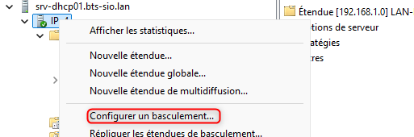
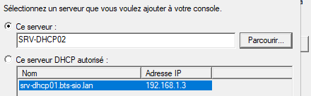
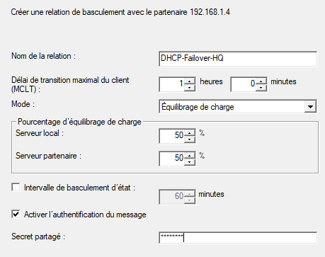

## Objectif

L'objectif est de configurer une relation de **basculement (Failover)** entre deux serveurs DHCP Windows. Cela garantit la **haute disponibilité** du service DHCP : si un serveur tombe en panne, le second prend le relais de manière transparente pour les clients.

## Contexte et Justification

Le service DHCP est un service critique. S'il tombe en panne, les nouveaux appareils ne peuvent pas rejoindre le réseau et les appareils existants ne peuvent pas renouveler leur bail, ce qui finit par paralyser les communications. Avoir un seul serveur DHCP est un **point de défaillance unique (SPOF)**.

**Analogie :** Si votre unique maître d'hôtel est malade, plus personne ne peut avoir de table. Le basculement DHCP consiste à embaucher un **second maître d'hôtel** qui connaît parfaitement le plan de salle (la base de données des baux) et qui peut prendre le relais instantanément.

## Prérequis

- **Deux serveurs Windows Server** membres du même domaine.
- Le rôle DHCP doit être installé (cf. procédure *Installation et Configuration d'un Serveur DHCP*) et **autorisé dans Active Directory** sur les **deux** serveurs.
- Les deux serveurs doivent avoir une **adresse IP statique**.
- Le premier serveur (que nous appellerons `SRV-DHCP01`) doit avoir au moins une étendue DHCP déjà configurée et active.
- Le second serveur (`SRV-DHCP02`) a le rôle installé et autorisé, mais aucune étendue configurée.

## Procédure de Configuration du Basculement

### Explication des Modes de Basculement

Windows propose deux modes pour le basculement :

- **Équilibrage de charge (Load Balance) :** C'est le mode **Actif/Actif**. Les deux serveurs répondent activement aux requêtes des clients. Vous répartissez la charge entre eux (par défaut 50/50). **C'est le mode le plus courant et recommandé.**
- **Secours à chaud (Hot Standby) :** C'est le mode **Actif/Passif**. Un serveur (le principal) gère 100 % des requêtes. Le second (le serveur de secours) reste en attente et ne devient actif que si le serveur principal ne répond plus.

### Configuration de la Relation de Basculement

La configuration se fait depuis le serveur DHCP principal (`SRV-DHCP01`).

1. Ouvrez la console de gestion **DHCP**.
2. Déroulez le nom de votre serveur, faites un clic droit sur **« IPv4 »** et choisissez **« Configurer le basculement… »**.

<b>Figure 1</b> · Configurer le basculement

3. L'assistant de configuration s'ouvre. La liste des étendues disponibles pour le basculement est affichée. Cliquez sur **« Suivant »**.
4. **Ajoutez le serveur partenaire.** Cliquez sur **« Ajouter un serveur »** et sélectionnez votre second serveur DHCP (`SRV-DHCP02`) dans la liste des serveurs autorisés. Cliquez sur **« OK »**, puis **« Suivant »**.

<b>Figure 2</b> · Ajout du serveur partenaire

5. Créez la relation de basculement :
   - **Nom de la relation :** Donnez un nom explicite (ex : `DHCP-Failover-HQ`).
   - **Mode :** Choisissez **« Équilibrage de charge »**. Vous pouvez laisser la répartition à 50 %.
   - **Secret partagé :** Tapez un mot de passe complexe. Il servira à sécuriser la communication entre les deux serveurs.
   - Cliquez sur **« Suivant »**.

<b>Figure 3</b> · Paramètres de la relation de basculement

6. Vérifiez le résumé des paramètres et cliquez sur **« Terminer »**. L'assistant va alors créer la relation et répliquer la configuration.

## Vérifications

**Vérifications :**

- **Sur le serveur secondaire (`SRV-DHCP02`) :** Ouvrez la console DHCP. L'étendue de `SRV-DHCP01` doit maintenant apparaître. Elle est active et synchronisée.
- **Sur l'un des deux serveurs :** Faites un clic droit sur l'étendue, allez dans **Propriétés \> Basculement**. Vous verrez l'état de la relation.
- **Sur un poste client :** Lancez la commande `ipconfig /renew`. Dans les consoles DHCP des deux serveurs, regardez dans le dossier **« Baux d'adresses »**. Le bail du client doit apparaître sur **l'un des deux serveurs**.

**Test de panne :**

1. Sur votre serveur DHCP **principal** (`SRV-DHCP01`), ouvrez les services (`services.msc`).
2. Trouvez le service **« Serveur DHCP »**, faites un clic droit dessus et **« Arrêter »**.
3. Sur votre poste client, ouvrez une invite de commandes et libérez son adresse IP : `ipconfig /release`.
4. Maintenant, demandez une nouvelle adresse : `ipconfig /renew`.
5. **Résultat :** Le client doit recevoir une nouvelle adresse IP sans aucun problème.
6. Allez sur le serveur **secondaire** (`SRV-DHCP02`) et vérifiez dans les baux d'adresses : le bail du client doit y être présent, prouvant que le second serveur a bien pris le relais.
7. N'oubliez pas de **redémarrer** le service DHCP sur `SRV-DHCP01` à la fin de votre test.

## Conseils et Bonnes Pratiques

- **Choix du mode :** Pour la plupart des cas, le mode **« Équilibrage de charge » (Load Balance)** est le meilleur choix. Il garantit que les deux serveurs travaillent activement, ce qui optimise les ressources. La configuration « Secours à chaud » est utile seulement si vous avez un serveur secondaire beaucoup moins puissant.
- **Répartition 80/20 :** Même en mode « Équilibrage de charge », il est courant de ne pas utiliser 50/50. Une répartition **80/20** permet d'identifier facilement un serveur « principal » (qui gère 80 % des baux) pour la gestion quotidienne, tout en assurant une redondance parfaite.
- **Secret partagé :** Utilisez un mot de passe long, complexe et unique comme secret partagé. Consignez-le dans un gestionnaire de mots de passe.
- **Synchronisation de l'heure :** La communication entre les partenaires de basculement est sensible au temps. Assurez-vous que vos deux serveurs DHCP sont **parfaitement synchronisés sur la même source de temps** (normalement, votre contrôleur de domaine).
- **Configuration globale :** Vous pouvez configurer le basculement pour une seule étendue (clic droit sur l'étendue) ou pour toutes les étendues d'un coup (clic droit sur le nœud « IPv4 »). Pour une nouvelle installation, configurer au niveau « IPv4 » est plus rapide.

## Dépannage

**Symptôme :** L'option « Configurer le basculement… » est grisée.

- **Cause :** Vous ne faites pas le clic droit au bon endroit.
- **Solution :** Assurez-vous de faire le clic droit sur le nœud **« IPv4 »** ou directement sur une **étendue**, et non sur le nom du serveur.

**Symptôme :** Le serveur partenaire n'apparaît pas dans la liste des serveurs à ajouter.

- **Cause la plus fréquente :** Le second serveur DHCP n'a pas été **autorisé dans Active Directory**.
- **Solution :** Sur le second serveur, ouvrez la console DHCP, faites un clic droit sur le nom du serveur et choisissez **« Autoriser »**. Vérifiez également la connectivité réseau (ping) entre les deux serveurs.

**Symptôme :** La réplication échoue ou l'étendue apparaît avec une icône rouge sur le serveur secondaire.

- **Cause 1 :** Le **secret partagé** ne correspond pas.
- **Cause 2 :** Un **pare-feu** (Windows ou réseau) bloque la communication entre les deux serveurs sur le port **TCP 647**.
- **Solution :** Supprimez la relation de basculement (clic droit sur l'étendue \> « Déconfigurer le basculement… ») et recréez-la en vous assurant que le secret partagé est identique. Vérifiez vos règles de pare-feu.

## Procédures Liées

- [Installation et Configuration d'un Serveur DHCP](/procedures/windows/installation-et-configuration-dun-serveur-dhcp) *(Installation du premier serveur)*
- [Ajout d'un Contrôleur de Domaine Secondaire](/procedures/windows/ajout-dun-controleur-de-domaine-secondaire) *(Second serveur du site)*
- [Configuration d'un Serveur de Temps (NTP) pour un Domaine AD](/procedures/windows/configuration-dun-serveur-de-temps-ntp-pour-un-domaine-ad) *(Horloges synchronisées entre partenaires)*
- [DHCP Relay](/procedures/cisco/dhcp-relay) *(Relais vers les deux partenaires)*
