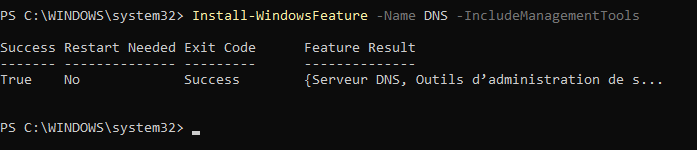
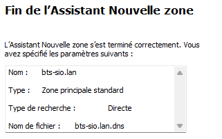
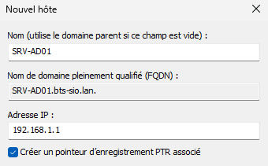
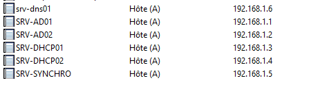
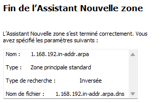
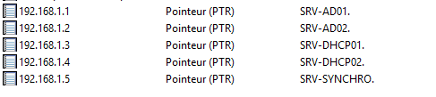
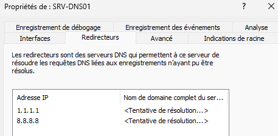

## Objectif

Cette procédure a pour objectif de détailler les étapes d'installation et de configuration d'un serveur DNS dédié sur un serveur membre de domaine Windows Server. L'objectif est de centraliser la résolution de noms pour le domaine tout en isolant ce service des contrôleurs de domaine pour renforcer la sécurité de l'infrastructure Active Directory.

## Contexte et Justification

Dans de nombreux environnements, le service DNS est hébergé directement sur les contrôleurs de domaine (DC). Bien que simple, cette configuration expose potentiellement le DC à des attaques visant le service DNS (ex : empoisonnement du cache, déni de service).

En dédiant un serveur membre à ce rôle, on crée une couche de séparation :

- **Sécurité renforcée :** Une attaque réussie sur le serveur DNS ne compromet pas directement le contrôleur de domaine, qui est le cœur de l'identité et de la sécurité du réseau.
- **Performance :** Le serveur dédié peut être optimisé spécifiquement pour la charge de travail DNS, sans être impacté par les autres tâches d'un DC (authentification, réplication AD, etc.).
- **Flexibilité :** Il est plus simple de gérer, mettre à jour ou remplacer un serveur DNS dédié sans impacter les services critiques d'Active Directory.

## Prérequis et Schéma Cible

**Prérequis :**

- Un contrôleur de domaine Active Directory fonctionnel (ex : SRV-AD01).
- Un **second serveur** Windows Server (ex : SRV-DNS01), **membre du domaine**, mais qui n'est PAS un contrôleur de domaine. Il doit avoir une adresse IP statique.
- Un client Windows joint au domaine pour les tests.

**Schéma cible :** Le serveur SRV-DNS01 sera notre unique serveur DNS faisant autorité pour la zone locale. Tous les clients et même le contrôleur de domaine SRV-AD01 l'utiliseront pour leurs requêtes. Pour les requêtes Internet, SRV-DNS01 utilisera des redirecteurs publics.

## Procédure de Configuration

### Installation du Rôle DNS sur le Serveur Membre

1. Connectez-vous à votre serveur dédié (SRV-DNS01) en tant qu'administrateur du domaine.
2. Ouvrez PowerShell en administrateur et installez le rôle DNS : `Install-WindowsFeature -Name DNS -IncludeManagementTools`.



<p class="figure-caption"><b>Figure 1</b> · Installation du rôle DNS</p>

3. Une fois l'installation terminée, ouvrez la console DNS via **Gestionnaire de serveur \> Outils \> DNS.**

### Création de la Zone de Recherche Directe

C'est l'étape la plus importante, car nous n'allons PAS intégrer la zone à l'AD.

1. Dans la console DNS, faites un clic droit sur **Zones de recherche directe** et choisissez **Nouvelle zone…**
2. **Type de zone :** Choisissez **Zone principale**. Décochez la case « Enregistrer la zone dans Active Directory ». Cliquez sur **Suivant.**
3. **Nom de la zone :** Entrez le nom exact de votre domaine Active Directory (ex : `bts-sio.lan`). Cliquez sur **Suivant.**
4. **Fichier de zone :** Laissez l'option par défaut **« Créer un nouveau fichier portant ce nom »**. Cliquez sur **Suivant.**
5. **Mise à jour dynamique :** C'est un choix de sécurité crucial. Sélectionnez **« Ne pas autoriser les mises à jour dynamiques »**. C'est l'option la plus sécurisée. Cela signifie que vous devrez créer tous les enregistrements manuellement. Cliquez sur **Suivant**, puis **Terminer.**



<p class="figure-caption"><b>Figure 2</b> · Assistant Nouvelle zone</p>

### Création des Enregistrements Manuels

Maintenant que la zone est créée, nous devons la peupler manuellement avec nos serveurs critiques.

1. Déroulez l'arborescence **Zones de recherche directe** et cliquez sur votre zone (`bts-sio.lan`).
2. Faites un clic droit dans la partie droite et sélectionnez **Nouvel hôte (A ou AAAA)…**
3. Enregistrez votre contrôleur de domaine :
   - **Nom :** `SRV-AD01`
   - **Adresse IP :** Entrez l'adresse IP statique de votre contrôleur de domaine (ex : `192.168.1.1`).
   - Cochez la case **« Créer un enregistrement de pointeur (PTR) associé »**. Un message d'erreur peut apparaître car la zone inversée n'existe pas encore ; nous la créerons à l'étape suivante.
   - Cliquez sur **Ajouter un hôte**.



<p class="figure-caption"><b>Figure 3</b> · Enregistrement A du contrôleur de domaine</p>

4. Répétez l'opération pour vos autres serveurs importants.

<div class="callout callout-note">

Comme la zone n'est pas intégrée à l'AD et n'accepte pas les mises à jour dynamiques, les enregistrements SRV indispensables à Active Directory (`_ldap`, `_kerberos`, `_msdcs`…) ne seront pas créés automatiquement. Recréez-les à partir du fichier `%SystemRoot%\System32\config\netlogon.dns` du contrôleur de domaine, sinon les clients ne trouveront plus le domaine (voir « Dépannage »).

</div>



<p class="figure-caption"><b>Figure 4</b> · Enregistrements A créés</p>

### Création de la Zone de Recherche Inversée

Cette zone permet de traduire une adresse IP en nom.

1. Dans la console DNS, faites un clic droit sur **Zones de recherche inversée** et choisissez **Nouvelle zone…**
2. Suivez l'assistant en choisissant **Zone principale** (non intégrée à l'AD).
3. Sélectionnez **Zone de recherche inversée IPv4** et entrez votre **ID de réseau** (ex : `192.168.1`).
4. Choisissez de **ne pas autoriser les mises à jour dynamiques**, comme pour la zone de recherche directe.



<p class="figure-caption"><b>Figure 5</b> · Zone de recherche inversée IPv4</p>

5. Une fois la zone créée, vérifiez que les enregistrements **PTR** pour vos serveurs ont été créés. Si ce n'est pas le cas, vous pouvez les ajouter manuellement (clic droit \> Nouveau pointeur (PTR)…).



<p class="figure-caption"><b>Figure 6</b> · Enregistrements PTR</p>

### Configuration des Redirecteurs

Cette étape permet à votre serveur DNS de résoudre les adresses Internet.

1. Faites un clic droit sur le nom de votre serveur (SRV-DNS01) et choisissez **Propriétés.**
2. Allez dans l'onglet **Redirecteurs**, cliquez sur **Modifier** et ajoutez des IP de serveurs publics (ex : `1.1.1.1`, `8.8.8.8`).



<p class="figure-caption"><b>Figure 7</b> · Redirecteurs DNS</p>

### Reconfiguration DNS des Clients et Serveurs

C'est l'étape finale pour que tout votre réseau utilise ce nouveau serveur DNS.

1. **Sur tous vos serveurs (y compris le DC) :** Modifiez leur configuration IP pour que leur serveur DNS **préféré** soit l'adresse IP de SRV-DNS01.
2. **Sur votre serveur DHCP :** Modifiez les options de l'étendue (scope) pour que le serveur DNS distribué aux clients soit l'IP de SRV-DNS01.
3. **Sur les clients :** Forcez le renouvellement de la configuration IP avec les commandes `ipconfig /release` et `ipconfig /renew`.

## Vérifications

Depuis une machine cliente, vérifiez que la résolution interne et externe fonctionne et que le serveur qui répond est bien SRV-DNS01 :

```powershell
nslookup srv-ad01.bts-sio.lan
nslookup www.google.fr
nslookup -type=SRV _ldap._tcp.dc._msdcs.bts-sio.lan
```

## Conseils et Bonnes Pratiques

**Sécurité :** En choisissant de ne pas autoriser les mises à jour dynamiques, vous avez un contrôle total sur votre zone DNS, mais cela implique une gestion manuelle rigoureuse. C'est le prix de la sécurité.

**Redondance :** Pour une vraie haute disponibilité, vous devriez déployer un **second serveur DNS dédié** (SRV-DNS02) et configurer cette zone en tant que **zone secondaire**, qui répliquera les données de la zone principale sur SRV-DNS01.

## Dépannage

**Symptôme :** Les clients ne peuvent plus joindre le domaine.

- **Cause probable :** Vous avez oublié de créer manuellement les enregistrements SRV et les enregistrements A (IPv4) pour le contrôleur de domaine dans la nouvelle zone DNS. Sans eux, personne ne peut trouver les services d'annuaire.
- **Solution :** Sur le nouveau serveur DNS, recréez à la main les enregistrements indispensables au fonctionnement d'AD (dossier `_msdcs` et enregistrements SRV), en vous appuyant sur le fichier `netlogon.dns` du contrôleur de domaine.

## Procédures Liées

- [Installation d'un Contrôleur de Domaine Active Directory](/procedures/windows/installation-dun-controleur-de-domaine-active-directory) *(Zones intégrées à Active Directory)*
- [Mise en Place de la Redondance DNS avec une Zone Secondaire](/procedures/windows/mise-en-place-de-la-redondance-dns-avec-une-zone-secondaire) *(Redondance avec une zone secondaire)*
- [Installation et Configuration d'un Serveur DHCP](/procedures/windows/installation-et-configuration-dun-serveur-dhcp) *(Options DNS distribuées aux clients)*
- [Déploiement Serveur DNS Local Bind9 (Conteneurisé)](/procedures/linux/deploiement-serveur-dns-local-bind9-conteneurise) *(Équivalent sous Linux)*
- [Configuration d'Azure DNS](/procedures/azure/configuration-dazure-dns) *(Équivalent dans le cloud)*
