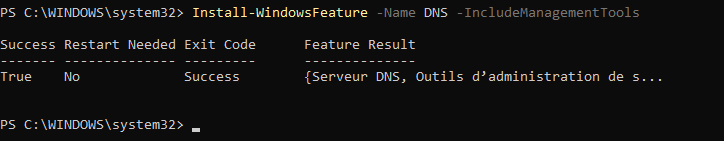
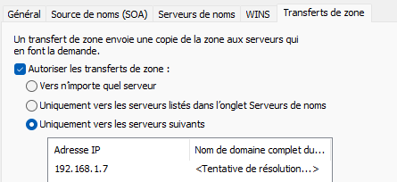
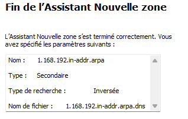
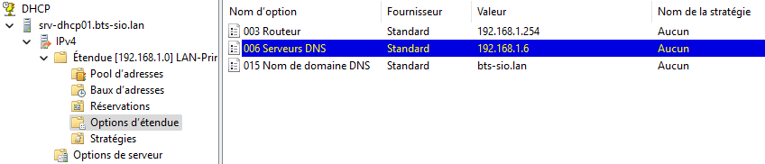
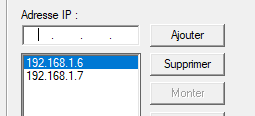

## Objectif

Cette procédure vise à déployer un second serveur DNS et à le configurer en tant que serveur secondaire pour une zone DNS existante. L'objectif est d'assurer la haute disponibilité du service de résolution de noms, de sorte que si le serveur DNS primaire tombe en panne, le service reste pleinement opérationnel pour les clients du réseau.

## Contexte et Justification

Un seul serveur DNS, même dédié, représente un **point de défaillance unique** (Single Point of Failure, SPOF). S'il devient indisponible (panne matérielle, maintenance, attaque), l'ensemble du réseau est paralysé : les utilisateurs ne peuvent plus accéder aux serveurs, aux applications, ni même naviguer sur Internet car la résolution de noms est impossible.

L'architecture **Primaire / Secondaire** résout ce problème :

- Le serveur **Primaire** héberge la copie « maître » (lecture/écriture) de la zone DNS. C'est le seul endroit où un administrateur peut faire des modifications.
- Le serveur **Secondaire** héberge une copie en **lecture seule** de la zone. Il demande périodiquement au serveur primaire s'il y a eu des mises à jour et, si c'est le cas, il télécharge les changements via un processus appelé **transfert de zone**.
- Les clients sont configurés pour utiliser les deux serveurs. Si le primaire ne répond pas, ils interrogent automatiquement le secondaire.

## Prérequis et Schéma Cible

**Prérequis :**

- Un serveur DNS primaire dédié et fonctionnel (`SRV-DNS01`, `192.168.1.6`), configuré selon la procédure *Configuration d'un Serveur DNS Dédié*.
- Une **nouvelle machine virtuelle** Windows Server (`SRV-DNS02`), membre du domaine et avec une adresse IP statique configurée (ex : `192.168.1.7`).
- Un serveur DHCP fonctionnel.

**Schéma cible :** `SRV-DNS01` sera le maître pour la zone `bts-sio.lan`. `SRV-DNS02` sera son serveur secondaire. Le serveur DHCP distribuera les deux adresses IP à tous les clients, `SRV-DNS01` en tant que DNS préféré et `SRV-DNS02` en tant que DNS auxiliaire.

## Procédure de Configuration

### Préparation du Second Serveur DNS

1. Assurez-vous que `SRV-DNS02` a une adresse IP statique (ex : `192.168.1.7`).
2. Configurez la carte réseau de `SRV-DNS02` pour que son serveur DNS préféré soit le serveur primaire (`SRV-DNS01`).
3. Installez le rôle DNS sur `SRV-DNS02` avec PowerShell :

```powershell
Install-WindowsFeature -Name DNS -IncludeManagementTools
```



<p class="figure-caption"><b>Figure 1</b> · Installation du rôle DNS</p>

### Autorisation des Transferts de Zone sur le Serveur Primaire

Par sécurité, un serveur DNS primaire refuse de partager ses informations. Nous devons explicitement l'autoriser à parler à notre futur serveur secondaire.

1. Connectez-vous à `SRV-DNS01` et ouvrez la console **DNS**.
2. Naviguez jusqu'à **Zones de recherche directe**, faites un clic droit sur votre zone (`bts-sio.lan`) et choisissez **Propriétés**.
3. Allez dans l'onglet **Transferts de zone**.
4. Cochez la case **« Autoriser les transferts de zone »**.
5. Pour une sécurité maximale, cochez l'option **« Uniquement vers les serveurs suivants »**.
6. Cliquez sur **Modifier**, ajoutez l'adresse IP de votre second serveur DNS (`192.168.1.7`), puis validez.
7. Cliquez sur **OK**.



<p class="figure-caption"><b>Figure 2</b> · Onglet Transferts de zone</p>

8. **Important :** Répétez cette opération pour votre **zone de recherche inversée**.

### Création de la Zone Secondaire sur le Serveur Secondaire

1. Connectez-vous à `SRV-DNS02` et ouvrez la console **DNS**.
2. Faites un clic droit sur **Zones de recherche directe** et choisissez **Nouvelle zone…**
3. L'assistant se lance. Cliquez sur **Suivant**.
4. **Type de zone :** Choisissez **Zone secondaire**. Cliquez sur **Suivant**.
5. **Nom de la zone :** Entrez le nom exact de la zone que vous voulez répliquer (ex : `bts-sio.lan`). Cliquez sur **Suivant**.
6. **Serveurs DNS maîtres :** Entrez l'adresse IP du serveur DNS primaire (`192.168.1.6`). Appuyez sur Entrée. Une coche verte doit apparaître. Cliquez sur **Suivant**, puis **Terminer**.
7. Après quelques instants, la zone `bts-sio.lan` apparaît. Si vous cliquez dessus, vous devez voir tous les enregistrements de la zone primaire. Ils sont en lecture seule.
8. Répétez l'opération pour créer la zone secondaire de votre **zone de recherche inversée**.



<p class="figure-caption"><b>Figure 3</b> · Zone secondaire répliquée</p>

### Mise à Jour de la Configuration DHCP

Il faut maintenant informer les clients de l'existence de ce second serveur DNS.

1. Allez sur votre serveur DHCP et ouvrez la console **DHCP**.
2. Naviguez jusqu'aux **Options d'étendue** de votre étendue IPv4.
3. Faites un clic droit sur l'option **006 Serveurs DNS** et choisissez **Propriétés**.



<p class="figure-caption"><b>Figure 4</b> · Options d'étendue</p>

4. L'adresse de `SRV-DNS01` doit déjà être là. Ajoutez l'adresse IP de `SRV-DNS02` (`192.168.1.7`) à la liste. Assurez-vous que l'IP du serveur primaire est en première position.



<p class="figure-caption"><b>Figure 5</b> · Option 006 Serveurs DNS</p>

5. Cliquez sur **OK**.

## Vérifications

**Test de réplication :** Sur le serveur primaire `SRV-DNS01`, créez un nouvel enregistrement A de test. Retournez sur le serveur secondaire `SRV-DNS02`, faites un clic droit sur la zone et choisissez **« Transférer depuis le maître »**. Vérifiez que le nouvel enregistrement apparaît.

**Test client :** Sur un poste client, exécutez `ipconfig /release` puis `ipconfig /renew`. Vérifiez avec `ipconfig /all` que les deux adresses de serveurs DNS sont bien présentes.

**Test de basculement :**

- Sur le serveur primaire `SRV-DNS01`, désactivez temporairement la carte réseau pour simuler une panne.
- Retournez sur le poste client et ouvrez une invite de commandes.
- Tapez `ipconfig /flushdns` pour vider le cache.
- Essayez de résoudre un nom avec `nslookup srv-ad01.bts-sio.lan`. La première tentative peut être un peu plus longue (le temps de détecter que le premier serveur est injoignable), mais la requête doit réussir en utilisant le second serveur DNS.

## Conseils et Bonnes Pratiques

**Notifications :** Dans les propriétés de la zone sur le serveur primaire, onglet « Transferts de zone », le bouton **« Notifier… »** vous permet de configurer le serveur primaire pour qu'il prévienne les serveurs secondaires dès qu'un changement a lieu, au lieu d'attendre que les secondaires viennent demander. Cela accélère la convergence.

## Dépannage

**Symptôme :** La zone secondaire sur `SRV-DNS02` ne se charge pas et affiche une erreur.

- **Cause probable :** Le pare-feu sur le serveur primaire `SRV-DNS01` bloque la requête de transfert de zone (port 53 TCP) en provenance de l'IP de `SRV-DNS02`, ou cette IP n'est pas dans la liste des serveurs autorisés.
- **Solution :** Assurez-vous que le pare-feu sur le serveur primaire autorise bien le trafic DNS en provenance de votre serveur secondaire et que l'IP de `SRV-DNS02` figure dans l'onglet **Transferts de zone**.

## Procédures Liées

- [Configuration d'un Serveur DNS Dédié](/procedures/windows/configuration-dun-serveur-dns-dedie) *(Serveur DNS principal)*
- [Ajout d'un Contrôleur de Domaine Secondaire](/procedures/windows/ajout-dun-controleur-de-domaine-secondaire) *(Alternative avec des zones intégrées à AD)*
- [Installation d'un Contrôleur de Domaine Active Directory](/procedures/windows/installation-dun-controleur-de-domaine-active-directory) *(Domaine hébergeant la zone)*
- [Déploiement Serveur DNS Local Bind9 (Conteneurisé)](/procedures/linux/deploiement-serveur-dns-local-bind9-conteneurise) *(Serveur secondaire possible sous Linux)*
