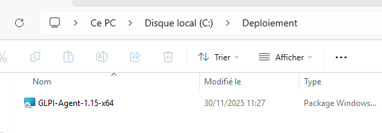
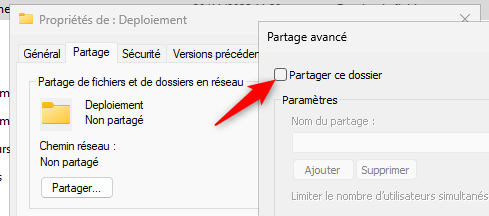
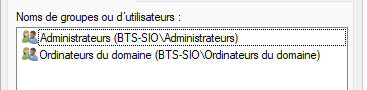
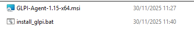
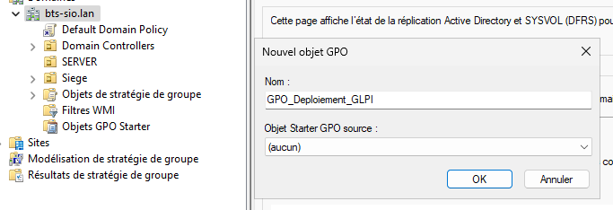
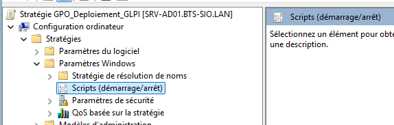
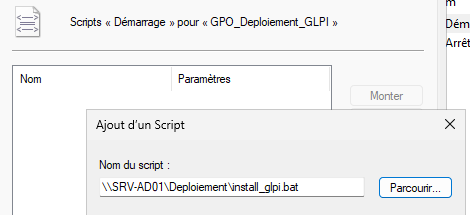

## Introduction

L'objectif est d'installer automatiquement l'agent d'inventaire sur tous les ordinateurs du domaine, sans intervention humaine, et de le configurer pour qu'il remonte les informations vers notre serveur GLPI (Linux).

## Contexte et Justification

Dans un parc de plusieurs centaines de machines, l'installation manuelle est impossible. Nous utiliserons une **GPO de démarrage (Startup Script)** plutôt qu'une installation MSI simple.

- **Pourquoi un script ?** Car l'installation MSI standard ne permet pas facilement de spécifier l'adresse IP du serveur GLPI (arguments d'installation). Le script nous permet de lancer l'installation avec les bons paramètres.

## Concepts Clés

**GPO (Group Policy Object) :** Des règles envoyées par le contrôleur de domaine pour configurer les ordinateurs ou les utilisateurs.

**UNC (Universal Naming Convention) :** Chemin réseau absolu (ex : `\\SRV-AD01\Deploiement\...`) indispensable pour que les PC trouvent le fichier.

**msiexec :** L'outil en ligne de commande de Windows pour installer des paquets `.msi` silencieusement.

## Prérequis

1. Avoir un Contrôleur de Domaine (AD DS) fonctionnel.
2. Avoir téléchargé l'installeur `.msi` de « GLPI Agent » (sur le [dépôt officiel](https://github.com/glpi-project/glpi-agent/releases/)) et l'avoir déposé sur le serveur Windows.
3. Des clients Windows intégrés au domaine (Active Directory).

## Configuration

### Création du Dossier de Partage

**Justification :** Les ordinateurs du réseau doivent pouvoir accéder au fichier d'installation avant même qu'un utilisateur ne se connecte.

1. Sur votre serveur AD, créez un dossier `Deploiement`.
2. Copiez-y l'installeur `glpi-agent-x.x-x64.msi`.



<p class="figure-caption"><b>Figure 1</b> · Dossier Deploiement et installeur</p>

3. Faites un clic droit sur le dossier \> **Propriétés \> Partage \> Partage avancé**.
4. Cochez « Partager ce dossier ».



<p class="figure-caption"><b>Figure 2</b> · Partage avancé du dossier</p>

5. **Permissions :**
   - Supprimez « Tout le monde ».
   - Ajoutez le groupe « **Ordinateurs du domaine** » et donnez-lui le droit **Lecture.**
   - Ajoutez « **Admins du domaine** » en **Contrôle total**.



<p class="figure-caption"><b>Figure 3</b> · Autorisations du partage</p>

### Création du Script d'Installation (.bat)

**Justification :** Ce script lance l'installation silencieuse en précisant l'adresse du serveur GLPI.

1. Dans le même dossier (`Deploiement`), créez un fichier texte nommé `install_glpi.bat`.
2. Collez le code suivant (adaptez l'adresse de votre serveur GLPI et le nom exact du fichier `.msi`) :

```bat
@echo off
REM Vérifie si l'agent est déjà installé pour ne pas le réinstaller en boucle
IF EXIST "C:\Program Files\GLPI-Agent\glpi-agent.exe" GOTO END

REM Installation silencieuse (/quiet) en pointant vers le serveur GLPI (SERVER=...)
msiexec /i "\\SRV-AD01\Deploiement\glpi-agent-1.15-x64.msi" /quiet SERVER="http://192.168.16.159/" RUNNOW=1

:END
EXIT
```

<div class="callout callout-note">

Avec GLPI 10 ou 11, l'agent accepte l'URL racine du serveur. Si votre GLPI est publié dans un sous-dossier, indiquez-le (ex : `http://192.168.16.159/glpi/`).

</div>



<p class="figure-caption"><b>Figure 4</b> · Script install_glpi.bat</p>

### Création de la GPO

**Justification :** Nous utilisons une stratégie « Ordinateur » car le logiciel doit être installé pour la machine, quel que soit l'utilisateur qui se connecte.

1. Ouvrez la console « Gestion de stratégie de groupe ».
2. Dans la colonne de gauche, déroulez l'arborescence jusqu'à votre domaine (ex : `bts-sio.lan`).
3. Faites un clic droit sur le nom du domaine (ou sur l'OU où sont rangés les PC) \> **Créer un objet GPO dans ce domaine, et le lier ici…**
4. Donnez un nom à la stratégie, par exemple `GPO_Deploiement_GLPI`.
5. Cliquez sur « OK ».



<p class="figure-caption"><b>Figure 5</b> · Nouvel objet GPO</p>

6. Faites un clic droit sur la GPO puis cliquez sur « Modifier ».
7. Naviguez vers : **Configuration ordinateur \> Stratégies \> Paramètres Windows \> Scripts (démarrage/arrêt).**



<p class="figure-caption"><b>Figure 6</b> · Scripts de démarrage dans l'éditeur de GPO</p>

8. Double-cliquez sur **Démarrage** (Startup).
9. Cliquez sur **Ajouter…** puis sur **Parcourir…**
10. Allez chercher votre script via son chemin réseau **UNC** (très important, n'utilisez pas `C:\...`) : `\\SRV-AD01\Deploiement\install_glpi.bat`.



<p class="figure-caption"><b>Figure 7</b> · Script ajouté au démarrage</p>

11. Validez tout et fermez l'éditeur.

## Vérifications

**Côté client Windows :**

1. Sur un PC client, ouvrez une invite de commande (CMD) et forcez la mise à jour des stratégies : `gpupdate /force`
2. Redémarrez le PC (le script de démarrage ne s'exécute qu'au boot).
3. Une fois redémarré, vérifiez que le dossier `C:\Program Files\GLPI-Agent` existe.
4. Vous pouvez forcer un inventaire immédiat en ouvrant `http://localhost:62354` dans le navigateur du client.

**Côté serveur GLPI (Linux) :**

1. Connectez-vous à l'interface web GLPI.
2. Allez dans le menu **Parc \> Ordinateurs**.
3. Votre PC Windows doit apparaître dans la liste avec sa configuration matérielle détaillée.


<p class="figure-caption"><b>Figure 8</b> · Ordinateur remonté dans GLPI</p>

## Dépannage

**Rien ne s'installe après le redémarrage :**

- **Droits d'accès :** Vérifiez que le groupe « Ordinateurs du Domaine » a bien accès en lecture au dossier partagé `\\SRV-AD01\Deploiement`.
- **Chemin du script :** Avez-vous bien mis le chemin UNC (`\\...`) dans la GPO et non le chemin local (`C:\...`) ? Le PC client ne connaît pas le `C:` du serveur.

**L'agent est installé mais ne remonte pas dans GLPI :**

- Vérifiez l'URL dans le script `.bat` (paramètre `SERVER`) : elle doit pointer vers votre serveur GLPI et l'inventaire doit être activé dans GLPI (**Administration \> Inventaire**).
- Vérifiez les pare-feux : le port 80 (HTTP) du poste client vers le serveur Linux doit être ouvert.

## Conseils et Bonnes Pratiques

**Délai d'attente réseau :** Parfois, le script tente de se lancer avant que la carte réseau du PC ne soit prête. Dans la GPO, activez le paramètre **Configuration ordinateur \> Modèles d'administration \> Système \> Ouverture de session \> Toujours attendre le réseau lors du démarrage de l'ordinateur et de l'ouverture de session**.

## Procédures Liées

- [Installation de GLPI](/procedures/linux/installation-de-glpi) *(Serveur GLPI cible)*
- [Déploiement de GLPI (Conteneurisé)](/procedures/linux/deploiement-de-glpi-conteneurise) *(Serveur GLPI conteneurisé)*
- [Gestion des Objets dans Active Directory](/procedures/windows/gestion-des-objets-dans-active-directory) *(Ciblage par OU et groupes)*
- [Mappage de Lecteurs Réseau avec les Stratégies de Groupe (GPO)](/procedures/windows/mappage-de-lecteurs-reseau-avec-les-strategies-de-groupe-gpo) *(Autre déploiement par GPO)*
