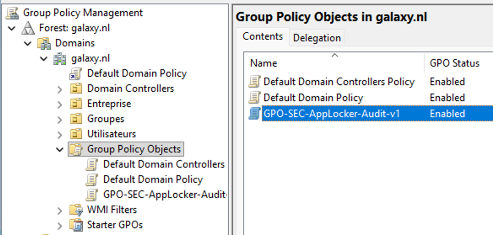
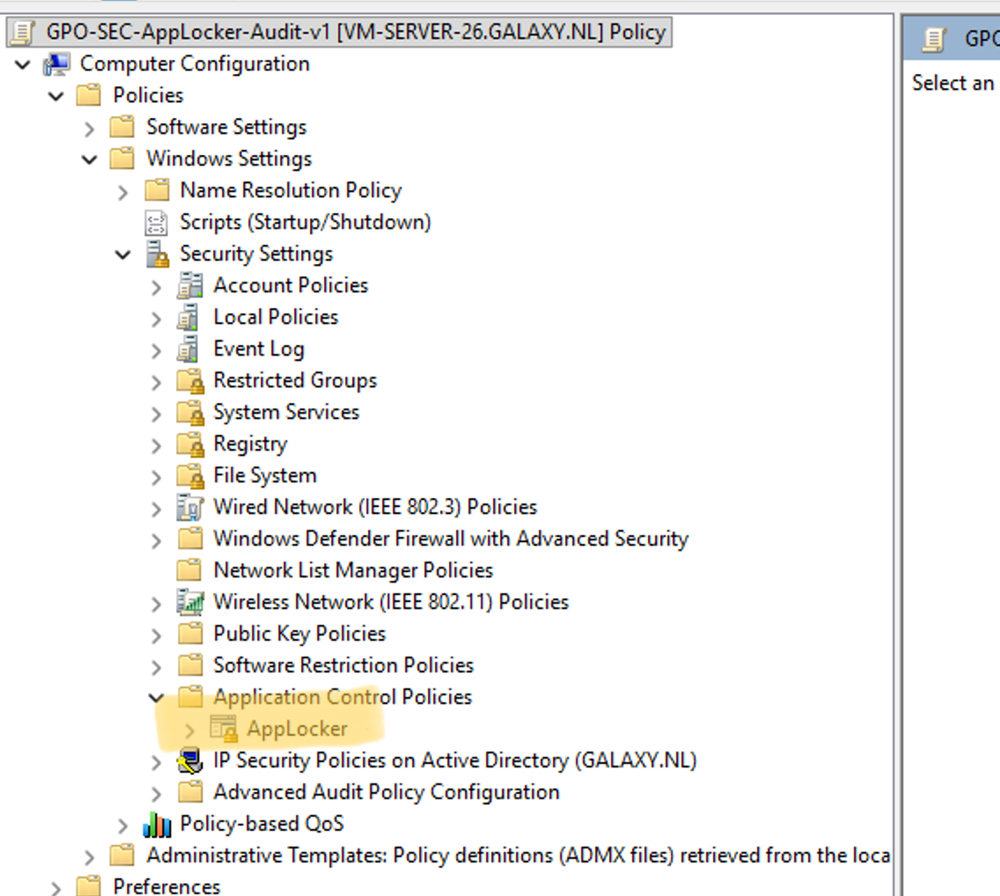
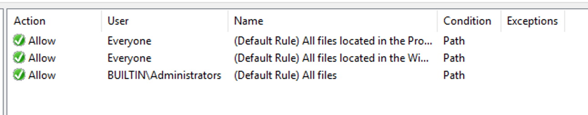
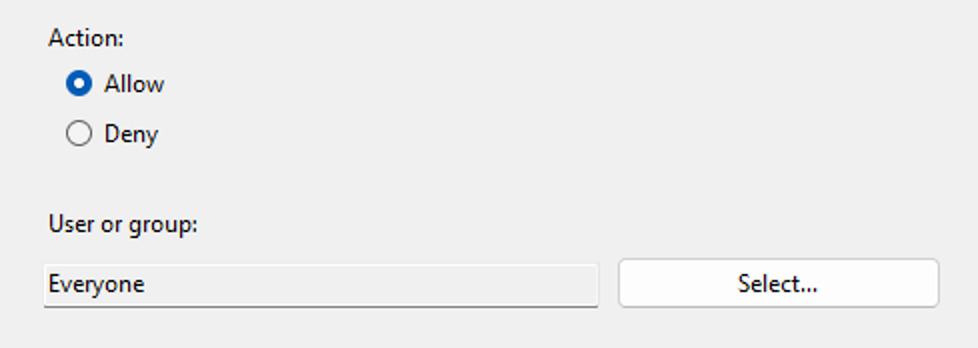
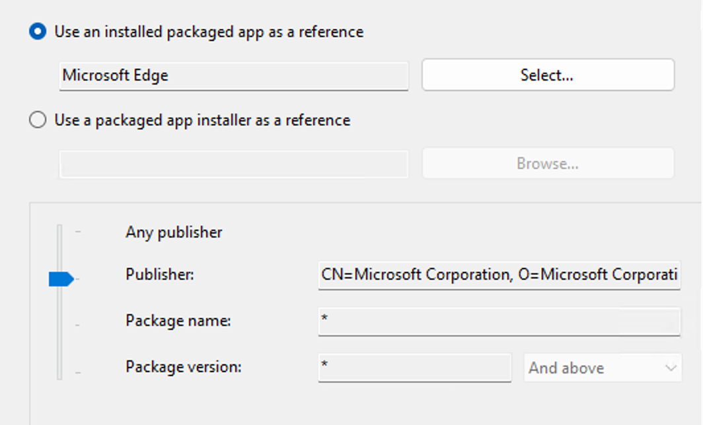
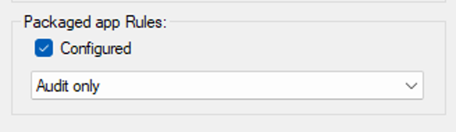
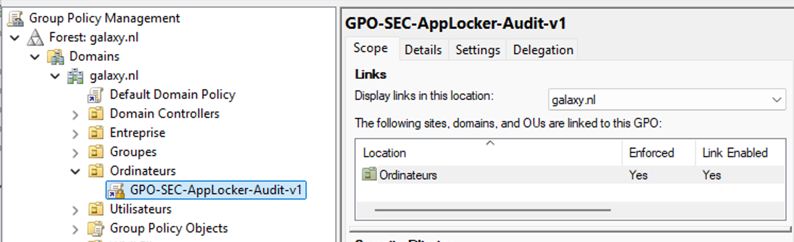

## Introduction

Cette procédure décrit la mise en œuvre d'AppLocker par GPO pour contrôler l'exécution d'applications sur un parc Windows 10, Windows 11 et Windows Server joint à un domaine Active Directory.

Le périmètre couvre les quatre collections de règles natives (Executable, Windows Installer, Script, Packaged app), l'activation du service Application Identity, et le workflow audit puis enforcement. La configuration par Intune et la configuration en mode standalone via Local Security Policy sortent du périmètre.

## Contexte et Justification

Un parc Windows laisse par défaut tout utilisateur exécuter n'importe quel binaire accessible en lecture depuis son profil, ce qui ouvre plusieurs surfaces d'attaque en production :

- Les applications portables lancées depuis `C:\Users\<user>\Downloads` contournent la politique d'installation.
- Les ransomwares exécutent leur charge depuis `%APPDATA%` ou `%TEMP%`.
- Les outils d'administration détournés (PsExec, AnyDesk, TeamViewer non validés) s'exécutent sans contrôle.

Bloquer ces scénarios par antivirus seul reste réactif : la signature du binaire peut être inconnue ou volontairement camouflée.

AppLocker apporte un contrôle proactif basé sur des règles d'allowlist ou de denylist, évaluées au niveau du fichier avant son exécution. Les règles peuvent cibler un éditeur de code, un hash ou un chemin, et s'appliquer à un utilisateur, un groupe ou à tous. Déployé par GPO, il s'intègre à la gouvernance AD existante et se déploie à grande échelle sans outillage tiers.

Le bénéfice opérationnel se mesure sur trois axes :

- **Surface d'exécution réduite** : la propagation latérale d'un binaire malveillant téléchargé par un utilisateur est limitée.
- **Traçabilité** : les événements 8002 à 8007 du journal Event Viewer sont exploitables par un SIEM.
- **Conformité** : les référentiels qui exigent un mécanisme de contrôle d'application (guide d'hygiène ANSSI, CIS Benchmarks Windows, ISO 27001 A.12.5) sont couverts.

## Concepts Clés

**Collection de règles.** AppLocker regroupe ses règles en quatre collections indépendantes :

- **Executable Rules** pour les `.exe` et `.com`.
- **Windows Installer Rules** pour les `.msi`, `.msp`, `.mst`.
- **Script Rules** pour les `.ps1`, `.bat`, `.cmd`, `.vbs`, `.js`.
- **Packaged app Rules** pour les applications UWP du Microsoft Store.

Chaque collection se configure et s'active séparément, avec son propre mode d'enforcement. Une cinquième collection, DLL Rules, existe mais reste désactivée par défaut pour des raisons de performance.

**Condition de règle.** Trois types de conditions permettent d'identifier un fichier :

| Condition | Principe | Force | Faiblesse |
|-----------|----------|-------|-----------|
| Publisher | Signature numérique (éditeur, produit, fichier, version) | Survit aux mises à jour du binaire signé | Inutilisable sur un binaire non signé |
| Path | Chemin absolu ou avec wildcard | Simple à écrire | Contournable si l'utilisateur peut écrire dans le chemin |
| File hash | Empreinte SHA256 du binaire | Infaillible | À régénérer à chaque mise à jour |

: Conditions de règle AppLocker

**Mode d'enforcement.** Chaque collection peut être en Not configured, Audit only ou Enforce rules. En mode audit, les règles ne bloquent rien mais génèrent des événements 8003 (would have been blocked), exploitables pour valider le périmètre avant bascule. En mode enforce, les règles bloquent effectivement et génèrent des événements 8004.

**Règles par défaut.** L'option Create Default Rules génère un jeu de règles qui autorise tous les binaires sous `%WINDIR%` et `%PROGRAMFILES%`, plus toute exécution par un administrateur. Sans ce socle, activer l'enforcement rend le poste inutilisable : Windows ne peut plus démarrer ses propres services signés.

**Application Identity Service (AppIDSvc).** Service Windows qui charge et applique les règles AppLocker via le driver `appid.sys` en mode kernel. Il est désactivé par défaut, et son démarrage automatique est la condition nécessaire à l'application effective des règles. Depuis Windows 10 et Windows Server 2016, il n'est plus modifiable via System Services dans la GPO (voir « Points de Vigilance »).

**Priorité Deny over Allow.** AppLocker évalue toujours les règles Deny avant les Allow. Un binaire qui correspond à la fois à une règle Deny et à une règle Allow est bloqué. Quand plusieurs GPO se superposent, les règles Deny cumulées prennent le dessus sur toute tentative d'autorisation.

## Prérequis

- Un compte membre de Domain Admins ou disposant des droits de création et de liaison de GPO sur l'OU cible.
- Un poste d'administration avec les outils RSAT, en particulier Group Policy Management Console (`gpmc.msc`) et le module PowerShell GroupPolicy.
- Un contrôleur de domaine Active Directory Windows Server 2016 minimum, schéma à jour.
- Des postes cibles sous Windows 10 version 2004 ou supérieure, Windows 11, ou Windows Server 2016 à 2025. Toutes les éditions sauf Home sont supportées depuis la suppression de la restriction Enterprise.
- Le module PowerShell AppLocker sur le poste d'édition (natif sur toute version supportée).
- Une OU de test contenant au moins un poste de validation avant déploiement sur l'OU de production.
- Le service AppIDSvc configuré en démarrage automatique sur les postes cibles (voir « Points de Vigilance »).

## Points de Vigilance

**Le service AppIDSvc ne se configure plus via la GPO System Services.** Depuis Windows 10 et Windows Server 2016, Application Identity est un processus protégé. Son type de démarrage ne peut plus être modifié par le nœud `Computer Configuration\Windows Settings\Security Settings\System Services` d'une GPO. Le réglage doit se faire par l'un de ces moyens :

- un script de démarrage GPO exécutant `sc.exe config appidsvc start=auto` ;
- un template de sécurité appliqué avec `secedit.exe` ;
- l'intégration directe dans l'image de déploiement (MDT ou Autopilot).

Omettre ce point est la cause la plus fréquente de règles AppLocker qui semblent ne rien appliquer en production.

**L'activation sans règles par défaut casse le poste.** Si une collection Executable Rules passe en Enforce rules sans règle Allow explicite, AppLocker bloque tous les binaires non autorisés, y compris les composants Windows. Le poste ne démarre plus correctement, la session utilisateur échoue, et l'intervention impose un démarrage en mode sans échec pour supprimer la politique. Générer les règles par défaut est la première action à effectuer dans chaque collection, avant toute règle personnalisée.

**Activer Executable Rules sans Packaged app Rules corrompt le menu Démarrer.** Windows 10 et 11 reposent sur des applications UWP pour le menu Démarrer, la recherche, les paramètres et le Microsoft Store. Si Executable Rules passe en enforce sans que Packaged app Rules soit configuré avec ses règles par défaut, ces composants sont bloqués. Configurez les quatre collections de manière cohérente, même si l'objectif initial ne concerne qu'un type de fichier.

**Les règles Deny l'emportent toujours sur les Allow.** Exemple : une GPO AppLocker-Base liée à l'OU parente autorise l'ensemble du parc, une GPO AppLocker-BlockEdge liée à une OU fille ajoute un Deny sur `msedge.exe`. Les règles se cumulent et Edge est bloqué sur l'OU fille. Si un administrateur tente ensuite de réautoriser Edge par une règle Allow dans une GPO prioritaire, rien ne change : le Deny ne peut être levé qu'en le supprimant de sa GPO d'origine.

**AppLocker est un contrôle user-mode.** Il évalue les exécutables et scripts au moment de leur lancement. Il ne protège ni contre les drivers kernel, ni contre le DLL sideloading non couvert par DLL Rules, ni contre les payloads injectés en mémoire dans un processus autorisé (LOLBAS via PowerShell signé par Microsoft, par exemple). Pour un durcissement au niveau kernel, App Control for Business (anciennement WDAC) est la réponse (voir « Alternatives et comparatif »).

**Microsoft recommande désormais App Control for Business en priorité.** AppLocker reçoit des correctifs de sécurité mais n'évolue plus fonctionnellement. Il reste pertinent pour les scénarios multi-OS, les règles par utilisateur ou groupe, et les déploiements GPO-first sans Intune. Cette orientation doit être prise en compte au moment de choisir l'outil, pas après le déploiement.

**L'édition Home de Windows ne reçoit pas les politiques AppLocker.** Même si le service AppIDSvc est présent, l'évaluation des règles n'est pas effective sur les éditions Home. Les éditions Pro, Enterprise, Education et Server sont supportées depuis la version 2004.

## Choix Architecturaux & Alternatives

### Quand choisir AppLocker par GPO

AppLocker est le bon choix pour un parc Active Directory on-premise hétérogène (Windows 10, Windows 11 et Windows Server), piloté par GPO sans Intune. Il convient particulièrement :

- aux postes partagés où différents groupes d'utilisateurs nécessitent des règles distinctes sur une même machine, cas qu'App Control ne gère pas nativement ;
- au durcissement ciblé et progressif : bloquer les applications portables dans `%USERPROFILE%`, empêcher l'exécution depuis `%TEMP%`, ou restreindre PowerShell aux administrateurs.

Ne choisissez pas AppLocker pour un parc Windows 11 managé à 100 % par Intune (Microsoft 365 Business Premium ou E3/E5) : App Control avec managed installer et Intelligent Security Graph est plus cohérent avec l'écosystème. Ne le choisissez pas non plus quand l'objectif inclut le blocage des drivers kernel ou des payloads en mémoire : AppLocker s'arrête au user-mode.

### Alternatives et comparatif

| Option | Cas d'usage typique | Force principale | Faiblesse principale | Coût relatif |
|--------|---------------------|------------------|----------------------|--------------|
| **AppLocker** | Parc AD on-prem multi-OS, règles par utilisateur ou groupe, pilotage GPO | Déploiement simple, règles granulaires par identité, intégration GPO native | User-mode uniquement, plus d'évolution fonctionnelle, politique device non uniforme | Gratuit, inclus dans Windows |
| **App Control for Business (ex-WDAC)** | Durcissement Zero Trust, Windows 10/11, Intune, de la PME au grand compte | Kernel-mode, allowlist explicite, réputation ISG, managed installer | Configuration XML complexe, device-centric uniquement, moins flexible par utilisateur | Gratuit, inclus dans Windows |
| **Software Restriction Policies (SRP)** | Legacy Windows 7, Windows Server 2008 R2 | Disponible sur les anciennes versions | Déprécié depuis Windows 10, pas de règles Packaged app, moins robuste | Gratuit, mais à bannir |
| **EDR tiers (CrowdStrike, SentinelOne, Defender for Endpoint ASR)** | Parc hétérogène inter-OS, détection comportementale | Couverture comportementale, corrélation SIEM, protection runtime | Coût de licence, complément et non substitut au contrôle d'application | Élevé, par poste et par mois |

Microsoft positionne officiellement App Control for Business comme successeur stratégique d'AppLocker pour les nouveaux déploiements. Les deux peuvent cohabiter : App Control applique le socle device-centric et AppLocker affine par utilisateur ou groupe.

### Impact des Choix

- **Complexité opérationnelle.** AppLocker offre la courbe d'apprentissage la plus douce : sa console ressemble au pare-feu Windows et les règles se créent à la souris. App Control demande la maîtrise des politiques XML et du WDAC Wizard.
- **Sécurité.** App Control couvre le kernel-mode et bloque les drivers non signés, AppLocker s'arrête au user-mode. Pour un environnement exposé (finance, santé, industrie critique), le différentiel justifie l'investissement dans App Control, éventuellement complété par AppLocker pour les règles par utilisateur.
- **Verrouillage technologique.** Les deux sont des technologies Microsoft propriétaires sans équivalent cross-platform. Migrer vers une solution tierce (Carbon Black, Ivanti Application Control) implique une refonte totale des politiques. Aucun n'enferme dans un cloud : tous deux fonctionnent en on-prem pur comme en hybride Intune.
- **Haute disponibilité.** AppLocker n'ajoute pas de SPOF : les règles sont mises en cache localement par AppIDSvc et restent appliquées hors connexion au DC. La dernière politique reçue persiste tant que la GPO n'est pas modifiée.
- **Limites de service.** Pas de limite dure documentée sur le nombre de règles, mais au-delà de quelques centaines de règles par collection, le temps de traitement à chaque démarrage de processus devient perceptible. En pratique, maintenez moins de 200 règles actives par collection.

## Méthode 1 : Configuration via la Console GPMC (gpmc.msc)

### Création de la GPO

1. Ouvrez `gpmc.msc` sur le contrôleur de domaine ou depuis un poste d'administration avec RSAT.
2. Créez une nouvelle GPO dans **Group Policy Objects** et nommez-la selon la convention maison, par exemple `GPO-SEC-AppLocker-Audit-V1`.

Évitez de modifier Default Domain Policy ou Default Domain Controllers Policy : une GPO dédiée facilite le rollback.

<b>Figure 1</b> · GPO dédiée dans Group Policy Objects

3. Faites un clic droit sur la GPO > **Edit**, puis naviguez jusqu'à **Computer Configuration > Policies > Windows Settings > Security Settings > Application Control Policies > AppLocker**.

<b>Figure 2</b> · Nœud AppLocker dans l'éditeur de GPO

### Génération des Règles par Défaut

1. Dans AppLocker, faites un clic droit sur **Executable Rules** > **Create Default Rules**. Trois règles Allow sont générées :
   - autoriser tous les utilisateurs à exécuter depuis `%PROGRAMFILES%` ;
   - autoriser tous les utilisateurs à exécuter depuis `%WINDIR%` ;
   - autoriser le groupe `BUILTIN\Administrators` à exécuter tous les fichiers.

<b>Figure 3</b> · Règles par défaut générées

2. Répétez l'opération pour **Windows Installer Rules**, **Script Rules** et **Packaged app Rules**.

Ces règles constituent le socle minimal garantissant qu'un poste reste fonctionnel après activation.

### Création d'une Règle Personnalisée par Éditeur

1. Faites un clic droit sur la collection cible > **Create New Rule**, puis suivez l'assistant.
2. **Before You Begin** : passez.
3. **Permissions** : choisissez Allow ou Deny, puis le groupe cible. Par défaut Everyone, à remplacer par un groupe AD métier pour une granularité plus fine.

<b>Figure 4</b> · Action et groupe ciblé

4. **Conditions** : sélectionnez Publisher, choisissez le binaire ou l'application de référence (par exemple Microsoft Edge pour bloquer Edge), puis ajustez le curseur de précision :
   - **Publisher** pour cibler tout l'éditeur ;
   - **Product name** (ou Package name) pour un produit spécifique ;
   - **File name** pour un binaire précis ;
   - **File version** pour une version donnée.

<b>Figure 5</b> · Condition Publisher et curseur de précision

Pour un blocage qui survit aux mises à jour, arrêtez-vous à File name et laissez la version sur « any version ».

5. **Exceptions** : ajoutez les exceptions éventuelles, par exemple autoriser `msedgewebview2.exe` alors qu'on bloque `msedge.exe`.
6. **Name** : donnez un nom descriptif suivant la convention, par exemple `Deny - Microsoft Edge - All versions`.

### Activation du Mode d'Enforcement

1. Faites un clic droit sur **AppLocker** > **Properties**.
2. Pour chaque collection concernée, cochez **Configured** et sélectionnez **Audit only** pour un premier déploiement.

<b>Figure 6</b> · Collection configurée en Audit only

Ne passez pas directement en Enforce rules. Le workflow recommandé : audit pendant 15 à 30 jours, analyse des événements 8003, ajustement des règles, puis bascule en enforce par vagues sur les OU de test avant la production.

### Liaison de la GPO

1. Fermez l'éditeur.
2. Dans GPMC, faites un clic droit sur l'OU cible (par exemple `OU=Postes-Test,OU=Postes,DC=galaxy,DC=nl`) > **Link an Existing GPO**, puis sélectionnez la GPO créée.
3. Sur les postes cibles, forcez l'actualisation avec `gpupdate /force`.

<b>Figure 7</b> · GPO liée à l'OU cible

## Dépannage

**« Les règles AppLocker sont visibles dans la GPO mais aucun blocage ne se produit sur les postes » :** la cause racine est presque toujours le service AppIDSvc non démarré. Exécutez `Get-Service AppIDSvc` sur le poste cible : si Status est Stopped ou StartType est Disabled, configurez le démarrage automatique comme décrit dans « Points de Vigilance ». Ce service ne se pilote plus via la GPO System Services depuis Windows 10.

**« This app has been blocked by your system administrator » sur un binaire qui devrait être autorisé :** la cause la plus fréquente est l'absence des règles par défaut dans la collection concernée. Ouvrez la GPO, exécutez Create Default Rules sur chaque collection configurée si ce n'est pas déjà fait, puis lancez `gpupdate /force` sur le poste.

**« Le menu Démarrer ne s'ouvre plus après activation d'AppLocker » :** la collection Packaged app Rules n'est pas configurée alors qu'Executable Rules est en enforce. Configurez Packaged app Rules avec les règles par défaut et repoussez la GPO. En urgence, faites un rollback en arrêtant AppIDSvc et en supprimant les fichiers sous `C:\Windows\System32\AppLocker`.

**« La GPO AppLocker s'applique sur certains postes et pas d'autres » :** vérifiez la portée de la GPO avec `gpresult /h rapport.html` sur un poste qui ne reçoit pas la politique. Causes fréquentes : filtrage WMI incorrect, groupe de sécurité de scoping ne contenant pas le poste, ou blocage d'héritage sur une OU fille. Confirmez aussi que le poste n'est pas en édition Home.

**« Les règles Publisher bloquent une version non anticipée d'une application » :** vérifiez le curseur de précision de la règle. Si la version a été figée, une mise à jour casse la correspondance. Repositionnez le curseur sur File name avec « any version », ou scindez en deux règles si le suivi de version est intentionnel.

## Conseils et Bonnes Pratiques

**Toujours démarrer en mode Audit only.** La bascule directe en Enforce rules sur un périmètre mal qualifié provoque des interruptions de service. Prévoyez 15 à 30 jours d'audit minimum, analysez les 8003 pour identifier les faux positifs, ajustez, puis basculez en enforce par OU de test avant la production.

**Privilégier les règles Publisher aux règles Path.** Les règles Path s'écrivent vite mais sont contournables dès que l'utilisateur peut écrire dans le chemin ciblé. Une règle Publisher survit aux mises à jour et aux changements de chemin. Réservez les règles Path aux binaires non signés, et signalez le risque dans le nom de la règle.

**Convention de nommage des règles.** Format recommandé : `<ACTION> - <APPLICATION> - <PORTÉE>`, par exemple `Deny - Microsoft Edge - All Users` ou `Allow - SEMIN ERP - GroupeSEMIN-ERP`. Le préfixe Allow ou Deny permet un tri visuel immédiat dans la console.

**Une GPO AppLocker dédiée par fonction.** N'empilez pas les règles dans la Default Domain Policy. Créez une GPO par finalité, par exemple `GPO-SEC-AppLocker-Base-Audit` pour le socle, `GPO-SEC-AppLocker-Browsers-Enforce` pour les navigateurs autorisés, `GPO-SEC-AppLocker-RemoteTools-Deny` pour bloquer AnyDesk et TeamViewer. Cette granularité facilite le rollback ciblé.

**Automatiser la collecte des événements AppLocker.** Les événements 8003 et 8004 sont la source de vérité du système, mais leur exploitation manuelle via Event Viewer ne passe pas à l'échelle. Transférez les journaux Microsoft-Windows-AppLocker vers un collecteur WEF ou un SIEM (Wazuh, Sentinel, Splunk) dès la phase d'audit.

**Appliquer le moindre privilège aux règles.** La règle par défaut qui autorise tout binaire exécuté par `BUILTIN\Administrators` est pratique en maquette mais dangereuse en production : un ransomware exécuté par un utilisateur admin local contourne toute la politique. Remplacez-la par un groupe `<DOMAINE>\Admins-AppLocker` restreint aux comptes d'administration réellement concernés.

**Combiner avec App Control for Business pour les environnements exposés.** AppLocker en user-mode complété par App Control en kernel-mode offre une défense en profondeur cohérente avec le modèle Zero Trust. App Control définit le socle device-centric, AppLocker affine par utilisateur ou groupe. Les deux cohabitent sans conflit.

**Documenter les exceptions avec un cycle de revue.** Chaque règle Allow ajoutée pour débloquer une application métier doit être tracée avec un identifiant de ticket, une date de création et une date de revue. Un audit semestriel permet de supprimer les exceptions obsolètes.

## Procédures Liées

- [Gestion des Objets dans Active Directory](/procedures/windows/gestion-des-objets-dans-active-directory) *(Ciblage des GPO par OU)*
- Durcissement de Windows Server avec OSConfig et Credential Guard *(Durcissement complémentaire)*
- Mise en Place du Modèle d'Administration en Tiers (Tiering) *(Restriction des postes d'administration)*
- [Installation d'un Client Windows 11 Professionnel](/procedures/windows/installation-dun-client-windows-11-professionnel) *(Postes clients ciblés)*
- Déploiement de Windows LAPS *(Protection des comptes locaux)*
