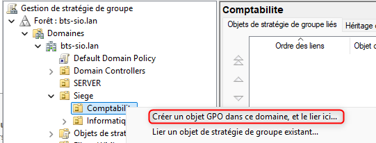
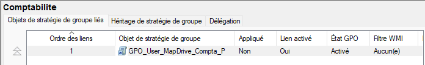
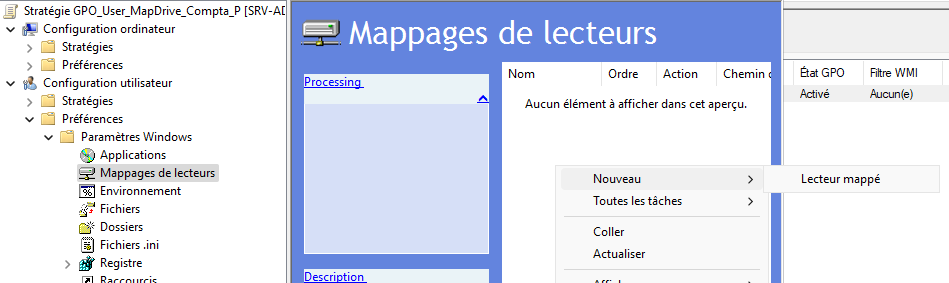
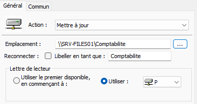
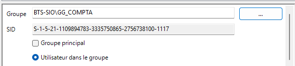

## Objectif

Cette procédure a pour objectif de créer et configurer une Stratégie de Groupe (GPO) pour mapper automatiquement un lecteur réseau sur les postes de travail des utilisateurs. L'opération vise à automatiser l'accès aux partages de fichiers en fonction de l'appartenance des utilisateurs à une Unité d'Organisation (UO) et/ou à un groupe de sécurité.

## Contexte et Justification

Demander aux utilisateurs de mapper manuellement leurs lecteurs réseau est inefficace : ils oublient le chemin d'accès, font des erreurs, et les mappages peuvent disparaître.

Les GPO permettent à l'administrateur de définir de manière centralisée quel lecteur doit être connecté pour quel utilisateur, de façon automatique à chaque ouverture de session.

Nous utiliserons les **Préférences de Stratégie de Groupe (GPP)**, la méthode moderne et flexible pour ce type de configuration. Contrairement à une stratégie « imposée », une préférence peut être modifiée par l'utilisateur (même si pour un lecteur réseau, c'est rarement le cas).

## Prérequis et Schéma Cible

**Prérequis :**

- Un environnement Active Directory fonctionnel.
- Un serveur de fichiers avec un partage réseau fonctionnel (ex : `\\SRV-FILES01\Comptabilite`, cf. procédure *Mise en Place d'un Serveur de Fichiers avec Partages et Sécurité NTFS*).
- Une unité d'organisation (UO) contenant les comptes des utilisateurs cibles (ex : UO Comptabilite).
- Un groupe de sécurité (ex : `GG_COMPTA`) ayant les permissions sur le partage.

**Schéma cible :**

Nous allons lier une GPO à l'UO Comptabilite. Quand un membre de cette UO ouvre sa session, un lecteur `P:` nommé « Comptabilité » apparaît automatiquement dans son Explorateur de fichiers, pointant vers `\\SRV-FILES01\Comptabilite`.

## Procédure de Configuration

### Création et Liaison de l'Objet de Stratégie de Groupe (GPO)

1. Sur un contrôleur de domaine, ouvrez la console **« Gestion de stratégie de groupe »** (tapez `gpmc.msc` dans une fenêtre Exécuter).
2. Naviguez dans l'arborescence jusqu'à l'OU où se trouvent vos utilisateurs cibles (ex : `bts-sio.lan\Utilisateurs\Comptabilite`).
3. Faites un clic droit sur cette UO et choisissez **« Créer un objet GPO dans ce domaine, et le lier ici… »**.

<b>Figure 1</b> · Créer un objet GPO et le lier

4. Donnez un nom explicite à votre GPO, par exemple `GPO_User_MapDrive_Compta_P`.
5. Cliquez sur **OK**. La nouvelle GPO apparaît, déjà liée à l'UO.

<b>Figure 2</b> · GPO liée à l'UO Comptabilite

### Configuration du Mappage de Lecteur via les Préférences

1. Faites un clic droit sur la GPO que vous venez de créer et choisissez **« Modifier… »**.
2. L'éditeur de gestion des stratégies de groupe s'ouvre. Naviguez dans l'arborescence suivante : **Configuration utilisateur \> Préférences \> Paramètres Windows \> Mappages de lecteurs**.
3. Dans la partie droite (qui est vide), faites un clic droit \> **Nouveau \> Lecteur mappé**.

<b>Figure 3</b> · Nouveau lecteur mappé

4. La fenêtre des propriétés s'ouvre. Configurez les champs suivants :
   - **Action :** `Mettre à jour` (c'est l'option la plus polyvalente).
   - **Emplacement :** Entrez le chemin UNC de votre partage : `\\SRV-FILES01\Comptabilite`.
   - **Libellé :** Donnez un nom convivial au lecteur, ex : `Comptabilité`.
   - **Lettre de lecteur :** Cochez `Utiliser` et choisissez `P:`.

<b>Figure 4</b> · Propriétés du lecteur P:

5. Cliquez sur **OK**. Votre mappage de lecteur est maintenant configuré.

### Ajout d'un Ciblage de Sécurité

Cette étape garantit que le lecteur n'est mappé que pour les membres d'un groupe de sécurité spécifique, même si d'autres utilisateurs se trouvent dans la même UO.

1. Dans la fenêtre des propriétés de votre mappage de lecteur, allez dans l'onglet **« Commun ».**
2. Cochez la case **« Ciblage au niveau de l'élément »** et cliquez sur le bouton **« Ciblage… »**.
3. Dans la nouvelle fenêtre, cliquez sur **Nouvel élément \> Groupe de sécurité**.
4. Cliquez sur le bouton **…** et sélectionnez votre groupe `GG_COMPTA`.

<b>Figure 5</b> · Ciblage sur le groupe GG_COMPTA

5. Cliquez sur **OK** sur toutes les fenêtres.

## Vérifications

- Connectez-vous à un poste client avec un utilisateur test **membre** de l'UO Comptabilite et du groupe `GG_COMPTA`.
- Ouvrez l'Explorateur de fichiers. Le lecteur `P:` nommé « Comptabilité » doit être présent et accessible.
- **Pour accélérer :** Si le lecteur n'apparaît pas tout de suite, ouvrez une invite de commandes sur le poste client et tapez `gpupdate /force` pour forcer l'application des GPO, puis fermez et rouvrez la session.
- Testez en vous connectant avec un utilisateur test qui n'est pas dans l'UO ou le groupe. Le lecteur ne doit pas apparaître.

## Conseils et Bonnes Pratiques

**Conventions de nommage :** Adoptez une convention de nommage claire pour vos GPO (ex : `GPO_User_...` pour les GPO utilisateur, `GPO_Computer_...` pour les GPO ordinateur) afin de vous y retrouver facilement.

## Dépannage

**Symptôme :** Le lecteur réseau apparaît avec une croix rouge.

- **Cause probable :** La GPO s'applique bien, mais l'utilisateur n'a pas les permissions de partage ou NTFS suffisantes pour accéder au dossier. C'est un problème de permissions sur le serveur de fichiers, pas de GPO.

**Symptôme :** Le lecteur n'apparaît pas du tout.

- **Cause probable :** La GPO ne s'applique pas. Vérifiez que la GPO est bien liée à la bonne UO (celle contenant les **utilisateurs**, pas les ordinateurs) et que l'utilisateur est bien dans cette UO. Utilisez `gpresult /r` sur le poste client pour lister les GPO appliquées.

## Procédures Liées

- [Mise en Place d'un Serveur de Fichiers avec Partages et Sécurité NTFS](/procedures/windows/mise-en-place-dun-serveur-de-fichiers-avec-partages-et-securite-ntfs) *(Partages à mapper)*
- [Gestion des Objets dans Active Directory](/procedures/windows/gestion-des-objets-dans-active-directory) *(Ciblage par groupes)*
- Déploiement de DFS Namespaces et DFS Replication *(Chemins indépendants du serveur)*
- Configuration de FSRM (Quotas et Filtrage de Fichiers) *(Quotas sur les partages)*
