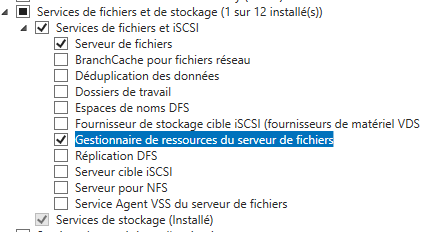
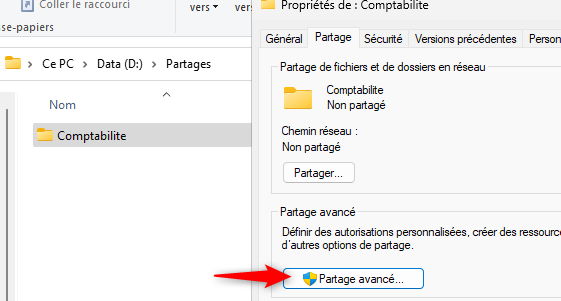
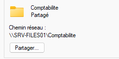
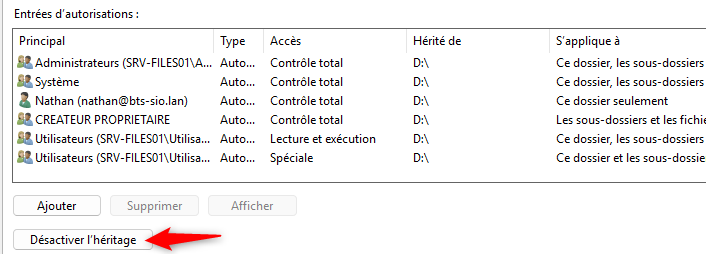
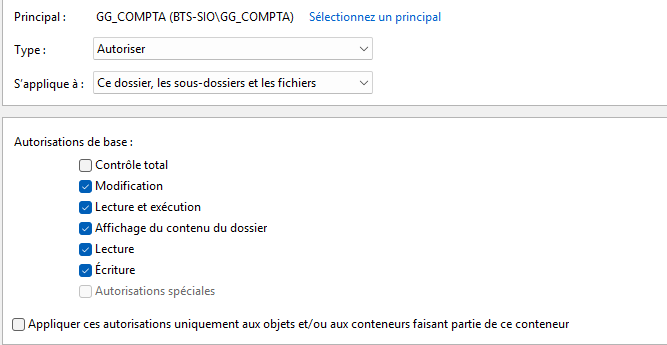
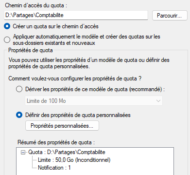

## Objectif

Cette procédure a pour objectif de configurer un serveur de fichiers Windows sécurisé. Nous allons créer des partages réseau, appliquer des permissions granulaires basées sur des groupes Active Directory (permissions NTFS), et mettre en place des quotas pour contrôler l'utilisation de l'espace disque.

## Contexte et Justification

Un serveur de fichiers permet de centraliser les données de l'entreprise. Pour le sécuriser, Windows utilise deux niveaux d'autorisations qui se combinent :

- **Autorisations de Partage :** C'est la « porte d'entrée » du partage réseau. Elles déterminent qui a le droit d'accéder au partage depuis le réseau. La bonne pratique est de les laisser très simples et permissives (ex : « Utilisateurs authentifiés » en contrôle total).
- **Autorisations NTFS :** C'est la sécurité au niveau du système de fichiers lui-même. Elles sont bien plus granulaires et déterminent précisément qui a le droit de lire, écrire, modifier ou supprimer chaque fichier et chaque dossier. **C'est ici que se fait la vraie sécurité.**

Les **Quotas** permettent d'éviter qu'un service ou un utilisateur ne sature le disque dur du serveur en y stockant trop de données.

## Prérequis et Schéma Cible

**Prérequis :**

- Un environnement Active Directory fonctionnel.
- Des groupes de sécurité créés pour les différents services (ex : `GG_COMPTA`).
- Un serveur Windows dédié (SRV-FILES01), membre du domaine, avec une IP statique.
- Un disque dur secondaire sur ce serveur, formaté en NTFS (ex : `D:`), dédié au stockage des données.

**Schéma cible :** Nous allons créer un partage `\\SRV-FILES01\Comptabilite`. Seuls les membres du groupe `GG_COMPTA` auront le droit de modifier les fichiers dans ce partage. L'espace total du dossier sera limité à 50 Go par un quota.

## Procédure de Configuration

### Préparation du Serveur et des Groupes Active Directory

1. Sur SRV-FILES01, assurez-vous que votre disque de données (D:) est en ligne. Créez un dossier racine pour tous vos partages, par exemple `D:\Partages`.
2. Dans « Utilisateurs et ordinateurs Active Directory », créez un groupe de sécurité nommé `GG_COMPTA` et ajoutez-y un utilisateur de test.

### Installation du Gestionnaire de Ressources du Serveur de Fichiers

Pour gérer les quotas, nous avons besoin d'un service de rôle supplémentaire.

1. Sur SRV-FILES01, ouvrez le **Gestionnaire de serveur**.
2. Allez sur « Ajouter des rôles et fonctionnalités ».
3. Déroulez **Services de fichiers et de stockage \> Services de fichiers et iSCSI** et cochez la case **Gestionnaire de ressources du serveur de fichiers**.

<b>Figure 1</b> · Service de rôle FSRM

4. Terminez l'installation.

### Création du Partage

1. Dans le dossier `D:\Partages`, créez un nouveau dossier nommé `Comptabilite`.
2. Faites un clic droit sur ce dossier \> **Propriétés** \> onglet **Partage** \> **Partage avancé…**

<b>Figure 2</b> · Partage avancé

3. Cliquez sur **Autorisations.**
4. Cliquez sur **Ajouter**, tapez « Utilisateurs authentifiés » et cliquez sur **OK**.
5. Sélectionnez « Utilisateurs authentifiés » et cochez la case **« Contrôle total »** dans la colonne « Autoriser ».
6. Supprimez « Tout le monde », puis cliquez sur **OK** deux fois. Le partage est créé.

<b>Figure 3</b> · Autorisations de partage

### Application des Permissions NTFS

C'est ici que nous mettons en place la vraie sécurité.

1. Faites un clic droit sur le dossier `D:\Partages\Comptabilite` \> **Propriétés** \> onglet **Sécurité**.
2. Cliquez sur **Avancé**. En bas à gauche, cliquez sur **Désactiver l'héritage**, puis choisissez **« Convertir les autorisations héritées en autorisations explicites sur cet objet ».**

<b>Figure 4</b> · Désactivation de l'héritage

3. Cliquez sur **Modifier**. Supprimez les groupes qui ne sont pas nécessaires, comme Utilisateurs. Laissez SYSTEM et Administrateurs avec un contrôle total.
4. Cliquez sur **Ajouter…**, tapez le nom de votre groupe `GG_COMPTA` et cliquez sur **OK**.
5. Sélectionnez votre groupe et donnez-lui les permissions **« Modification »** (ce qui inclut lecture, écriture et suppression).

<b>Figure 5</b> · Permission Modification pour GG_COMPTA

6. Cliquez sur **OK** pour valider.

### Configuration d'un Quota de Stockage

1. Dans le **Gestionnaire de serveur**, allez dans **Outils \> Gestionnaire de ressources du serveur de fichiers.**
2. Déroulez **Gestion des quotas \> Quotas**.
3. Dans le volet Actions à droite, cliquez sur **Créer un quota…**
4. **Chemin d'accès du quota :** Naviguez jusqu'à votre dossier `D:\Partages\Comptabilite`.
5. Cochez **« Définir les propriétés du quota personnalisées »** et cliquez sur **Propriétés personnalisées.**
6. **Limite :** Entrez 50 et choisissez Go.
7. **Type de quota :** Laissez **« Quota inconditionnel »** (empêche de dépasser la limite).
8. Cliquez sur **OK**, puis **Créer.**

<b>Figure 6</b> · Quota de 50 Go

## Vérifications

1. Connectez-vous à un poste client avec un utilisateur **membre** du groupe `GG_COMPTA`.
2. Dans l'Explorateur de fichiers, tapez `\\SRV-FILES01\Comptabilite` et validez. Vous devez pouvoir accéder au dossier, y créer un fichier et le supprimer.
3. Fermez la session et connectez-vous avec un utilisateur qui **n'est pas membre** du groupe.
4. Essayez d'accéder au même partage. Vous devez recevoir un message **« Accès refusé »**.

## Conseils et Bonnes Pratiques

**Groupes vs utilisateurs :** La règle d'or est **AGDLP** (Accounts -> Global groups -> Domain Local groups -> Permissions). Pour faire simple : mettez toujours des **groupes** dans les permissions, jamais des utilisateurs individuels.

**ABE (Access-Based Enumeration) :** Dans le **Gestionnaire de serveur \> Services de fichiers et de stockage \> Partages**, ouvrez les propriétés du partage et activez l'énumération basée sur l'accès. Si cette option est cochée, les utilisateurs qui n'ont pas la permission d'accéder à un dossier ne le verront même pas apparaître dans la liste. C'est plus propre et plus sécurisé.

## Procédures Liées

- [Mappage de Lecteurs Réseau avec les Stratégies de Groupe (GPO)](/procedures/windows/mappage-de-lecteurs-reseau-avec-les-strategies-de-groupe-gpo) *(Mappage des partages par GPO)*
- [Mise en Place d'un Volume à Tolérance de Panne (RAID)](/procedures/windows/mise-en-place-dun-volume-a-tolerance-de-panne-raid) *(Stockage redondant)*
- [Configuration de FSRM (Quotas et Filtrage de Fichiers)](/procedures/windows/configuration-de-fsrm-quotas-et-filtrage-de-fichiers) *(Quotas et filtrage de fichiers)*
- [Déploiement de DFS Namespaces et DFS Replication](/procedures/windows/deploiement-de-dfs-namespaces-et-dfs-replication) *(Espace de noms et réplication)*
- [Installation d'un Serveur de Fichiers Samba](/procedures/linux/installation-dun-serveur-de-fichiers-samba) *(Équivalent sous Linux)*
