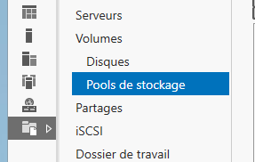
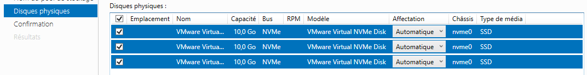
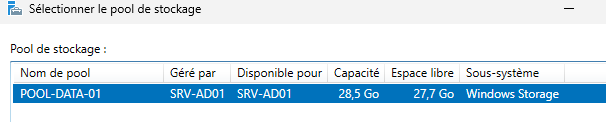
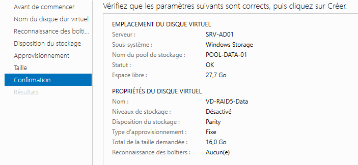
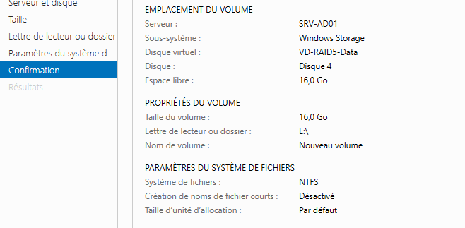

## Objectif

L'objectif est de créer un espace de stockage sécurisé sur un serveur Windows qui peut **survivre à la panne d'un disque dur**, en utilisant la technologie RAID logicielle intégrée : les **Espaces de stockage (Storage Spaces)**.

## Contexte et Justification

Sur un serveur de fichiers, les données sont critiques. Si vous stockez toutes vos données sur un seul disque dur physique et que celui-ci tombe en panne, **tout est perdu**. Le RAID (Redundant Array of Independent Disks, regroupement redondant de disques indépendants) est une technologie qui combine plusieurs disques durs pour fonctionner comme une seule unité, dans le but de protéger les données contre une panne matérielle.

## Concepts Clés

**Les Espaces de Stockage (Storage Spaces)**

C'est la technologie moderne de Windows Server pour créer du RAID logiciel. C'est une « boîte de LEGO » pour le stockage : vous prenez des briques de base (vos disques durs physiques) et vous construisez des formes plus grandes et plus solides (vos volumes RAID).

**Les Niveaux de RAID**

Voici les 3 niveaux de base que vous pouvez créer :

| Niveau RAID | Nom courant | Disques min. | Tolérance de panne | Idéal pour… |
|-------------|------------|--------------|--------------------|-------------|
| RAID 0 | Agrégation (Simple) | 2 | Aucune | Performances maximales (ex : montage vidéo temporaire). **Ne pas utiliser pour des données critiques.** |
| RAID 1 | Miroir | 2 | 1 disque | Données très critiques, système d'exploitation. Très sécurisé mais coûteux en espace. |
| RAID 5 | Parité | 3 | 1 disque | Serveurs de fichiers. Le meilleur compromis entre sécurité, performance et coût. |

: Niveaux de RAID disponibles

Pour cette procédure, nous allons mettre en place un **RAID 5**, le plus courant pour un serveur de fichiers.

## Prérequis

- Une machine physique ou une VM Windows Server installée et fonctionnelle.
- **3 disques durs virtuels « vierges »** ajoutés à votre machine.

## Procédure Pratique : Création d'un Volume RAID 5

### Création du Pool de Stockage

**Analogie :** Le pool, c'est comme jeter toutes vos briques LEGO dans un grand bac. On rassemble tout le stockage brut disponible en un seul endroit.

1. Ouvrez le **Gestionnaire de serveur**.
2. Allez dans **Services de fichiers et de stockage \> Volumes \> Pools de stockage**.

<b>Figure 1</b> · Pools de stockage

3. Dans la section « POOLS DE STOCKAGE », cliquez sur **TÂCHES \> Nouveau pool de stockage…**
4. L'assistant se lance. Cliquez sur **Suivant**.
5. Donnez un **nom** à votre pool de stockage (ex : `Pool-Data-01`) et cliquez sur **Suivant**.
6. Sélectionnez les 3 disques virtuels que vous avez ajoutés. Ils doivent apparaître comme disponibles. Cochez-les tous.

<b>Figure 2</b> · Sélection des disques physiques

7. Cliquez sur **Suivant**, puis sur **Créer**.

### Création du Disque Virtuel (le RAID)

**Analogie :** Maintenant que le bac de briques (le pool) est prêt, nous allons construire la structure. C'est ici que nous choisissons la forme de notre construction : le niveau de RAID.

1. Une fois le pool créé, cochez la case **« Créer un disque virtuel lorsque l'Assistant se ferme »**. Cliquez sur **Fermer**. L'assistant de création de disque virtuel se lance automatiquement.
2. Assurez-vous que le bon pool de stockage est sélectionné et cliquez sur **Suivant**.

<b>Figure 3</b> · Sélection du pool de stockage

3. Donnez un **nom** au disque virtuel (ex : `VD-RAID5-Data`).
4. Sur l'écran « Disposition du stockage », sélectionnez **Parité**. C'est le nom que Microsoft donne au **RAID 5**.
5. Sur l'écran « Type d'approvisionnement », sélectionnez **Fixe**. Cela alloue immédiatement tout l'espace et offre de meilleures performances.
6. Spécifiez la **taille** du disque. Vous pouvez choisir « Taille maximale ».

<b>Figure 4</b> · Disposition Parité

7. Cliquez sur **Suivant**, puis **Créer**.

### Création du Volume (la Partition)

**Analogie :** La structure (le disque virtuel) est construite. Il faut maintenant l'aménager pour pouvoir y stocker des choses : lui donner une lettre, un nom et un système de fichiers.

1. Une fois le disque virtuel créé, l'assistant de création de volume se lance. Cliquez sur **Suivant**.
2. Le serveur et le nouveau disque sont déjà sélectionnés. Cliquez sur **Suivant**.
3. Choisissez une **lettre de lecteur** (ex : `E:`).
4. Laissez le système de fichiers sur **NTFS**. Donnez un **nom de volume** explicite (ex : `DATA`).
5. Cliquez sur **Suivant**, puis **Créer**.

<b>Figure 5</b> · Confirmation de création du volume

## Vérifications

1. **Vérification :** Allez dans l'**Explorateur de fichiers**. Vous devez voir un nouveau lecteur **DATA (E:)**. Vous pouvez y créer des fichiers et des dossiers.
2. **Test de panne (la preuve que ça fonctionne) :**
   - Créez un fichier texte sur votre nouveau disque `E:`.
   - Arrêtez votre machine.
   - Retirez ou supprimez l'un des 3 disques que vous aviez ajoutés.
   - Redémarrez la machine.
   - Allez dans l'Explorateur de fichiers : le disque `E:` est toujours là et votre fichier texte est toujours lisible ! Le RAID 5 a fonctionné.
   - Dans les « Pools de stockage », vous verrez un avertissement indiquant qu'un disque est manquant, prouvant que le système a détecté la panne.

## Conseils et Bonnes Pratiques

**Homogénéité des disques :** En production, utilisez toujours des disques de **même modèle, même taille et même vitesse** pour constituer un pool. Cela garantit des performances prévisibles et stables.

**Configurer un disque de rechange à chaud (Hot Spare) :** Dans les propriétés de votre pool de stockage, vous pouvez désigner un disque comme « Hot Spare ». Ce disque reste inactif, mais si l'un des disques du RAID tombe en panne, le système l'utilisera **automatiquement** pour reconstruire les données, minimisant ainsi le temps pendant lequel vos données sont vulnérables.

**Utiliser ReFS comme système de fichiers :** Pour les grands volumes de stockage de fichiers, le système de fichiers **ReFS (Resilient File System)** est souvent un meilleur choix que le NTFS. Il intègre des mécanismes d'auto-réparation qui protègent mieux contre la corruption silencieuse des données.

**Supervision :** Un RAID n'est pas une solution « installez et oubliez ». Surveillez régulièrement l'état de santé de vos pools et de vos disques physiques depuis le Gestionnaire de serveur.

**Le plus important : le RAID n'est PAS une sauvegarde !** Ceci est la règle la plus importante. Le RAID vous protège contre une **panne matérielle** (un disque qui casse). Il ne vous protège **PAS** contre :

- Une suppression accidentelle de fichier.
- Un virus ou un ransomware qui chiffre vos données.
- Une corruption de données logicielle.
- Un sinistre majeur (incendie, inondation).

Vous devez **toujours** avoir une stratégie de sauvegarde distincte et régulière de vos données, même si elles sont sur un volume RAID.

## Dépannage

**Symptôme :** Mes disques n'apparaissent pas lors de la création du pool.

- **Cause :** Ils contiennent peut-être déjà une partition.
- **Solution :** Ouvrez la « Gestion des disques », trouvez les disques, faites un clic droit et « Supprimer le volume » pour qu'ils redeviennent « Non alloué ».

**Symptôme :** L'option « Parité » (RAID 5) est grisée.

- **Cause :** Vous n'avez pas sélectionné assez de disques.
- **Solution :** Le RAID 5 nécessite un minimum de 3 disques physiques dans le pool.

## Procédures Liées

- [Mise en Place d'un Serveur de Fichiers avec Partages et Sécurité NTFS](/procedures/windows/mise-en-place-dun-serveur-de-fichiers-avec-partages-et-securite-ntfs) *(Données hébergées sur le volume)*
- Configuration des Storage Spaces et de la Déduplication *(Alternative moderne avec Storage Spaces)*
- [Mise en Place d'un Volume RAID 5 Logiciel sous Linux](/procedures/linux/mise-en-place-dun-volume-raid-5-logiciel-sous-linux) *(Équivalent sous Linux)*
- Chiffrement des Volumes avec BitLocker *(Chiffrement du volume)*
- [Installation de Windows Server 2025](/procedures/windows/installation-de-windows-server-2025) *(Installation du serveur)*
