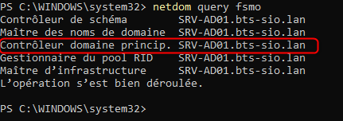
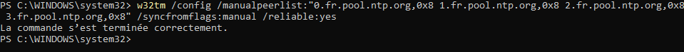
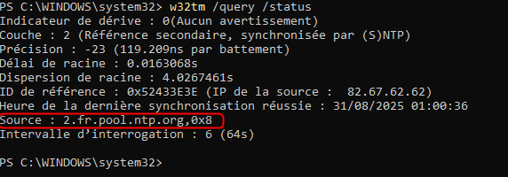

## Objectif

Cette procédure a pour objectif de configurer le service de temps Windows (NTP) au sein d'un domaine Active Directory. L'opération consiste à forcer le contrôleur de domaine jouant le rôle d'émulateur PDC à se synchroniser sur des serveurs de temps Internet fiables, afin qu'il puisse ensuite distribuer une heure juste et cohérente à tous les autres serveurs et postes de travail du domaine.

## Contexte et Justification

La synchronisation de l'heure n'est pas une simple commodité. Pour Active Directory, c'est une exigence de sécurité fondamentale. Le protocole d'authentification par défaut, **Kerberos**, se base sur des « tickets » qui ont une durée de validité très courte (quelques minutes).

**Le Risque :** Si l'horloge d'un poste client et celle d'un contrôleur de domaine ont un décalage de plus de 5 minutes (par défaut), le contrôleur de domaine considérera que le ticket d'authentification est invalide ou potentiellement frauduleux, et **refusera la connexion**. Cela peut entraîner des échecs d'ouverture de session et des erreurs d'accès aux ressources partagées.

**La Solution :** Active Directory implémente une hiérarchie NTP naturelle :

- Le contrôleur de domaine avec le rôle **PDC Emulator** (Maître d'Opérations) est la source de temps faisant autorité pour tout le domaine.
- Tous les autres contrôleurs de domaine se synchronisent sur le PDC Emulator.
- Tous les serveurs membres et postes de travail se synchronisent sur n'importe quel contrôleur de domaine.

Notre travail est donc simple : il suffit de s'assurer que la « source » de cette pyramide (le PDC Emulator) est elle-même réglée sur une heure fiable.

## Prérequis et Schéma de Fonctionnement

**Prérequis :**

- Un environnement Active Directory fonctionnel avec au moins un contrôleur de domaine.
- Un accès Internet pour le contrôleur de domaine détenant le rôle PDC Emulator. Le port **UDP 123** (NTP) doit pouvoir sortir vers Internet.

**Schéma de fonctionnement :** Nous allons configurer le PDC Emulator pour qu'il ne se fie plus à son horloge interne, mais qu'il aille chercher l'heure sur des serveurs de temps publics (ex : `pool.ntp.org`). Il deviendra ensuite la référence pour le reste du réseau.

## Procédure de Configuration

Toutes les actions suivantes se font sur un contrôleur de domaine, en ouvrant une **Invite de commandes (CMD)** ou **PowerShell en tant qu'administrateur.**

### Identifier le Contrôleur de Domaine Maître du Temps (PDC Emulator)

1. Sur n'importe quel contrôleur de domaine, tapez la commande suivante : `netdom query fsmo`.
2. Repérez la ligne **« Contrôleur domaine princip. »** (ou « PDC » en anglais). Le nom du serveur indiqué est celui sur lequel nous devons effectuer la configuration. Pour le reste de la procédure, nous supposerons que c'est SRV-AD01.



<p class="figure-caption"><b>Figure 1</b> · Résultat de netdom query fsmo</p>

### Configuration pour se Synchroniser sur des Sources Externes

1. **Connectez-vous à votre contrôleur de domaine PDC Emulator** (SRV-AD01).
2. Définissez les serveurs de temps externes. Exécutez la commande suivante pour configurer le service afin qu'il utilise le pool de serveurs NTP français. Le flag `0x8` indique au client d'envoyer les requêtes en mode « Client » plutôt que « Symétrique ».

```powershell
w32tm /config /manualpeerlist:"0.fr.pool.ntp.org,0x8 1.fr.pool.ntp.org,0x8 2.fr.pool.ntp.org,0x8 3.fr.pool.ntp.org,0x8" /syncfromflags:manual /reliable:yes /update
```



<p class="figure-caption"><b>Figure 2</b> · Configuration des sources NTP externes</p>

3. **Redémarrez le service de temps** pour que la nouvelle configuration soit prise en compte : `Restart-Service w32time`.
4. Forcez une première synchronisation : `w32tm /resync /rediscover`.

## Vérifications

- Toujours sur le PDC Emulator, attendez une minute ou deux, puis exécutez la commande suivante pour interroger l'état de la synchronisation : `w32tm /query /status`.
- Vous devriez voir dans la ligne **« Source »** un des serveurs du pool `fr.pool.ntp.org`. La ligne **« Atteindre »** (Reach) doit indiquer une valeur autre que 0, prouvant que le contact a été établi.



<p class="figure-caption"><b>Figure 3</b> · Résultat de w32tm /query /status</p>

- Pour voir avec quel pair spécifique la synchronisation a lieu : `w32tm /query /peers`.
- Sur un poste client du domaine, `w32tm /query /source` doit renvoyer le nom d'un contrôleur de domaine.

## Procédures Liées

- [Installation d'un Contrôleur de Domaine Active Directory](/procedures/windows/installation-dun-controleur-de-domaine-active-directory) *(Émulateur PDC, source de temps du domaine)*
- Transfert et Prise de Rôles FSMO *(À reconfigurer après un déplacement du PDC)*
- Dépannage de la Réplication AD et de Kerberos *(Écart d'horloge et Kerberos)*
- [Synchronisation de l'Heure avec chrony](/procedures/linux/synchronisation-de-lheure-avec-chrony) *(Synchronisation des serveurs Linux)*
