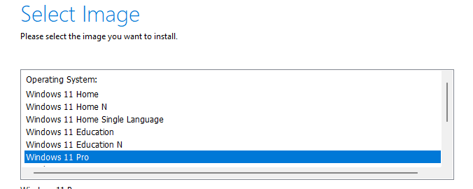
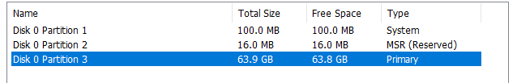

## Objectif

Ce document a pour but de guider, étape par étape, à travers l'installation complète de **Windows 11 Professionnel** sur une machine physique ou virtuelle. Cette machine servira de poste de travail client pour les tests d'intégration dans un domaine Active Directory.

## Contexte et Prérequis

Cette procédure crée le poste de travail standard que l'on retrouve en entreprise. Contrairement à Windows 10, Windows 11 possède des prérequis matériels stricts qui doivent être respectés.

**Média d'installation :** Une clé USB bootable de Windows 11 ou le fichier ISO, téléchargeable sur le [site officiel de Microsoft](https://www.microsoft.com/fr-fr/software-download/windows11).

**Configuration Matérielle Requise :**

- **Processeur :** 2 cœurs ou plus, 1 GHz ou plus (64 bits).
- **Mémoire vive :** 4 Go de RAM.
- **Stockage :** 64 Go d'espace disque.
- **Micrologiciel :** Le système doit supporter **l'UEFI** et le **Démarrage Sécurisé (Secure Boot)** doit être activé.
- **TPM 2.0 :** Le module de plateforme sécurisée (Trusted Platform Module) version 2.0 est **obligatoire**. C'est une puce de sécurité qui gère le chiffrement.

**Pour une VM :** Dans les paramètres de votre machine virtuelle (VMware, Hyper-V), activez le chiffrement de la VM (VMware) et ajoutez un **« Virtual Trusted Platform Module »** avant de commencer l'installation.

## Procédure d'Installation

### Démarrage et Lancement de l'Installateur

1. Démarrez l'ordinateur ou la VM sur le média d'installation (clé USB ou ISO).
2. Choisissez la **langue**, le **format de l'heure** et le **type de clavier**, puis cliquez sur **« Suivant ».**
3. Cliquez sur **« Installer maintenant ».**
4. Entrez une clé de produit ou cliquez sur **« Je n'ai pas de clé de produit »** pour continuer (vous pourrez l'activer plus tard).
5. Sélectionnez l'édition **Windows 11 Professionnel**. La version « Pro » est indispensable pour pouvoir joindre un domaine Active Directory.

<b>Figure 1</b> · Choix de l'édition Windows 11 Professionnel

### Partitionnement et Installation des Fichiers

1. Acceptez les termes du contrat de licence.
2. Sur l'écran de sélection du disque, si des partitions existent, supprimez-les pour effectuer une installation propre.
3. Sélectionnez **« Espace non alloué »** et cliquez sur **« Suivant »**. Windows créera automatiquement les partitions nécessaires.

<b>Figure 2</b> · Sélection de l'espace non alloué

4. L'installation va copier les fichiers et redémarrer plusieurs fois. Soyez patient.

### Configuration Initiale (OOBE, Out Of Box Experience)

C'est la phase de configuration finale où vous personnalisez Windows.

1. Confirmez votre **pays ou région.**
2. Confirmez la **disposition du clavier.**
3. Connectez-vous à un réseau pour obtenir les mises à jour.
4. Donnez un **nom à votre ordinateur** (ex : PC-COMPTA-01).
5. Sur l'écran « Comment voulez-vous configurer cet appareil ? », choisissez **« Configurer pour un usage professionnel ou scolaire ».**
6. **Étape cruciale :** L'assistant vous incite à utiliser un compte Microsoft. Pour créer un compte local (préférable pour une machine de test de domaine) :
   - Cliquez sur **« Options de connexion ».**
   - Choisissez **« Compte de domaine »** ou **« Compte hors connexion »** si l'option est disponible.
   - Saisissez le nom de votre premier utilisateur local (ex : adminlocal) et son mot de passe.
7. Configurez les questions de sécurité et les paramètres de confidentialité.

## Premiers Pas Post-Installation

1. **Installer les pilotes / Outils de l'hyperviseur :** Installez les VMware Tools ou les VirtualBox Guest Additions pour des performances optimales.
2. **Lancer les mises à jour :** Allez dans **Paramètres \> Windows Update** et lancez la recherche de mises à jour. Répétez l'opération après chaque redémarrage jusqu'à ce que le système soit entièrement à jour.

## Conseils et Bonnes Pratiques

- **Compte Local :** La création d'un compte local est une bonne pratique pour un poste qui sera ensuite joint à un domaine. Le compte administrateur du domaine prendra le relais pour la gestion.
- **Vérifiez le TPM avant de commencer :** Assurez-vous d'avoir bien activé le TPM virtuel dans les paramètres de votre VM **avant** de lancer l'installation pour éviter un message d'erreur bloquant.

## Procédures Liées

- [Déploiement d'un Serveur WDS pour l'Installation d'OS par le Réseau (PXE)](/procedures/windows/deploiement-dun-serveur-wds-pour-linstallation-dos-par-le-reseau-pxe) *(Déploiement par le réseau)*
- [Gestion des Objets dans Active Directory](/procedures/windows/gestion-des-objets-dans-active-directory) *(Jonction et rangement dans le domaine)*
- [Mappage de Lecteurs Réseau avec les Stratégies de Groupe (GPO)](/procedures/windows/mappage-de-lecteurs-reseau-avec-les-strategies-de-groupe-gpo) *(Lecteurs réseau des utilisateurs)*
- [Configuration d'AppLocker par GPO](/procedures/windows/configuration-dapplocker-par-gpo) *(Contrôle des applications)*
- Déploiement de Windows LAPS *(Mot de passe administrateur local)*
