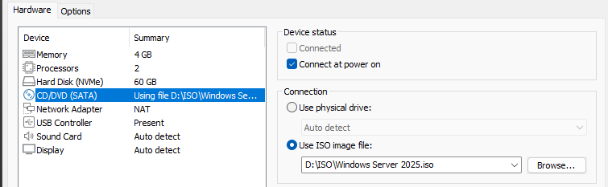
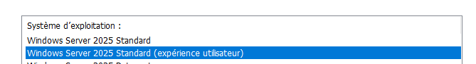
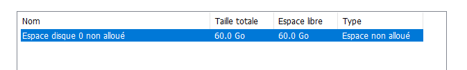
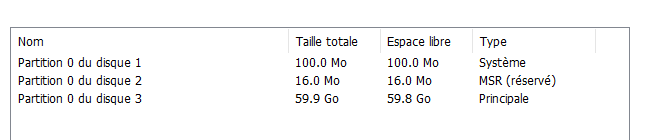
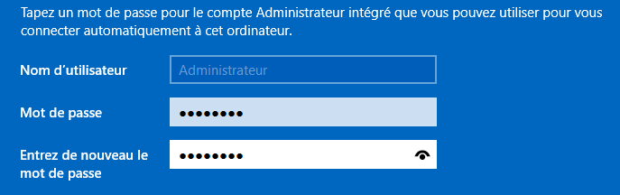
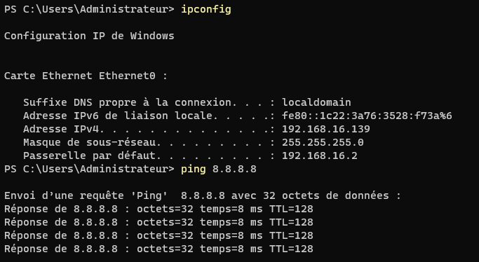

## Objectif

Ce document a pour but de guider l'utilisateur à travers toutes les étapes nécessaires à l'installation de Windows Server 2025 sur une machine virtuelle. Cette procédure constitue le socle indispensable avant le déploiement de tout rôle ou service (Active Directory, Web, Fichiers, etc.).

## Contexte et Justification

Lors de l'installation, Windows Server propose deux options d'installation :

- **Server Core (par défaut) :** Une installation minimale **sans interface graphique**, gérée entièrement en ligne de commande (CLI) et PowerShell. Elle est plus légère, plus sécurisée et recommandée pour les serveurs de production dédiés à un seul rôle.
- **Desktop Experience (Expérience de bureau) :** L'installation complète avec l'interface graphique traditionnelle (menu Démarrer, Explorateur de fichiers, etc.). Elle est plus intuitive et recommandée pour l'apprentissage ou pour les serveurs qui hébergent plusieurs rôles de gestion.

Pour cette procédure de base, nous choisirons l'option **Desktop Experience**.

## Prérequis

- **Fichier ISO :** L'image disque (.iso) de Windows Server 2025. Elle est téléchargeable légalement [ici](https://www.microsoft.com/fr-fr/evalcenter/download-windows-server-2025).
- **Hyperviseur :** Un logiciel de virtualisation comme **VMware Workstation/Player**, **Oracle VirtualBox** ou **Hyper-V**.
- **Ressources minimales pour la VM :**
  - **Processeur :** 2 CPU.
  - **Mémoire vive :** 4 Go de RAM.
  - **Disque dur :** 60 Go d'espace libre.

## Procédure d'Installation

### Création de la Machine Virtuelle (VM)

1. Dans votre hyperviseur, lancez l'assistant de création d'une nouvelle machine virtuelle.
2. Choisissez d'installer le système d'exploitation plus tard (ne sélectionnez pas encore l'ISO), pour éviter l'installation automatique proposée par certains hyperviseurs.
3. Allouez les ressources à la VM en respectant les prérequis (2 CPU, 4 Go de RAM, 60 Go de disque).
4. Configurez l'adaptateur réseau en mode **NAT** pour un accès simple à Internet, ou en **Bridge** si la VM doit être sur le même réseau que votre machine physique.
5. Dans les paramètres du lecteur CD/DVD de la VM, sélectionnez le fichier ISO de Windows Server 2025.
6. Avant de finaliser, vérifiez que l'ordre de démarrage (Boot Order) place bien le lecteur CD/DVD en premier pour que la VM démarre sur l'ISO.
7. Démarrez la machine virtuelle.

<b>Figure 1</b> · Paramètres de la VM

### Démarrage et Lancement de l'Installation

1. Un message « Press any key to boot from CD or DVD… » s'affiche. Appuyez sur n'importe quelle touche.
2. Choisissez la **langue** d'installation, le format de l'heure et le type de clavier.
3. Cliquez sur « Installer maintenant ».
4. Sur l'écran de sélection du système d'exploitation, choisissez **Windows Server 2025 Standard (Expérience utilisateur)**. C'est une étape cruciale pour avoir l'interface graphique.

<b>Figure 2</b> · Choix de l'édition avec Expérience utilisateur

5. Acceptez les termes du contrat de licence.

### Partitionnement et Installation des Fichiers

1. L'assistant affiche le disque dur virtuel de 60 Go (ou la taille que vous avez définie). Il est affiché comme « Espace non alloué ».

<b>Figure 3</b> · Espace non alloué

2. Sélectionnez cet espace et cliquez sur « Créer une partition » (Create Partition).
3. Conservez la taille maximale proposée et cliquez sur « Appliquer » (Apply). Windows vous informera qu'il va créer des partitions supplémentaires pour les fichiers système. Acceptez en cliquant sur « OK ».

<b>Figure 4</b> · Partitions créées

4. Plusieurs partitions sont créées. Assurez-vous que la partition principale est sélectionnée, puis cliquez sur **« Suivant ».**
5. L'installation commence. Windows va copier les fichiers, installer les fonctionnalités et les mises à jour. Ce processus prend plusieurs minutes et le serveur **redémarre automatiquement**.

### Premier Démarrage et Configuration Initiale

1. Après le redémarrage, Windows finalise la préparation des périphériques.
2. L'écran de configuration s'affiche et vous invite à définir le mot de passe du compte administrateur local intégré : **Administrateur.**
3. Choisissez un mot de passe **robuste** (majuscules, minuscules, chiffres, symboles) et confirmez-le.

<b>Figure 5</b> · Mot de passe du compte Administrateur

4. Une fois le mot de passe défini, vous arrivez sur l'écran de verrouillage. Appuyez sur **Ctrl + Alt + Suppr** (ou **Ctrl + Alt + Inser** dans un hyperviseur) pour ouvrir la session.

## Vérifications et Premières Étapes Post-Installation

### Installation des Outils de l'Hyperviseur

**Justification :** Cette étape est l'équivalent de l'installation des pilotes (drivers) pour un ordinateur physique. Ces outils sont un ensemble de logiciels qui améliorent drastiquement les performances et l'ergonomie de la machine virtuelle. Ils sont **essentiels** pour une utilisation confortable et optimale.

Les bénéfices incluent :

- Amélioration des performances graphiques et disque.
- Intégration parfaite de la souris entre la VM et votre PC.
- Synchronisation de l'heure.
- Activation du copier-coller et du glisser-déposer de fichiers.

**Pour VMware (Workstation/ESXi) :**

1. Dans la barre de menu de VMware, cliquez sur **VM \> Install VMware Tools…**
2. Une notification apparaît dans Windows Server. Ouvrez l'Explorateur de fichiers et allez sur **« Ce PC »** : un lecteur CD virtuel nommé « VMware Tools » a été monté.
3. Ouvrez ce lecteur et exécutez **setup.exe**.
4. Suivez l'assistant d'installation (choisissez l'installation « Typique ») et redémarrez la VM à la fin.

**Pour VirtualBox :**

1. Dans la barre de menu de VirtualBox, cliquez sur **Périphériques \> Insérer l'image CD des Additions invité…**
2. Comme pour VMware, un lecteur CD virtuel apparaît dans « Ce PC ».
3. Ouvrez-le et exécutez **VBoxWindowsAdditions-amd64.exe**.
4. Suivez l'assistant et redémarrez la machine virtuelle.

### Vérification de la Connectivité Réseau

**Justification :** Un serveur n'est utile que s'il peut communiquer sur le réseau. Cette vérification rapide permet de confirmer que la configuration réseau de base est fonctionnelle.

1. **Ouvrez une fenêtre PowerShell** depuis le menu Démarrer.
2. **Vérifiez l'adresse IP locale :** Tapez la commande `ipconfig` pour afficher la configuration réseau. Vérifiez que la carte réseau a bien reçu une adresse IP (généralement via DHCP à ce stade).
3. **Testez la connectivité Internet :** Utilisez la commande `ping 8.8.8.8` (serveur DNS de Google). Cela permet de tester la sortie Internet sans dépendre de la résolution de noms.

<b>Figure 6</b> · Résultat d'ipconfig et du ping

### Mise à Jour

**Justification :** C'est l'étape de sécurité la **plus importante** après une nouvelle installation. Le fichier ISO que vous avez utilisé peut dater de plusieurs mois. Des dizaines de correctifs de sécurité et de stabilité ont pu être publiés depuis. L'application de ces mises à jour **avant** d'installer le moindre rôle garantit que vous ne construisez pas votre infrastructure sur une base vulnérable.

1. Ouvrez le menu **Démarrer** et cliquez sur l'icône d'engrenage pour accéder aux **Paramètres**.
2. Dans la fenêtre des Paramètres, cliquez sur la section **« Windows Update ».**
3. Vous arrivez directement sur l'onglet **Windows Update**. Cliquez sur le bouton **« Rechercher des mises à jour »**.
4. Windows se connecte alors aux serveurs de Microsoft pour trouver, télécharger et installer toutes les mises à jour nécessaires. Ce processus peut prendre un certain temps.
5. Si un redémarrage est nécessaire pour finaliser l'installation, un message vous l'indiquera. Redémarrez le serveur.

Votre serveur Windows est désormais installé, optimisé pour la virtualisation, connecté et entièrement à jour. Il constitue une « image de base » saine, prête pour la phase de configuration spécifique à son futur rôle.

## Procédures Liées

- [Installation d'un Contrôleur de Domaine Active Directory](/procedures/windows/installation-dun-controleur-de-domaine-active-directory) *(Promotion en contrôleur de domaine)*
- [Durcissement de Windows Server avec OSConfig et Credential Guard](/procedures/windows/durcissement-de-windows-server-avec-osconfig-et-credential-guard) *(Durcissement du système)*
- [Déploiement de Windows Admin Center](/procedures/windows/deploiement-de-windows-admin-center) *(Administration à distance)*
- [Déploiement de Hyper-V et Gestion des VM](/procedures/windows/deploiement-de-hyper-v-et-gestion-des-vm) *(Hôte de virtualisation)*
- [Configuration de PowerShell Remoting et de JEA](/procedures/windows/configuration-de-powershell-remoting-et-de-jea) *(Administration par PowerShell)*
