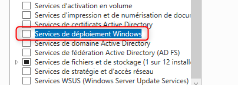
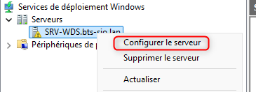
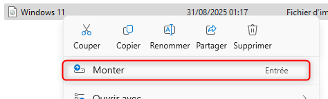
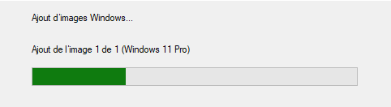
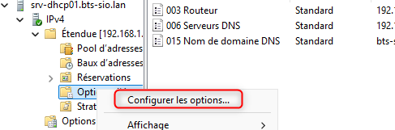
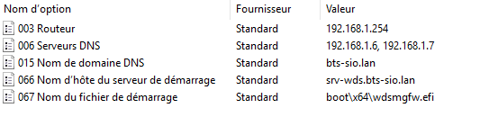

## Objectif

Cette procédure a pour objectif d'installer et de configurer le rôle **Services de déploiement Windows (WDS)**. Le but est de créer un serveur capable de déployer des systèmes d'exploitation Windows (comme Windows 11) sur des ordinateurs « nus » (sans OS) via le réseau, en utilisant la technologie de démarrage **PXE (Preboot Execution Environment).**

## Contexte et Justification

Dans une entreprise, installer manuellement chaque poste de travail avec une clé USB est une perte de temps considérable et une source d'erreurs et d'incohérences. WDS permet de centraliser et d'automatiser ce processus.

Le fonctionnement est le suivant :

1. Un nouvel ordinateur démarre sur sa carte réseau et demande une adresse IP au serveur DHCP.
2. La réponse DHCP lui indique où se trouve le serveur WDS.
3. L'ordinateur télécharge depuis le serveur WDS un environnement de pré-installation (Windows PE), puis l'installeur de Windows.

Les bénéfices sont multiples :

- **Gain de temps massif :** Permet de déployer des dizaines de machines simultanément.
- **Standardisation :** Garantit que tous les postes sont installés avec la même image d'entreprise, les mêmes paramètres et les mêmes logiciels.
- **Centralisation :** La gestion des images d'installation se fait depuis un seul et unique serveur.

## Prérequis et Schéma de Fonctionnement

**Prérequis :**

- Une infrastructure **Active Directory**, **DNS** et **DHCP** fonctionnelle.
- Un serveur Windows Server dédié pour devenir le serveur WDS (ex : SRV-WDS), membre du domaine et avec une adresse IP statique.
- **Important :** Ce serveur doit disposer d'une partition dédiée et formatée en NTFS pour stocker les images (ex : un disque `D:`).
- Le fichier **ISO** d'une version de Windows à déployer (ex : Windows 11 Professionnel).

**Schéma de fonctionnement :** Un client démarre en PXE, obtient une offre DHCP contenant l'adresse du serveur WDS, contacte ce dernier via TFTP pour télécharger l'image de démarrage, puis installe l'image Windows via le réseau.

## Procédure de Déploiement

### Préparation du Serveur WDS

1. Préparez une nouvelle VM Windows Server, donnez-lui une IP statique et joignez-la au domaine.
2. Ajoutez un second disque virtuel à cette VM. Une fois dans Windows, ouvrez la **Gestion des disques**, mettez le disque en ligne, initialisez-le et créez un **Nouveau volume simple** (ex : `D:`), formaté en NTFS.
3. Créez un dossier à la racine de ce nouveau disque, par exemple `D:\RemoteInstall`.

### Installation du Rôle WDS

1. Dans le **Gestionnaire de serveur**, cliquez sur « Ajouter des rôles et fonctionnalités ».
2. Sélectionnez le rôle **Services de déploiement Windows.**

<b>Figure 1</b> · Rôle Services de déploiement Windows

3. Dans l'écran « Services de rôle », laissez les deux options par défaut cochées (« Serveur de déploiement » et « Serveur de transport »).
4. Terminez l'installation.

### Configuration Initiale du Serveur WDS

1. Dans le **Gestionnaire de serveur**, allez dans **Outils \> Services de déploiement Windows.**
2. Dans la console WDS, déroulez « Serveurs », faites un clic droit sur votre serveur (qui a une icône d'avertissement) et choisissez **Configurer le serveur.**

<b>Figure 2</b> · Configurer le serveur WDS

3. L'assistant se lance. Choisissez l'intégration **« Intégré à Active Directory ».**
4. Pour le « Chemin d'accès au dossier d'installation à distance », indiquez le dossier que vous avez créé (ex : `D:\RemoteInstall`).
5. Pour les « Paramètres initiaux du serveur PXE », choisissez **« Répondre à tous les ordinateurs clients (connus et inconnus) »** pour le labo. Cliquez sur **Terminer.**

### Ajout des Images de Démarrage et d'Installation

1. Montez votre fichier ISO de Windows 11 sur le lecteur virtuel de votre serveur WDS.

<b>Figure 3</b> · ISO Windows 11 montée

2. Dans la console WDS, faites un clic droit sur **Images de démarrage \> Ajouter une image de démarrage...**
3. Naviguez jusqu'à votre lecteur DVD virtuel, ouvrez le dossier `\sources` et sélectionnez le fichier **boot.wim**. Suivez l'assistant.
4. Ensuite, faites un clic droit sur **Images d'installation \> Ajouter une image d'installation...**
5. Créez un nouveau « groupe d'images » (ex : « Windows 11 x64 »).
6. Naviguez de nouveau vers le dossier `\sources` de l'ISO et sélectionnez cette fois le fichier **install.wim.**
7. L'assistant listera les différentes éditions de Windows contenues dans le fichier (Pro, Famille, etc.). Cochez celles que vous souhaitez rendre disponibles pour le déploiement.

<b>Figure 4</b> · Choix des éditions à déployer

### Configuration du Serveur DHCP (Options 66 et 67)

Pour que les clients sachent où trouver le serveur WDS, nous devons le leur indiquer via DHCP.

1. Connectez-vous à votre serveur DHCP et ouvrez la console **DHCP**.
2. Naviguez jusqu'aux **Options d'étendue** de votre étendue IPv4.
3. Faites un clic droit sur « Options d'étendue » \> **Configurer les options…**

<b>Figure 5</b> · Options d'étendue DHCP

4. Cochez la case **066 Nom d'hôte du serveur de démarrage**. Dans la valeur, entrez le nom de domaine complet (FQDN) de votre serveur WDS (ex : `srv-wds.bts-sio.lan`).
5. Cochez la case **067 Nom du fichier de démarrage**. Pour des clients modernes (UEFI), entrez la valeur `boot\x64\wdsmgfw.efi`.
6. Cliquez sur **OK.**

<b>Figure 6</b> · Options 066 et 067 configurées

## Vérifications

1. Créez une **nouvelle machine virtuelle complètement vierge**.
2. Démarrez cette VM. Si nécessaire, appuyez sur la touche pour démarrer sur le réseau (souvent F12).
3. La VM doit contacter le DHCP, puis afficher un message indiquant qu'elle contacte le serveur WDS.
4. L'environnement de pré-installation Windows doit se charger.

<b>Figure 7</b> · Démarrage PXE du client

5. L'assistant d'installation de Windows apparaît. Vous pouvez alors choisir la version de Windows 11 que vous avez ajoutée et l'installer sur le disque virtuel.

## Conseils et Bonnes Pratiques

**Images personnalisées :** La véritable puissance de WDS est de pouvoir déployer une image « maître » que vous avez préparée en amont (avec des logiciels, des mises à jour, des paramètres spécifiques). Pour cela, on utilise des outils comme MDT (Microsoft Deployment Toolkit) en complément de WDS.

## Dépannage

**Symptôme :** Le client ne trouve pas le serveur PXE (erreur « PXE-E53: No boot filename received »).

- **Cause :** Les options DHCP 66 et 67 sont mal configurées ou non appliquées. Vérifiez les valeurs et redémarrez le service DHCP.

**Symptôme :** Le client contacte le serveur WDS mais le téléchargement échoue (erreur TFTP).

- **Cause :** Un pare-feu bloque le protocole TFTP (port UDP 69) entre le client et le serveur WDS. Assurez-vous que le pare-feu du serveur WDS autorise bien le service.

## Procédures Liées

- [Installation et Configuration d'un Serveur DHCP](/procedures/windows/installation-et-configuration-dun-serveur-dhcp) *(Options PXE et adressage)*
- [Installation d'un Client Windows 11 Professionnel](/procedures/windows/installation-dun-client-windows-11-professionnel) *(Système déployé sur les postes)*
- [Installation de Windows Server 2025](/procedures/windows/installation-de-windows-server-2025) *(Déploiement de serveurs)*
- [Gestion des Objets dans Active Directory](/procedures/windows/gestion-des-objets-dans-active-directory) *(Comptes ordinateurs dans le domaine)*
